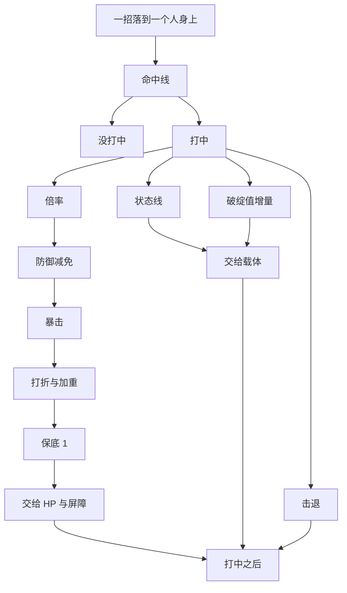

# 一下打到一个人：先判中没中，中了再分伤害线与状态线，顺序写死

> **正典层级**：第 5 级（系统细化）。与[玩法正典](../canon/gameplay/玩法定位.md)冲突时以正典为准；**式子的样子与起步值以[各类公式计算](../../desc/各类公式计算.md)为准，[数值模型](./数值模型.md)登记参数；本页一个数都不定。**
>
> 返回 [总索引](../README.md)｜[系统文档与提案索引](./README.md)｜相关：[战斗与关卡](../canon/gameplay/战斗与关卡.md) · [角色与成长](../canon/gameplay/角色与成长.md) · [`回合系统`](./回合系统.md) · [`技能系统`](./技能系统.md) · [状态效果系统](./状态效果系统.md) · [数值模型](./数值模型.md)｜台账：[`GP-32`](../spec/issues/README.md)

## 摘要

**这一页回答一个问题：一招打到一个人身上，打没打中、疼多少、挂不挂得上状态。** 读完你能判断两件事 —— 一个新的伤害机制该插在结算的哪一步（还是根本不该插），以及一条「为什么这一下没反应」的疑问该去查哪个数。

**本页的入口是「一招落到一个人身上」**：谁打的、用哪一招、打到谁、这一下是不是先手或借机攻击，都由出手那一侧交进来。出口是把算好的数与状态交出去。

**先判中没中，中了才往下算。** 命中线判这一下打没打中；打中了，伤害线算疼多少，状态线算挂不挂得上，两者互不影响；同一下还累积破绽值，写了击退的招把人推开。**伤害线的顺序写死**：倍率 → 防御减免（防御换算成减免百分比，穿透先从防御里扣）→ 暴击 → 打折与加重 → 保底 1。

**伤害类型只有物理与魔法，各对一份防御、一份暴击。** 暴不暴击，几率是攻方那一份的暴击几率减守方那一份的暴击避免，钳在 0–100；治疗与屏障算魔法那一份。类型标签不是伤害类型：元素类标签只决定这一下试挂哪条状态，性质类标签各写一条效果、只能落在结算已有的那几处，所以没有火抗、穿刺抗这一层。

**本页持有**命中线、伤害线与状态线各自的步骤与顺序，暴不暴击怎么判，治疗与屏障的量怎么算，破绽值增量、击退与撞击、误伤和回合外多打的那一下落在哪一步，范围招打中的每个人那一份带的系数，每一笔扣血记在谁名下，以及出手前的预览。

**本页不持有**这些，各有自己的家：

- 出手的时机与顺序：先手、借机攻击什么时候打、回合外多打的那几种互不引出（[`回合系统`](./回合系统.md)）。
- 一招能选谁、范围里有谁、要不要看得见（[`技能系统`](./技能系统.md)、[`感知与视野系统`](./感知与视野系统.md)）。
- 状态本身的时长、叠层与额外效果（[状态效果系统](./状态效果系统.md)）。
- 地形与物件算不算掩体、从哪一格打出去加命中（[`关卡系统`](./关卡系统.md)）。
- 打中之后的样子：出手冲一下、挨打闪白、音效、伤害数字长什么样（[战斗与关卡 · 打击反馈](../canon/gameplay/战斗与关卡.md)）。
- 属性怎么派生出命中率、防御这些量（[`成长系统`](./成长系统.md)），以及一切数值（[数值模型](./数值模型.md)）。

最要紧的那条承诺：**不新建载体、不新建姿态，打中之后也不自己发任何东西。** 本页算完就交出去 —— 伤害交给 HP 与屏障，治疗交给 HP，挂上的状态、屏障的量与破绽值交给载体；吸血、吸蓝、反击都是状态，本页只给它们一个「打中之后」的时点。

## 术语

只列**只有本页在用**的词。跨页共用的在[术语表](../reference/术语表.md)，本节不重复（`破绽值`、`韧性`、`载体`、`派生表`、`基底`、`派生量`、`量纲` 都在那边）。

| 词 | 它在本页指什么 |
| --- | --- |
| **命中线** | 判这一下打没打中的那一串步骤：攻方命中率减守方的真实闪避几率，加地形修正，钳在 0–100，再乘这一下的折扣 |
| **伤害线** | 算出「这一下疼多少」的那一串步骤，顺序写死 |
| **状态线** | 算出「这一下挂不挂得上一条状态」的那一串步骤。它与伤害线**互不影响** |
| **防御减免** | 伤害线的一步：目标那一份防御换算成减免百分比，把伤害压下来；穿透先在这一步从防御里扣 |
| **打折与加重** | 伤害线的一步：按守方身上的状态与这一下的处境把伤害调轻或调重，格挡、露出破绽、借机攻击的折扣、误伤减半都在这里 |
| **混伤** | 一招同时算物理和魔法两份减免。**本页明确不做**，理由在「理由与取舍」 |
| **背击** | 从背后打给额外倍率。**本页明确不做** —— 正典不做背刺 |
| **部位伤害** | 打头打腿各有倍率。**本页明确不做** |

## 上游约束

只链接约束本页的正典与已接受的 ADR，并说明各约束本页的哪一部分。

- [战斗与关卡 · 防御与破绽](../canon/gameplay/战斗与关卡.md)：隔得越远越躲得开，挨着打最难躲。暴击分物理与魔法两份，各有暴击几率、暴击避免与暴击倍率，治疗与屏障算魔法那一份；暴击只往上加，出手前显示的是不暴击时的那个数。防御换算成减免百分之多少，面板上防御值与减免百分比都写，越高每多一点换来的越少，到不了 100%。防御那一招给自己挂「格挡」，破绽值攒满就露出破绽；反击是一条状态，挂着控制状态、露出破绽、倒下、失控或正在准备的人不还手。式子见[各类公式计算](../../desc/各类公式计算.md)「命中」「暴击」「伤害」。命中几率是攻方命中率减守方的真实闪避几率、再加地形的修正；真实闪避几率是面板上的闪避率乘一个随两人隔的格数变大的倍率，挨着时最小，范围招按施法的人到每个被打到的人各算一次。暴不暴击的几率是攻方的暴击几率减守方的暴击避免，几率都钳在 0 到 100；物理招读物理那一份暴击，魔法招读魔法那一份。暴击倍率物理那一份由力量加、魔法那一份由智力加，暴击避免不由属性给（[角色面板](../../desc/角色面板.md)）。**约束命中线与暴击的两条式子、真实闪避几率按几格算、暴击读哪一份、防御减免那一步的形状，也约束打折与加重那一步要认得出格挡与露出破绽。**
- [战斗与关卡 · 战斗状态：挂上、叠层与解除](../canon/gameplay/战斗与关卡.md)：抗性按状态各一份，不按元素也不按伤害类型；元素只决定这一下试挂哪种状态，中毒、流血这类由招自己挂；被带某个类型标签的招打中时做什么，写在那条状态自己的声明里。挂不挂得上的式子见[各类公式计算](../../desc/各类公式计算.md)「挂上状态」：技能声明一个施加概率，减掉目标对这一种状态的抗性，地形挂的也照这一条；每回合掉的血不暴击、挂状态的几率也不受暴击影响，见同一份「暴击」；掉的血按层数乘，见[状态](../../desc/状态.md)「叠加」。**约束状态线与每回合掉的血不进暴击那一步，也约束本页只把这一下带的标签交给目标身上的状态。**
- [战斗与关卡 · 技能与操作：普通攻击与防御都是技能，技能栏不绑按键](../canon/gameplay/战斗与关卡.md)：类型是标签不是伤害类型，伤害只分物理与魔法两条线；性质类标签各写一条效果，加一种类型不改结算。击退把人往外推几格，撞上了两个都扣血，撞到自己人那一下按误伤算。**约束本页只认这一招的声明、不问出手的是谁，也约束性质类标签只能落在结算已有的那几处。**
- [战斗与关卡 · 误伤：范围招打到自己人减半](../canon/gameplay/战斗与关卡.md)：敌我都有误伤，命中、伤害与挂状态的几率都减半；撞到自己人那一下也算；失控的人打自己人不减半；有些状态能免疫误伤。**本页误伤那一节只是把这几条落到各自那一步。**
- [战斗与关卡 · 回合：我方阶段主角先动、其余按敏捷，然后是敌方阶段](../canon/gameplay/战斗与关卡.md)：先手那一下必中，范围招打到的都算；借机攻击用普通攻击，命中与伤害都比平常低；挂着控制状态的与失控的、露出破绽、倒下或还在准备的人不借机攻击、不反击、不协作攻击。**约束命中线认得出先手，也约束借机攻击的折扣乘在哪、交进本页的回合外那一下都是打得出来的。**
- [战斗与关卡 · 资源：HP 与 MP](../canon/gameplay/战斗与关卡.md)：吸血、吸蓝都是状态，不是人人都有的规则；一下打中几个人时，两样都按每个人各算一份，每一份乘一个随打中人数变小的系数，打中一个人时是 1（[各类公式计算](../../desc/各类公式计算.md)）。**约束本页只给「打中之后」一个时点、自己不回任何东西，也约束交给它的每一份带着那个系数。**
- [战斗与关卡 · 尸体与资源点：都有血条，打碎它的人拿东西](../canon/gameplay/战斗与关卡.md)：东西给最后弄碎它的人，被敌人弄碎的什么都不给；被灼烧、中毒、流血弄死的算挂上那条状态的人，被推进岩浆、被撞死的算推他的人。尸体是一个有面板的中立单位，挡了敌人的路，敌人也会打它。**约束本页出的每一笔扣血都记着算谁的，也约束打尸体不算误伤。**
- [战斗与关卡 · 完成标准](../canon/gameplay/战斗与关卡.md)：击杀经验给打死那个敌人的人，打死算谁的照尸体与资源点那一条。**约束「每一笔扣血都记着算谁的」那一份也给击杀经验读；给多少不在本页。**
- [战斗与关卡 · 战斗区域的空间模型：一格一个基础单位的俯视棋盘](../canon/gameplay/战斗与关卡.md)：掩体降低从另一边打过来的命中、不挡视线；地形写清从这里打出去加不加命中，例如高处打低处；数格子横、竖、斜各算一格，大个子从离得最近的那一格数。**约束地形修正看哪两头，也约束真实闪避几率按几格算。**
- [战斗与关卡 · 打击反馈](../canon/gameplay/战斗与关卡.md)：伤害数字按种类长得不一样、默认打开；出手前看得到命中几率与伤害。**约束结算的结果带着种类，也约束出手前的预览与结算对得上。**
- [战斗与关卡 · 两层难度，职责不重叠](../canon/gameplay/战斗与关卡.md)：温馨难度下我方的人不吃自己人的误伤。**约束误伤那一节认得出不吃误伤的人。**
- [战斗与关卡 · 失败判定](../canon/gameplay/战斗与关卡.md)：倒下的学生亮出神秘庇佑，选不中、也不受伤，范围招也打不到他。**约束挂着它的人不进本页，每回合掉的血也不扣他。**
- [角色与成长 · 角色面板](../canon/gameplay/角色与成长.md)：面板上每一项都有上限，上限见[角色面板](../../desc/角色面板.md)；百分比的面板值可以超过 100%，真实几率是两边面板值相减之后才钳在 0 到 100。**约束命中线、暴击与状态线都只钳相减之后的那个数。**
- [角色与成长 · 四项属性的作用方向](../canon/gameplay/角色与成长.md)：攻分物理与魔法、各对一份防御；魔法攻击同时驱动伤害、屏障与治疗的量；力量推高对方的破绽值，体质撑高自己的韧性上限。每项属性管哪几样见[角色面板](../../desc/角色面板.md)：敏捷给物理与魔法两份暴击几率、命中率与闪避率，力量给物理暴击倍率，智力给魔法暴击倍率。**这是本页两种伤害类型、治疗与屏障的量、命中线、暴击几率与暴击倍率、破绽值那几格的来源。**
- [角色与成长 · 效果从哪来：状态是效果本身，天赋是来路之一](../canon/gameplay/角色与成长.md)：吸血、反击这类每条只定义一次，谁身上都能挂，敌人与角色共用；全局难度也是一条来路，温馨难度下我方不吃自己人的误伤就从这里来。**约束本页不为回复、反击与误伤免疫另写规则，只读载体上的状态。**
- [人物 · 战斗中的位置：教练，而非输出核心](../canon/characters/人物.md)：主角输出低全库只有「薪火相传」一个答案。**约束本页不给主角的招开任何例外通道。**
- [ADR-0035](../decisions/ADR-0035-战斗改成俯视的格子回合制.md)：战斗是俯视的格子回合制，敏捷管命中、闪避与出手顺序。**约束本页的入口是一招落到一个人身上，结算里没有按时间走的量。**
- [ADR-0025](../decisions/ADR-0025-取值集的家由加一个的代价决定.md)：加一个取值只要多一条声明的，归内容。**约束元素类与性质类标签有哪几个由外置数据给，本页不列名字。**
- [ADR-0009](../decisions/ADR-0009-编辑器主导的开发模式.md)：参数唯一来源是场景与资源，代码不留能用的默认值。**约束本页定出的每个量纲将来落成外置数据，缺配置当场报错。**

## 结构

### 一下打到一个人，按这个顺序结算

下面这张图回答一个问题：**一招打向别人、落到一个人身上之后，哪些步骤按什么顺序发生，以及哪几支彼此无关。** 顺序是本页最要紧的事，而它用散文写要读好几段。**设计意图，尚未实现。**



**重画条件**：命中线或伤害线增删一步、两步换顺序、打中之后多出一支，或者「打中之后」挪到别的位置时重画。

**图例**：方框是一步，箭头是先后；从「打中」分出去的几支互不影响，在「打中之后」汇到一起。治疗与屏障不走这张图，见下面「治疗与屏障：倍率 → 暴击」。

**这张图不新增任何事实，权威是下面那几张表与那几条算式。** 每一步为什么在这个位置、穿透在哪一步扣、钳制为什么排在相减之后，图都放不下。

- **结算的单位是一招打到的一个人。** 一招打到几个人，每个人各走一遍，命中、暴击与挂状态都各掷各的 —— 离施法的人隔几格、闪避率、暴击避免与抗性本来就是每人一份。
- **没打中，这一下对他什么都不产出**：不扣血、不挂状态、不累积破绽值、不击退，也不进「打中之后」。它与「免疫」是两个分得开的结果（见下面「状态线：抗性减的是施加概率」）。
- **这一下读的是挨打之前两边身上的状态。** 这一下挂上的状态、攒满破绽值露出的破绽，从下一下起才算 —— 露出破绽那条「这期间挨打更疼」管的是露出破绽之后的那一段（[战斗与关卡 · 防御与破绽](../canon/gameplay/战斗与关卡.md)）。
- **打中之后在这一下全部算完才到**，击退与撞击也算在里面。
- **挂着神秘庇佑的人不进本页**：倒下的学生选不中、范围招也打不到他，也不受伤（[战斗与关卡 · 失败判定](../canon/gameplay/战斗与关卡.md)），所以每回合掉的血也不扣他。

### 命中线：攻方命中率减守方的真实闪避几率，加地形修正

```
真实闪避几率 = 守方面板上的闪避率 × 距离倍率（按两人隔几格查）
命中几率 = 攻方命中率 − 守方的真实闪避几率 + 地形修正，钳在 0–100
再乘这一下的折扣：借机攻击乘它的折扣，误伤减半
```

- **真实闪避几率按两人隔几格算**：距离倍率随格数只升不降，挨着时最小，离得越远越躲得开；理由在[战斗与关卡 · 防御与破绽](../canon/gameplay/战斗与关卡.md)。格数与施放距离同一个数法：横、竖、斜各算一格，大个子从离得最近的那一格数（[`技能系统` · 数格子：横、竖、斜各算一格，选人还要自己看得见](./技能系统.md)）。倍率表见[各类公式计算](../../desc/各类公式计算.md)「命中」；2 格以上各是多少还没给，登记在[数值模型](./数值模型.md)。
- **范围招从施法的人数到每一个被打到的人**：打到几个人，每人按自己离施法的人隔几格各算一份，不从落点数。
- **只钳相减之后的那个数**：命中率与闪避率都是面板上的百分比，可以超过 100%，乘过倍率的真实闪避几率也不单独钳；钳在 0–100 的只有加完地形修正的命中几率（[角色与成长 · 角色面板](../canon/gameplay/角色与成长.md)）。所以面板上多出 100% 的那一截照样有用。
- **准备回合不为 0 的招**，两人隔几格取出手那一刻还是落下那一刻：待定（见台账 [`DOC-160`](../spec/issues/README.md)）。
- **地形修正看两头**：攻方站的那一格写的「从这里打出去加不加命中」，例如高处打低处加命中；守方是不是站在掩体后面、这一下是不是从掩体另一边打过来，是就降。这几格写在地形与物件的声明上（[`关卡系统`](./关卡系统.md)），降多少、加多少归[数值模型](./数值模型.md)。
- **掩体不挡视线**：看得见照样能打，只是难打中（[战斗与关卡 · 战斗区域的空间模型：一格一个基础单位的俯视棋盘](../canon/gameplay/战斗与关卡.md)）。
- **折扣乘在钳过之后**：先钳到 0–100，再乘借机攻击的折扣、误伤再减半。折扣乘的是玩家看到的那个几率，所以「打几折」说得清；借机攻击「照普通攻击算完再乘折扣」的形式在[数值模型](./数值模型.md)。
- **先手那一下必中**，范围招打到的都算（[战斗与关卡 · 回合：我方阶段主角先动、其余按敏捷，然后是敌方阶段](../canon/gameplay/战斗与关卡.md)）；是不是先手由[`回合系统`](./回合系统.md)交进来时标明。先手的范围招打到自己人时，取必中还是误伤减半：待定。
- **命中线只管打向别人的那一下**：打敌人的招，以及范围招波及到的自己人。给自己与自己人放的治疗、屏障与增益没有守方，不判命中。
- **打中了才判暴不暴击**，几率另有一条式子，在下面「暴击排在减伤之后，治疗与屏障也能暴击」。地形修正、借机攻击的折扣与误伤减半都不碰暴击的几率：正典给它们写到的只有命中、伤害与挂状态的几率。

### 伤害线：倍率 → 防御减免 → 暴击 → 打折与加重 → 保底 1

| 步 | 做什么 | 为什么在这个位置 |
| --- | --- | --- |
| 倍率 | 攻方的物理攻击或魔法攻击乘上这一招的倍率 | 起点必须是「谁打的、用哪招」，而不是一个裸数字 |
| 防御减免 | 目标对应那一份防御换算成减免百分比，伤害乘（1 − 减免百分比）；**穿透先从防御里扣掉**，扣完不得小于 0 | 减免要作用在完整伤害上；排到暴击后面会让暴击的意思跟着减伤的形式变 |
| 暴击 | 判暴不暴击，读这一招那一类的那一份；暴击了就把**已减伤的伤害**再乘攻方那一份的暴击倍率 | 见下面「暴击排在减伤之后，治疗与屏障也能暴击」 |
| 打折与加重 | 守方身上的格挡让这一下变轻、露出破绽让它变重；借机攻击乘它的折扣，误伤减半 | 都是「这一下的处境」，放在一处，加一条改挨打轻重的状态就不用加一步；排在保底之前，任何折扣都打不到 0 |
| 保底 1 | 结果不足 1 则取 1 | 保证不存在「打不动」的对局 |

**防御换算成减免百分比，越高每多一点换来的越少，减免到不了 100%**（[战斗与关卡 · 防御与破绽](../canon/gameplay/战斗与关卡.md)）；换算的式子见[各类公式计算](../../desc/各类公式计算.md)「伤害」，式子里的常数 K 还没给，登记在[数值模型](./数值模型.md)。递减是结构要求而不是调优：线性换算早晚会有人把减免堆到 100%，那时保底 1 就成了唯一还在起作用的东西。

**面板上写防御值，也写它换算出来的减免百分比**（[战斗与关卡 · 防御与破绽](../canon/gameplay/战斗与关卡.md)）。那个百分比就是这一步在穿透为 0 时算出来的数，面板不另写一份换算：两份换算迟早对不上，而玩家照着面板配装。

**打折与加重那一步本页只定位置，改多少归[数值模型](./数值模型.md)。** 格挡来自防御那一招，到自己下一回合为止挨打变轻；露出破绽来自破绽值攒满，下一回合动不了、这期间挨打更疼（[战斗与关卡 · 防御与破绽](../canon/gameplay/战斗与关卡.md)）。两条都是载体上的状态，要让格挡减得更多、露出破绽之后挨打没那么疼，改的就是这两条的量，不另开一步。

### 伤害类型只有物理与魔法，各对一份防御

| 伤害类型 | 由谁的哪个量打出 | 被哪份防御减免 | 被哪种穿透穿 | 读哪一份暴击 |
| --- | --- | --- | --- | --- |
| 物理 | 攻方的物理攻击 | 目标的物理防御 | 物理穿透 | 物理那一份：攻方的暴击几率与暴击倍率、目标的暴击避免 |
| 魔法 | 攻方的魔法攻击 | 目标的魔法防御 | 法术穿透 | 魔法那一份：攻方的暴击几率与暴击倍率、目标的暴击避免 |

**一招只能是其中一类**，面板上写成「魔法·火焰」这样：前半是伤害类型，后半是标签。不做「一半物理一半魔法」的混伤：混伤要同时读两份防御，于是「这件装备对它有没有用」说不清，而玩家判断敌人该换什么装备正是靠这个。

**两份防御都不是单一来源**：属性给基底（体质），大头来自宝物、宝石、天赋与状态（[角色与成长 · 四项属性的作用方向](../canon/gameplay/角色与成长.md)；结构在[`装备系统`](./装备系统.md)）。本页只读那个算出来的值，不关心它由几项加成。

### 穿透是减值，作用在防御减免那一步

- **穿透按类型分两种**，各只穿自己那一份：物理穿透只减物理防御，法术穿透只减魔法防御。
- **穿透后的有效防御不得小于 0。** 不做负防御放大 —— 那会让「穿透超了」变成额外增伤，一个本该是「抵消对面堆防」的机制就变成了纯增伤，而且叠上递减曲线之后完全算不清。
- **穿透是减防御的值，不是按比例忽略防御。** 防御那一侧已经有递减曲线管边际收益，再叠一层百分比就有两处递减，说不清「多一点穿透值多少」。
- **性质类标签里「无视一部分防御」的那种落在这里**：穿刺这类给这一下多一份对应的穿透，不另开一条按比例的路。
- 穿透从这一招自己的声明与它带的性质类标签来（[`技能系统`](./技能系统.md)）；量纲与取值归[数值模型](./数值模型.md)。

### 暴击排在减伤之后，治疗与屏障也能暴击

暴击乘的是**已经减伤过的伤害**。减伤按比例算时，先暴击再减伤算出来一样；把顺序写死，是为了减伤的形式怎么换，暴击都只是在减伤之后的那个数上再乘一个倍率，玩家看到的暴击倍率就是它字面的意思。

```
暴击几率 = 攻方那一份的暴击几率 − 守方那一份的暴击避免，钳在 0–100
暴击了：这一下的量 × 攻方那一份的暴击倍率
```

- **暴击分物理与魔法两份，每份各有暴击几率、暴击避免与暴击倍率**（[战斗与关卡 · 防御与破绽](../canon/gameplay/战斗与关卡.md)）。一招算物理还是魔法就用那一份：物理招读两边物理那一份，魔法招读两边魔法那一份。治疗与屏障算魔法那一份，见下面「治疗与屏障：倍率 → 暴击」。
- **暴击几率由敏捷给；暴击倍率物理那一份由力量加，魔法那一份由智力加，起步值见[各类公式计算](../../desc/各类公式计算.md)「暴击」；暴击避免不由属性给。** 三样都能被宝物、天赋与状态改（[各类公式计算](../../desc/各类公式计算.md)「属性换算成面板」）。本页只读算出来的值：力量与智力各加多少、别的来路各改多少归[数值模型](./数值模型.md)，派生在[`成长系统`](./成长系统.md)的派生表。
- **钳在 0–100 的是相减之后的那个数**：两边的面板值都可以超过 100%（[角色与成长 · 角色面板](../canon/gameplay/角色与成长.md)），守方的暴击避免不低于攻方的暴击几率时，这一下暴不了。所以暴击避免高过 100% 的那一截照样有用，抵得住对面更高的暴击几率。
- **技能都能暴击，伤害、治疗与屏障都算**（[战斗与关卡 · 防御与破绽](../canon/gameplay/战斗与关卡.md)）。暴击只往上加：出手前显示的是不暴击时的那个数，所以「这一口够不够」照样算得出来。暴击倍率被负面的来路压到 100% 以下时怎么办，待定（见台账 [`DOC-160`](../spec/issues/README.md)）。
- **每回合掉的血不暴击，挂状态的几率也不受暴击影响**（[战斗与关卡 · 战斗状态：挂上、叠层与解除](../canon/gameplay/战斗与关卡.md)）。暴击只乘在一招打中当场算出来的那个量上。

### 治疗与屏障：倍率 → 暴击

- **量从施放者的魔法攻击乘这一招的倍率来，再判暴击**：魔法攻击同时驱动伤害、屏障与治疗的量（[角色与成长 · 四项属性的作用方向](../canon/gameplay/角色与成长.md)）。
- **暴击读施放者魔法那一份**：治疗与屏障算魔法那一份（[战斗与关卡 · 防御与破绽](../canon/gameplay/战斗与关卡.md)），算物理的招带的治疗与屏障也一样。
- **不过防御减免，也不判命中**：有益的招只作用于自己人（[战斗与关卡 · 误伤：范围招打到自己人减半](../canon/gameplay/战斗与关卡.md)），没有要减的防御，也没有守方。所以暴不暴击只看施放者那一份的暴击几率，钳在 0–100，不减谁的暴击避免。
- **治疗交给 HP；屏障是载体上一条带量的状态**，挨打时伤害先扣它，扣完才扣 HP。

### 类型是标签，不是伤害类型

伤害只分物理与魔法，一招的类型另写成标签，分元素类与性质类（[战斗与关卡 · 技能与操作：普通攻击与防御都是技能，技能栏不绑按键](../canon/gameplay/战斗与关卡.md)）。**加一种标签不改结算** —— 所以本页只给标签留了固定的挂点，元素类与性质类各写一节。

#### 元素不是伤害类型

**元素类标签唯一的机制作用，是决定这一下尝试施加哪一条状态。** 那份映射**由每个元素自己声明** —— 一个元素声明它施加哪一条状态，缺声明载入报错。

**这一格按 [ADR-0025](../decisions/ADR-0025-取值集的家由加一个的代价决定.md) 归内容**：加一个元素不需要新逻辑，只需要多一条声明，所以在册的那几个由外置数据给出、本页不列名字。

**为什么要写明这份映射住在哪**：说不出家在哪的映射，加一个元素时要改几处散文，而漏改一处的表现是那个元素附不上任何状态，**且不报错**。

- **所以没有「火抗」这一层。** 说某个敌人「弱火」，机制上读的是它**灼烧抗性低**。这是内容描述用语与机制读数的对应关系，不是两套数据。
- **元素不参与减免计算** —— 一记带火的物理招式，减免仍然只看物理防御。
- **一招可以带元素类标签而不附带状态**（施加概率为 0），也可以不带元素类标签。
- **中毒、流血这类不由元素给**，由招自己或性质类标签挂，例如斩击挂流血（[战斗与关卡 · 战斗状态：挂上、叠层与解除](../canon/gameplay/战斗与关卡.md)）。

#### 性质类标签各写一条效果，挂在结算已有的几处上

**性质类标签（穿刺、钝击、斩击这类）各写一条效果，效果只能落在这几处**：

- **防御减免那一步多一份穿透**：穿刺「无视一部分防御」就是它。
- **破绽值多累积一份**：钝击「更容易打出破绽」就是它。
- **状态线多试一条状态**：斩击「挂流血」就是它。
- **交给目标身上的状态去读**：状态自己写「被带某个标签的招打中时做什么」，例如冻结的人挨钝击就碎冰，多一份伤害、同时解冻（[战斗与关卡 · 战斗状态：挂上、叠层与解除](../canon/gameplay/战斗与关卡.md)）。本页只把这一下带的标签交过去，那一份伤害怎么算写在那条状态上。

**一个标签的效果落不进这几处，就是一个新机制**：要先改本页，不是多填一条声明。所以载入时一个标签写了这几处以外的效果被拒，并说清是哪一个；有哪几个标签是内容（[ADR-0025](../decisions/ADR-0025-取值集的家由加一个的代价决定.md)），本页不列名字。

### 状态线：抗性减的是施加概率

```
实际施加概率 = 这一条状态声明的施加概率 − 目标对这一条状态的抗性，结果钳在 0–100
误伤再减半，乘在钳过之后
```

- **管的是一下打中时往对面身上试挂的状态，范围招波及到的自己人也算。** 实际施加概率就是正典说的「挂状态的几率」。一下打中可以要试好几条（几个元素类标签各选一条，性质类标签与招自己也能挂），每一条各走一遍、各掷各的。给自己与自己人挂的格挡、屏障与增益放出去就挂上，不走这条线。
- **地形挂的状态也照这一条**：站在岩浆上挂不挂灼烧，看灼烧抗性（[战斗与关卡 · 战斗状态：挂上、叠层与解除](../canon/gameplay/战斗与关卡.md)）；声明的概率写在那一格地形上。
- **抗性按状态各记一份**，不按元素、不按伤害类型。中毒抗性与灼烧抗性是两个数。
- **没有一项总的状态抗性**：「状态抗性升高」这类状态做的是让每一种状态的抗性一起升（[状态](../../desc/状态.md)），所以试挂哪一条，减掉的只是那一条的抗性。抗性不由属性给（[角色面板](../../desc/角色面板.md)）。
- **输入不在 100 处钳，钳制只在输出那一头。** 声明的概率与这一种状态的抗性**各自都可以超过 100**，抗性也可以为负（负抗性就是易伤）；**只有相减之后的结果钳在 0–100**（[角色与成长 · 角色面板](../canon/gameplay/角色与成长.md)）。这一种状态的抗性是面板上的一项，有一道上限，那道上限可以高过 100（[角色面板](../../desc/角色面板.md)）。所以「概率 120 对抗性 40」得 80、「抗性 150 对概率 100」得 0、「概率 60 对抗性 −20」得 80，没有一种输入会算出越界的数。
- **暴击不碰它，误伤再减半。** 减半乘在钳过之后的那个几率上，所以玩家看到的「减半」就是字面的一半。
- **免疫是合法结果，但它必须看得见。** 抗性把实际施加概率压到 0 时，这一下要产出一个**与「没打中」分得开**的结果，界面上给出可读的「免疫」而不是毫无反应 —— 「一整类技能对某个目标归零」本身不是问题，「玩家看不出为什么」才是。呈现归[`界面系统`](./界面系统.md)，本页只要求那个结果分得出来。
- **施加成功之后本页就交出去了**，来源记挂上它的人。时长、叠层、叠满时做什么、可否解除、显示全在[状态效果系统](./状态效果系统.md)。

### 破绽值：本页只产出增量，攒满之后露出破绽归载体那一侧

- 一下打中同时累积**破绽值**：基底来自**攻方的力量**，带钝击这类标签的多累积一份。累积到守方的**韧性上限**就露出破绽，韧性上限来自**受方的体质**。两个量都从[`成长系统`](./成长系统.md)那张派生表取，本页只读。
- **两头各挂一项属性是刻意的**：力量推高对方的破绽值，体质撑高自己的韧性上限（理由在[角色与成长 · 四项属性的作用方向](../canon/gameplay/角色与成长.md)）。所以「打出破绽得多快」是两边属性的比，不是单边的量 —— 本页只把两个数交给载体，不在这里做那个比较。
- **露出破绽是载体上的一条状态**：下一回合动不了，这期间挨打更疼（[战斗与关卡 · 防御与破绽](../canon/gameplay/战斗与关卡.md)）。攒满之后挂上它、破绽值随回合怎么衰减，都在载体那一侧；「挨打更疼」那一半在本页的打折与加重那一步读。
- **格挡、借机攻击的折扣与误伤减半碰不碰破绽值：待定。** 正典写到的只有命中、伤害与挂状态的几率。

### 击退与撞击：几格写在招上，撞上了两个都扣血

- **击退几格是这一招自己写的一格**（[`技能系统`](./技能系统.md)），打中了才推。推的路线怎么走、撞上了什么，不在本页。
- **撞上墙、物件或别人时，撞的两个都扣血**，这一笔记在推的人名下（[战斗与关卡 · 技能与操作：普通攻击与防御都是技能，技能栏不绑按键](../canon/gameplay/战斗与关卡.md)）。撞到推的人自己这一边的人，那一下按误伤算。撞击扣多少、读不读防御、暴不暴击：待定，量归[数值模型](./数值模型.md)。
- **推进岩浆、毒池这类地形，就吃那一格的效果**：那一格挂的状态照状态线算，来源记推的人。所以被推进去烧死、毒死的，算推他的人（[战斗与关卡 · 尸体与资源点：都有血条，打碎它的人拿东西](../canon/gameplay/战斗与关卡.md)）。

### 误伤：范围招打到自己人，命中、伤害与挂状态的几率都减半

- **敌我都有误伤**（[战斗与关卡 · 误伤：范围招打到自己人减半](../canon/gameplay/战斗与关卡.md)）。范围招打到出手的人自己这一边的人时，命中几率、伤害与挂状态的几率各在自己那一步减半：命中线与状态线乘在钳过之后，伤害线在打折与加重那一步。
- **撞到自己人那一下也算误伤**（见上面「击退与撞击：几格写在招上，撞上了两个都扣血」）。
- **打尸体不算误伤**：尸体是一个有面板的中立单位，不站哪一边，单体招打它、范围招波及到它都不按误伤减半，敌人打它也一样（[战斗与关卡 · 尸体与资源点：都有血条，打碎它的人拿东西](../canon/gameplay/战斗与关卡.md)）。
- **失控的人打自己人照常算，不减半**：那是乱打，不是范围招波及到的。本页读出手的人身上挂没挂失控。
- **不吃误伤是一条状态。** 挂着它的人，被自己人的范围招打到、被撞到时，不判命中、不扣血、不挂状态；他被不被推开、累不累积破绽值：待定。温馨难度给我方每个人挂上它（[战斗与关卡 · 两层难度，职责不重叠](../canon/gameplay/战斗与关卡.md)、[角色与成长 · 效果从哪来：状态是效果本身，天赋是来路之一](../canon/gameplay/角色与成长.md)），别的来路也能给。
- **伤害招不能直接对自己人放，有益的范围招只作用于自己人**：那是选目标的事，归[`技能系统`](./技能系统.md)。

### 回合外多打的那一下：照普通攻击算，借机攻击再打折

- **借机攻击、反击与协作攻击都走本页同一条线**，由[`回合系统`](./回合系统.md)交进来时标明是哪一种。
- **谁打不出这几下由[`回合系统`](./回合系统.md)判**：挂着控制状态（眩晕、石化、冻结、露出破绽、失控）的、倒下或还在准备的人，不借机攻击、不反击、不协作攻击（[战斗与关卡 · 回合：我方阶段主角先动、其余按敏捷，然后是敌方阶段](../canon/gameplay/战斗与关卡.md)、[战斗与关卡 · 防御与破绽](../canon/gameplay/战斗与关卡.md)）。交进本页的都是打得出来的那一下，本页不另查。
- **借机攻击**用它的普通攻击：命中几率与伤害照算完，再各乘一个折扣（[战斗与关卡 · 回合：我方阶段主角先动、其余按敏捷，然后是敌方阶段](../canon/gameplay/战斗与关卡.md)；折扣的形式与值在[数值模型](./数值模型.md)）。正典打折的只有命中与伤害，挂状态与暴击的几率照普通攻击。
- **反击**是一条状态：挂着它的人挨近战打中之后，当场还手一下普通攻击（[战斗与关卡 · 防御与破绽](../canon/gameplay/战斗与关卡.md)），照常算、不打折。那一下排在哪一刻归[`回合系统`](./回合系统.md)；是不是近战读这一招的声明（[`技能系统`](./技能系统.md)）。
- **协作攻击**补的那一下照常进本页，补多少归[数值模型](./数值模型.md)。
- **这几种都不会再引出这几种里的任何一种**：规则的家在[`回合系统`](./回合系统.md)，本页只在交给「打中之后」时带上「这是回合外多打的那一下」。

### 打中之后：吸血、吸蓝、反击都是状态，本页只给时点

一下打中、全部算完交出去以后，本页把这一下的结果交给「打中之后」。**本页自己不回任何东西** —— 吸血、吸蓝、反击、反伤都是状态，谁身上挂着谁才有（[战斗与关卡 · 资源：HP 与 MP](../canon/gameplay/战斗与关卡.md)）。

那份结果带着这些：

- 打的人、挨打的人、用的哪一招，这一招带的标签、是不是近战；
- 打出去的伤害（保底 1 之后那个数），暴击了没有；
- 挂上了哪几条状态，交出去之后他露出破绽了没有、倒没倒下；
- 这一下是不是误伤、是不是回合外多打的那一下；
- 随这一下打中的人数变小的那个系数，打中一个人时是 1（见下面）。

谁读它：

- **两边身上的状态**：写了「打中时」的看攻方，例如吸血、吸蓝按打出去的伤害回 HP 与 MP；写了「挨打时」的看守方，例如反伤；写了「暴击时」「把敌人打出破绽时」的看对应那一格。每条状态在哪个时点做什么写在它自己身上（[状态效果系统](./状态效果系统.md)）。
- **[`回合系统`](./回合系统.md)**：反击与协作攻击排在这一下之后，打中还在准备的人就取消他写了可以被打断的那一招（[战斗与关卡 · 预警与打断](../canon/gameplay/战斗与关卡.md)），都读这一份。
- **实战值**：实战值只在命中时积累（[角色与成长 · 书 → 学会 → 练熟](../canon/gameplay/角色与成长.md)），[`成长系统`](./成长系统.md)读的就是这一份。

**一招打中几个人，每个人各交一份，每一份都带着那个系数。** 吸血与吸蓝按每个人各算一份，每一份乘这个系数（[战斗与关卡 · 资源：HP 与 MP](../canon/gameplay/战斗与关卡.md)）。系数只看这一下打中了几个人，不看范围形状，值见[各类公式计算](../../desc/各类公式计算.md)。所以打中的人越多，份数越多，而每一份越少。

### 每一笔扣血都记着算谁的

本页出的每一笔扣血都带「记在谁名下」，掉落那一侧拿它判东西给谁（[战斗与关卡 · 尸体与资源点：都有血条，打碎它的人拿东西](../canon/gameplay/战斗与关卡.md)），击杀经验也照它给打死那个敌人的人（[战斗与关卡 · 完成标准](../canon/gameplay/战斗与关卡.md)）。

| 扣血从哪来 | 记在谁名下 |
| --- | --- |
| 一招打中 | 出手的人 |
| 撞击 | 推的人，撞的两个都算 |
| 每回合掉的血 | 挂上那一层的人；被推进地形那一下挂上的，记推的人 |

- **每一层各记各的来源。** 灼烧、中毒、流血这类再挂一次加一层，每回合掉的血按层数乘（[战斗与关卡 · 战斗状态：挂上、叠层与解除](../canon/gameplay/战斗与关卡.md)），所以一条状态上的几层可以是几个人挂的。几层来自不同的人时，弄死他的那一下算谁的：待定。
- **每回合掉的血不判命中、不暴击**；读不读防御、吃不吃格挡与露出破绽、算不算保底 1：待定。每层每回合掉多少归那条状态与[数值模型](./数值模型.md)。
- **自己走进岩浆这类地形挂上的那一层没有可记的人**，那样弄死的东西给谁：待定。
- **召唤物打的照记召唤物**，算到召唤它的人头上是掉落与击杀经验那边照正典做的事。
- **被敌人打碎的尸体什么都不给**：那一笔照记在敌人名下，给不给东西由掉落那一侧照正典判。
- **击杀经验本页只给出打死他的那一下记在谁名下**：给多少、按双方的等级、状态与天赋怎么折算不在本页，归[数值模型](./数值模型.md)。
- **本页出的都算「用攻击打碎」那一份。** 采集那一下扣的血读生活技能、不从本页出，两样各累计多少由掉落那一侧分开记。
- **资源点与尸体挨攻击时判不判命中、读不读防御：待定。** 尸体用跟所有人一样的面板、多数栏是空的（正典），空着的那几栏在结算里读作什么，跟它一起定。

### 出手前看到的数与结算走同一条线

- **瞄准时显示的命中几率与伤害**（[战斗与关卡 · 打击反馈](../canon/gameplay/战斗与关卡.md)），就是命中线与伤害线不掷骰走一遍：命中几率照算，真实闪避几率按瞄准那一刻两人隔几格，防御减免照目标那一份防御的换算、穿透照扣，伤害按不暴击算。所以玩家看到的数与结算对得上，暴击只会往上加。
- **瞄准时要不要显示暴不暴击的几率，待定（见台账 [`DOC-160`](../spec/issues/README.md)）**；显示的话，也是这一条线不掷骰算出来的那个数，读两边那一份的暴击几率与暴击避免。
- **角色面板上的减免百分比也从这一条线来**：防御减免那一步在穿透为 0 时的换算（上面「伤害线：倍率 → 防御减免 → 暴击 → 打折与加重 → 保底 1」）。
- **范围招对每个会被打到的人各算一遍**，各按他离施法的人隔几格；打到自己人的那几个按误伤显示。
- **借机攻击也一样**：走之前显示的被打中的几率里，命中几率由本页给（打过折的那个），会不会借机攻击归[`回合系统`](./回合系统.md)。
- **不另写一份预览的算法。** 两份算法迟早对不上，而玩家照着预览拿主意。

## 接口

### 它读谁

| 读什么 | 从哪里来 |
| --- | --- |
| 物理攻击、魔法攻击、两份防御、命中率、闪避率，物理与魔法各一份的暴击几率、暴击避免与暴击倍率，韧性上限、各状态的抗性 | 属性派生，归[`成长系统`](./成长系统.md)的派生表；本页只读算完的值 |
| 倍率、伤害类型、类型标签、要试的状态与施加概率、穿透、击退几格、是不是近战、治疗与屏障的倍率、范围形状与大小 | **这一招自己的声明**（[`技能系统`](./技能系统.md)）。普通攻击与防御也是技能，**敌我一样，本页不问出手的是谁** |
| 每个元素类标签施加哪一条状态、每个性质类标签落在哪一处 | 标签自己的声明，内容外置（[ADR-0025](../decisions/ADR-0025-取值集的家由加一个的代价决定.md)） |
| 攻方那一格加不加命中、守方算不算在掩体后面、地形挂什么状态与它的概率 | 地形与物件的声明（[`关卡系统`](./关卡系统.md)）；怎么判在不在掩体后面不在本页 |
| 这一下是不是先手、借机攻击、反击或协作攻击 | [`回合系统`](./回合系统.md)交进来时标明 |
| 两边身上的状态：格挡、露出破绽、失控、不吃误伤、神秘庇佑、屏障 | [状态效果系统](./状态效果系统.md)的载体 |
| 两人这一刻隔几格 | 两人站在哪一格；数法与施放距离同一个（[`技能系统`](./技能系统.md)） |
| 谁和谁是自己人 | 阵营那一侧；本页只用这个事实。尸体是中立单位，不算哪一边 |
| 全部系数、折扣与幅度 | [数值模型](./数值模型.md) |

### 它把结果交给谁

| 产出 | 交给哪个已有系统 |
| --- | --- |
| 伤害 | 交给 HP 与屏障：身上有屏障的先扣屏障，扣完才扣 HP。数带着种类（物理、魔法、暴击这类）交给界面去画，默认显示 |
| 治疗量 | 目标的 HP，同样带着种类给界面 |
| 屏障量 | 载体上那条屏障状态 |
| 挂上的状态 | [状态效果系统](./状态效果系统.md)的施加入口，来源记挂上它的人 |
| 免疫 | 一个与「没打中」分得开的结果，界面上给出可读的免疫（[`界面系统`](./界面系统.md)） |
| 破绽值增量 | 同一份载体；攒满韧性上限露出破绽由那一侧做 |
| 击退 | 推几格、谁推的；推的路线与撞上什么不在本页，撞上之后的撞击伤害回本页算 |
| 打中之后那份结果 | 两边身上的状态（载体）、反击与协作攻击的排序和打断（[`回合系统`](./回合系统.md)）、实战值（[`成长系统`](./成长系统.md)） |
| 每一笔扣血记在谁名下 | 掉落那一侧，以及给击杀经验的那一侧（规则在[战斗与关卡 · 尸体与资源点：都有血条，打碎它的人拿东西](../canon/gameplay/战斗与关卡.md)与[战斗与关卡 · 完成标准](../canon/gameplay/战斗与关卡.md)） |
| 出手前的预览 | 界面：瞄准时的命中几率与伤害，借机攻击被打中的几率 |
| 两份防御换算出来的减免百分比 | 角色面板（[`界面系统`](./界面系统.md)）：写在防御值旁边 |

**挂载点到此为止。** 下次加一样与「打中之后发生什么」有关的东西时，先问「它挂在上面哪一个」，而不是顺手插一个新钩子 —— 尤其是给人回东西的那一类，它们一律是挂在「打中之后」上的状态。

### 作者在编辑器里填什么

**无。** 本页整条是规则层的结算线：它读的量来自派生表与一招上的声明，产出交给载体与 HP，没有一格是场景或资源上的导出属性（[ADR-0009](../decisions/ADR-0009-编辑器主导的开发模式.md)）。伤害数字与音效长什么样归作者，但那一侧不由本页持有。

### 它不碰的那几条接缝

上面两张表里没有的，都不是漏了。这几条是最容易被误接上的：

- **不碰出手的时机与顺序。** 先手、借机攻击什么时候打、反击与协作攻击什么时候触发，在[`回合系统`](./回合系统.md)；本页从「这一招落到这个人身上」那一刻起算。
- **不碰选目标。** 一招能选谁、范围里有谁、要不要看得见，在[`技能系统`](./技能系统.md)与[`感知与视野系统`](./感知与视野系统.md)。
- **不碰姿态。** 露出破绽、倒下的样子与流转在[`角色动作状态系统`](./角色动作状态系统.md)；本页交出去的露出破绽是一条状态，不是一个姿态。
- **不碰时长与叠层。** 交出去之后那条状态活多久、怎么叠、叠满做什么、能不能解除，全在[状态效果系统](./状态效果系统.md)。
- **不碰阵营划分本身。** 谁和谁是自己人不由本页定，本页只用这个事实。
- **不碰破绽的阈值行为。** 本页只产出破绽值增量，攒满之后露出破绽由载体那一侧做。
- **不碰挪人。** 击退的路线、撞上什么、落进哪一格，不在本页。

### 代码落点

结算线落在规则层 `rules/Combat/` 下，挂上的状态、屏障的量与破绽值交给同一处的状态载体 `rules/Combat/StatusEffects.cs`。那个目录下除状态载体之外的代码按 [ADR-0035](../decisions/ADR-0035-战斗改成俯视的格子回合制.md) 删掉或重写，本页不在它们上面接。

## 边界与非目标

- **不定任何数值**：式子的样子与起步值以[各类公式计算](../../desc/各类公式计算.md)为准，面板各项的上限见[角色面板](../../desc/角色面板.md)，[数值模型](./数值模型.md)登记参数。还没给的数登记在数值模型：倍率、防御换算里的常数 K、2 格以上的距离倍率、属性换算成面板的初始值与每点给多少、穿透量纲、命中修正、格挡与露出破绽改多少、借机攻击的折扣、各状态抗性的幅度、击杀经验给多少。
- **不定出手的时机与顺序**：先手、借机攻击什么时候打、反击与协作攻击怎么触发、回合外多打的那几种互不引出，都在[`回合系统`](./回合系统.md)。本页只认交进来时标明的那一种。
- **不选目标**：一招能选谁、范围里有谁、要不要看得见、伤害招不能直接对自己人放，在[`技能系统`](./技能系统.md)与[`感知与视野系统`](./感知与视野系统.md)。
- **不实现状态**：时长、叠层、叠满时做什么、被某类标签打中时做什么、打中时与挨打时那几条状态各做什么，全在[状态效果系统](./状态效果系统.md)。
- **不定地形**：哪一格算掩体、从哪一格打出去加命中、地形挂什么状态，写在地形与物件的声明上（[`关卡系统`](./关卡系统.md)）。
- **不做打中之后的样子**：出手冲一下、挨打闪白、音效与伤害数字长什么样（[战斗与关卡 · 打击反馈](../canon/gameplay/战斗与关卡.md)），本页只给出数与它的种类。
- **不做混合伤害类型**：一招只能是物理或魔法。
- **不做元素抗性与标签抗性**：没有火抗、穿刺抗这一层，元素只选状态。
- **不做伤害浮动**：同一招打同一个目标，不暴击时伤害是确定值。
- **不做背击与部位伤害**：正典不做背刺（[战斗与关卡 · 感知与视野](../canon/gameplay/战斗与关卡.md)）；部位要每个敌人各声明一套打哪儿算哪儿，而大个子打中哪一格只按那一格的地形算（[战斗与关卡 · 战斗区域的空间模型：一格一个基础单位的俯视棋盘](../canon/gameplay/战斗与关卡.md)）。
- **采集那一下扣的血不从本页出**：它读生活技能（[战斗与关卡 · 尸体与资源点：都有血条，打碎它的人拿东西](../canon/gameplay/战斗与关卡.md)）。
- **同名不同物**：「防御」在本页有两处 —— 一招叫防御的技能（用了给自己挂格挡，在打折与加重那一步起作用），与物理防御、魔法防御那两份量（在防御减免那一步）。

## 理由与取舍

- **没选把元素做成第三、第四种伤害类型。** 那样每个目标要带一排元素抗性，而玩家得同时盯两套减免（防御一套、元素一套）；装备词条与敌人面板也跟着翻倍。让元素只选状态之后，「弱火」这句话仍然成立 —— 它读的是灼烧抗性 —— 而数据少了一整层。性质类标签同理，所以也没有穿刺抗。
- **没选让抗性直接减伤害。** 抗性如果既减概率又减伤害，它就成了第二份防御，和物理／魔法那两份职责重叠。只减概率之后，抗性回答的是「这条状态挂不挂得上」，防御回答的是「这一下疼不疼」，两个问题各有一个答案。
- **没选把状态线的输入钳在 100 以内。** 钳住输入（概率不得超过 100、抗性不得堆到 100）防的是必中与完全免疫。不钳的理由是**相减是线性的**：概率 120 打抗性 40 仍然被减掉 40，钳住输入换不来抗性的存在感，只是少一种表达 —— 高概率技能是压制手段，堆抗性是对它的回答，两者在同一个减法里各自成立。每种状态的抗性是面板上的一项，照样有上限，只是那道上限可以高过 100（[角色面板](../../desc/角色面板.md)）。完全免疫那一头取**允许但必须看得见**：要防的是「玩家看不出为什么这招没反应」，那就把原因显示出来，而不是禁止玩家达到免疫 —— 「我这一套配装免疫灼烧」是构筑该有的回报。
- **没选把暴击排在减伤之前。** 减伤按比例算时两种顺序算出来一样，但减伤的形式一换，暴击前置就会让玩家看到的暴击倍率随对面防御浮动，而暴击是最需要「一眼看懂」的机制。
- **没选让穿透按比例忽略防御。** 防御已经有递减曲线，百分比穿透会叠出两处递减，玩家算不清一点穿透值多少；减值式穿透还天然带一个可读的上界 —— 扣到 0 就到顶。穿刺的「无视一部分防御」因此也落成一份穿透。
- **没选允许负防御。** 穿透超出防御时不产生额外增伤：那会让穿透从「抵消对面堆防」变成「纯增伤」，于是最优解是无脑堆穿透。
- **没选伤害带随机浮动。** 随机会让「这次少了」有两种解释（运气／对面换装），出手前显示的伤害也就不再是会打出去的那个数。随机性已经由命中与暴击承载：命中几率出手前看得见，暴击只往上加。
- **没选让格挡、露出破绽、借机攻击与误伤各占一步。** 它们都是「这一下的处境」，放在打折与加重一处，加一条改挨打轻重的状态就只是填声明；各占一步的话，每加一种就要改一次结算顺序。
- **没选让一招另外声明「这一下有多重」。** 击退几格每招自己写，打出破绽的快慢由力量与钝击这类标签管；再加一格就是这两件事的第二个家。
- **没选让吸血、吸蓝、反击成为人人都有的规则。** 每回合本来就自然回 MP，人人打中再白拿一份，MP 就不缺了；做成状态之后它是一次构筑选择，敌人与角色共用同一条定义（[战斗与关卡 · 资源：HP 与 MP](../canon/gameplay/战斗与关卡.md)、[角色与成长 · 效果从哪来：状态是效果本身，天赋是来路之一](../canon/gameplay/角色与成长.md)）。
- **没选让误伤全额，也没选干脆不做。** 范围招打到自己人是它的代价；减半让「贴着队友放」成为一个算得清的取舍，而不是一律不敢放（[战斗与关卡 · 误伤：范围招打到自己人减半](../canon/gameplay/战斗与关卡.md)）。
- **没选给借机攻击一套自己的算法。** 它用普通攻击照算完再打折，所以「它比平常低多少」只看那两个折扣；另一套算法就是又一个算伤害的地方。
- **没选让预览另算一遍。** 两份算法迟早对不上，而玩家照着预览拿主意；对不上的那一下，他只会觉得游戏在骗他。
- **没选把结算写进技能各自的定义里。** 那等于每个技能都能自己决定顺序，于是「为什么这招无视防御」会每个技能各有一个答案。顺序固定在本页，技能只填字段。

## 验收

**可自动验证项**（纯规则层，与引擎无关）：

- 命中线钳在 0–100：命中率减真实闪避几率加地形修正超过 100 的取 100、低于 0 的取 0；掩体后面的目标比不在掩体后面时难打中，高处打低处比平地容易打中，各一条。
- 真实闪避几率按格数：两边面板不变，挨着时的真实闪避几率最小，隔得越远不会变小；斜着隔几格与横着隔几格算得一样，大个子从离得最近的那一格数。
- 范围招按施法的人数：同一招打到两个面板相同的人，离施法的人远的那个，真实闪避几率不低于近的那个；落点挪到其中一个人脚下，结果也不变（反证：不从落点数）。
- 只钳相减之后：攻方命中率超过 100% 时，照样先被守方的真实闪避几率减掉一截再钳（反证：命中率没有先在 100 处钳住）；守方暴击避免超过 100% 时，抵得住超过 100% 的暴击几率。
- 先手必中：命中几率算出来为 0 的一下，标成先手时照样打中。
- 没打中什么都不产出：不扣血、不挂状态、不累积破绽值、不击退，也不触发「打中之后」；它与「免疫」不是同一个取值。
- 结算顺序：构造一次「高防御 + 暴击」的命中，结果必须等于「减伤后的伤害 × 攻方那一份的暴击倍率」。
- 防御换算：减免百分比随防御变高而变高，每多一点多出来的越来越少，防御调到极高也不到 100%；角色面板上的减免百分比等于穿透为 0 时这一步用的那个。
- 保底 1：防御调到极高，再挂格挡、再乘借机攻击的折扣、再按误伤减半，伤害仍为 1，不为 0 也不为负。
- 类型隔离：物理招式对「魔法防御极高、物理防御为 0」的目标不被减免，反之亦然，各一条。
- 穿透隔离：物理穿透对魔法防御无效，反之亦然，各一条。
- 穿透下界：穿透大于防御时，有效防御取 0 而不是负数；且伤害不超过零防御时的伤害。
- 暴击管到哪：暴击时治疗量与屏障量都比不暴击时多；每回合掉的血从不暴击；同一下暴击与不暴击时，挂状态的几率相同。
- 暴击读对的那一份：物理招只读两边物理那一份，把魔法那一份调到极端，它暴不暴击的几率与暴击倍率都不变；魔法招反过来，各一条。治疗与屏障读施放者魔法那一份，把他物理那一份调到极端也不变（反证）。
- 暴击倍率跟属性、暴击避免不跟：只调高攻方的力量，物理招暴击的那一下跟着变大，魔法招、治疗与屏障暴击的那一下不变；只调高智力反过来，各一条。只调守方的四项属性，这一下暴不暴击的几率不变（反证：暴击避免不跟属性）。
- 暴击的几率钳在 0–100：守方的暴击避免不低于攻方的暴击几率时从不暴击；暴击几率减暴击避免超过 100 时每一下都暴击。误伤与借机攻击的那一下、从高处打下来的那一下，暴击的几率都与平常相同。
- 格挡与露出破绽：同一下打在挂着格挡的目标上比不挂时轻，打在露出破绽的目标上比平时重；这一下攒满破绽值让他露出破绽，这一下本身不加重。
- 预览对得上：瞄准时给出的命中几率与伤害，等于两人站位不变时实际结算的命中几率与不暴击的伤害；暴击的那一下只比预览多。范围招每个人的那一份按他离施法的人隔几格各算。
- 元素不减免：同一招带元素类标签与不带，对同一目标的伤害相同。
- 元素的声明：一个元素缺「它施加哪一条状态」时**载入被拒**并说清是哪一个；**加一个正典没点名的元素载入成功且代码零改动**。这一对要在同一批用例里 —— 只有后者的话，「漏填了」与「它没有这项」分不出来。
- 性质类标签：加一个效果落在本页那几处之一、只写声明的标签，载入成功且代码零改动；一个标签写了那几处以外的效果，**载入被拒**并说清是哪一个。这一对同样要在同一批用例里。
- 状态概率只在输出那一头钳：`概率 60 对抗性 20` 得 40、`概率 120 对抗性 40` 得 80、`概率 100 对抗性 150` 得 0、`概率 60 对抗性 −20` 得 80，都不越界。
- 挂上「状态抗性升高」之后，同一下试挂的每一条都按升了的抗性减；只调一条状态的抗性，别的几条不变（反证）。
- 输入不在 100 处钳的反证：声明概率 ≥100 的技能定义**载入通过**；抗性来源叠加超过 100、还没到面板那道上限时**不被挡**。它们钉的是「钳制只发生在相减之后」—— 缺了它们，实现里悄悄在 100 处加一道钳不会被任何测试发现。
- 免疫分得出来：实际施加概率为 0 时产出的结果与「这一下没打中」**不是同一个取值**。
- 误伤：同一招打到敌人与打到自己人（两边面板相同），后者的命中几率、伤害与挂状态的几率各是前者的一半；出手的人挂着失控时不减半；撞到自己人那一下减半；挂着「不吃误伤」的人被自己人的范围招打到时不扣血、不挂状态。打尸体伤害不减半：同一招打到尸体，伤害不按误伤减半，出手的是我方还是敌人都一样。
- 借机攻击：命中几率与伤害等于同一下普通攻击的乘上各自的折扣，挂状态的几率不变。
- 回复是状态，不是规则：身上没有吸蓝的人打出魔法伤害时 MP 不变，挂上那条之后才回；吸血、吸蓝回的量读的是打出去的伤害。**这一对一起才钉住「打中之后」本页自己不发东西。** 挂着吸蓝打出物理伤害时 MP 也不变（反证：吸蓝只认魔法伤害，见[状态](../../desc/状态.md)）。
- 范围招每人一份：挂着吸血的人用范围招打中几个人，「打中之后」的结果每个人各一份，每一份带的系数相同且小于 1。系数随打中的人数分档变小，打中一个人时是 1，单体招、范围招一样（反证：不看范围大小）。
- 记在谁名下：一招打中记出手的人；撞击两边都记推的人；每回合掉的血每一层记挂上它的人；被推进地形那一下挂上的记推的人；敌人打碎尸体那一下记在敌人名下。打死一个敌人时，交给击杀经验那一侧的就是打死他那一下记的那个人（可用替身验证）。
- 交出去而不是自己实现：施加状态走[状态效果系统](./状态效果系统.md)那份载体的入口（可用替身验证被调用一次），破绽值与屏障同理；本页不直接改姿态。
- 神秘庇佑：挂着它的人每回合掉的血不扣。

**必须实机确认项**：出手前看到的命中几率与伤害读不读得懂；伤害量级读起来顺不顺（量级的判据在[数值模型](./数值模型.md)）；状态挂上去时玩家看不看得出来；**免疫那条反馈读不读得出来** —— 玩家要能分清「它免疫这个状态」与「这一下打空了」。按 [ADR-0009](../decisions/ADR-0009-编辑器主导的开发模式.md) 的分工由作者实机看，本页不判。

**完成边界**：命中线、伤害线与状态线各落成一条，顺序与本页一致；暴击按这一招那一类读对那一份；格挡、露出破绽、借机攻击与误伤都只在各自那一步起作用；打中之后只给时点、本页自己不发任何东西；每一笔扣血都记着算谁的；预览与结算走同一条线。做到这些，后面加技能、加状态、加标签就只是填声明。

## 下游同步

- **代码**：结算线落规则层 `rules/Combat/`，与状态载体 `rules/Combat/StatusEffects.cs` 同一处；抗性、标签与各项系数走内容外置（`ENG-5`）。
- **数值**：式子的样子与起步值以[各类公式计算](../../desc/各类公式计算.md)为准，面板各项的上限见[角色面板](../../desc/角色面板.md)，[数值模型](./数值模型.md)登记参数。还没给的进数值模型的参数表：倍率、防御换算里的常数 K、穿透量纲、属性换算成面板的初始值与每点给多少、2 格以上的距离倍率、掩体与高处的命中修正、格挡与露出破绽改多少、借机攻击的两个折扣。撞击扣多少、每层每回合掉多少、破绽值增量、各状态抗性的幅度也进那张表。
- **台账**：落地归 [`GP-32`](../spec/issues/README.md)。
- **该上升进正典的**：暂无。本页用到的规则 —— 元素不是伤害类型、误伤减半、借机攻击打得比平常低、吸血与吸蓝与反击都是状态 —— 都已经在正典；本页只持有它们在结算里的位置与顺序。结算顺序与字段按定义不进正典。
