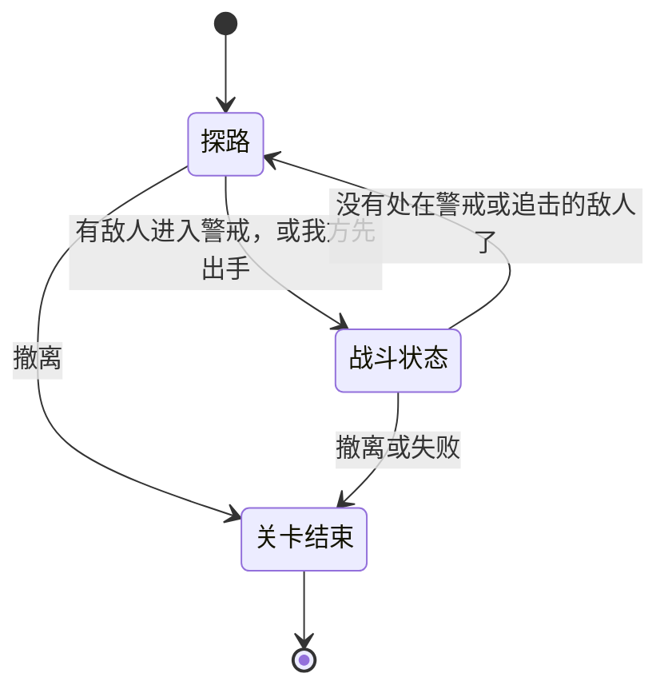
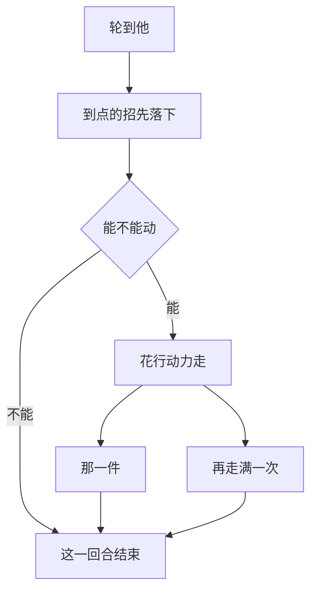

# 探路与打仗走同一套回合：我方阶段主角先动、敌方阶段随后，每个人轮到时先走再做那一件，冷却、状态与施法回合都数他自己的回合

> **正典层级**：第 5 级（系统细化）。与[战斗与关卡](../canon/gameplay/战斗与关卡.md)冲突时以正典为准；**行动力的起步值与上限、借机攻击的几率与折扣、关卡事件每回合的几率全归[数值模型](./数值模型.md)，本页一个都不定。**
>
> 返回 [总索引](../README.md)｜[系统文档与提案索引](./README.md)｜相关：[战斗与关卡 · 回合：我方阶段主角先动、其余按敏捷，然后是敌方阶段](../canon/gameplay/战斗与关卡.md) · [ADR-0035](../decisions/ADR-0035-战斗改成俯视的格子回合制.md) · [战斗AI系统](./战斗AI系统.md) · [技能系统](./技能系统.md) · [状态效果系统](./状态效果系统.md)｜台账：[`DOC-160`](../spec/issues/README.md)

## 摘要

**这一页回答一个问题：战斗区域里的回合怎么一回合一回合往下走，每一刻轮到谁、该叫哪个系统。** 读完你能判断：一样新东西（一招、一条状态、一个关卡事件）该挂在回合的哪一刻上；「这件事算不算用掉他这一回合」该照哪条规则答。

**探路与打仗是同一套回合，差别只在走路怎么算。** 出征加载完，整张图都是战斗区域：没进战斗状态时，主角每走一格就是一回合；进了战斗状态，每个人轮到时先用行动力走，再做一件占回合的事。两边的先后、冷却与状态的时长、关卡事件的触发点都由这一套推进，没有第二套。

下面这张图回答一个问题：**一关里回合处在哪一种状态，凭什么换。**

**重画条件**：进入或结束战斗状态的判据改了、多出一种新的状态，或者撤离与失败之外多出结束一关的办法时重画。

**这张图不新增任何事实，权威是下面「探路与战斗状态：同一套回合，差别在走路怎么算」那一节。** 进入那一刻落在一回合中间怎么办、中立怪物怎么算，图都放不下。

**它持有**：回合与阶段的先后；一个人这一回合能做什么（行动力、那一件、不占回合的事、再走满一次）；施法到一半的招还要占住施法者几次回合；先手；借机攻击何时结算、哪些不算；回合外多打的那几种互不引出。点远处一格之后怎么接着走、何时停下，撤离与上下楼，相机跟谁，以及这些东西进续玩点的那一份，也归本页。

**它不持有**这些，各有自己的家：

- 一下打中多少、命中几率多少：[`伤害系统`](./伤害系统.md)。
- 一招有哪些字段、冷却还剩几回合：[`技能系统`](./技能系统.md)。
- 身上挂着什么状态、还剩几回合、这一回合能不能动：[`状态效果系统`](./状态效果系统.md)。
- 不由玩家操作的人这一回合做什么、警戒到了哪一步：[`战斗AI系统`](./战斗AI系统.md)。
- 这一刻谁看得见谁：[`感知与视野系统`](./感知与视野系统.md)。
- 那一排小头像、走得到的格子、借机攻击的提示画成什么样：[`界面系统`](./界面系统.md)。
- 一格地形走进去扣几点、门与楼梯在哪：[`关卡系统`](./关卡系统.md)。
- 关卡事件出不出、出哪一个：[`事件系统`](./事件系统.md)。
- 续玩点怎么写：[`存档系统`](./存档系统.md)。
- 全部数值：[数值模型](./数值模型.md)。

最要紧的那条承诺：**本页只推进回合，在固定的时点叫别的系统；自己不算伤害、不判视野，也不持有冷却与状态的剩余回合。** 时点列在下面「接口」一节，**到此为止**：加一样新东西时先问它挂在哪一个时点，不在回合里另插一个钩子。

## 术语

只列**只有本页在用**的词。跨页共用的在[术语表](../reference/术语表.md)，本节不重复（`续玩点`、`分片`、`钩子`、`种子`、`警戒`、`撤离`、`撤退`、`接管输入`、`挂载点` 都在那边）。

| 词 | 它在本页指什么 |
| --- | --- |
| **自己的回合** | 一回合里轮到某一个人的那一段：从轮到他起，到他这一回合结束。冷却、状态的时长与施法回合数的都是它 |
| **那一件** | 一个人一回合里唯一一件占回合的事；做了它，他这一回合就结束 |
| **再走满一次** | 不做那一件，换成用一份满的行动力再走一遍 |
| **施法到一半的招** | 施法回合不为 0、已经出手还没落下的一招，连同它标出来的格子与还要占住施法者几次回合 |
| **一场** | 从进入战斗状态到战斗状态结束的那一段；战斗中每回合开头出事件的几率，按这一场打了几回合涨 |

## 上游约束

- [战斗与关卡 · 回合：我方阶段主角先动、其余按敏捷，然后是敌方阶段](../canon/gameplay/战斗与关卡.md)：探路也一回合一回合走；进入与结束战斗状态的判据；先手；阶段与出手顺序；行动力；那一件与不占回合的事；冷却与状态的时长按自己的回合数算；点远处一格；借机攻击；撤离。**这是本页全部结构的来源。**
- [战斗与关卡 · 玩家操作谁](../canon/gameplay/战斗与关卡.md)：在主角那一回合里点一个学生就接管他，一回合一个，不占主角那一件；学生那一场真打没有接管。**约束本页「接管」那一节。**
- [战斗与关卡 · 战斗区域的空间模型：一格一个基础单位的俯视棋盘](../canon/gameplay/战斗与关卡.md)：八向走、斜走也算一步、不许从两个挡路的东西中间斜穿；数格子横竖斜各算一格，大个子从离得最近的那一格数；地形写走进去扣几点；门在战斗状态下开、关各扣 1 点。**约束行动力怎么扣，与借机攻击那一圈怎么数。**
- [战斗与关卡 · 预警与打断](../canon/gameplay/战斗与关卡.md)：施法回合按施法者自己的回合算，占住他之后的几次回合，轮到他时先落下；等的那几回合只能走或者跳过；消耗出手时付，冷却从落下算起；可以被打断的打中就取消。**约束「施法回合」那一节与续玩点里施法到一半的招。**
- [战斗与关卡 · 防御与失衡](../canon/gameplay/战斗与关卡.md)：格挡到自己下一回合为止；被打崩下一回合动不了；反击是一条状态；回合外多打的那几种互不引出。**约束跳过与到期的时点，以及「互不引出」那一节。**
- [战斗与关卡 · 关系在战斗里：协作攻击与出征增益](../canon/gameplay/战斗与关卡.md)：协作攻击不占补那一下的人的回合，补的那一下不会引出新的协作攻击。**同上。**
- [战斗与关卡 · 队友与敌人](../canon/gameplay/战斗与关卡.md)：特殊援助按敏捷排进我方阶段、全由 AI 动、接管不了；召唤物写清能存在几回合，敌人召出来的算敌人；指令不占回合；同时活着的敌人总上限那里，更要防的是敌方阶段等太久。**约束阶段里排进谁，也是「敌方阶段等不等太久」那条实机确认的出处。**
- [战斗与关卡 · 相机：探路时跟主角，战斗时跟当前轮到的人](../canon/gameplay/战斗与关卡.md)：镜头跟谁、看不见的敌人不跟、敌方阶段能快放。**约束「相机」那一节。**
- [战斗与关卡 · 关卡事件与附加目标](../canon/gameplay/战斗与关卡.md)：触发点有进入战斗状态那一刻与战斗中每回合开头，后者的几率随这一场打了几回合往上涨、掷的那一下按种子定；做选择时暂停、不花回合；中立怪物挨了打才算进战斗状态；能交互的物件用掉一回合。**约束本页交给事件系统的触发点与回合数。**
- [战斗与关卡 · 关卡由手工片段按规则拼装](../canon/gameplay/战斗与关卡.md)：上下楼全队一起换层、倒下的也带上，主场景与子场景各自的状态都留着，敌人不跟。**约束「撤离与上下楼」那一节与按层各记一份。**
- [战斗与关卡 · 完成标准](../canon/gameplay/战斗与关卡.md)：达成目标后不自动结束，要走回入口撤离，达成与否决定算成功还是撤退。**约束撤离在本页只是一个动作，算什么在任务系统。**
- [战斗与关卡 · 失败判定](../canon/gameplay/战斗与关卡.md)：撤出用掉一回合、打不断；倒下的学生占着那一格，扶他用掉一回合；退出再回来接着那一刻，轮到谁照旧。**约束失败时回合停下，以及续玩点那一份。**
- [战斗与关卡 · 资源：HP 与 MP](../canon/gameplay/战斗与关卡.md)：HP 与 MP 每回合自然回一点，探路时走着也在回。**约束自然回复挂在回合的时点上。**
- [战斗与关卡 · 说明右键才看，画面上只留图形](../canon/gameplay/战斗与关卡.md)：看说明不花回合，一路走着时右键先让人停下；出手顺序那一排小头像一直在画面上。**约束连着走的那一串何时停下，与本页交给界面的顺序。**
- [角色与成长 · 四项属性的作用方向](../canon/gameplay/角色与成长.md)：敏捷管出手顺序；属性不改一回合能做几件、走几格；失衡值随回合衰减。**约束顺序只读敏捷、行动力不读属性。**
- [角色与成长 · 效果从哪来：状态是效果本身，天赋是来路之一](../canon/gameplay/角色与成长.md)：被动技能有挂在回合时点上的触发（被敌人先发现进入战斗状态时、每回合第一次走开、回合开头），触发不许是每回合必然发生的事。**约束本页给出的时点要接得住这些触发。**
- [玩法定位 · 存档](../canon/gameplay/玩法定位.md)：关卡里退出再回来接着那一刻，轮到谁照旧；每出一个结果就写一次，结果一出来先写进去再播。**约束本页那一份续玩点与写入的时点。**
- [玩法定位 · 弹界面接管输入就暂停世界，世界里的动作不暂停](../canon/gameplay/玩法定位.md)：界面接管输入时回合与时长都不走，连着走的那一串当场停下；被打崩动不了、敌方阶段轮不到我方都不暂停。**约束「暂停」落在回合的哪几处。**
- [玩法定位 · 随机事件：事件可以晚做，扩展点现在就留](../canon/gameplay/玩法定位.md)：钩子的位置定死，事件系统只在那几处被询问；基地也不必长出格子与回合。**约束本页只发正典点名的触发点，不另开。**
- [时间与经营 · 背包与仓库](../canon/gameplay/时间与经营.md)：战斗区域里转移不花回合、翻包不花回合，从宝箱或留在原地的那一份拿一次用掉一回合，打开的是当前轮到的那个人的背包。**约束那一件与不占回合那张表里背包那几行。**
- [ADR-0035](../decisions/ADR-0035-战斗改成俯视的格子回合制.md)：战斗是俯视的格子回合制；页首的后续补充写明战斗状态下走路花行动力、探路时照旧一格一格走；验证方法点名了要写成单测的那几条规则。**约束本页的验收。**
- [ADR-0024](../decisions/ADR-0024-学生那条战线改成一场真打.md)：学生那一场由 AI 驱动，玩家不操作。**约束那一场里没有主角、也没有接管。**
- [ADR-0009](../decisions/ADR-0009-编辑器主导的开发模式.md)：参数唯一来源是场景与资源，代码不留能用的默认值。**约束行动力起步值这类配置缺了当场报错，不兜底。**

## 结构

### 探路与战斗状态：同一套回合，差别在走路怎么算

**探路**：没进战斗状态时，一回合里每个人做一件事，走一格就用掉这一回合（[ADR-0035](../decisions/ADR-0035-战斗改成俯视的格子回合制.md) 页首的后续补充）。玩家点一格，主角沿路一格一格走过去，每走一格全场的人各动一回合，这就是连着走的那一串。探路时走进关着的门那一格就是开门。

**进入战斗状态**：有敌人进入警戒（看见了我方的人，或被同伴传播到），或者我方先对敌人出手。那一刻：

- 连着走的那一串停下，接着按回合来，不重新摆位。
- 这一场从这里开始，回合数从这里数起。
- 叫事件系统的「进入战斗状态那一刻」那个触发点（下面「时点：回合走到哪一刻，调谁」）。

**战斗状态结束**：场上没有处在警戒或追击的敌人了，回到探路。判据读[`战斗AI系统`](./战斗AI系统.md)那台警戒状态机，本页不另造一套。结束那一刻，这一场的回合数清零，没挨过打的中立怪物跟着离开。

**进入或结束落在一回合中间时**（例如主角走着走着被看见，或者他一出手就开打），这一回合余下的人按探路还是按战斗状态动、这一回合算不算这一场的第一回合，**待定（见台账 [`DOC-160`](../spec/issues/README.md)）**。正典定下的只有：不重新摆位；进入之后的第一个敌方阶段照先手那一条走（下面「先手：没被发现就先动手的那一下」）。

**中立怪物挨了打就算进战斗状态**：探路时打它一下，就进入战斗状态。没挨过打的不让战斗状态开始，战斗状态结束时跟着离开（[战斗与关卡 · 关卡事件与附加目标](../canon/gameplay/战斗与关卡.md)）。挨过打之后它处在警戒状态机的哪一格、拖不拖着这一场不结束，由那台状态机答（[`战斗AI系统`](./战斗AI系统.md)）。

**学生那一场真打**（[ADR-0024](../decisions/ADR-0024-学生那条战线改成一场真打.md)）照同一套回合走，只是场上没有主角：我方阶段从敏捷最高的学生开始，全由 AI 动，没有接管。

### 一回合：我方阶段，然后敌方阶段

- **我方阶段**：主角永远第一个动，然后其余的我方角色（学生与特殊援助）按敏捷从高到低一个一个动。我方的召唤物算特殊援助，排在这一阶段里；特殊援助倒下就退场，从顺序里拿掉。
- **敌方阶段**：敌人按敏捷一个一个动；中立的怪物也排在这一阶段，跟敌人一起按敏捷排；敌人召出来的算敌人。
- **顺序在每一回合开头按那一刻的敏捷排一次**，中途敏捷变了，下一回合才算。出手顺序那一排小头像照这一份画。
- **敏捷一样时次序固定，不掷骰**：同一个局面排出来的先后永远一样。拿什么定这个次序，**待定（见台账 [`DOC-160`](../spec/issues/README.md)）**。
- **倒下的人与回合中途才出现的人**：倒下的学生（包括这一回合里被扶起来的），这一回合里才召出来、复活或刷出来的，排不排进这一回合的顺序，**待定（见台账 [`DOC-160`](../spec/issues/README.md)）**。召唤物能存在的那几回合数的是谁的回合，同样待定。
- **轮到了却动不了的，跳过**：被打崩的「下一回合动不了」、施法回合还没到点又写了施法时不能走的，都是轮到了、被跳过。被跳过的那一次照样是他自己的一次回合：正典写陨石术「下一次轮到他时直接跳过」，跳过的是轮到他的那一次。

为什么主角第一个、为什么分阶段，理由在[战斗与关卡 · 回合：我方阶段主角先动、其余按敏捷，然后是敌方阶段](../canon/gameplay/战斗与关卡.md)，本页不复述。

### 轮到一个人：先走，再做那一件

**他这一回合从轮到他开始。** 开头先过这几关，然后才交给玩家或 AI：

- 到点的招先落下：他施法到一半的招到了点，就在这一刻落下（下面「施法回合：占住施法者自己的回合，轮到他时先落下」）。
- 问[`状态效果系统`](./状态效果系统.md)他这一回合能不能动：动不了的跳过；失控的由[`战斗AI系统`](./战斗AI系统.md)替他随机行动，正典没给主角与被接管的学生开例外；施法回合还没到点的，照那一招写的只能走或者跳过。
- 先手之后的第一个敌方阶段里，还没发现我方的敌人跳过（下面「先手：没被发现就先动手的那一下」）。
- 过了这几关，主角与被接管的学生交给玩家，其余交给 AI。

**战斗状态下走路花行动力**，探路时没有行动力：

- **回满**：每回合开头回满，没用完的不留到下一回合。回满落在这一回合开头那一刻还是轮到他的那一刻，**待定（见台账 [`DOC-160`](../spec/issues/README.md)）**：差别在先动的人给他挂的加速、减速、定身当回合算不算。
- **扣法**：走一格扣 1 点，斜着走也是 1 点；走进写了别的扣法的地形，照那一格的声明扣（[`关卡系统`](./关卡系统.md)）。开门、关门各扣 1 点，不是那一件。
- **起步与改动**：起步多少写在角色定义上，缺了当场报错、不兜底。状态（加速、减速、定身）、地形、天赋与宝物拿到时定死的主词条与负面词条能改它，属性、等级与随机词条不改，改完之后有一道上限。
- **一处算**：这一回合走得到哪些格、每一格花几点，由本页算一份，界面标格子、AI 挑落脚点都读这一份。
- **挨着**：横、竖、斜相邻的那八格；占几格的大个子从它离得最近的那一格数（[战斗与关卡 · 战斗区域的空间模型：一格一个基础单位的俯视棋盘](../canon/gameplay/战斗与关卡.md)）。借机攻击那一圈、协作攻击的「挨着同一个敌人」、扶人、采集、用物件、开宝箱、转移给周围一格的人，都按这一条数。
- 人算不算挡路的东西（穿不穿得过自己人、能不能从两个人中间斜穿）、剩的点不够那一格的扣法时让不让走进去、大个子走一步按哪几格扣，**待定（见台账 [`DOC-160`](../spec/issues/README.md)）**。

**一回合只做一件占回合的事，就是那一件。** 先花行动力走，再做那一件；那一件一做，他这一回合就结束，剩下的行动力作废，不用另按一下。

| 占回合：那一件 | 不占回合 |
| --- | --- |
| 采一下 | 不占回合的招与物品：要在那一件之前放，只受它自己的冷却与消耗限制 |
| 放一招占回合的技能 | 把背包里的东西转移给周围一格的队友 |
| 用一样占回合的物品 | 翻包、点开宝箱或留在原地的那一份看剩什么、右键看说明：都是界面接管输入，世界停着 |
| 换一件宝物：只换得了主角自己的（[`装备系统`](./装备系统.md)），宝石在关卡里换不了 | 给没被接管的学生下集火、撤退、待命 |
| 从宝箱或留在原地的那一份里拿一次 | 在主角那一回合里点一个学生接管 |
| 扶起倒下的人 | 开门、关门：各扣 1 点行动力 |
| 用一下能交互的物件：只有主角与被接管的学生 | 回合外多打的那几种：不占出手那个人的回合 |
| 撤离、上下楼：只有主角 | |
| 原地等一回合 | |

**每一招、每一样物品都写清占不占回合**，那一格在[`技能系统`](./技能系统.md)与[`物品系统`](./物品系统.md)。战斗区域里打开的是当前轮到的那个人的背包，拖一样东西进背包就是拿一次（[时间与经营 · 背包与仓库](../canon/gameplay/时间与经营.md)）。背包里丢弃一样东西在战斗区域里占不占回合，正典没写，**待定（见台账 [`DOC-160`](../spec/issues/README.md)）**。

**再走满一次**：不做那一件，换成再走一份满的行动力；第二次走完或者他停下不走了，这一回合结束。理由在正典：想走得更远就得放弃出手，撤退与追人都有代价。第一次没走完的那几点留不留、施法时能走的那几回合里能不能也这样换，**待定（见台账 [`DOC-160`](../spec/issues/README.md)）**。

**敌人照同一条**：走路花行动力，一回合一件占回合的事，不占回合的招另外能放。

下面这张图回答一个问题：**战斗状态下轮到一个人，他这一回合按什么先后走完。** 权威是上面的条目与表，图放不下「施法时能走的只能走」这类条件。

**重画条件**：轮到他时开头要过的关多了一样或换了先后、那一件之外多出结束一回合的办法，或者再走满一次的规则变了时重画。

### 接管：在主角那一回合里点定，轮到那个学生时由玩家操作

- 在主角那一回合里点一个学生，这一回合就接管他；一回合只接管一个，不占主角自己那一件。
- 轮到他时，玩家替下他的 AI 直接操作他，技能栏换成他的招。他在顺序里的位置照敏捷，不因接管提前；被接管的那一回合，[`战斗AI系统`](./战斗AI系统.md)那条决策循环不替他跑。
- 只有学生接管得了：特殊援助接管不了；学生那一场真打没有主角，也就没有接管。
- 进入战斗状态以后，要学生采集、要他用能交互的物件，都得接管他：没被接管的学生只打架，AI 不碰物件。
- 主角这一回合被跳过或失控时，这一回合还接不接管得了学生，**待定（见台账 [`DOC-160`](../spec/issues/README.md)）**。

### 施法回合：占住施法者自己的回合，轮到他时先落下

**施法回合按施法者自己的回合数**，因为落下的那一刻就是他再一次轮到的那一刻；看那一排小头像，就知道还要等多久（[战斗与关卡 · 预警与打断](../canon/gameplay/战斗与关卡.md)）。

- **出手那一回合**：施法回合不为 0 的招只把要打的格子标出来。消耗在这一刻付，被打断不退。这一回合就是被占住的第一次，放出去之后他这一回合结束。
- **占住几次**：施法回合写几，从出手那一回合算起就占住他自己那么多次回合；再下一次轮到他时，到点的招先落下，然后他照常做这一回合的事。施法回合 2 的陨石术：出手那一回合放出去，下一次轮到他时跳过，再下一次轮到他时先落下。
- **等的那几回合**：写了施法时能走的，每次轮到只能用行动力走，那一件做不了；没写的直接跳过。
- **标出来的格子钉在地上**，以自己为中心的招与写了跟着目标走的招除外；落下时打的是那时站在那些格子上的人。
- **冷却从落下那一刻开始算**，落下的那一回合就当作用过它的那一回合。
- **打断**：写了可以被打断的，施法的人被打中就取消，借机攻击打中也算；写了不可打断的，挨打、被打崩、被冻住都照样到点落下。还在等施法回合的人不会借机攻击。
- 施法者在落下之前倒下或死掉时那一招落不落下，以及取消正好落在他自己那一回合里时（例如走开时挨了借机攻击）这一回合还能不能做那一件，**待定（见台账 [`DOC-160`](../spec/issues/README.md)）**。

施法到一半的招由本页记着（下面「本页持有的东西，以及进续玩点的那一份」）：施法者、哪一招、标出来的格子或跟着的目标、还要占住他几次。那一招的字段读[`技能系统`](./技能系统.md)，落下那一下怎么算在[`伤害系统`](./伤害系统.md)。

### 先手：没被发现就先动手的那一下

**探路时没被发现就先动手，这一下必中，范围招打到的都算**（[战斗与关卡 · 回合：我方阶段主角先动、其余按敏捷，然后是敌方阶段](../canon/gameplay/战斗与关卡.md)）。理由是迷雾与探路要有回报。本页的那一半：

- 这一下就是让这一场开始的那一下：出手时还在探路，打到的每一个，本页都告诉[`伤害系统`](./伤害系统.md)这一下必中。
- 进入战斗状态之后的第一个敌方阶段，还没发现我方的敌人不动；哪一个算还没发现，读警戒状态机那一刻的那一格（[`战斗AI系统`](./战斗AI系统.md)）。这一阶段过了，下一个敌方阶段照常。

### 借机攻击：走出敌人那一圈之前先结算

**从一个敌人周围那一圈（挨着它的八格）走出去时，它有几率顺手打一下，敌我都一样**；在那一圈里绕着它走不算。

- **结算时机**：那一步迈出去之前。打中了照样打断写了可以被打断的招；被这一下打倒或冻住的停在原地，剩下的行动力作废。
- **那一下**：用出手那个人的普通攻击，不占他的回合，命中与伤害都比平常低。怎么打折在[`伤害系统`](./伤害系统.md)，折扣与几率的值归[数值模型](./数值模型.md)。
- **次数**：一个人一回合最多借机攻击一次，每回合开头清零。
- **走之前看得到**这一步会被谁借机攻击、被打中的几率多少：本页给出会出手的人与各自的几率，命中几率问伤害系统，画法归[`界面系统`](./界面系统.md)。
- **不算走开的**：被击退、被推走、撤离与上下楼，以及写了「不引发借机攻击」的招（后撤、瞬移这类，那一格在[`技能系统`](./技能系统.md)）。身上带着让这一次走开不引发的状态也不算，例如被动技能「每回合第一次从敌人那一圈走开，不引发借机攻击」（[角色与成长 · 效果从哪来：状态是效果本身，天赋是来路之一](../canon/gameplay/角色与成长.md)）。
- **不会借机攻击的**：被打崩的、被冻住的、倒下的、还在等施法回合的，以及没挨过打的中立怪物。
- **几率**：全库一个基础值，状态、特质与天赋能改，属性与战斗智慧不改。理由在正典那一节：它是回合外多打的一下，而属性不改一回合能做几件事。

### 回合外多打的那几种：借机攻击、反击、协作攻击互不引出

**这几种都是回合外多打的一下**：都不占出手那个人的回合，也都不会再引出这几种里的任何一种，免得两个人你来我往打个没完（[战斗与关卡 · 防御与失衡](../canon/gameplay/战斗与关卡.md)）。

- **反击**是一条状态：挂着它的人挨近战打中之后，当场还手一下普通攻击（[`状态效果系统`](./状态效果系统.md)）。谁的招都能给自己挂上它，敌人也一样。
- **协作攻击**：关系到一定档位的两个人挨着同一个敌人时，一个出手，另一个跟着补一下；主角与学生之间也算，敌人那一边可以由特质给（[战斗与关卡 · 关系在战斗里：协作攻击与出征增益](../canon/gameplay/战斗与关卡.md)）。关系档读[`人际系统`](./人际系统.md)，哪一档开、补多少归[数值模型](./数值模型.md)。
- **本页管的是它们插在哪一刻、彼此引不引出**：引出它们的那一下打中之后，才轮到反击与协作攻击；这几种打中时，对面身上的反击与身边人的协作攻击都不触发。
- 一下出手同时引出反击与协作攻击时谁先结算，**待定（见台账 [`DOC-160`](../spec/issues/README.md)）**。

### 点远处一格：探路时连着走，战斗状态下每回合走满接着走

- **探路时**：点一格，主角沿路一格一格走过去，一格一回合。进入战斗状态、弹出一层接管输入的界面、右键看说明，这一串都当场停下（[玩法定位 · 弹界面接管输入就暂停世界，世界里的动作不暂停](../canon/gameplay/玩法定位.md)、[战斗与关卡 · 说明右键才看，画面上只留图形](../canon/gameplay/战斗与关卡.md)）。
- **战斗状态下**：这一回合走得到就直接走过去；走不到的，之后每回合主角自己走满接着走，不用每回合点一下。
- **停下交回给玩家**：看见新的敌人、我方有人挨打、下一步会被借机攻击、出了关卡事件，或者走到了。停在他自己那一回合里的，剩下的行动力与那一件都交回玩家。
- **只有主角会跨回合接着走**：接管一回合一换，下一回合那个学生不一定还归玩家。
- 接着走的那几回合用不用再走满一次、「看见新的敌人」算不算重新走进视野的那一个、那几回合里还接不接管学生，**待定（见台账 [`DOC-160`](../spec/issues/README.md)）**。

理由在正典：大厅与广场里敌人可能站得远，一回合点一下是重复劳动，而停下来的那几种时候正要玩家拿主意。

### 撤离与上下楼：全队一起走

- **撤离**：主角走到入口那一格，把这一回合的那一件用来撤离，全队跟着一起出去，倒下的学生也带出去；敌人不追出战斗区域。这一下打不断，也不算走开。
- **上下楼**照同一条：主角走到楼梯那一格，用掉那一件，全队一起换层，倒下的也带上；敌人不跟着上下楼。撤出要先回到楼梯上，再走回主场景的入口。
- **主场景与子场景各自的状态都留着**（[战斗与关卡 · 关卡由手工片段按规则拼装](../canon/gameplay/战斗与关卡.md)），所以本页按层各记一份在不在战斗状态、这一场打到第几回合。回合只在全队所在的那一层往下走，另一层停在离开的那一刻。
- 换层那一回合里还没轮到的人，到了新的一层怎么接着动，**待定（见台账 [`DOC-160`](../spec/issues/README.md)）**。
- **撤离或失败都让关卡结束**，回合停下。撤离算成功还是撤退，由[`任务系统`](./任务系统.md)看目标达成没有；主角倒下、全体学生倒下或任务目标损毁即任务失败，判定也在那一侧（[战斗与关卡 · 失败判定](../canon/gameplay/战斗与关卡.md)）。

### 相机：探路时跟主角，战斗状态下跟当前轮到的人

- 没进战斗状态时镜头跟着主角；战斗状态下跟着当前轮到的人。
- 轮到玩家操作的人（主角或被接管的学生）时，按住鼠标中键能拖开看别处，按一个键回到他；用哪个键归界面侧。镜头不缩放，也拖不出地图边。
- **迷雾里看不见的敌人轮到它时，镜头不跟过去，直接算完、不播**：跟过去就等于告诉玩家它在哪。看不看得见读[`感知与视野系统`](./感知与视野系统.md)那一份可见性数据，本页不另判。
- 看不见的敌人在它那一回合里走进视野，或者从迷雾里打中我方的人时，镜头从哪一刻起跟、播不播，**待定（见台账 [`DOC-160`](../spec/issues/README.md)）**。
- **敌方阶段快放**是设置里的一项，只让敌方阶段播得快些，结算一个字不改。那一项挂在[`界面系统`](./界面系统.md)的设置里；动作本身多快归 [`GP-6`](../spec/issues/README.md)。

### 本页持有的东西，以及进续玩点的那一份

本页持有的只有回合进行到哪一步，全部只在关卡里成立，所以**整份进临时续玩点，不进正式存档**：照[`存档系统`](./存档系统.md)那条判据，它跨不过一次睡眠。关卡里退出再回来，轮到谁也照旧（[玩法定位 · 存档](../canon/gameplay/玩法定位.md)）。

| 本页持有 | 说明 |
| --- | --- |
| 在不在战斗状态 | 主场景与子场景各一份 |
| 这一场打到第几回合 | 战斗中每回合开头出事件的几率读它；战斗状态结束就清零；主场景与子场景各一份 |
| 先手之后的第一个敌方阶段过了没有 | 没过的那个敌方阶段里，还没发现我方的敌人不动 |
| 这一回合的顺序、轮到谁、谁已经动完 | 出手顺序那一排小头像照它画 |
| 轮到的那个人这一回合的进度 | 剩几点行动力、做没做那一件、换没换成再走满一次 |
| 这一回合接管的是谁 | 没接管就是空 |
| 每个人这一回合借机攻击过没有 | 每回合开头清零 |
| 施法到一半的招 | 施法者、哪一招、标出来的格子或跟着的目标、还要占住他几次回合 |

**不在本页的**：每个人站在哪、血量、身上的状态与剩余回合、冷却还剩几回合、警戒到哪一步、关卡事件的记账，各由持有它的那一侧声明自己的分片，本页不复述。**点远处一格之后接着走的那一份不存**：退出时那一层界面接管输入，它当场就停了。

## 接口

### 时点：回合走到哪一刻，调谁

下面这张表是本页全部的挂载点。**表是权威**，上面「结构」里各节说的时点都落在这里的某一行。

| 时点 | 本页做什么 | 调谁、要什么 |
| --- | --- | --- |
| 进入战斗状态那一刻 | 停下连着走的那一串；这一场开始数回合；记下先手之后的第一个敌方阶段还没过 | [`事件系统`](./事件系统.md)：「进入战斗状态那一刻」那个触发点；[`状态效果系统`](./状态效果系统.md)：挂在「被敌人先发现、进入战斗状态时」上的被动技能 |
| 回合开头 | 按那一刻的敏捷排出这一回合的顺序；借机攻击次数清零 | 战斗状态下：[`事件系统`](./事件系统.md)「战斗中每回合开头」那个触发点，带这一场第几回合；出不出、出哪一个按种子在那一侧掷 |
| 轮到他时 | 到点的招先落下；问能不能动；先手之后的第一个敌方阶段里跳过还没发现我方的；交给玩家或 AI；相机跟过去 | [`技能系统`](./技能系统.md)与[`伤害系统`](./伤害系统.md)：落下那一下；[`状态效果系统`](./状态效果系统.md)：能不能动、失控没有、行动力被改了多少；[`战斗AI系统`](./战斗AI系统.md)：不由玩家操作的人做什么、警戒到哪一步；[`感知与视野系统`](./感知与视野系统.md)：这个人我方看不看得见 |
| 他每要走一格 | 判这一步走不走出某个敌人那一圈，走出就先结算借机攻击；再扣这一格的行动力 | [`伤害系统`](./伤害系统.md)：借机攻击那一下；[`状态效果系统`](./状态效果系统.md)：这一次走开引不引发；[`关卡系统`](./关卡系统.md)：这一格扣几点、门开着没有 |
| 他做那一件、放不占回合的招 | 记下那一件做没做，做了这一回合就结束；施法回合不为 0 的记成施法到一半的招，消耗当场付 | [`技能系统`](./技能系统.md)与[`物品系统`](./物品系统.md)：占不占回合、施法回合那几格；[`伤害系统`](./伤害系统.md)：当场生效的那一下；[`装备系统`](./装备系统.md)：换宝物；[`背包系统`](./背包系统.md)：拿一次；[`关卡系统`](./关卡系统.md)：采一下、用物件 |
| 一下出手打中之后 | 轮到它引出的反击与协作攻击；它们打中时也不往下引 | [`状态效果系统`](./状态效果系统.md)：挂没挂反击；[`人际系统`](./人际系统.md)：两个人的关系档 |
| 一件事结算完 | 先写进续玩点，再交给表现去播；看不见的敌人那一回合直接算完不播 | [`存档系统`](./存档系统.md)：写续玩点；播多快归 [`GP-6`](../spec/issues/README.md)，敌方阶段快放读设置 |
| 他这一回合结束时 | 轮到顺序里的下一个；一个阶段都动完就进下一个阶段，敌方阶段动完就是下一回合开头 | — |
| 战斗状态结束那一刻 | 回到探路；这一场的回合数清零；没挨过打的中立怪物离开 | [`战斗AI系统`](./战斗AI系统.md)：判据那台警戒状态机；[`事件系统`](./事件系统.md)：中立怪物是关卡事件 |
| 撤离、失败 | 关卡结束，回合停下 | [`任务系统`](./任务系统.md)：算成功、撤退还是失败 |
| 界面接管输入 | 回合停在那一刻，关掉才接着走；敌方阶段与动不了的那一回合不因玩家没输入而停 | [`界面系统`](./界面系统.md) |

状态的剩余回合、冷却、行动力回满、自然回复与失衡值衰减各落在上表哪一行，正典只定了一半，见下面「时长、冷却与每回合会变的量在哪一刻变」。

**一件事**指走了一格、做了那一件、放了一招不占回合的、打了一下回合外多打的。走一格也算，因为下一步可能引出借机攻击，那一下掷出来就得先写进去：正典要强退也改不了已经掷出来的命中（[玩法定位 · 存档](../canon/gameplay/玩法定位.md)）。

### 时长、冷却与每回合会变的量在哪一刻变

本页只给时点，扣多少、扣到几由持有那个量的一侧自己办。**正典定下的**：

- 冷却与状态的时长都按持有者自己的回合数算。冷却 N 就是用过之后，过 N 个自己的回合才能再用；冷却 1 就是每回合都能用，所以用过它的那一回合本身就算过了一个。
- 被跳过的那一次也是他自己的一次回合，冷却与状态照样往下数。
- 探路时也一回合一回合走，冷却、状态与自然回复照样一回合一回合过。
- 界面接管输入时，回合与游戏时间都不走，这些量都停着。
- 正典里既有到下一回合开头为止的，也有到这一回合结束为止的：防御挂的格挡「到自己下一回合为止」，被动给的加速「到自己的第一回合结束」。所以轮到他时与他这一回合结束时，本页都给出时点。

**正典没定的，待定（见台账 [`DOC-160`](../spec/issues/README.md)）**：

- 状态的剩余回合扣在持有者自己那一回合的开头还是结尾，还是由每条状态自己写落在哪一个。
- 冷却减一落在他自己那一回合的开头还是结尾。哪一回合能再用，减在开头还是结尾都一样；差别只在别人的回合里，面板上显示还剩几回合。
- 行动力回满落在这一回合开头还是轮到他时；被动技能里写的「回合开头」（例如「回合开头，身边一圈没有敌人时」）指哪一个，是同一个问题。回合开头排顺序、出关卡事件、刷援军与回满谁先谁后，跟着它一起定。
- HP 与 MP 每回合的自然回复、失衡值随回合的衰减，各落在哪一刻。

### 谁读本页

| 读者 | 读什么 |
| --- | --- |
| [`界面系统`](./界面系统.md) | 这一回合的顺序与轮到谁（出手顺序那一排小头像）；施法到一半的招还要等几次；轮到的人剩几点行动力、走得到哪些格；这一步会被谁借机攻击、几率多少；在不在战斗状态 |
| [`战斗AI系统`](./战斗AI系统.md) | 轮到的人是不是被接管；走得到哪些格、每一格花几点；这一步会不会引出借机攻击 |
| 相机 | 当前轮到的人、在不在战斗状态 |
| [`背包系统`](./背包系统.md) | 当前轮到的人：战斗区域里打开的是他的背包 |
| [`事件系统`](./事件系统.md) | 「进入战斗状态那一刻」与「战斗中每回合开头」，后者带这一场第几回合 |
| [`存档系统`](./存档系统.md) | 本页那一份续玩点分片 |
| 表现层 | 每一件事的结果、这一回合播不播、现在是哪一个阶段（敌方阶段快放读它） |

### 本页不碰的接缝

- **伤害与命中不在本页。** 本页只告诉[`伤害系统`](./伤害系统.md)这一下是平常出手、借机攻击还是先手，怎么算是那一侧的事。
- **招的字段不在本页。** 占不占回合、施法回合、施法时能不能走、可不可以被打断、引不引发借机攻击，都是[`技能系统`](./技能系统.md)那张表上的格，本页只读。
- **状态不在本页。** 能不能动、行动力被改多少、这一次走开引不引发借机攻击，都问[`状态效果系统`](./状态效果系统.md)。
- **谁看得见不在本页。** 相机跟不跟、「看见新的敌人」都读[`感知与视野系统`](./感知与视野系统.md)那一份可见性数据。
- **界面不在本页。** 那一排小头像、走得到的格子、借机攻击的提示怎么画，在[`界面系统`](./界面系统.md)。

**挂载点到此为止。** 将来加一样「回合里某一刻要发生的事」，先问它挂在上面那张表的哪一行；没有合适的一行，说明要改的是本页，不是在别处另起一个计时。

## 边界与非目标

- **不定任何数值**：行动力的起步值、上限与各项改多少，借机攻击的几率与折扣，战斗中每回合开头出事件的几率怎么涨，打完一群敌人要几回合，全归[数值模型](./数值模型.md)。代码动作多快、敌方阶段快放快多少归 [`GP-6`](../spec/issues/README.md)。
- **只在战斗区域里有回合**：基地、城区与室内没有格子与回合，经营那一半照旧。
- **不做 AI 的选择**：不由玩家操作的人这一回合做什么全在[`战斗AI系统`](./战斗AI系统.md)；本页只决定轮到谁、他这一回合能做什么。
- **不定键位**：拖镜头、回到当前那个人用哪个键，归界面侧。
- **不做技能留在地上的效果那一层**：它带剩几回合、到点清掉，第一版不做；它的剩余回合挂在本页哪一个时点，随那一层一起定。
- **同名不同物，写的时候带全名**：
  - **回合**与**自己的回合**：前者是我方阶段加敌方阶段的一整轮，后者是其中轮到某一个人的那一段。冷却、状态与施法回合数的是后者。
  - **先手**与**出手顺序**：先手是探路时没被发现就先动手的那一下；出手顺序是每回合按阶段与敏捷排出来的先后。
  - **接管**与**接管输入**：前者是玩家替一个学生做一回合；后者是一层界面接过了玩家的输入，世界停下（[术语表](../reference/术语表.md)）。
  - **撤离**与**撤退**指令：前者是主角带全队走出入口、结束这一关；后者是让没被接管的学生往主角身后退。
  - **一场**与**一关**：一场是一次进入到结束战斗状态；一关里可以打好几场。
  - **那一件**与别处说的「一件东西」：本页的那一件是一回合里那一件占回合的事。

## 理由与取舍

- **没选让探路与战斗状态各走一套回合。** 正典要的是探路与打仗不分两种场景，进入战斗状态时接着按回合来、不重新摆位。两套的话，切换那一刻就要回答谁的冷却、谁施法到一半的招怎么搬过去，而搬错了不报错。
- **没选让本页存冷却与状态的剩余回合。** 它们各有持有它的一侧，本页再存一份就是两个家；本页只给时点，扣多少、扣到几由持有者自己办。
- **没选让界面与 AI 各算一遍这一回合走得到哪些格。** 两边各算的话，迟早出现格子标着走得到、AI 却当它走不到；跟可见性数据一个道理，一处算、两边读。
- **没选在回合中途重排顺序。** 正典写明敏捷中途变了下一回合才算；中途重排的话，那一排小头像在一回合里会变，拿它估施法到一半的招还要等几次就不准了。
- **没选让结算跟着播放走。** 正典要结果一出来先写进续玩点再播，结算与播放本来就是分开的；分开之后，看不见的敌人那一回合直接算完不播、敌方阶段快放只改播放，都碰不到结算。
- **没选轮到哪个学生就当场问接不接管，也没选让被接管的紧跟着主角动。** 前者每轮到一个学生都要停下来等玩家；后者等于接管谁就让谁提前动，敏捷排出来的顺序被接管顶掉。
- **没选让点远处一格之后一路走到底。** 正典点名的那几种停下的时候，正是要玩家拿主意的时候；先走过去再说，就把那一刻跳过了。
- **没选把正典没定的时点先按惯例定下来。** 状态在开头还是结尾到期、行动力何时回满，玩家看得出差别，是正典该定的规则；本页写成待定，等正典给出答案。

## 验收

**可自动验证项**（规则层单测，不启引擎）：

- **先后**：主角第一个动，其余我方按敏捷，然后敌方阶段按敏捷，中立怪物排在敌方阶段。敏捷一样时，同一个局面排出同一个顺序；回合中途敏捷变了，这一回合的顺序不变。
- **一回合一件**：做完那一件之后再要走、再要放一招，都被拒；不占回合的招放在那一件之后被拒；不做那一件可以再走满一次，走完这一回合结束。
- **行动力**：走一格扣 1 点，斜走也扣 1 点，开门、关门各扣 1 点，写了别的扣法的地形照那一格扣。没用完的到下一回合不留；两个挡路的东西斜着挨着时，斜穿被拒。
- **接管**：一回合只接管得了一个学生，特殊援助接管不了；接管不改他在顺序里的位置；被接管的那一回合，AI 不替他做决定。
- **冷却与跳过**：冷却 N 的招用过之后，再轮到他 N 次才能再用；被跳过的那几次也算数。
- **施法回合**：施法回合写几，从出手那一回合算起就占住他几次，之后再轮到他时先落下；打的是落下那时站在标出来的格子上的人。消耗在出手时付、被打断不退；可以被打断的被打中就取消，借机攻击打中也算；不可打断的挨打、被打崩、被冻住都照样落下。
- **先手**：探路时没被发现就出手，打到的每一个都必中；进入战斗状态之后的第一个敌方阶段，还没发现我方的敌人不动，下一个敌方阶段照常。
- **借机攻击**：走出一个敌人那一圈才引发，在那一圈里绕着走不引发；在那一步之前结算，被打倒或冻住的停在原地；一个人一回合最多一次。被击退、被推走、撤离、上下楼与写了不引发的招都不引发；被打崩、被冻住、倒下、等施法回合的与没挨过打的中立怪物都不借机攻击。
- **互不引出**（反证）：借机攻击打中挂着反击的人，他不还手；协作攻击打中挂着反击的敌人，它不还手；反击那一下不引出协作攻击。
- **进出战斗状态**：有敌人进入警戒或我方先出手，连着走的那一串停下、位置不变；打中立怪物一下也进入战斗状态；没有处在警戒或追击的敌人了就回到探路，这一场的回合数清零。
- **点远处一格**：战斗状态下这一回合走不到的，之后每回合接着走；正典点名的那几种停下的情形各一条，出现就停下交回给玩家。
- **撤离与上下楼**：全队一起走，倒下的也带上，敌人不跟；打不断；不在全队那一层的回合不往下走。
- **触发点**：进入战斗状态那一刻发一次；战斗状态下每回合开头发一次并带这一场第几回合，探路时不发。
- **续玩点**：一件事结算完先写再播；写完读回来，轮到谁、剩几点行动力、做没做那一件、施法到一半的招都一样。
- **暂停**：界面接管输入时，敌方阶段一个人都不往下动，关掉之后接着动；没有界面时，敌方阶段不因玩家没输入而停。
- **相机**：轮到看不见的敌人时，跟随目标不换。

**必须实机确认项**（按 [ADR-0009](../decisions/ADR-0009-编辑器主导的开发模式.md) 的分工由作者实机看，本页不判）：敌人一多时敌方阶段等不等太久，快放快到多少合适；镜头跟着一个个轮到的人转来转去晕不晕。点远处一格之后停下的时机顺不顺手；那一排小头像看不看得清还要等几次；借机攻击的提示读不读得懂；探路连着走的节奏慢不慢。

**完成边界**：一回合的先后、一个人一回合能做什么、施法回合、先手、借机攻击与回合外多打的那几种、进出战斗状态、点远处一格、撤离与上下楼、相机跟谁，都落进规则层并有上面那批单测。续玩点读回来接着那一刻；写着待定的那几个时点有了答案并写进本页。做到这些，「探路 → 被发现 → 一回合一回合打 → 回到探路或撤离」这条链在规则层走得通。

## 下游同步

- **代码**：回合推进、行动力、借机攻击的判定与施法到一半的招落**规则层**，它们只吃位置、顺序与各系统给的那几格，不需要引擎。接管走代码仓 `rules/Foundation/Actors/ActorControl.cs` 那份可替换的控制器：轮到被接管的学生时换成本地玩家，他这一回合结束换回 AI。相机跟谁交给 `rules/UI/CameraRig.cs` 那台既有的跟随，本页只给跟谁。代码什么时候写，见 [ADR-0035](../decisions/ADR-0035-战斗改成俯视的格子回合制.md) 的落地要求。
- **存档**：本页声明一个分片，进临时续玩点，内容是上面「本页持有的东西，以及进续玩点的那一份」那张表。缺字段时补一关刚加载完的那一份：在探路、没有施法到一半的招、没有接管。
- **数值**：行动力那一组、借机攻击那一组、战斗中每回合开头出事件的几率、打完一群敌人要几回合，值都归[数值模型](./数值模型.md)的尚未给值表。本页不加新的量。
- **台账**：本页归 [`DOC-160`](../spec/issues/README.md)；落地条目随第一份战斗需求立项。
- **该上升进正典的**：写着待定的那几个时点，凡是玩家看得出来的（行动力何时回满、状态在开头还是结尾到期、点远处一格之后用不用再走满一次、进出战斗状态落在一回合中间时余下的人怎么动），定下来之后写进[战斗与关卡 · 回合：我方阶段主角先动、其余按敏捷，然后是敌方阶段](../canon/gameplay/战斗与关卡.md)。字段与接口按定义不进正典。
