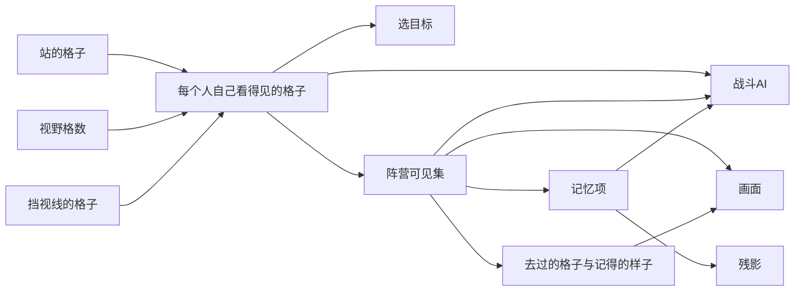

# 视野按格数算、全作只算一份：自己看得见的格子管选目标，阵营可见集管 AI 与画面

> **正典层级**：第 5 级（系统细化）。与[战斗与关卡](../canon/gameplay/战斗与关卡.md)冲突时以正典为准；**视野格数的起步值、地形与状态各改几格、记忆项留几回合全归[数值模型](./数值模型.md)，残影淡出多快归 `GP-6`，本页一个都不定。**
>
> 返回 [总索引](../README.md)｜[系统文档与提案索引](./README.md)｜相关：[战斗与关卡 · 感知与视野](../canon/gameplay/战斗与关卡.md) · [ADR-0035](../decisions/ADR-0035-战斗改成俯视的格子回合制.md) · [回合系统](./回合系统.md) · [技能系统](./技能系统.md) · [战斗AI系统](./战斗AI系统.md) · [关卡系统](./关卡系统.md)｜台账：[`GP-51`](../spec/issues/README.md)

## 摘要

**这一页回答一个问题：这一刻谁看得见哪几格，格子上的人与东西露不露出来。** 读完你能判断两件事：一样新东西要「看得见才能做」或「看得见才画」时，该读这份数据的哪一层；「隔着墙选中了人」「敌人站在看得见的地方却没反应」这类缺陷，又该去查哪一环。

**视野按格数算，不看朝向。** 每个人从他站的格子往外数，视线被写了挡视线的格子挡住，挨着的格子一律看得见，关着的门也挡视线。往外数几格就是视野格数：起步值写在角色定义上，站在高处多看几格，天气挂的那一条状态能让人看不远。

**这份可见性数据只算一次，按读者分成几层：**

- **自己看得见的格子**：每人一份，选目标读它。指向一个人的招，目标要在出手的人自己看得见的地方，队友看见的借不来。
- **阵营可见集**：同一阵营每个人看得见的格子取并集，加上落在这些格子里的人与东西。画面上谁显形、AI 知道对面在哪，都读它。
- **记忆集**：一个人离开阵营可见集时，那个阵营在他最后被看见的那一格留一条记忆项。残影是它在画面上的样子。
- **去过的格子与记得的样子**：只有我方一份，只有画面读。迷雾的全黑、压暗与照常，由它与我方可见集一起画出来。

下面这张图回答一个问题：**这一份数据由什么算出来，又被谁读走。** 「一次计算、没有第二份」这句话的分量在中间那两个节点上，每一个读者都从它们出来。

**重画条件**：可见性数据多一层或多一个读者、视野格数多一个来源、挡视线换了判法，或者残影不再读记忆项时重画。

**这张图不新增任何事实**，权威是下面「结构」那几节，谁读哪一层以「接口」那张表为准。

**它持有**：可见性数据怎么分层、视野怎么数、挡视线怎么判、什么时候重算、什么显形什么不显形、记忆项与残影、去过的格子与记得的样子，以及这些进续玩点的那一份。

**它不持有**这些，各有自己的家：

- 看见之后怎么办（警戒、追击、向同伴传播）：[`战斗AI系统`](./战斗AI系统.md)。
- 施放距离怎么数：[`技能系统`](./技能系统.md)。选不选得上要两样都过，本页只答看不看得见。
- 视野格数的起步值与状态改出来的那一份怎么汇总：[`成长系统`](./成长系统.md)的派生表。状态本身在[`状态效果系统`](./状态效果系统.md)，天气挂哪一条在[`天气系统`](./天气系统.md)。
- 每一格地形与物件写了什么、门开着没有：[`关卡系统`](./关卡系统.md)。
- 掩体让命中降多少：[`伤害系统`](./伤害系统.md)。
- 回合走到哪一刻：[`回合系统`](./回合系统.md)。
- 压暗、残影与被挡住时透出的轮廓画成什么样：作者在 Godot 里配。
- 全部数值：[数值模型](./数值模型.md)。

最要紧的那条承诺，也是本系统存在的理由：**AI 感知与玩家看到的画面由同一份可见性数据驱动，一次计算、没有第二份。** 正典写出了两边各算一遍的后果：画面上看不见却已被攻击，或者敌人站在看得见的地方装作没发现你。**这条有反证钉住**：把可见集清空，AI 必须找不到目标。

**整张图一次拼好、片段之间没有转场，所以它兑现的是「往哪走、要不要绕」。** 探路时没被发现就能先动手（[回合系统 · 先手：没被发现就先动手的那一下](./回合系统.md)），躲在墙后的敌人得走过去才打得到，关上门能把两群敌人隔开分着打，没去过的地方会漏采。

## 术语

只列**只有本页在用**的词。跨页共用的在[术语表](../reference/术语表.md)，本节不重复（`可见集`、`记忆项`、`残影`、`显形`、`续玩点`、`分片`、`派生表`、`警戒`、`片段`、`反证` 都在那边）。

| 词 | 它在本页指什么 |
| --- | --- |
| **视野格数** | 一个人此刻能往外数几格：角色定义上的起步值，加上状态与脚下那一格地形改出来的量 |
| **自己看得见的格子** | 从一个人自己站的格子算出来的那一份；选目标只读它，不读阵营可见集 |
| **记忆集** | 一个阵营此刻持有的全部记忆项，我方、敌方各一份 |
| **去过的格子** | 我方可见集曾经包括过的格子，不必走到；按层记，一关里不回退 |
| **记得的样子** | 我方最后一次看见一格时，它上面会变的那几样是什么样；压暗时地形照它画 |

## 上游约束

- [战斗与关卡 · 感知与视野](../canon/gameplay/战斗与关卡.md)：没有角色全知，做法是三态迷雾，没去过的格子全黑，去过、现在没人看得见的压暗，地形照记得的样子画，人与可交互的东西不显。视野按格数算、不看朝向，被写了挡视线的格子挡住，挨着的一律看得见；地形与天气都能改视野，关着的门也挡。友方取并集、敌方独立取并集，共用同一套视野组件；离开视野的在最后已知位置留残影并淡出。AI 感知与玩家视野表现由同一份可见性数据驱动；只在战斗区域生效；半径多大归本页。**这是本页全部结构的来源；半径本页只定由什么组成，值交给数值模型。**
- [战斗与关卡 · 战斗区域的空间模型：一格一个基础单位的俯视棋盘](../canon/gameplay/战斗与关卡.md)：加载完整张图都是战斗区域，迷雾从落地那一格起生效。数格子横、竖、斜各算一格，大个子从离得最近的那一格数。每种地形写清挡不挡视线、算不算掩体、站在上面多看几格；掩体不挡视线，是跟它分开写的单独一格。关着的门挡视线，被打破的门口一直开着；天气给区域里所有人挂一条状态，子场景不吃；高低只是地形上的一格效果。**约束视野怎么数、本页读地形与物件的哪几格，以及不读算不算掩体那一格。**
- [战斗与关卡 · 技能与操作：普通攻击与防御都是技能，技能栏不绑按键](../canon/gameplay/战斗与关卡.md)：指向一个人的招，目标要在出手的人自己看得见的地方、也在施放距离以内才选得上；范围招的落点也要看得见；队友看见的敌人会显示出来，但借不来打。**约束本页除了阵营可见集，还要给出每个人自己看得见的格子。**
- [战斗与关卡 · 尸体与资源点：都有血条，打碎它的人拿东西](../canon/gameplay/战斗与关卡.md)：矿、树、灌木与尸体都有血条，打碎了给东西；尸体不挡路也不挡视线；宝箱挨着点开、挑着拿。**约束「可交互的东西」那一类有哪些，也约束尸体不进挡视线的判定。**
- [战斗与关卡 · 地上不放东西](../canon/gameplay/战斗与关卡.md)：背包放不下的留在原地，只有打碎它的人能拿，上面冒一个小光点，一眼看得出值不值得回去。**这是压暗处那个小光点那条待定的出处。**
- [战斗与关卡 · 关卡由手工片段按规则拼装](../canon/gameplay/战斗与关卡.md)：片段拼成一整张连着的格子图，片段之间没有转场；一关最多一个主场景加一个子场景，两层各自的状态都留着；探索感靠分支路径、迷雾与可破坏通路。**约束可见性数据按层算整张图、不按片段切，也约束去过的格子按层各记一份。**
- [战斗与关卡 · 关卡事件与附加目标](../canon/gameplay/战斗与关卡.md)：刷敌人的事件到点刷在我方看不见的格子里；中立怪物不站哪一边。**约束事件系统也读本页，也约束中立怪物不并进任何一边。**
- [战斗与关卡 · 敌人也是角色](../canon/gameplay/战斗与关卡.md)：敌人发现我方后向附近同伴传播警戒，关着的门也挡它。召唤、分裂、复活、来源点与刷出来的另受一道同时活着的总上限，多大要实测；回合制里视野只在有人走动时才要重算，更要防的是敌方阶段等太久。**约束警戒传播不归本页，也约束「输入变了才重算」与那条实测的量法。**
- [战斗与关卡 · 队友与敌人](../canon/gameplay/战斗与关卡.md)：特殊援助跟着出征、排进我方阶段，技能召出来的也算特殊援助；敌人召出来的算敌人。**约束谁的视野并进我方、谁的并进敌方。**
- [战斗与关卡 · 回合：我方阶段主角先动、其余按敏捷，然后是敌方阶段](../canon/gameplay/战斗与关卡.md)：有敌人看见了我方的人，或被同伴传播到，就进入战斗状态；先手的理由是迷雾与探路要有回报；战斗状态下点远处一格，看见新的敌人就停下。**约束本页给出「谁刚进了我方可见集」，也是「敌人进不进警戒读它自己看得见的格子」的出处。**
- [战斗与关卡 · 相机：探路时跟主角，战斗时跟当前轮到的人](../canon/gameplay/战斗与关卡.md)：迷雾里看不见的敌人轮到它时，镜头不跟过去。**约束相机读我方可见集。**
- [战斗与关卡 · 说明右键才看，画面上只留图形](../canon/gameplay/战斗与关卡.md)：格子上的一切右键看说明；瞄准范围招时，会被打到的人都描一圈边；被树冠、屋顶这类高的东西挡住的人透出轮廓。**约束描边与右键说明也只按我方可见集给，也约束「被挡住时透出轮廓」跟挡视线分开。**
- [战斗与关卡 · 完成标准](../canon/gameplay/战斗与关卡.md)：目标进度必须始终可见，例如还剩几个来源点。**约束「不给还剩几个资源点」那一条碰不到任务目标的进度。**
- [角色与成长 · 角色面板](../canon/gameplay/角色与成长.md)：所有角色共用同一套面板，包括主角、学生与敌方精英。**约束视野格数敌我同一种读法，视野组件也只有一种。**
- [角色与成长 · 效果从哪来：状态是效果本身，天赋是来路之一](../canon/gameplay/角色与成长.md)：效果写成状态，天赋、特质、宝物、地形与天气都是给人挂上状态的来路。**约束改视野格数的，除了脚下那一格地形写的多看几格，只走状态这一路。**
- [玩法定位 · 存档](../canon/gameplay/玩法定位.md)：关卡里退出再回来接着那一刻；每出一个结果就写一次续玩点，结果一出来先写进去再播。**约束记忆项、去过的格子与记得的样子进续玩点，也约束重算排在写续玩点之前。**
- [ADR-0035](../decisions/ADR-0035-战斗改成俯视的格子回合制.md)：战斗是俯视的格子回合制，加载完整张图都是战斗区域，迷雾从落地那一格起生效；视野的系数归数值模型；验证方法点名迷雾三态写成规则层单测。**约束本页的范围与验收。**
- [ADR-0009](../decisions/ADR-0009-编辑器主导的开发模式.md)：参数唯一来源是场景与资源，代码不留能用的默认值；场景与摆位由作者在 Godot 里管。**约束缺视野起步值当场报错，也约束压暗与残影的画法不在本页。**

## 结构

### 一份数据，一次计算：自己看得见的格子与阵营可见集都在这里取

| 产出 | 内容 | 按什么分 | 谁读它 |
| --- | --- | --- | --- |
| 自己看得见的格子 | 一个人此刻看得见的格子 | 每人一份 | 选目标（[`技能系统`](./技能系统.md)）；敌人进不进警戒（[`战斗AI系统`](./战斗AI系统.md)） |
| 阵营可见集 | 同一阵营每个人看得见的格子取并集，加上落在这些格子里的人与东西 | 我方、敌方各一份 | AI 知道对面在哪；画面上谁显形；相机跟不跟；援军刷在哪 |
| 记忆集 | 离开阵营可见集的人，各一条记忆项 | 我方、敌方各一份 | AI；残影只画我方那一份 |
| 去过的格子与记得的样子 | 我方看见过的格子，与每一格最后一次被看见时的样子 | 只有我方，按层各一份 | 只有画面 |

- **读口只有一个**：谁想知道「看不看得见」都问这一份。表现层不自己再判一次距离，AI 不直接遍历世界里的实体表；实现时最省事的做法正是后者，而它不报错。
- **这条有反证钉住**：把可见集清空（自己看得见的格子与阵营可见集一起清），AI 必须找不到目标。没有这条反证，「两边读同一份」在代码里就只是一句注释。
- **为什么自己看得见的格子也在本页取**：正典两句同时成立，队友看见的敌人会显示出来，但借不来打。只给阵营可见集，「出手的人自己看不看得见」就没地方答；只给每人一份，画面与 AI 要各自再取一次并集，那就是第二份。
- **敌人进不进警戒，读它自己看得见的格子**：正典把「看见了我方的人」与「被同伴传播到」写成两条路。拿阵营可见集当「看见了」，一只看见就等于全都看见，传播那一条就没了用处。警戒那台状态机在[`战斗AI系统`](./战斗AI系统.md)。

### 视野怎么数：按格数往外数，被挡视线的格子挡住，挨着的一律看得见

**一个人看得见哪几格，只看这几样**：他站的格子、他此刻的视野格数、这一层每一格写没写挡视线。

- **数法**：从他站的格子往外，横、竖、斜各算一格，所以看得见的范围是一块方形，与施放距离同一个数法。占几格的大个子，从它离得最近的那一格数。不看朝向，所以没有扇形。
- **视线**：从他站的格子看向某一格，中间经过的格子里只要有一格写了挡视线，被看的那一格就看不见。挡视线的那一格自己看得见：墙看得见，墙后面看不见。
- **谁能写挡视线**：地形，以及摆在上面的东西，例如墙、门、巨石、树干、可破坏通路。人不挡视线，正典只许地形与物件写它；尸体明写不挡。
- **门**：关着挡，开着不挡；打破之后那个门口一直开着，也就一直不挡。门开着还是关着由[`关卡系统`](./关卡系统.md)记。
- **挨着的一律看得见**：横、竖、斜相邻的八格，不管视野格数多小、不管旁边斜着隔着什么。「挨着」与[回合系统 · 轮到一个人：先走，再做那一件](./回合系统.md)里那一条同一个数法；理由在正典，贴得够近就一定被发现。
- **高处只多看几格**：高低只是地形上的一格效果（正典），所以站得高看得远，却看不过挡视线的格子。

**视野格数**由下面几处加起来：

| 来源 | 家在哪 | 说明 |
| --- | --- | --- |
| 起步值 | 角色定义（[`成长系统`](./成长系统.md)），面板上视野那一项（[战斗改成俯视战棋](./proposals/战斗改成俯视战棋.md)） | 敌我同一种；缺了载入报错，不兜底 |
| 状态改出来的那一份 | [`成长系统`](./成长系统.md)派生表的来源那一栏；状态本身在[`状态效果系统`](./状态效果系统.md) | 天气挂的那一条就在这里；子场景不吃天气，下去时它撤掉 |
| 脚下那一格的多看几格 | 地形的声明（[`关卡系统`](./关卡系统.md)） | 按他此刻站的格子加，走下来就没了 |

- **加完之后再小，挨着的格子也照样看得见**：上面那条「挨着的一律看得见」不受视野格数管。
- **量纲**：格数，整数；值全归[数值模型](./数值模型.md)。

**正典没定的，待定（见台账 [`DOC-160`](../spec/issues/README.md)）**：

- 视线从格子的哪一点连到哪一点、两头看是不是一样；两个挡视线的格子斜着挨着时，中间漏不漏视线（走路那一条是不许从中间斜穿）。
- 能走进去、又写了挡视线的格子（例如一片高草）：站在里面的人，从外面看不看得见。
- 大个子站在几种地形上时，取哪一格的多看几格；它占的几格里只看得见一格，算不算看见它。
- 视野格数加完之后有没有一道上限：行动力有一道，视野正典没写。

### 视野组件要声明什么

**每个上战场的角色都有一个视野组件，敌我同一种**（正典：两边共用同一套视野组件）。主角、学生、特殊援助、召唤物与敌人都是这一种，没有「玩家专用视野」。

**它不另存任何数，只读角色身上已有的这几样**：

| 它读的 | 家在哪 |
| --- | --- |
| 阵营 | 角色身上那一格（代码仓 `rules/Foundation/Actors/CombatSide.cs`），组件不另存一份 |
| 站的格子 | 角色的位置；大个子是它占的那几格，占几格写在角色定义上 |
| 视野格数 | 上面那张表；角色定义缺视野起步值时载入报错，说清缺的是哪个角色（[ADR-0009](../decisions/ADR-0009-编辑器主导的开发模式.md)） |

- **没有朝向那一项**：视野不看朝向，所以组件不读角色朝向，也没有另一个「视线方向」。
- **谁并进哪一边**：主角、学生与特殊援助并进我方，技能召出来的算特殊援助；敌人与敌人召出来的并进敌方。中立怪物不站哪一边（正典），所以不并进任何一边，只有它自己看得见的格子。
- **倒下的学生还产不产出视野，待定（见台账 [`DOC-160`](../spec/issues/README.md)）**：他还占着那一格（[战斗与关卡 · 失败判定](../canon/gameplay/战斗与关卡.md)），正典没说他还看不看得见。不算的话，队伍被打散时迷雾会跟着缩回来。

### 什么时候重算：输入变了才算，排在那件事结算完之后

- **正典的判断**：回合制里视野只在有人走动时才要重算。本页把它写全：下面任何一样输入变了才算，没变就不算。
- **输入**，任何一样变了就重算：
  - 有人换了格：走一格、被击退或推走、瞬移。
  - 有人上场或离场：召出来、刷出来、复活、死了、退场。
  - 门开了、关了或被打破。
  - 挡视线的东西多了或没了：造墙、打碎挡路的东西、可破坏通路打通。
  - 有人的视野格数变了：状态挂上或掉了、走上或走下高处。
  - 全队换层。
- **时点**：这些变化都落在[回合系统 · 时点：回合走到哪一刻，调谁](./回合系统.md)那张表的某一行上。重算排在那一行结算完之后、写续玩点之前，读者都读重算之后的那一份。
- **为什么排在写续玩点之前**：记忆项与去过的格子是重算出来的，先写就存下上一步的样子。读者若先于重算读，点远处一格会在敌人已经露出来之后再多走一格。
- **范围**：全队所在的那一层整张图。片段之间没有转场，视线照样穿过门口进下一块；另一层停在离开的那一刻（[回合系统 · 撤离与上下楼：全队一起走](./回合系统.md)）。

### 什么显形，什么不显形

**我方画面上每一格都处在下面某一种态里**，由去过的格子与我方可见集算出来：

| 这一格 | 地形与场景物件 | 人 | 可交互的东西 |
| --- | --- | --- | --- |
| 没去过 | 全黑 | 不显 | 不显 |
| 去过、现在没人看得见 | 照记得的样子画，压暗 | 不显 | 不显 |
| 看得见 | 照常 | 显形 | 显形 |

**分类判据：这样东西给不给人东西、能不能挨着用一下。** 加一样新东西时问这一句，不按它长得像什么归：

- **不给东西也用不了的，是这张图的样子本身**，归「地形与场景物件」：地形、墙、门、巨石、树干、可破坏通路。门也在这一类，开门是走路的一部分，不算用一下。
- **能采、打碎了给东西、能点开挑着拿、能挨着用一下的**，归「可交互的东西」：资源点、尸体与残骸、宝箱、能交互的物件、留在原地的东西。

下面这张图回答一个问题：**我方画面上的一格凭什么换态。**

**重画条件**：一格多出一种态、态之间多一条路，或者「去过」换了判法时重画。

**图里没有回到「没去过」的那条路**，因为去过的格子一关里不回退。权威是上面那张表与下面「去过的格子与记得的样子：只有我方一份，只给画面」那一节。

- **记得的样子**：我方最后一次看见那一格时，上面会变的那几样是什么样，即门开着、关着还是打破了，可破坏通路碎没碎，有没有造出来的墙。门在我方看不见时被关上，画面上照旧画开着，再看见时才变。技能留在地上的那一层第一版不做，记不记它随那一层一起定。
- **残影是「人不显」的唯一例外**：记忆项那一格画残影，不管那一格压暗还是看得见，见下面「目标离开可见集之后：记忆项与残影」。
- **画面上哪一处都只按我方可见集画**：显形、血条与状态小图标、瞄准时描边的人、右键看说明，都只给我方可见集里的人与东西。压暗的格子右键只说得出记得的地形，没去过的格子什么都没有。
- **不给「这一关还剩几个资源点」与「这一关有几个事件」的读口**：那等于把视野约束绕掉，而「要不要把这片走一遍」这个决策全靠它。关卡事件放下的东西也照这张表显形（[`事件系统`](./事件系统.md)）。

**正典没定的，待定（见台账 [`DOC-160`](../spec/issues/README.md)）**：

- 我方看不见的敌人标出来的预警格，以及落在我方看不见的格子里的预警格，显不显。
- 出手顺序那一排小头像里，放不放我方看不见的敌人。
- 从迷雾里打过来的那一下，打的人显不显形；与[回合系统 · 相机：探路时跟主角，战斗状态下跟当前轮到的人](./回合系统.md)里镜头那一条待定一起定。
- 走得到的格子与点远处一格的路线，算不算进没去过的格子、绕不绕开我方看不见的人：标出来或绕开，都会漏出那里有什么。
- 留在原地的东西上那个小光点，压暗时显不显：东西是我方的，显出来不漏敌情，而正典写着可交互的东西不显（[战斗与关卡 · 地上不放东西](../canon/gameplay/战斗与关卡.md)）。

### 目标离开可见集之后：记忆项与残影

- **一个人离开阵营可见集时，那个阵营在他最后被看见的那一格留一条记忆项**，带一个剩几回合，数完就去掉；他重新进可见集，那一条当场去掉。
- **按回合数**：记忆项属于一个阵营，不属于一个人，所以数的是一整轮回合，不是谁自己的回合；探路时也一回合一回合过。
- **只给人，不给东西**：正典给残影的理由是敌人凭空消失会被当成 bug，而东西不会自己走开。
- **记忆项不跟着目标移动**：它记的是「他刚才在这」。跟着走就等于偷偷给了跟踪能力，而那正是「没有角色全知」要挡的。
- **残影是记忆项的表现，不是另一件东西**：一份数据、一种呈现，只画我方那一份。怎么淡出作者在 Godot 里配，淡出多快归 `GP-6`。
- **AI 读记忆集是允许的**，这是它的用处：被叫来的同伴走向那一格再重新看。[`战斗AI系统`](./战斗AI系统.md)的警戒传播传的就是这一格。
- **记忆项进临时续玩点，可见集不进**：可见集每次都能从站位、地形与视野格数重算出来，存它等于存一份缓存（[存档系统 · 派生量不单独存](./存档系统.md)）；记忆项是走过来的历史，算不回来。

**正典没定的，待定（见台账 [`DOC-160`](../spec/issues/README.md)）**：

- 记忆项的回合数减一落在哪一刻；它与[回合系统 · 时长、冷却与每回合会变的量在哪一刻变](./回合系统.md)里状态到期那一条是同一个问题。
- 那一格又被我方看见、而他已经不在那里时，记忆项去不去掉。

### 去过的格子与记得的样子：只有我方一份，只给画面

- **去过指我方看见过**：我方可见集曾经包括过那一格就算，不用走到。理由是看见一间屋、没走进去，转身之后它又全黑的话，「照记得的样子画」就无从说起。
- **一关里不回退**：去过就一直是去过。
- **只有我方一份**：读它的只有画面，敌方 AI 用不上「这一块走没走过」。
- **按层各记一份**：主场景与子场景各自的状态都留着（[战斗与关卡 · 关卡由手工片段按规则拼装](../canon/gameplay/战斗与关卡.md)），换层回来，那一层去过的格子与记得的样子照旧。
- **进临时续玩点**：它跨不过一次睡眠（[存档系统 · 进哪一侧：判据一句话](./存档系统.md)）。

### 本页进续玩点的那一份

| 进临时续玩点 | 按什么分 |
| --- | --- |
| 记忆集 | 我方、敌方各一份，每一层各一份 |
| 去过的格子与记得的样子 | 只有我方，每一层各一份 |

**自己看得见的格子与阵营可见集不进**：读回来之后重算一次，结果与写之前一样。这要求重算只读站位、地形与物件的声明、门的开关与视野格数，不读别的会变的东西。

## 接口

### 谁读它、谁喂它

| 方向 | 对方 | 给什么 |
| --- | --- | --- |
| 入 | [`回合系统`](./回合系统.md) | 时点：输入变了的那一行结算完，本页重算，排在写续玩点之前 |
| 入 | 角色 | 阵营、站的格子、大个子占的那几格 |
| 入 | [`成长系统`](./成长系统.md) | 派生表里视野那一行：起步值与状态改出来的那一份 |
| 入 | [`关卡系统`](./关卡系统.md) | 每一格地形与物件写没写挡视线、多看几格；门开着、关着还是打破了；造出来的墙与打通的通路。**算不算掩体那一格本页不读** |
| 出 | [`技能系统`](./技能系统.md) | 这个人自己看不看得见那一格 |
| 出 | [`战斗AI系统`](./战斗AI系统.md) | 每个人自己看得见的格子（进不进警戒）、阵营可见集与记忆集；**那是它知道对面在哪的唯一来源** |
| 出 | [`回合系统`](./回合系统.md) | 这个敌人我方看不看得见（相机跟不跟）；谁刚进了我方可见集（点远处一格停不停） |
| 出 | [`事件系统`](./事件系统.md) | 我方看不见的格子：刷敌人的事件刷在那里 |
| 出 | [`界面系统`](./界面系统.md)与表现层 | 我方可见集、记忆集、去过的格子与记得的样子：迷雾、显形、残影、描边与右键说明都从它画 |
| 出 | [`图鉴系统`](./图鉴系统.md) | 一个敌人第一次进我方可见集时报一次。它不持有这份数据，拿到的是一次转变 |
| 出 | [`统计事件总线系统`](./统计事件总线系统.md) | 一个人进、出阵营可见集，各一条事件 |
| 存档 | [`存档系统`](./存档系统.md) | 本页一个分片进临时续玩点，内容见上面「本页进续玩点的那一份」 |
| **作者填** | 无 | 挡视线与多看几格是地形与物件声明上的格（[`关卡系统`](./关卡系统.md)）。压暗、残影与被挡住时透出的轮廓怎么画，作者在 Godot 里配（[ADR-0009](../decisions/ADR-0009-编辑器主导的开发模式.md)） |

**挂载点到此为止。** 将来加一样「要不要看得见」的东西时，先问它挂在上面哪一格、读哪一层，不顺手插一个新钩子。

### 它不碰的接缝

- **警戒不在本页。** 「看见了」是本页的产出，「看见了之后怎么办」全在[`战斗AI系统`](./战斗AI系统.md)。警戒传播按范围传、被关着的门挡（正典），不读本页的视线；本页对两个阵营完全对称，而警戒只有敌人那一侧有。
- **施放距离不在本页。** 选不选得上要两样都过：本页答看不看得见，[技能系统 · 数格子：横、竖、斜各算一格，选人还要自己看得见](./技能系统.md)数施放距离。
- **掩体不在本页。** 算不算掩体与挡不挡视线是地形与物件上分开的两格（正典），本页只读后者。掩体后面的人照样看得见、选得上，命中降多少在[伤害系统 · 命中线：攻方命中率减守方闪避率，加地形修正](./伤害系统.md)。
- **姿态不在本页。** 「发现」不是一个姿态，本页不往[`角色动作状态系统`](./角色动作状态系统.md)递任何东西。
- **画法不在本页。** 本页只回答一格处在哪一种态、谁显形；画成什么样是作者在 Godot 里配的事。

## 边界与非目标

- **不定任何数值**：视野格数的起步值、各地形多看几格、改视野的状态各改几格、记忆项留几回合，全归[数值模型](./数值模型.md)；残影淡出多快归 `GP-6`。
- **只在战斗区域生效**：基地、城区与室内不做迷雾（正典）。
- **不做朝向扇形，也不做潜行与背刺**：正典排掉了，理由在下面「理由与取舍」。
- **不做听觉与足音**：正典只写了视野。将来真要加，它是本页多一个产出（一份「听得见谁」），不是另一份可见性数据；写下这条，是为了那天不会长出第二个读口。
- **不定优化手段**：只重算变了的那几份可以，前提是结果与全部重算一样。
- **不给计数器**：「这一关还剩几个资源点」「这一关有几个事件」都不给，理由在上面「什么显形，什么不显形」。
- **同名不同物，写的时候带全名**：
  - **「挡视线」与「被挡住时透出轮廓」**：前者是规则，挡住了就看不见、选不上；后者是画法，树冠、屋顶这类高的东西盖住了我方看得见的人，画面上透出他的轮廓（[战斗与关卡 · 说明右键才看，画面上只留图形](../canon/gameplay/战斗与关卡.md)）。我方看不见的人不画，轮廓也不画。
  - **「去过」与「走到过」**：本页的去过指我方看见过。
  - **「可交互的东西」与「能交互的物件」**：前者是显形那张表里的一类；后者是正典里雕像、装置那一种，是前者的一员。
  - **「资源点」与「来源点」**：不给还剩几个资源点；还剩几个来源点是护卫设施委托的目标进度，正典要它始终可见（[战斗与关卡 · 完成标准](../canon/gameplay/战斗与关卡.md)）。
- **容易混成一件事的几对词**：
  - **「挡视线」与「算不算掩体」**：地形与物件上分开的两格，本页只读前者，见上面「它不碰的接缝」。
  - **「可见集」与「显形」**：前者是数据，后者是它在画面上的一种用法。
  - **「记忆项」与[`战斗AI系统`](./战斗AI系统.md)的「最后已知位置」**：记忆项是一条记录，最后已知位置是它的一格；警戒传播传的就是那一格。
- **「视野」与「感知」是同一件事的两个叫法**：视野是那几格，感知是读它得出的结果；不许把其中一个当成另一套机制。

## 理由与取舍

- **没选让 AI 与画面各算一遍。** 正典已经把后果写死：画面上看不见却已被攻击、敌人站在看得见的地方装作没发现你。它是本页唯一的防重构点，所以配了一条反证，不只写一句话。
- **没选只给阵营可见集。** 正典要的是队友看见的会显示、却借不来打；只有并集的话，「出手的人自己看不看得见」没有地方答。
- **没选只给每人一份、让读者自己取并集。** 画面与 AI 各取一次，就是两份并集，迟早给出两个答案。
- **没选带朝向的扇形视野。** 扇形买的是从背后摸过去，而本作不做潜行与背刺；按格数加挡视线的格子，玩家一眼就看得出哪里看得见（[战斗改成俯视战棋 · 我们没选带朝向的扇形视野](./proposals/战斗改成俯视战棋.md)）。
- **没选拿阵营可见集判敌人进不进警戒。** 一只看见就等于全都看见，「先处理掉放哨的」就不成立了，而正典给警戒传播的理由正是它。
- **没选把「去过」定成走到过。** 看见过的屋子转身又全黑，地形就记不住；正典要的是去过的地方照记得的样子画。
- **没选让敌方也记去过的格子。** 它没有读者：敌方 AI 不需要知道「这一块走没走过」，多一份就多一份要存、要读回来的东西。
- **没选用引擎的物理射线判视线。** 视线只看格子上写没写挡视线，规则层就算得出来；射线要在规则层之外多一个判定口，而层掩码取错时它不报错（`ENG-19` 撞过同一种）。
- **没选让掩体也挡一点视线。** 正典把两样分开写：挡视线的后面根本打不了，掩体只让人难打中。混成一格的话，站到一道矮墙后面就同时改了两件事。
- **没选让记忆项跟着目标走。** 那等于偷偷给了跟踪能力，而正典要的是没有角色全知。
- **没选把残影做成另一条数据。** 它是记忆项的表现；分成两份的话，「记多久」与「画多久」会各自漂移。
- **没选在本页处理警戒。** 本页对两个阵营完全对称，而警戒只有敌人那一侧有；混在一起会让这份数据长出一半只对一个阵营成立的字段。
- **没选现在做听觉。** 正典只写了视野；加一条听觉会立刻带出「脚步声算不算」「墙挡不挡声」，而它们都没有上游。
- **没选把正典没定的规则先按惯例定下来。** 视线怎么连、预警格与小头像显不显这类，玩家看得出差别，是正典该定的规则；本页写成待定，等正典给出答案。

## 验收

**可自动验证项**（规则层单测，不启引擎）：

- **一份数据**（承重项）：读口只有一个；**把可见集清空之后 AI 找不到目标**（反证）。
- **自己看得见的格子**：队友看得见、他自己看不见的敌人，在阵营可见集里，不在他自己看得见的格子里；选不上那一半在[`技能系统`](./技能系统.md)。
- **数法**：视野格数以内、视线没被挡的格子看得见，以外看不见；斜着数也是一格。
- **挨着的一律看得见**：视野格数压到最小、四面都是挡视线的格子时，挨着的八格照样看得见。
- **挡视线**：隔着写了挡视线的格子看不见；那一格自己看得见；人与尸体不挡。
- **门**：关着挡、开着不挡；打破之后一直不挡。
- **掩体**（反证）：把一格的算不算掩体换掉，可见集一格都不变；算掩体、不挡视线的东西后面的人看得见。
- **地形与状态**：站上写了多看几格的地形，就多看那么几格，走下来就回去；挂上一条改视野的状态（天气那一条），视野格数跟着变，撤掉就回去。
- **阵营可见集**：我方任一人看得见就进我方可见集；敌方那一份不受我方影响；两边是同一种组件；中立怪物不并进任何一边。
- **缺起步值**：角色定义缺视野起步值时载入被拒，报错说清是哪个角色。
- **三态**：没去过、去过而现在看不见、看得见各一条；去过的格子不回退；门在我方看不见时被关上，记得的样子照旧是开着，再看见时才变。
- **显形**：压暗的格子里人与可交互的东西不显，地形照记得的样子画；资源点与敌人走同一条路。
- **记忆项**：离开可见集时在最后被看见的那一格生成；目标继续走，那一条不跟着动；回合数完就去掉；重新进可见集时当场去掉。
- **重算时点**：一步走完，读者读到的已经是这一步之后的可见集；写进续玩点的记忆项与去过的格子是重算之后的。
- **范围**：视线穿过门口进下一块片段；不在全队那一层的可见性不往下算。
- **续玩点**：记忆集、去过的格子与记得的样子写完读得回来；可见集不进，读回来重算的与写之前一样。
- 读口里**没有**「这一关还剩几个资源点」这一项。
- 战斗区域之外不产出任何可见性约束。
- **实测，不判对错**：同时活着的总上限那么多人、视野格数取能加到的最大值时，重算一次要多久；这个数交给[数值模型](./数值模型.md)去定那道总上限。

**必须实机确认项**：全黑与压暗分不分得开，压暗读不读得出是「去过但现在看不见」，又不像地形没画完。残影读不读得出是「刚才在这」；被高的东西挡住时透出的轮廓与压暗叠在一起读不读得清；资源点在视野边上显形的那一下醒不醒目。视野格数多大才不显得瞎，又不至于一眼看穿整间大厅；敌人一多时，一步一算会不会让人觉得卡。按 [ADR-0009](../decisions/ADR-0009-编辑器主导的开发模式.md) 的分工由作者实机看，本页不判。

**完成边界**：视野按格数算、被挡视线的格子挡住、挨着的一律看得见；视野格数从派生表与脚下地形来，缺起步值报错；自己看得见的格子与阵营可见集一次算出，敌我同一种组件。三态迷雾从去过的格子与记得的样子画；记忆项与残影是同一件事的两半；每一类读者都从同一份读，且有反证钉住；输入变了才重算，排在写续玩点之前。做到这些，「走进一块地方 → 看见几只 → 先手、绕开还是关门分开打 → 漏采还是走一遍」这条链在文档层面就走得通了。

## 下游同步

- **代码**：可见性计算落**规则层**，它只吃格子上的声明、站位与视野格数，产出几份集合，不需要引擎，而规则层本来也不能引用 Godot。迷雾、显形与残影落引擎层，只读不产。阵营读代码仓 `rules/Foundation/Actors/CombatSide.cs`，不另建一份。代码什么时候写，见 [ADR-0035](../decisions/ADR-0035-战斗改成俯视的格子回合制.md) 的落地要求；[战斗改成俯视战棋 · 实现与过渡](./proposals/战斗改成俯视战棋.md)把迷雾排在第一份战斗需求之后。
- **存档**：本页声明一个分片，进临时续玩点，内容是上面「本页进续玩点的那一份」那张表。缺字段时补一关刚加载完的那一份：没有记忆项，去过的格子从落地那一格重新看起。
- **数值**：视野格数的起步值、各地形多看几格、改视野的状态各改几格、记忆项留几回合，进[数值模型](./数值模型.md)的尚未给值表。除记忆项之外量纲都是格数；记忆项是回合数且大于零，为零就没有残影，而正典要它留下并淡出。同时活着的总上限也进那张表，按上面那条实测，与[`回合系统`](./回合系统.md)里敌方阶段等多久一起定。残影淡出多快归 `GP-6`。
- **台账**：落地在 [`GP-51`](../spec/issues/README.md)；写着待定的那几处归 [`DOC-160`](../spec/issues/README.md)。
- **该上升进正典的**：写着待定的那几处，凡是玩家看得出来的，定下来之后写进[战斗与关卡 · 感知与视野](../canon/gameplay/战斗与关卡.md)：视线怎么连、高草里的人、大个子怎么算、视野有没有上限、倒下的学生看不看得见、预警格与小头像显不显、打的人显不显形、走得到的格子漏不漏、压暗处的小光点。另有一条按推断写进本页：「去过」指看见过，正典另有所指时以正典为准。字段与接口按定义不进正典。
