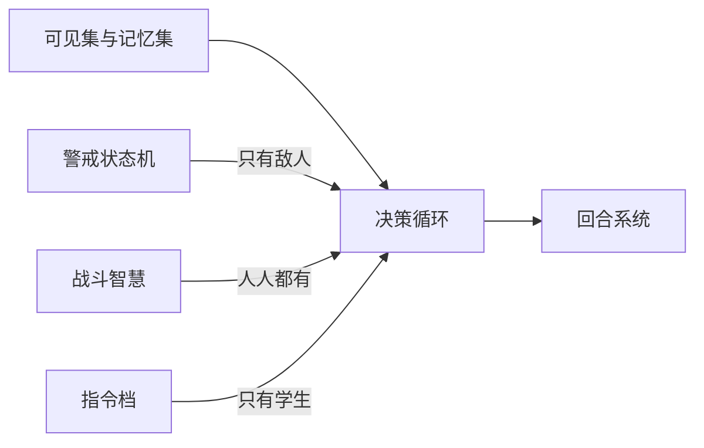
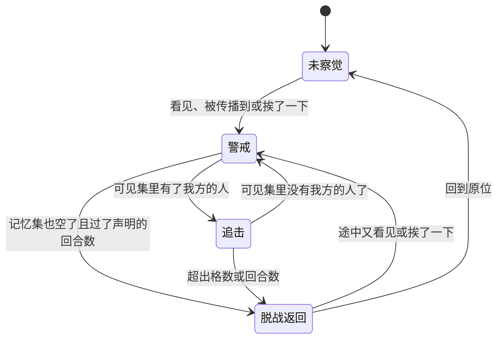

# 敌我共用一条决策循环与一套战斗智慧：每升一档多会一件看得出来的事，敌人另挂一台警戒状态机

> **正典层级**：第 5 级（系统细化）。与[战斗与关卡](../canon/gameplay/战斗与关卡.md)冲突时以正典为准；**战斗智慧的升档阈值、警戒传播的范围与延迟、脱战的格数与回合数、全局难度给敌人数值的那一份修饰全归[数值模型](./数值模型.md)，本页一个都不定。**
>
> 返回 [总索引](../README.md)｜[系统文档与提案索引](./README.md)｜相关：[战斗与关卡 · 战斗智慧：敌我同一套 AI，分八档](../canon/gameplay/战斗与关卡.md) · [ADR-0035](../decisions/ADR-0035-战斗改成俯视的格子回合制.md) · [回合系统](./回合系统.md) · [感知与视野系统](./感知与视野系统.md) · [技能系统](./技能系统.md) · [关卡系统](./关卡系统.md)｜台账：[`GP-36`](../spec/issues/README.md)

## 摘要

**这一页回答一个问题：一个不由玩家操作的角色，轮到他时这一回合怎么走、做哪一件。** 读完你能判断两件事：一条新的 AI 行为算地板还是分档、分档的话进哪一档；以及「这个学生为什么还不会那一招」该去看什么。

敌人、学生与特殊援助走**同一条决策循环**，也按同一套**战斗智慧**分档。差别只在挂上去的门：敌人另挂警戒状态机与警戒传播，学生另挂一个指令档。

下面这张图回答一个问题：**这条循环上挂着哪几个门，哪个门是哪一侧的。** 「敌我走同一条循环」这句话的分量全在中间那个节点上，它只有一个。



**重画条件**：循环上增删一个门、某个门换到另一侧，或者敌我分开走两条循环时重画。

**这张图不新增任何事实，权威是下面「结构」那几节。** 每一档解锁什么、警戒怎么传播、分级面板怎么取子集，图都放不下。

**它持有**：决策循环那条链；战斗智慧每一档解锁什么，地板与分档怎么切；敌人的警戒状态机、脱战与警戒传播；「对策」那一格的取值、含义与载入校验；分级面板怎么取子集；指令档与它的默认档；全局难度在敌人战斗智慧上挪的那一档；以及这些进续玩点的那一份。

**它不持有**这些，各有自己的家：

- 谁看得见谁：[`感知与视野系统`](./感知与视野系统.md)。
- 回合怎么轮、一回合走得到哪些格、借机攻击何时结算：[`回合系统`](./回合系统.md)。
- 一招有哪些字段、施法回合与冷却：[`技能系统`](./技能系统.md)。
- 一下打中算出什么：[`伤害系统`](./伤害系统.md)。
- 身上挂着什么、这一回合能不能动：[`状态效果系统`](./状态效果系统.md)。
- 姿态与流转：[`角色动作状态系统`](./角色动作状态系统.md)。
- 有哪些敌人、各会什么招：那是内容（`ENG-5`）。
- 敌人预算、放置位、种类池、门与地形：[`关卡系统`](./关卡系统.md)。
- 寻路算法，以及经营侧的学生日程 AI。
- 全部数值：[数值模型](./数值模型.md)。

**最要紧的承诺。** 一是**不给敌人开专用通道**：敌人也是角色，角色定义、面板、状态载体、技能表与成长字段全是同一套，哪里看起来像例外，那里写明了它为什么不是。二是**一个档位只由一样东西推**：学生的战斗智慧只跟着实战值涨，关系不进来；关系在战斗里由协作攻击与出征增益兑现，玩家才说得出他为什么变聪明了。

## 术语

只列**只有本页在用**的词。跨页共用的在[术语表](../reference/术语表.md)，本节不重复（`决策循环`、`分级面板`、`预警`、`对策`、`警戒`、`脱战`、`可见集`、`记忆项`、`实战值`、`档位` 都在那边）。

| 词 | 它在本页指什么 |
| --- | --- |
| **地板** | 人人从第一天就有、不占任何一档的那些基础行为。清单在正典，本页不复述 |
| **指令档** | 玩家下给学生的那条指令此刻处在哪一档；没有指令时处在默认档「自由作战」 |

## 上游约束

- [战斗与关卡 · 战斗智慧：敌我同一套 AI，分八档](../canon/gameplay/战斗与关卡.md)：敌人、学生与特殊援助用同一套 AI，按战斗智慧分档；升档必须解锁一个玩家看得出来的具体行为，不是提高命中率这类数值。学生的战斗智慧靠实战值涨、不用等级，起步那一档写在角色定义上；每种敌人写自己那一档，难度再整体挪一档；关系不进战斗智慧；至少要做最低与最高两档；档名不与关系档、生活技能档重名。**这是本页分档全部结构的来源；档数与档名是接口常量，家在那里。**
- [战斗与关卡 · 基础 AI 不分档，人人从第一天就有](../canon/gameplay/战斗与关卡.md)：哪些行为是地板，收指令与扶人为什么归地板。**约束本页分档表里不许出现任何一条地板行为；清单在正典，本页不复述。**
- [战斗与关卡 · 分档的是时机、衔接与配合](../canon/gameplay/战斗与关卡.md)：判据是「做不做是地板，什么时候做、跟谁一起做是分档」；点过名的分档行为；最低那一档由「都还不会」定义；防御时机归分档；每一档各解锁哪几条交给本页。**这是本页分档表的判据与它的验收依据。**
- [战斗与关卡 · 队友的道具与技能使用](../canon/gameplay/战斗与关卡.md)：触发条件按类型分、不分档；只用自己持有的物品；用药是这一回合的那一件，所以挑时机归分档。**约束地板那一节里用药与恢复那几条。**
- [战斗与关卡 · 资源：HP 与 MP](../canon/gameplay/战斗与关卡.md)：药品这类道具回 MP，打中回 MP 是状态，不是人人都有的规则。**约束「资源不足且有恢复手段」那一条读的是回 MP 的药品。**
- [战斗与关卡 · 关系在战斗里：协作攻击与出征增益](../canon/gameplay/战斗与关卡.md)：协作攻击由关系档位开，不占补那一下的人的回合，补的那一下不再引出新的协作攻击；主角与学生之间也算，敌人那一边可以由特质给。**约束协作攻击那一节，也是关系不进战斗智慧的另一半。**
- [战斗与关卡 · 队友与敌人](../canon/gameplay/战斗与关卡.md)：那几条指令不占回合、随时能下给没被接管的学生；没有指令时处在自由作战，那不是又一条指令；「撤退」指令与撤出关卡是两件事。特殊援助有自己的战斗智慧，全由 AI 动，不听指令、接管不了，倒下就退场。**约束指令档那一节与特殊援助那一节。**
- [战斗与关卡 · 敌人也是角色](../canon/gameplay/战斗与关卡.md)：敌人与主角、学生同一张定义表，招在技能那张表里；分级面板是同一套面板的两个子集；每种敌人在定义上写自己那一档。人形敌人死了留尸体，其余的声明魔化载体类别，那只决定死亡终态留下什么。发现我方后向附近同伴传播警戒，范围小到不把隔着空片段的两群连成一片，关着的门也挡它；脱战按格数或回合数。一条委托放的敌人有上限，召唤与刷新另受同时活着的总上限；精英随机带一两条状态；起步做魔化生物与人形敌人。**这是敌人那一侧全部结构的来源。**
- [战斗与关卡 · 预警与打断](../canon/gameplay/战斗与关卡.md)：每一招写一个施法回合，不为 0 的先把要打的格子标出来；标出来的那几回合里人能走开、能防御，写了可以被打断的打中就取消；消耗在出手时付、被打断不退。可不可打断与「对策」是同一格，结构在本页；对策的取值是走开、防御、打断，全部敌人合起来要覆盖到每一种；刻意走不开的那几类，对策里没有走开。**约束「预警与对策」那一节。**
- [战斗与关卡 · 回合：我方阶段主角先动、其余按敏捷，然后是敌方阶段](../canon/gameplay/战斗与关卡.md)：进入与结束战斗状态的判据读本页那台警戒状态机；先手之后的第一个敌方阶段，还没发现我方的敌人不动。行动力与再走满一次；借机攻击敌我都一样，几率不受战斗智慧改动；敌人照同一条。**约束走位那一节，也约束警戒状态机要答得出谁处在警戒或追击、谁算还没发现。**
- [战斗与关卡 · 战斗区域的空间模型：一格一个基础单位的俯视棋盘](../canon/gameplay/战斗与关卡.md)：八向走，数格子横、竖、斜各算一格；掩体与挡视线分开写；门挡路、挡视线、挡警戒传播，人形的会开门，野兽与魔化生物只能把门打破。**约束走位那一节与门那一节，也约束警戒传播的范围怎么数。**
- [战斗与关卡 · 技能与操作：普通攻击与防御都是技能，技能栏不绑按键](../canon/gameplay/战斗与关卡.md)：普通攻击与防御都是技能；指向一个人的招，目标要在出手的人自己看得见的地方、也在施放距离以内才选得上，队友看见的借不来打。**约束决策循环里「知道对面在哪」与「选得上谁」分两半读。**
- [战斗与关卡 · 防御与失衡](../canon/gameplay/战斗与关卡.md)：防御是一招技能、用了挂格挡；失衡值攒满被打崩；反击是一条状态；回合外多打的那几种互不引出；失控是一条异常状态，随机行动、可能打到自己人。**约束分档表里防御与反击那几条，也约束失控时这条链怎么走。**
- [战斗与关卡 · 误伤：范围招打到自己人减半](../canon/gameplay/战斗与关卡.md)：敌我都有误伤。**约束「放范围招时避开自己人」是一条有后果的分档行为。**
- [战斗与关卡 · 尸体与资源点：都有血条，打碎它的人拿东西](../canon/gameplay/战斗与关卡.md)：不留尸体的敌人掉落直接给击杀者；残骸不能被复活；复活出来的战斗智慧固定是愚笨；随机事件里来帮忙的人没有背包；没进战斗状态时学生自己采身边的，进入战斗状态以后只打架。**约束载体类别那一节、探路那一节与复活出来的那一档。**
- [战斗与关卡 · 地上不放东西](../canon/gameplay/战斗与关卡.md)：学生那一份留在原地的东西，没进战斗状态时他背包有了空位自己去拿。**约束探路那一节。**
- [战斗与关卡 · 关卡事件与附加目标](../canon/gameplay/战斗与关卡.md)：能交互的物件 AI 不自己去碰；刷敌人的事件；中立怪物不主动打人，挨了打才还手，挨了打就算进战斗状态。**约束中立怪物那一节。**
- [战斗与关卡 · 关卡由手工片段按规则拼装](../canon/gameplay/战斗与关卡.md)：片段按种子拼成一整张连着的图，片段之间没有转场；剧情关整关固定；上下楼时两层各自的状态都留着，敌人不跟着上下楼。**约束脱战不为片段边界写特例，也约束换层时警戒停在离开那一刻。**
- [战斗与关卡 · 两层难度，职责不重叠](../canon/gameplay/战斗与关卡.md)：全局难度改所有敌人的数值与战斗智慧；委托难度改这一关的地图、敌人的等级与数量、有没有精英；BOSS 只出在主线的剧情关里，委托里最强的是精英；两层都不碰资源产出与经济压力。**这是全局难度那一节的唯一来源，本页不加第三层。**
- [战斗与关卡 · 感知与视野](../canon/gameplay/战斗与关卡.md)：没有角色全知；AI 感知与玩家画面由同一份可见性数据驱动。**这是决策循环第一步只读那份数据的来源。**
- [战斗与关卡 · 失败判定](../canon/gameplay/战斗与关卡.md)：学生倒下不死亡、每人每关可被救起一次；倒下的学生亮出神秘庇佑，选不中，敌人不再追着他打；扶他要走到旁边、用掉一回合。**约束「扶倒地的同伴」这条地板怎么做，也约束目标选择里没有倒下的学生。**
- [战斗与关卡 · 玩家操作谁](../canon/gameplay/战斗与关卡.md)：被接管的那一回合由玩家操作；学生那一场真打没有主角，也就没有接管。**约束决策循环不替被接管的学生跑。**
- [角色与成长 · 角色面板](../canon/gameplay/角色与成长.md)：所有角色共用同一套面板，包括敌方精英，而且这是一致性要求；面板上有战斗智慧那一栏，主角那一栏写「变幻无常」。**这是分级面板取子集那条的硬依据。**
- [角色与成长 · 四项属性的作用方向](../canon/gameplay/角色与成长.md)：防御与抗性的大头不在属性上，而在宝物、宝石、天赋与状态。**这是「精英要装宝物」那条的关键输入。**
- [角色与成长 · 书 → 学会 → 练熟](../canon/gameplay/角色与成长.md)：实战值只在命中时积累。**约束学生升档读的是同一个量。**
- [角色与成长 · 效果从哪来：状态是效果本身，天赋是来路之一](../canon/gameplay/角色与成长.md)：全局难度与精英随机带的都是给人挂状态的来路。**约束全局难度给敌人数值的那一半走状态，也约束本页不为精英那几条另加行为。**
- [角色与成长 · 失衡与它长出的永久增益](../canon/gameplay/角色与成长.md)：活跃失衡以永久增益改造角色，与战斗里的失衡同名不同物。**这是畸形那一档的出处，也是「失衡」两处都写全名的理由。**
- [角色与成长 · 战利品归属](../canon/gameplay/角色与成长.md)：玩家手动配的装备优先于学生的自动选择。**约束「玩家标记的优先目标优先于 AI 自己挑的」用同一个做法，不新造规则。**
- [世界观 · 外魔与魔化](../canon/world/世界观.md)：魔化造物按来源分类，那是来源分级不是难度分级。**约束载体类别在战斗里只管死亡终态留下什么；类数是接口常量，家在那里。**
- [人物 · 战斗中的位置：教练，而非输出核心](../canon/characters/人物.md)：主角那组伤害极低的攻击招，战术价值在于打崩、打断敌方施法与配合。**这是对策覆盖校验要顺带保证至少有一招打得断的理由。**
- [玩法定位 · mod 的扩展边界](../canon/gameplay/玩法定位.md)：内容外置、规则不外置。**约束三种敌人是配置取值，不是三套分支。**
- [玩法定位 · 弹界面接管输入就暂停世界，世界里的动作不暂停](../canon/gameplay/玩法定位.md)：演出接管输入时世界暂停。**约束演出期间这条链不跑、本页不为演出加状态。**
- [玩法定位 · 存档](../canon/gameplay/玩法定位.md)：关卡里退出再回来，接着退出那一刻。**约束警戒与下过的指令进续玩点。**
- [玩法定位 · 视角规则](../canon/gameplay/玩法定位.md)：本作不做基地防卫战，基地里没有格子与回合。**约束基地里没有战斗 AI。**
- [ADR-0035](../decisions/ADR-0035-战斗改成俯视的格子回合制.md)：战斗是俯视的格子回合制；特殊援助由 AI 动、接管不了。**约束本页每一条都按回合说，没有按时间推进的东西。**
- [ADR-0024](../decisions/ADR-0024-学生那条战线改成一场真打.md)：节点 16 学生那条战线由 AI 驱动、玩家不操作，那一场倒下自动起身。**这是「主角不在场的那一关」那一节的唯一来源。**
- [ADR-0018](../decisions/ADR-0018-内容定义按声明扩展.md)：角色定义只有一张表，「只对一部分角色成立」加的是一项能力声明。**约束敌人的级别、决策配置与战斗智慧是随「作为敌人出场」来的格。**
- [ADR-0025](../decisions/ADR-0025-取值集的家由加一个的代价决定.md)：一格能填哪些值，看加一个要付什么代价。**约束对策那份取值归代码。**
- [ADR-0009](../decisions/ADR-0009-编辑器主导的开发模式.md)：参数唯一来源是场景与资源，缺配置当场报错、不兜底。**约束本页每一条载入校验都报错，不给默认值。**

## 结构

### 决策循环：一条顺序固定的链

每一个不由玩家操作的角色，轮到他时走同一条链：

```
取可见集与记忆集 → 选目标 → 定这一回合怎么走、放哪几招、做哪一件 → 交给回合系统
```

**这几个环节顺序固定，没有第二条链。** 这一条挡的是「每加一类角色就长出一套自己的决定方式」。

- **轮到他时走一遍，这一回合里他每走一步、每放一招，都从头再走一遍。** 局面每一步都可能变：可见性数据在每一步之后重算（[`感知与视野系统` · 什么时候重算：输入变了才算，排在那件事结算完之后](./感知与视野系统.md)），借机攻击也可能在半路把他打停。
- **第一步的输入只有[`感知与视野系统`](./感知与视野系统.md)那一份。** 知道对面在哪，读自己这一边的阵营可见集与记忆集；一招选不选得上目标，读他自己看得见的格子（[`技能系统` · 数格子：横、竖、斜各算一格，选人还要自己看得见](./技能系统.md)）。AI 不许直接读世界里的实体表：这条是那份数据的承重项，反证在两页各写一次（清空可见集后 AI 找不到目标）。
- **本页只产出「想怎么走、做哪一件」。** 这一步走不走得通、这一招放不放得出来，由[`回合系统`](./回合系统.md)、[`技能系统`](./技能系统.md)与[`状态效果系统`](./状态效果系统.md)各自判，AI 挑之前读的也是它们给的那一份。被拒就是被拒，AI 不绕过去，也不自己另算一份：两边各算，迟早出现「他明明被打崩了却出手了」这种不一致，而它不报错。
- **要估打不打得中、打多疼，读瞄准预览那一条线**（[`伤害系统` · 出手前看到的数与结算走同一条线](./伤害系统.md)），不另写一份。
- **被接管的那一回合，这条链不替他跑**（[`回合系统` · 接管：在主角那一回合里点定，轮到那个学生时由玩家操作](./回合系统.md)）。
- **失控时这条链照走，只是选目标与选招换成随机挑**：在走得到、打得到的范围里挑，敌我都算，不读战斗智慧（[战斗与关卡 · 防御与失衡](../canon/gameplay/战斗与关卡.md)：失控随机行动，可能打到自己人）。主角与被接管的学生失控时也由本页替他动（[`回合系统` · 轮到一个人：先走，再做那一件](./回合系统.md)）。怎么随机，**待定**（见台账 [`DOC-160`](../spec/issues/README.md)）。
- **剧情演出期间这条链不跑。** 演出接管输入，世界跟着暂停，回合不往下走（[玩法定位 · 弹界面接管输入就暂停世界，世界里的动作不暂停](../canon/gameplay/玩法定位.md)）。本页不为演出加任何状态，演出要摆布角色时走[`剧情演出系统`](./剧情演出系统.md)自己那条路。加一个「被演出接管」的态，就要回答「演出里敌人能不能打你」，而正典已经答了。

### 敌我共用这条链，差别只在挂上去的门

| 谁 | 额外挂什么 |
| --- | --- |
| 敌人 | 警戒状态机、警戒传播；全局难度在战斗智慧上挪的那一档 |
| 中立怪物 | 同一台警戒状态机，进警戒只认挨了一下那一条 |
| 学生 | 指令档 |
| 特殊援助 | 不另挂：不收指令，也接管不了 |

**没选拆成敌我两份。** 两边共用同一份角色面板、同一套技能与道具管道、同一份可见性数据、同一套战斗智慧；拆开会让「这一招现在能不能放」有两个家，而那种分叉不报错。挂上去的门是加法，不是两套并行的逻辑。

**敌人也是角色，数据上没有第二种东西。** 它是角色定义那张表里带「作为敌人出场」那项声明的一条（[`成长系统` · 角色定义上不会变的声明项](./成长系统.md)），它的招是它会的技能（[`技能系统` · 技能不属于任何人：谁会哪一招只记在角色身上](./技能系统.md)），它身上的状态在同一份载体上。敌我之间的差别一律是各自声明的格：级别、决策配置、战斗智慧那一档、是不是人形、行动力的起步值、占几格。

### 一个角色这一回合能做什么，读它自己身上的

**AI 只从这个角色自己有的里面挑**，没有一张「它能做什么」的另一份清单：

- **招**：他会的主动技，普通攻击与防御也在里面；被动技一直生效，不用挑（[`技能系统` · 主动技进技能栏，被动技不进，都不设数量上限](./技能系统.md)）。
- **物品**：他自己背包里的（[`背包系统`](./背包系统.md)）；没有背包的就没有这一项。
- **走路**：他的行动力（[`回合系统`](./回合系统.md)）。
- **开门**：只有人形的会，见下面「门：人形的开门，别的只能打破」。
- **别的那一件**：扶起倒下的人、原地等一回合人人都有；采一下、拿自己留在原地的那一份只在探路时，见下面「探路时的队友：跟着主角走，采身边的，不先动手」；能交互的物件 AI 不碰（[战斗与关卡 · 关卡事件与附加目标](../canon/gameplay/战斗与关卡.md)）。

**找不到能用的就不做，这是正常筛选，不报错。** 不会击退招的不去推人进岩浆，没有背包的不去喝药，都不用写特例。

**作为敌人出场的角色一个主动技都不会时，载入报错**，并说清是哪个角色：它会一直站着不打，而那不报错。这条与上一条要分开写：混在一起，「内容配错了」就会静默变成「它就是不做那件事」。

### 走位：按行动力算一回合走到哪

- **走得到哪些格、每一格花几点、哪一步会引出谁的借机攻击、被打中的几率多少，都读[`回合系统`](./回合系统.md)算的那一份**（[`回合系统` · 借机攻击：走出敌人那一圈之前先结算](./回合系统.md)）。界面标格子读的也是它；AI 自己再算一遍，迟早出现格子标着走得到、AI 却当它走不到。
- **够不着就放弃出手去追。** 这一回合走完够不着目标的，可以把那一件换成再走满一次（[`回合系统` · 轮到一个人：先走，再做那一件](./回合系统.md)）。去追是地板，最低那一档的样子就是追着最近的对手打；追谁、追到哪一格停，是分档。
- **低血量后退也走这一份**，一回合退不远时同样可以换成再走满一次。
- **借机攻击人人都读得到，绕不绕开是分档。** 最低那一档照直走出对手那一圈；聪慧那一档起会绕着走，或者换一招写了不引发借机攻击的招（[`技能系统` · 一个战斗技能要声明的字段](./技能系统.md)）。身上带着让这一次走开不引发的状态时，回合系统给的那一份已经算进去了。
- **地形写的掩体与效果读[`关卡系统`](./关卡系统.md)**：找不找掩体、把不把人推进岩浆，是分档表里的行为。

### 门：人形的开门，别的只能打破

- **人形的会开门**（[战斗与关卡 · 战斗区域的空间模型：一格一个基础单位的俯视棋盘](../canon/gameplay/战斗与关卡.md)）：战斗状态下开门扣行动力，扣多少照[`回合系统`](./回合系统.md)那一条；探路时走进关着的门那一格就是开门。所以对人形的，一扇关着的门只是路上多花的行动力。
- **不是人形的开不了，只能把门打破**，打破了那个门口就一直开着（正典）。对它们，一扇关着的门是一堵要先打碎的墙：去打门还是绕另一条路，是走位那一步的取舍。门要打几下、怎么算打破，归[`关卡系统`](./关卡系统.md)，**待定**（见台账 [`DOC-160`](../spec/issues/README.md)）。
- **是不是人形读角色定义上的一格。** 正典在敌人那边写了人形与魔化载体类别（下面「载体类别只决定死亡终态留下什么」），主角、学生、特殊援助与召唤物也要答这一格。它放在角色定义的哪里归[`成长系统`](./成长系统.md)，**待定**（见台账 [`DOC-160`](../spec/issues/README.md)）。
- **关着的门挡警戒传播**，见下面「警戒传播：按范围传，只有一跳，关着的门挡住」；它也挡视线，那一半在[`感知与视野系统`](./感知与视野系统.md)。
- **AI 关不关门，待定**（见台账 [`DOC-160`](../spec/issues/README.md)）：正典给关门的理由是玩家把追兵挡在外面、把两群敌人隔开分着打，没写 AI 这一侧。

### 敌人的警戒状态机

**它与身上的状态是正交的**：警戒管「打谁、往哪去」，[`状态效果系统`](./状态效果系统.md)管「这一回合能不能动」。一个被打崩的敌人仍然处在追击；合成一台的话，每一种状态都要为每一格警戒各写一遍。

下面这张图回答一个问题：**一个敌人的警戒处在哪一格，凭什么换。**



**重画条件**：多出或删掉一格状态、多一条进警戒的路，或者脱战的条件变了时重画。

**下面那张表是权威**，图放不下「回合数数它自己的回合」这类条件。

| 状态 | 它在做什么 | 进入 | 退出去哪 |
| --- | --- | --- | --- |
| **未察觉** | 守在原位，没有目标 | 初始；脱战返回回到原位 | 它自己看得见的格子里有了我方的人、被同伴传播到，或挨了我方一下 → 警戒 |
| **警戒** | 知道我方在附近：往记忆集里那一格去，到了再看 | 上面那几条；追击里可见集没有我方的人了；脱战返回途中又看见或挨了一下 | 敌方阵营可见集里有了我方的人 → 追击；可见集与记忆集里都没有我方的人，这样过了声明的回合数 → 脱战返回 |
| **追击** | 选目标、追、打 | 警戒里可见集有了我方的人 | 可见集里没有我方的人了 → 警戒；离原位超出声明的格数，或追击超出声明的回合数 → 脱战返回 |
| **脱战返回** | 往原位走 | 警戒与追击里写的那几条 | 回到原位 → 恢复，回到未察觉；途中又看见或挨了一下 → 警戒 |

- **进不进警戒，读它自己看得见的格子；进了之后知道对面在哪，读敌方阵营可见集与记忆集**（[`感知与视野系统` · 一份数据，一次计算：自己看得见的格子与阵营可见集都在这里取](./感知与视野系统.md)）。拿阵营可见集判进不进警戒，一只看见就等于全都看见，警戒传播就没了用处。
- **敌方阵营可见集里一有我方的人，就当场进追击。** 警戒那一格留给手上只有记忆项、或者连记忆项都没有的：喊它的那一只也已经看不见了、挨了一下没看见是谁、追丢了。
- **挨了我方一下也进警戒。** 正典把「我方先对敌人出手」写成进入战斗状态的一条路，而战斗状态在「没有处在警戒或追击的敌人」时结束；挨打不进警戒的话，先手一出手，这一场当场就结束。挨了一下却看不见是谁打的，它往哪去，**待定**（见台账 [`DOC-160`](../spec/issues/README.md)）。
- **战斗状态在不在，读的就是这张表**：有一个敌人处在警戒或追击，战斗状态就在；处在脱战返回的不算（[`回合系统` · 探路与战斗状态：同一套回合，差别在走路怎么算](./回合系统.md)）。
- **原位就是拼地图时它被摆在的那一格**（[`关卡系统`](./关卡系统.md)），不另存。
- **回到原位时恢复**：HP、MP 与失衡值回到初始，身上由这一次交战施加的可解除状态清掉，不可解除的按它自己的时长走完（[`状态效果系统`](./状态效果系统.md)；失衡值怎么攒见[`伤害系统` · 失衡值：本页只产出增量，攒满之后打崩归载体那一侧](./伤害系统.md)）。不恢复的话，「打掉一半退回去、再进来接着打」就是一条不报错的免费路径。
- **脱战返回途中又看见我方的人或挨了一下，回到警戒**：它只是在往回走，路上照样看得见、照样挨得了打。
- **回合数都数它自己的回合**，跟冷却与状态的时长同一个数法（[`回合系统`](./回合系统.md)）。
- **换层时另一层停在离开的那一刻**：敌人不跟着上下楼，两层各自的状态都留着（[战斗与关卡 · 关卡由手工片段按规则拼装](../canon/gameplay/战斗与关卡.md)），那一层的警戒与回合数一起停住（[`回合系统` · 撤离与上下楼：全队一起走](./回合系统.md)）。
- **敌人不追出战斗区域**：撤离之后这一关结束，警戒随它一起没了。

### 先手之后的第一个敌方阶段：谁算还没发现

[`回合系统` · 先手：没被发现就先动手的那一下](./回合系统.md)写明，先手之后的第一个敌方阶段里还没发现我方的敌人不动；谁算还没发现，由本页答。

- **先手那一下出手的那一刻处在未察觉的敌人都算，挨了那一下的也算。** 它们此刻多半已经进了警戒，那一阶段照样不动。不这样算的话，先手打到的那几只第一个就动起来，正典给先手的那份回报（摸清站位再动手，就该比撞上去打得好）只剩没打到的那些。
- **本页记着这一批是谁**，那一个敌方阶段过完就清掉；那一阶段过没过，由回合系统记。

### 中立怪物：挨了打才进警戒

- **它挂同一台警戒状态机，进警戒只有挨了一下那一条**：自己看见了我方的人、被谁传播到，都不让它进警戒（[战斗与关卡 · 关卡事件与附加目标](../canon/gameplay/战斗与关卡.md)：不主动打人，挨了打才还手）。
- **它不站哪一边，所以没有阵营可见集**：知道对面在哪，只读它自己看得见的格子（[`感知与视野系统` · 视野组件要声明什么](./感知与视野系统.md)）。
- **它不发警戒传播，也收不到**：警戒传播是敌人向同伴喊，它不是谁的同伴。
- **挨过打的处在警戒或追击，拖着这一场不结束**：正典写它挨了打就算进战斗状态。
- **还手打谁**（打它的那一个，还是那一边的人）**待定**（见台账 [`DOC-160`](../spec/issues/README.md)）；挨过打之后还照不照脱战那几条走，一起待定。
- **它什么时候离开，归那条关卡事件**（[`事件系统`](./事件系统.md)）；没挨过打的随战斗状态结束一起离开，也不借机攻击（[`回合系统` · 借机攻击：走出敌人那一圈之前先结算](./回合系统.md)）。

### 脱战：追出格数或回合数就放弃，回原位恢复

**没有脱战，玩家会把全图敌人拖成一串**（[战斗与关卡 · 敌人也是角色](../canon/gameplay/战斗与关卡.md)）。整张图连成一片、片段之间没有转场，所以下面这张表里的条件是让敌人回去的唯一办法。

| 条件 | 量纲 | 它挡什么 |
| --- | --- | --- |
| 离原位的格数 | 格数，数法与施放距离一样 | 守位的敌人不离开自己的位置太远：远程与守位的留在原处，不跟着玩家整屋跑成一串 |
| 追击的回合数 | 它自己的回合数 | 打一下就跑、让它一直追：追够了它就回原位恢复，所以边打边退磨不掉它 |

- **追击的回合数从哪一刻数起**（进追击就数，还是只数够不着目标的那几回合）**待定**（见台账 [`DOC-160`](../spec/issues/README.md)）：前一种会让一场正打着的仗打到一半脱战。
- **不为片段边界写特例**：片段之间没有转场，敌人照样追过门口进下一块；挡住它的只有上面那张表、关着的门与撤离。
- **警戒那一格也有自己的回合数**：可见集与记忆集里都没有我方的人，这样过了几回合就脱战返回。它与记忆项留几回合是不同的两个数：后者管「记得他在哪」多久，前者管「记不得之后还守着」多久。
- 这几个量的值都归[数值模型](./数值模型.md)。

### 警戒传播：按范围传，只有一跳，关着的门挡住

**一个敌人因为自己看见了我方的人而进警戒的那一刻，向范围内的同伴传播警戒**（[战斗与关卡 · 敌人也是角色](../canon/gameplay/战斗与关卡.md)）。不做的话，一只一只引出来打就是最优解；做了才有真后果：不先处理掉放哨的，接下来要面对被叫来的一群。

- **传的只有警戒本身。** 被传到的同伴进警戒，知道对面在哪照旧读敌方阵营可见集与记忆集：喊它的那一只此刻还看得见的，它就知道在哪；已经看不见的，它走向记忆项那一格再重新看。最后已知位置就是那条记忆项上的那一格（[`感知与视野系统` · 目标离开可见集之后：记忆项与残影](./感知与视野系统.md)），本页不另存一份。
- **只有一跳。** 被传到的不往外传；它之后自己又看见了我方的人也不传，因为它已经在警戒里，没有「进警戒的那一刻」。链式的话，一群里的一只叫醒另一只、那一只再往外叫，范围再小也会顺着站位连到隔壁那一群。
- **挨了一下进警戒的不喊**：正典写的是「发现我方后」传播，挨打不是看见。
- **范围按格数数，与施放距离同一个数法，不读视线；隔着关着的门不传**（[战斗与关卡 · 战斗区域的空间模型：一格一个基础单位的俯视棋盘](../canon/gameplay/战斗与关卡.md)）。「隔着」怎么判（两只之间的连线穿过一扇关着的门，还是两只之间走得通的路都要穿过它）**待定**（见台账 [`DOC-160`](../spec/issues/README.md)）。
- **范围要小到不把隔着空片段的两群连成一片**（正典）。约束形式：传播范围小于两群之间最近的两个敌人隔着的格数。两群隔多远由拼地图那一侧定（[`关卡系统`](./关卡系统.md)），所以这条要两边对着判；值归[数值模型](./数值模型.md)。
- **延迟是回合数，可以为零**；喊出去还没传到的那几声进续玩点（下面「本页进续玩点的那一份」）。
- **中立怪物不收也不发**，见上面「中立怪物：挨了打才进警戒」。

### 预警与对策：每一招上的显式声明

**预警就是施法回合不为 0 的那一招出手时标出来的格子**，一直标到它落下（[战斗与关卡 · 预警与打断](../canon/gameplay/战斗与关卡.md)）。施法回合是那一招在[`技能系统` · 一个战斗技能要声明的字段](./技能系统.md)那张表上的一格，怎么数在[`回合系统` · 施法回合：占住施法者自己的回合，轮到他时先落下](./回合系统.md)；本页只用它。

**对策是那张表上的另一格，含义与载入校验的家在本页**（那张表把它指了过来）。每一招都要填，不分是谁会的：技能不属于任何人（[`技能系统` · 技能不属于任何人：谁会哪一招只记在角色身上](./技能系统.md)），而敌我同一套 AI，学生施法到一半的招一样会被高档的敌人打断。

| 对策 | 意思 | 不许填的 |
| --- | --- | --- |
| **走开** | 标出来的格子里的人，在那一招落下之前走得出去 | 写了跟着目标走的（[`技能系统` · 有的格按条件才填，填错在载入时就被拒](./技能系统.md)） |
| **防御** | 落下之前防御，挂着格挡挨这一下 | 无 |
| **打断** | 落下之前打中施法的那个人，这一招就取消；**对策里含它就是「可以被打断」**，不另开一格 | 无 |

- **取值就是正典列的那几样，按 [ADR-0025](../decisions/ADR-0025-取值集的家由加一个的代价决定.md) 归代码。** 加一种对策要写一段新的应对判定，不是多一条数据，所以加一种算一次改设计、要先立项；一招带哪几种是内容。填了一个不在册的对策，载入被拒并说清它不在册。
- **缺对策载入报错**（正典：可不可打断由它自己声明，缺声明报错）。
- **范围大到一回合走不出去的，对策里不填走开**（正典）。这一条判不了：走不走得出去看对面那一回合剩几点行动力，所以它归内容自己把握。
- **施法回合为 0 的招，对策怎么填待定**，跟[`技能系统`](./技能系统.md)那一条一起定：没有标出来的那几回合，走开与打断都来不及。
- **AI 读得到哪些预警格，按它那一边看不看得见算**：跟我方画面上那几格显不显是同一个问题，在[`感知与视野系统` · 什么显形，什么不显形](./感知与视野系统.md)那条待定里一起定。
- **消耗在出手那一刻付，被打断不退**（正典）。这一条对 AI 有执行体上的理由：退还的话打断就没有代价，被打断的敌人蓝没少、立刻再放，于是玩家永远打断、它永远重放；不退还，它的蓝会见底，打断才真的换到东西。

**一条载入校验兑现正典挂的账：全部作为敌人出场的角色合起来，它们会的招要覆盖到每一种对策，少一种就报错并说清少哪一种。** 遍历路径是每个作为敌人出场的角色 → 它会的每一招 → 各自的对策。

- **这条校验顺带保证至少有一招打得断。** 主角那组伤害极低的攻击招，战术价值在于打崩、打断敌方施法与配合（[人物 · 战斗中的位置：教练，而非输出核心](../canon/characters/人物.md)）；这条校验让它在内容上永远有对象。
- **校验放在全部敌人合起来这一层，不是每个敌人。** 要求每种敌人都带一招打得断的，会逼出一批不合理的内容（一只只会扑咬的野兽为什么要有一招要等几回合的施法）；玩家需要的是整套敌人里每一种对策都有用。
- **不是每一招都该带打断**：全都能打断会让打断变成唯一最优解（正典）。一招带哪几种对策是内容，本页只要求那一格显式填。

### 分级面板是同一套面板的两个子集

| 级别 | 取面板上的哪几栏 | 出在哪 |
| --- | --- | --- |
| 杂兵 | 等级、四项属性、技能、战斗智慧 | 委托与剧情关 |
| 精英 | 上面那些，另加特质、天赋、实战值 | 委托与剧情关；委托里最强的就是它 |
| BOSS | 同精英 | 只出在主线的剧情关里 |

**缺的栏读作空或零，不是另一份数据结构。** 正典写明所有角色共用同一套面板，而且那是一致性要求（[角色与成长 · 角色面板](../canon/gameplay/角色与成长.md)）；[`成长系统`](./成长系统.md)那条「不许给任何角色开专用成长通道」是同一条纪律的另一面。**判据：新加一级敌人时，填的是「取哪几栏」，而不是「用哪份结构」。**

- **战斗智慧那一栏杂兵也取。** 正典一句写每种敌人都在角色定义上写自己那一档，另一句给杂兵的简化版只列了等级、四项属性与技能；本页按前一句取，两句怎么对齐**待定**（见台账 [`DOC-160`](../spec/issues/README.md)）。
- **等级不写死在角色定义上。** 同一种敌人在难的委托里等级更高，角色定义还是那一份（[战斗与关卡 · 两层难度，职责不重叠](../canon/gameplay/战斗与关卡.md)）；等级在拼地图时按这一关的委托难度给（[`关卡系统`](./关卡系统.md)），剧情关也标了一档委托难度。等级怎么带出四项属性与精英的天赋，**待定**（见台账 [`DOC-160`](../spec/issues/README.md)）：名册上的角色是升级给属性点与天赋点，而敌人不成长、不跨关存在。
- **技能那一栏敌我是同一张技能表。** 敌人会哪几招就是角色定义「初始技能」那一格里的那些（[`成长系统` · 角色定义上不会变的声明项](./成长系统.md)），它不读书。
- **敌人的实战值在角色定义上给定、不在关卡内累积。** 敌人不跨关存在，累积那一份没有读者；它唯一的读者是技能孔解锁（[`技能系统`](./技能系统.md)）。这不是专用通道：字段与读口都是同一套，只是喂它的来源不同。
- **精英与 BOSS 装宝物，杂兵不装。** 装的那条路是[`装备系统` · 谁来配：玩家配主角，学生自动配而玩家可覆盖](./装备系统.md)那条既有判据，不另开一种；偏好轴对精英与 BOSS 必填，缺了载入报错。
- **为什么必须装**：防御与抗性的大头不在属性上（[角色与成长 · 四项属性的作用方向](../canon/gameplay/角色与成长.md)），不装宝物的精英只剩基底防御；要让它硬，就得给敌人加一个「直接写死防御」的字段，而那正是一条专用通道。
- **穿着的那件不保证掉落。** 掉落表是角色定义上另一件事，与它穿什么无关；绑在一起的话，难的委托里的精英就成了一条刷宝路径。
- **精英身上随机带的那一两条是状态**，拼地图时掷给它（[角色与成长 · 效果从哪来：状态是效果本身，天赋是来路之一](../canon/gameplay/角色与成长.md)），本页不为它们另加行为。
- **敌人不用消耗道具，它的恢复手段是一个技能。** 这样不用给敌人开背包，也不用回答「打死它掉不掉那瓶药」。这不是专用通道：「只用自己持有的物品」照样成立，敌人身上没有物品，那条管道对它是空的；恢复技在同一张技能表里，所以「打断」照样有对象。

### 三种敌人的差别落在决策配置的取值上

**杂兵、远程、精英不是三套代码分支**，而是同一条决策循环的几组配置取值：偏好的交战距离（格数）、进攻欲望、用不用技能、会不会守位。理由是[玩法定位 · mod 的扩展边界](../canon/gameplay/玩法定位.md)写明内容外置、规则不外置，几套分支等于把内容写进规则。那几格是角色定义上随「作为敌人出场」来的格（[`成长系统` · 角色定义上不会变的声明项](./成长系统.md)）。

- **判据：加一种敌人行为时，先问它能不能只靠调那几格取值表达出来。** 表达不出来的，说明它要的是一条新行为，而不是一种新敌人。
- **决策配置与战斗智慧是两件事。** 决策配置答「它是哪一种打法」，战斗智慧答「这种打法它打得多聪明」；同一种打法的两只档位不同，看得出来的差别落在下面那张分档表上。
- **人形敌人走同一套配置**（[战斗与关卡 · 敌人也是角色](../canon/gameplay/战斗与关卡.md)：起步是土匪这一类，碰上敌对的冒险者时用的也是它）。它与魔化生物的差别在会开门、死了留尸体，都是各自声明的格。

### 载体类别只决定死亡终态留下什么

**敌人在角色定义上声明它是什么**：人形的不是魔化的，死了留尸体；其余的声明它的魔化载体类别（取值见[世界观 · 外魔与魔化](../canon/world/世界观.md)，本页不复述类数）。正典写明那是来源分级不是难度分级，所以在战斗里它：

- **不改数值，也不改战斗智慧。**
- **只决定死亡终态留下什么**：尸体、残骸，或者什么都不留（[战斗与关卡 · 尸体与资源点：都有血条，打碎它的人拿东西](../canon/gameplay/战斗与关卡.md)）。残骸跟尸体同一套，只是不能被复活；不留尸体的，掉落直接给击杀者，「搜刮」那条采集路径对它不成立。
- **复活尸体那一招只对尸体成立**：残骸与有人站在上面的都拉不起来，复活出来的战斗智慧固定是愚笨（正典）。

**正典在门、兵器与行动力那几处还写了野兽。** 野兽不是魔化的话，它在这一格声明什么，**待定**（见台账 [`DOC-160`](../spec/issues/README.md)）。

### 战斗智慧：一个档位，敌我同一套

**敌人、学生与特殊援助都按战斗智慧分档**，档名与档数是接口常量，家在[战斗与关卡 · 战斗智慧：敌我同一套 AI，分八档](../canon/gameplay/战斗与关卡.md)。**一套而不是敌我各一套**（正典），所以「这只怪有多聪明」与「这个学生有多聪明」能直接比。

| 谁 | 那一档从哪来 |
| --- | --- |
| 学生 | 角色定义上写的起步那一档，跟着实战值往上涨；不读等级 |
| 敌人 | 角色定义上写的那一档，再按全局难度挪（下面「全局难度：战斗智慧整体挪一档，数值那一半走状态」） |
| 特殊援助 | 角色定义上写的那一档 |
| 复活出来的 | 固定是愚笨（正典） |
| 主角 | 不由 AI 驱动，面板上那一栏写「变幻无常」；失控时由本页随机行动，不读档位 |

- **学生的那一档读实战值汇总量**（[`成长系统` · 技能：书给起点，实战值给战力](./成长系统.md)，那是派生量）。实战值只在命中时积累（[角色与成长 · 书 → 学会 → 练熟](../canon/gameplay/角色与成长.md)），所以「AI 变聪明」与「他真的打过」是同一件事；不用等级，是因为等级由玩家喂经验决定（正典）。
- **起步那一档与实战值怎么合**（从起步那一档起、实战值每越过一道阈值涨一档，还是每一档各一道阈值、起步那一档只当下限）**待定**（见台账 [`DOC-160`](../spec/issues/README.md)）；阈值的值归[数值模型](./数值模型.md)。
- **关系不进战斗智慧**：一个档位只由一样东西推，玩家才说得出他为什么变聪明了（正典）。关系给的是协作攻击与出征增益，见下面「协作攻击：关系给的那一下，不进战斗智慧」。
- **升档只解锁看得出来的行为，不改数值**（正典）。所以本页没有一个按档位变的命中、伤害或借机攻击几率。
- **被接管的那一回合**由玩家操作，面板上照旧显示那个学生自己那一档（正典）。
- **那一档是派生量，不单独存**（[`存档系统` · 派生量不单独存](./存档系统.md)）：学生的读回来重算，敌人的读角色定义与全局难度。

### 每一档解锁什么：每升一档多读一样东西

**判据是正典那一句**（做不做是地板，什么时候做、跟谁一起做是分档），**排进哪一档看它读的是什么**：每升一档，多读一样东西，于是多会一件看得出来的事。加一条新行为时先问它读什么，那样东西落在哪一档，它就进哪一档；靠背清单的话，迟早有人把一条时机类的东西塞进地板。

| 档 | 这一档多读的东西 | 解锁什么 |
| --- | --- | --- |
| 愚笨 | 离自己最近的那个对手 | **都还不会**：追着最近的对手打、站在预警格里不走、放范围招连自己人一起炸、防御不挑时候、站在预警格里喝药 |
| 迟钝 | 自己脚下是不是预警格 | **会走出被预警标出来的格子**；喝药与放招之前先走出预警格 |
| 平常 | 那一招还有几回合落下 | **防御挑时候**：在施法回合不为 0 的那一招落下来之前防御 |
| 机敏 | 自己人站在哪 | **放范围招时避开自己人** |
| 聪慧 | 自己这一步走到哪 | **会找掩体**；**走开时避开借机攻击** |
| 睿智 | 对面每个人是什么、身上挂着什么 | **优先处理远程的对手**；**先打最弱的那个**；**近战之前看对面挂没挂反击** |
| 卓绝 | 对面施法到一半的招，同伴这一回合刚做了什么 | **会打断写了可以被打断的招**；**会接着主角打崩的那一个补刀**；**主角放屏障时主动走进范围** |
| 超凡 | 地形的效果与自己全部的招 | **会把人推进岩浆**；**技能之间的衔接** |

- **正典点过名的每一条都在表里**（[战斗与关卡 · 分档的是时机、衔接与配合](../canon/gameplay/战斗与关卡.md)），另加的是走开时避开借机攻击与近战之前看反击。借机攻击与反击都是回合外多打的一下、敌我都一样，按判据算「什么时候做」，所以进分档、不进地板。
- **每一档各解锁哪几条，正典交给本页**；正典持有的是判据、档名与点过名的那几条。
- **技能之间的衔接有可判定的形式**，不是一句「衔接更好」：几招串成一套，顺序由目标当前状态与自己全部技能的冷却决定，不是固定顺序。判据：同一组技能在两种目标状态下排出两种顺序。
- **点名主角的那几条，敌人那一边没有对象，不触发，也不换对象。** 找不到对象就不做，与「不会击退招的不去推人」是同一条。
- **近战之前看反击那一条，读口人人都有**：对面身上挂着什么，可见集里的人谁都读得到（[`状态效果系统`](./状态效果系统.md)）；用不用它是分档，最低那一档挂着反击也照打。
- **至少要做最低与最高两档**（正典）：这个设计的核心风险就是玩家分不分得出来，只做一档等于没验证。

### 地板与分档的边界：切开的那几处

**判据是正典那一句。** 清单在[战斗与关卡 · 基础 AI 不分档，人人从第一天就有](../canon/gameplay/战斗与关卡.md)，本页不复述；这里只写容易切错的几处。

| 这件事 | 地板那一半 | 分档那一半 |
| --- | --- | --- |
| 用药与用技能 | 用不用 | 挑不挑时机：先走出预警格再喝 |
| 防御 | 会防御 | 挑不挑时候 |
| 走位 | 够不着就走满去追；低血量后退 | 追谁、站哪：找掩体、绕开借机攻击、走进主角的屏障 |
| 收指令 | 收得到，下了就照办，人人一样 | 无 |
| 扶人 | 去扶倒地的同伴 | 无 |

- **收指令一条都不分档**（正典）：低档的不收指令，看起来是坏了，而玩家会当成 bug，不会当成「他还嫩」。
- **扶倒地的同伴是地板**：按判据它是「做不做」；放进档位会让一支新队伍完全不能互救，与每人每关可被救起一次冲突（[战斗与关卡 · 失败判定](../canon/gameplay/战斗与关卡.md)）。
- **扶人怎么做**：走到倒下的那个人旁边，把这一回合的那一件用来扶他（正典）；只去扶这一关还救得起的。倒下的人身上亮着神秘庇佑，选不中、不受伤，敌人不再追着他打，所以目标选择里没有倒下的学生（[`状态效果系统`](./状态效果系统.md)）。
- **地板行为与分档行为走同一条管道**，差别只在触发条件里多不多一个时机判断。两条管道会让低档的在实现上真的变成另一种角色，玩家看到的就会是「坏了」而不是「他还嫩」。

**用药与恢复的触发按类型分，都是地板**（[战斗与关卡 · 队友的道具与技能使用](../canon/gameplay/战斗与关卡.md)）。

| 触发 | 用什么 |
| --- | --- |
| 生命过低 | 治疗的药品或治疗技能 |
| 身上有可解除的异常状态 | 对应的解除道具或技能 |
| 资源不足且有恢复手段 | 回 MP 的药品（[战斗与关卡 · 资源：HP 与 MP](../canon/gameplay/战斗与关卡.md)）；敌人没有物品，用回 MP 的技能 |

- **只用自己持有的物品**（正典）：想让某个队友有药，就转移给他。
- **用药是这一回合的那一件**（写了占回合的那些），喝了就做不了别的；不占回合的物品在那一件之前用（[`回合系统`](./回合系统.md)）。
- 阈值与优先顺序的值归[数值模型](./数值模型.md)。

### 活跃失衡畸形那一档排在战斗智慧之上

**战斗智慧解锁的是「他会不会」，不是「他一定会做」。** 一个角色挂上[`活跃失衡系统` · 个体失衡长出的永久增益是一张二维分档表](./活跃失衡系统.md)里畸形那一档时，那一档的行为优先：攻击欲极强、不防御也不躲预警。于是一个战斗智慧练到高档的学生会当场站在预警格里不走。

- **这是有意的代价，不是本页漏了一条**：判据与理由在那一份（战斗智慧答「会不会」，那一档答「还愿不愿意」），本页不复述。
- **它管整张分档表，所以只写在这里一次**，表里不为它加行；加行就等于把一条优先关系拆成好几条例外。
- **反证钉在本页，因为行为是本页产出的**：给一个战斗智慧高的角色挂上那一档，他不走出预警格，也不防御。
- **「攻击欲极强」那半句落成什么行为**（低血量还退不退、还喝不喝药）**待定**（见台账 [`DOC-160`](../spec/issues/README.md)）。
- **玩家那一侧要看得懂原因**：他的境况档位已经有读口，接住它的那一页归 `UI-29`；本页不为它加读口，也不加一条「为什么不躲」的提示。

### 指令是一个互斥的档，默认档不算一条指令

**正典那几条指令构成一个互斥的档**（哪几条见[战斗与关卡 · 队友与敌人](../canon/gameplay/战斗与关卡.md)，本页不复述），**外加一个默认档「自由作战」**。

**自由作战不是一条新指令**，它是没有指令时的样子，所以正典那份清单一条不多一条不少。不写出这个默认档的话，「待命」就会被误当成默认值，于是队友默认不接战。

- **指令不占回合，随时能下给没被接管的学生**（正典）；被接管的那一回合玩家直接操作他，指令档留着，下一回合接着用。
- **指令下给谁**（全队一份，还是每个学生各一份）**待定**（见台账 [`DOC-160`](../spec/issues/README.md)）。
- **指令与战斗智慧正交**：指令改「打哪个、要不要打」，战斗智慧改「掐得准不准、接不接得上」。低档的学生照样收得到指令。
- **集火就是标一个优先目标**（正典），玩家标的优先于 AI 自己挑的；做法与[角色与成长 · 战利品归属](../canon/gameplay/角色与成长.md)那条「玩家手动配的优先」同源，不新造规则。
- **「撤退」指令与撤离是两件事**：前者让队友脱离交战、往主角身后退；后者是主角走到入口那一格、全队一起出去（正典）。两处都写全名。
- **特殊援助不收指令**（正典），所以他们一直是没有指令的样子。

### 协作攻击：关系给的那一下，不进战斗智慧

- **协作攻击不是 AI 挑的一个动作。** 关系到一定档位的两个人挨着同一个敌人时，一个出手，另一个跟着补一下，不占他自己的回合（[战斗与关卡 · 关系在战斗里：协作攻击与出征增益](../canon/gameplay/战斗与关卡.md)）。它插在哪一刻、与借机攻击和反击彼此引不引出，在[`回合系统` · 回合外多打的那几种：借机攻击、反击、协作攻击互不引出](./回合系统.md)；补多少在[`伤害系统` · 回合外多打的那一下：照普通攻击算，借机攻击再打折](./伤害系统.md)。
- **不连锁**：补的那一下不会再引出新的协作攻击（正典），免得连成一串。
- **它不进战斗智慧**：两个人关系好、一起打得顺，这件事由协作攻击兑现，不由档位兑现。
- **主角与学生之间也算**（正典）；主角与被接管的学生由玩家操作，照样引得出，它不经过这条链。
- **敌人那一边由特质给**（正典，例如狼群）。杂兵的子集里没有特质那一栏，所以由特质给的协作攻击只落得到精英与 BOSS 身上；成群的杂兵要不要也带、怎么带，**待定**（见台账 [`DOC-160`](../spec/issues/README.md)）。

### 特殊援助：同一条链，不收指令，接管不了

- **委托方派来的人、来帮忙的镇民、随机事件里来帮忙的人、技能召出来的东西，都是特殊援助**（[战斗与关卡 · 队友与敌人](../canon/gameplay/战斗与关卡.md)）。他们走同一条决策循环，战斗智慧写在各自的角色定义上。
- **不收指令、接管不了**（正典）：接管是教官替自己的学生做一回合，他们不是他的学生。
- **地板照样成立，有什么用什么**：随机事件里来帮忙的人没有背包（[战斗与关卡 · 尸体与资源点：都有血条，打碎它的人拿东西](../canon/gameplay/战斗与关卡.md)），用药那几条对他们是空的；扶倒地的同伴，他们照样会去。
- **倒下就退场**，不算进失败判定（正典），所以没有人要去扶他们。
- **敌人召出来的算敌人**（正典），走敌人那一侧。

### 探路时的队友：跟着主角走，采身边的，不先动手

- **没进战斗状态时，学生跟着主角一格一格走**（[战斗与关卡 · 回合：我方阶段主角先动、其余按敏捷，然后是敌方阶段](../canon/gameplay/战斗与关卡.md)：每走一格全场的人各动一回合）。跟多近、怎么排，**待定**（见台账 [`DOC-160`](../spec/issues/README.md)）。
- **没被接管的学生自己采身边的**（[战斗与关卡 · 尸体与资源点：都有血条，打碎它的人拿东西](../canon/gameplay/战斗与关卡.md)），只挑我方可见集里的：看不见的不会被采，所以摸黑走过去会漏采。「身边」多远，一起待定。
- **他那一份留在原地的东西，背包有了空位就自己去拿**（[战斗与关卡 · 地上不放东西](../canon/gameplay/战斗与关卡.md)）。
- **AI 自己开不开宝箱，待定**（见台账 [`DOC-160`](../spec/issues/README.md)）：宝箱与留在原地的那一份是同一套（正典），而正典只写了学生自己去拿他那一份。
- **能交互的物件 AI 不碰**（[战斗与关卡 · 关卡事件与附加目标](../canon/gameplay/战斗与关卡.md)）。
- **探路时学生不先动手。** 先手是玩家挑时候的事：摸清站位再动手，就该比撞上去打得好（正典）；学生自己出手，就替玩家开了这一场。
- **进入战斗状态以后学生只打架**（正典）：要他采、要他拿东西，得接管他。

### 主角不在场的那一关：战斗智慧照算，点名主角的那几条不触发

有一关声明「玩家操作谁」填的是「没有人」（[`关卡系统` · 一关的声明：来源、倒下处置、玩家操作谁、额外增益](./关卡系统.md)），那一场里主角不在场（[ADR-0024](../decisions/ADR-0024-学生那条战线改成一场真打.md)）。**本页为它加零条规则**：决策循环开头那句就是「每一个不由玩家操作的角色」，学生在那一关与在别处一样走同一条链。要写明的只有下面这几处「读主角」的东西在那一关变成什么。

| 它读主角的什么 | 那一关怎么办 |
| --- | --- |
| 点名主角的那几条分档行为（接着他打崩的那一个补刀、他放屏障时走进范围） | **不触发**，因为没有对象；**不给它们换对象** |
| 指令档 | 取默认档「自由作战」：没有玩家，也就没有人下指令；这不是又一条指令 |
| 「撤退」指令要往主角身后退 | 同上，这一关下不出这条指令 |
| 地板那条「去扶倒地的同伴」 | **没有对象**：那一关的倒下处置声明成自动起身，没有人停在倒下上 |
| 接管 | 没有：接管要在主角那一回合里点（[`回合系统`](./回合系统.md)） |

- **战斗智慧照算**：学生的那一档读的是实战值，不要求主角站在场上。
- **为什么不给那几条换一个对象。** 把「主角」换成「场上任一同伴」或者临时指一个队长，等于为一关造出一套只在这里成立的行为；那套行为在别处没有读者，而它一旦存在，「这一档解锁了什么」就有了两个答案。找不到对象就不做：正常筛选，不是错误，不报错。
- **代价写明**：学生跟主角配合得多好，在那一场里看不出来；学生之间的协作攻击照常。

### 全局难度：战斗智慧整体挪一档，数值那一半走状态

- **全局难度改所有敌人的数值与战斗智慧**（[战斗与关卡 · 两层难度，职责不重叠](../canon/gameplay/战斗与关卡.md)），哪一档往哪边挪写在那里，本页不复述。
- **战斗智慧那一半在本页**：敌人用的那一档，是角色定义上写的那一档再按全局难度挪过的。挪完落到最低一档之下或最高一档之上时怎么办，**待定**（见台账 [`DOC-160`](../spec/issues/README.md)）。
- **挪的只是敌人**：敌人召出来的跟着挪，学生与特殊援助不挪。中立怪物与复活出来的（正典写它固定是愚笨）挪不挪，一起待定。
- **数值那一半不在本页**：它是挂在敌人身上的一份修饰，走状态载体（[`状态效果系统`](./状态效果系统.md)）；全局难度是给人挂状态的来路之一（[角色与成长 · 效果从哪来：状态是效果本身，天赋是来路之一](../canon/gameplay/角色与成长.md)），调多少归[数值模型](./数值模型.md)。温馨难度下我方不吃自己人的误伤也是一条状态（[`伤害系统` · 误伤：范围招打到自己人，命中、伤害与挂状态的几率都减半](./伤害系统.md)）；火种难度下精英多带的那一条，拼地图时掷（[`关卡系统`](./关卡系统.md)）。
- **委托难度不碰战斗智慧**：它改的是这一关有多大、敌人多高等级、有什么（正典）；等级怎么落到敌人身上，见上面「分级面板是同一套面板的两个子集」。
- **两层都不碰资源产出与经济压力**（正典）。全局难度开局选定后锁定，所以敌人用哪一档在载入时就定了。

### 敌人预算从关卡那一侧接住

**[`关卡系统`](./关卡系统.md)给这一关放多少敌人、放在哪、有没有精英、这个遗址这一季出得来哪几种，外加敌人的等级；本页给每一种敌人怎么打。**

- **「哪几种出得来」与「它是什么」是两件事，别混。** 前者是一份按遗址与季节分组的名单，容器在那一侧；后者是那个敌人的角色定义与它怎么打，怎么打的家在本页。判据：改它会不会改掉某一种敌人本身，会就不归关卡那一侧。
- **一条委托放的敌人有上限，召唤、分裂、复活与刷出来的另受同时活着的总上限**，到了上限，召唤与刷新就不再出（[战斗与关卡 · 敌人也是角色](../canon/gameplay/战斗与关卡.md)）。那几个数的家在那里，本页不复述。
- **BOSS 不从委托的预算里来**：它只出在主线的剧情关里（[战斗与关卡 · 两层难度，职责不重叠](../canon/gameplay/战斗与关卡.md)），剧情关整关固定、不拼。
- **回合中途才出现的敌人**（召唤、分裂、复活、刷出来的）进场时处在警戒状态机的哪一格，**待定**（见台账 [`DOC-160`](../spec/issues/README.md)）。
- **本页不反过来改配额**：一进一出，两侧不互相写。

### 本页进续玩点的那一份

本页持有的警戒与指令只在关卡里成立，所以**整份进临时续玩点**；关卡里退出再回来，接着退出那一刻（[玩法定位 · 存档](../canon/gameplay/玩法定位.md)）。

| 进临时续玩点 | 说明 |
| --- | --- |
| 每个敌人与中立怪物处在警戒状态机的哪一格 | 战斗状态在不在读它 |
| 每个敌人追击了几回合、在警戒里几回合没见到我方的人 | 脱战与警戒退回脱战返回读它 |
| 喊出去还没传到的警戒 | 延迟不为零时才有 |
| 先手那一下出手时处在未察觉的那一批 | 先手之后的第一个敌方阶段过完就清掉 |
| 中立怪物挨没挨过打 | 没挨过打的随战斗状态结束离开，也不借机攻击 |
| 下过的指令 | 指令档 |

**不进的**：战斗智慧（派生量，学生的读回来重算，敌人的读角色定义与全局难度）；原位（读拼地图时它被摆在哪一格）；可见集（[`感知与视野系统`](./感知与视野系统.md)读回来重算）。分片怎么声明在[`存档系统`](./存档系统.md)。

## 接口

### 谁喂它、谁读它

| 方向 | 对方 | 给什么 |
| --- | --- | --- |
| 入 | [`感知与视野系统`](./感知与视野系统.md) | 每个人自己看得见的格子（进不进警戒、选不选得上），阵营可见集与记忆集（知道对面在哪）；**知道对面在哪的唯一来源** |
| 入 | [`回合系统`](./回合系统.md) | 轮到谁、他是不是被接管；走得到哪些格、每一格花几点、哪一步会引出谁的借机攻击；施法到一半的招与它标出来的格子 |
| 入 | [`技能系统`](./技能系统.md) | 他会的每一招的字段：施放距离、范围形状、施法回合、对策、占不占回合、冷却还剩几回合、消耗 |
| 入 | [`状态效果系统`](./状态效果系统.md) | 两边身上挂着什么：反击、格挡、打崩、失控、神秘庇佑、畸形那一档的增益 |
| 入 | [`伤害系统`](./伤害系统.md) | 瞄准预览那一条线：打不打得中、打多疼 |
| 入 | [`成长系统`](./成长系统.md) | 实战值汇总量（学生升档读它）；角色定义上随「作为敌人出场」来的格 |
| 入 | [`关卡系统`](./关卡系统.md) | 敌人预算、放置位、种类池、敌人的等级；地形与物件写的掩体与效果、门开着没有 |
| 入 | [`背包系统`](./背包系统.md) | 他自己背包里有什么 |
| 入 | 全局难度 | 敌人那一档往哪边挪 |
| 出 | [`回合系统`](./回合系统.md) | 这一回合怎么走、在那一件之前放哪几招、做哪一件；**被拒就是被拒，不绕过去** |
| 出 | [`回合系统`](./回合系统.md) | 哪些敌人处在警戒或追击（战斗状态在不在）；先手之后那一阶段谁不动 |
| 出 | 死亡终态 | 载体类别决定留尸体、残骸还是什么都不留；采集与掉落那一侧接[`关卡系统`](./关卡系统.md) |
| 出 | [`统计事件总线系统`](./统计事件总线系统.md) | 学生升一档一条、敌人进入警戒一条 |
| 出 | [`图鉴系统`](./图鉴系统.md) | 敌人的角色定义与它会的招（含施法回合与对策）被它按标识读走；**本页不加字段** |
| 读 | [`装备系统`](./装备系统.md) | 精英与 BOSS 的自动配装走它那条判据与偏好轴 |
| 存档 | 临时续玩点 | 上面「本页进续玩点的那一份」那张表 |
| 作者填 | 无 | 角色定义上的那几格是内容数据（`ENG-5`）；本页没有挂在场景上的导出属性 |

**挂载点到此为止。** 将来加一样与 AI 有关的东西时，先问它挂在上面哪一格，而不是顺手插一个新钩子。

### 它不碰的那几条接缝

- **可见性数据**：本页只读，怎么算在[`感知与视野系统`](./感知与视野系统.md)。
- **回合与那一件**：轮到谁、一回合能做几件、借机攻击何时结算，在[`回合系统`](./回合系统.md)；本页只递「想怎么走、做哪一件」。
- **姿态与流转**：在[`角色动作状态系统`](./角色动作状态系统.md)。
- **伤害与状态的结算**：一次命中算出什么在[`伤害系统`](./伤害系统.md)，挂上之后怎么走在[`状态效果系统`](./状态效果系统.md)。
- **门、地形与敌人预算**：[`关卡系统`](./关卡系统.md)持有，本页是它的下游。

## 边界与非目标

- **不定任何数值**：战斗智慧的升档阈值、警戒传播的范围与延迟、脱战的格数与回合数、警戒退回脱战返回的回合数、全局难度给敌人数值的那一份修饰、用药的阈值与优先顺序，全归[数值模型](./数值模型.md)。**接口常量不是数值**：档数与档名、指令条数、魔化载体类数，家在正典或[世界观](../canon/world/世界观.md)那一节。
- **不定内容**：有哪些敌人、各会什么招、每一招带哪几种对策，属内容，走[内容外置](../canon/gameplay/玩法定位.md)（`ENG-5`）。
- **不改档名**：正典已定，本页照它走。
- **不做寻路**：本页决定往哪去、哪一步划算，怎么绕过障碍是实现。
- **不做可见性计算、回合推进、姿态与流转、伤害结算与技能字段**：各在上面「它不碰的那几条接缝」列的那几份。
- **不做掉落表**：掉落归谁在正典，掉什么是内容。
- **不做 BOSS 的多阶段与专属机制**：那是内容，随各 BOSS 设计走；本页只保证它用同一套面板与同一条决策循环。
- **不做学生日程 AI**：那是经营侧的另一套，明确后置（进度见[待办台账](../spec/issues/README.md)）。
- **不做基地防卫战**：正典明确不做（[玩法定位 · 视角规则](../canon/gameplay/玩法定位.md)），基地里没有格子与回合，也就没有战斗 AI。
- **不做界面**：战斗智慧那一栏怎么显示、指令怎么下、预警格与打断反馈长什么样，归[`界面系统`](./界面系统.md)，由作者实机验收（`UI-17` 与 `UI-32`）。
- **不做敌人的样子与摆位**：作者在 Godot 里管（[ADR-0009](../decisions/ADR-0009-编辑器主导的开发模式.md)）。
- **不设计存档序列化格式**：只定哪些进临时续玩点，格式与版本口径在 [ADR-0015](../decisions/ADR-0015-存档的版本与缺字段口径.md)，分片怎么声明在[`存档系统`](./存档系统.md)。
- **同名不同物，两处都要写全名**：
  - **「撤退」指令与撤离**：前者是队友脱离交战往主角身后退，后者是主角走到入口那一格、全队一起结束这一趟。
  - **「失衡」**：战斗里的失衡是失衡值攒满被打崩，下一回合动不了；[`活跃失衡系统`](./活跃失衡系统.md)那个是跨日的世界量，畸形那一档从它来。只写「失衡」时，「他失衡了所以不防御」会同时读得通两种意思。
  - **「档」**：战斗智慧的档与关系档、生活技能的技艺档、境况档、委托难度都不是一回事；正典写明战斗智慧的档名不与关系档、生活技能档重名。
  - **「警戒」与状态**：前者管打谁、往哪去，后者管这一回合能不能动。
  - **「预警」与[`感知与视野系统`](./感知与视野系统.md)的「发现」**：预警是施法回合不为 0 的那一招标出来的格子，发现是看见了。
  - **「技能之间的衔接」与「协作攻击」**：前者是一个人自己几招的先后，后者是两个人一前一后的出手。
  - **「中立怪物」与「敌人」**：中立怪物排在敌方阶段里（[`回合系统`](./回合系统.md)），但不是敌人：不站哪一边，也不收不发警戒传播。

## 理由与取舍

- **没选拆成敌我两份文档。** 两边共用同一份角色面板、同一套技能与道具管道、同一份可见性数据；拆开会让「这一招现在能不能放」有两个家，而那种分叉不报错。正典那条「不许给任何角色开专用通道」正好禁止这个。
- **没选给敌人与学生各一套分档。** 一套档位，「这只怪有多聪明」与「这个学生有多聪明」才能直接比（正典）。
- **没选让关系进战斗智慧。** 一个档位由两样东西推，玩家就说不出他为什么变聪明了（正典）；关系在战斗里的分量由协作攻击与出征增益承担，那两样都是玩家说得出来源的东西。
- **没选让升档提高命中率这类数值。** 数值涨了玩家分辨不出来，只会觉得是数字在变（正典）；本页因此没有一个按档位变的数。
- **没选单靠一张清单记每一档解锁什么，而是按「多读一样东西」排。** 清单只答得了现有的那几条；加一条新行为时，「它读什么」答得出它进哪一档。
- **没选把收指令或扶人放进档位。** 按判据它们是「做不做」；低档的不收指令或不扶人，看起来是坏了，而一支新队伍完全不能互救与每人每关可被救起一次冲突。代价是它们不再是高档队友的亮点，换来的是低档队友不像坏了。
- **没选让警戒与身上的状态合成一台。** 那样每一种状态都要为每一格警戒各写一遍，而一个被打崩的敌人明明仍在追击。
- **没选拿阵营可见集判进不进警戒。** 一只看见就等于全都看见，「先处理掉放哨的」就不成立了，而正典给警戒传播的理由正是它。
- **没选链式警戒传播。** 链式会顺着站位把隔壁那一群连进来，而正典要两群之间喘得了口气。代价是范围外的同伴真的不知道，那是刻意的。
- **没选传播时另存一份位置。** 最后已知位置已经在记忆项上，另存一份就是两个家，而两份对不上不报错。
- **没选让中立怪物收发警戒传播。** 它不站哪一边，不是谁的同伴；收得到的话，打一群敌人会把旁边的宝箱怪也叫醒，挨了打才还手那一条就破了。
- **没选要求每种敌人都带每一种对策。** 那会逼出不合理的内容；玩家需要的是整套敌人里每一种对策都有用，所以校验放在全部敌人合起来这一层。
- **没选把「打不打得断」另开一个字段。** 它就是对策里的一项，所以那条覆盖校验顺带保证了至少有一招打得断；另开字段要再写一条一模一样的校验。
- **没选给敌人一个「直接写死防御」的字段。** 那是专用通道；让精英装宝物，换来的是「它强在哪」查得到出处，代价是每个精英定义多一个偏好轴字段。
- **没选让敌人穿着的宝物必定掉落。** 绑在一起的话，难的委托里的精英就成了一条刷宝路径。
- **没选给敌人另开定义表与招式表。** 敌人也是角色：定义表只有一张的理由在 [ADR-0018](../decisions/ADR-0018-内容定义按声明扩展.md)，招只有一张表的理由在[`技能系统` · 理由与取舍](./技能系统.md)，本页只接住。
- **没选给敌人开背包、让它用消耗道具。** 恢复走技能就够，而且不用回答「打死它掉不掉那瓶药」。
- **没选把三种敌人写成三套分支。** 内容外置、规则不外置；三套分支等于把内容写进规则，而 mod 加一种敌人就要改代码。
- **没选让载体类别影响数值或战斗智慧。** 正典写明那是来源分级不是难度分级；让它影响强度，就等于偷偷把它变成了难度分级。
- **没选让 AI 自己算走得到哪些格、招放不放得出来。** 那一份由回合系统、技能系统与状态效果系统各算一处；AI 再算一份就会有两个答案，而不一致时玩家看到的是「他明明动不了却出手了」。
- **没选给全局难度另配一套 AI 系数（出手多积极、多爱压上去这类）。** 挪一档改的是看得出来的行为，跟「升档只解锁看得出来的行为」是同一条；另配一套系数，玩家只会觉得是数字在变。
- **没选让探路时的学生自己先动手。** 先手是迷雾与探路给玩家的回报，学生自己出手就替玩家开了这一场。

## 验收

**可自动验证项**（规则层单测，不启引擎）：

- **决策循环只有一条**：每个不由玩家操作的角色都走同一条链，那几个环节顺序固定；被接管的那一回合不跑。
- **目标只从可见集与记忆集取**（承重项）：**把可见集清空之后 AI 找不到目标**（反证，与[`感知与视野系统`](./感知与视野系统.md)那条是同一条，两边各写一次）。
- **选得上的目标只在出手的人自己看得见的格子里**：队友看得见、他自己看不见的对手，他的指向一个人的招选不上。
- **被拒不绕过**：走不通的一步、放不出来的招、动不了的那一回合，都走同一条拒绝路径。
- **找不到能用的就不做，且不报错**：不会击退招的角色永不产出推人这个动作；**作为敌人出场的角色一个主动技都不会时载入被拒**。各一个用例，钉住「正常筛选」与「内容配错」是两回事。
- **失控**：选目标与选招随机，敌我都可能被挑中，不读档位。
- **警戒状态机**：每条流转各一条用例。**同伴看见了、自己没看见的未察觉敌人不进警戒**，除非被传播到（反证：拿阵营可见集判的实现过不了这一条）。挨了我方一下进警戒；脱战返回途中又看见回到警戒。
- **战斗状态**：有一个敌人处在警戒或追击就在；只剩脱战返回的就不在。
- **先手**：先手那一下出手时处在未察觉的敌人，下一个敌方阶段都不动，挨了那一下的也不动；再下一个敌方阶段照常。
- **脱战**：离原位超出格数脱战、追击超出回合数脱战，各一条；**回到原位后 HP、MP 与失衡值回到初始，这一次交战施加的可解除状态被清掉**；不为片段边界写特例（追过门口进下一块照追）。
- **警戒传播**：范围内的同伴收到、范围外的收不到；**隔着关着的门收不到**；**传播不越过一跳**（被传到的同伴不会再叫第三个）；挨了一下进警戒的不喊；**敌方没有一个看得见他时，被叫来的同伴走向记忆项那一格，不是他此刻站的格子**。
- **中立怪物**：看见我方、被传播到都不进警戒，挨了一下才进；它不喊也收不到。
- **门**：人形的开门，扣的行动力照回合系统那一条；不是人形的不产出开门这个动作。
- **对策**：缺对策载入被拒；填了不在册的对策载入被拒；全部敌人合起来少一种对策时报错并说清少哪一种，每种都齐时不报错。
- **那条顺带保证真的在**：构造一批敌人，它们的招都不带打断，**载入被拒**。缺了这一条，就分不出那条覆盖校验认不认打断这一项。
- **分级面板**：杂兵那份是完整面板的子集、缺席的栏读作空或零；**不存在第二份面板结构**；同一种敌人在两档委托难度里等级不同、角色定义是同一份。
- **敌人实战值**：定义上给定，关卡内命中不让它上涨。
- **装备**：精英缺偏好轴时载入被拒；敌人穿着的宝物不出现在它的掉落表里。
- **敌人不用消耗道具**：它的恢复一律是技能。
- **载体类别**：纯灵之物死亡后不留可搜刮的尸体，掉落直接给击杀者；残骸不能被复活。
- **地板与分档**：地板清单里的每一条在最低那一档就成立；**分档表与地板清单没有交集**。
- **每一档都多一条**：相邻两档各构造一个局面，高一档的做了那件事、低一档的没做（例如同一个预警格，愚笨的站着不走、迟钝的走出去）。
- **战斗智慧**：学生的那一档只读实战值汇总量，**改关系档位不动它**；全局难度只挪敌人那一档，学生与特殊援助不动；复活出来的是愚笨。
- **畸形那一档优先**（承重项的反证）：给一个战斗智慧高的角色挂上[`活跃失衡系统`](./活跃失衡系统.md)畸形那一档的增益，他**不走出预警格**，也不防御。它挡的是「两张表各写行为、谁优先没人判」那种实现，那种实现不报错，表现是这一档变成了纯收益。
- **指令**：收不收得到指令不随档位变；没有指令时处在自由作战；**自由作战不计入正典那几条指令**（指令枚举与正典对得上）；集火标的那个覆盖 AI 自己挑的。
- **探路**：学生只采我方可见集里的；探路时学生不先对敌人出手。
- **主角不在场的那一关**：那一关里学生照旧由这条决策循环驱动（没有第二条控制路径）；战斗智慧照算、不因为主角不在掉到最低；点名主角的那几条不触发且不报错；指令档取默认档。
- **续玩点**：本页那一份写完读得回来；**战斗智慧不进存档**（重算得出同一个值）。

**必须实机确认项**：低档与高档在画面上分不分得出来，**这是本设计的核心风险，而且永远没有机器判据**：机器只能判「这一档比上一档多了一条行为」。还要看：预警格看不看得出来是预警；打断的反馈与打中的反馈分不分得开；敌人被叫来的那一下读不读得出「它是被叫来的」；敌方阶段里敌人的走位看起来是有意的还是乱走；探路时学生跟着走、自己去采，看起来顺不顺。按 [ADR-0009](../decisions/ADR-0009-编辑器主导的开发模式.md) 的分工由作者实机看，本页不判。

**完成边界**：决策循环落成唯一一条且目标只从可见性数据取（有反证）；敌人的警戒按表流转、脱战按那张表、传播只一跳而且被关着的门挡住；对策按声明且载入校验都报得到；分级面板取子集且没有第二份结构；战斗智慧每一档都多一条看得出来的行为，分档表里没有地板行为；指令档加一个默认档；全局难度只挪敌人那一档。做到这些，「一只敌人看见学生 → 叫人 → 追 → 被打断 → 脱战归位 → 死了留下什么」与「一个学生从愚笨练到超凡，每升一档多出一件看得见的事」在文档层面就都走得通了。

## 下游同步

- **代码**：决策循环与警戒状态机落**规则层**，它们只吃可见性数据、回合系统给的格子与各系统的字段，不需要引擎。谁驱动谁查代码仓 `rules/Foundation/Actors/ActorControl.cs` 那张登记表，本页这条循环就是那里 `ActorControllerKind.AI` 那一种控制器。那份注释写明「任何『这个角色是不是主角』的判断都不得用来决定它由谁驱动」，主角不在场的那一关正是它第一次真被用到。阵营读 `rules/Foundation/Actors/CombatSide.cs`，全局难度给敌人数值的那一份修饰落状态载体 `rules/Combat/StatusEffects.cs`。代码什么时候写，见 [ADR-0035](../decisions/ADR-0035-战斗改成俯视的格子回合制.md) 的落地要求。
- **存档**：本页声明一个分片，进临时续玩点，内容是上面「本页进续玩点的那一份」那张表。缺字段时补一关刚加载完的那一份：敌人都在未察觉，没有下过指令。
- **数值**：战斗智慧的升档阈值、警戒传播的范围与延迟、离原位的格数、追击的回合数、警戒退回脱战返回的回合数、全局难度给敌人数值的修饰，进[数值模型](./数值模型.md)的尚未给值表。量纲：阈值是实战值，范围与离原位是格数，延迟与那几个回合数是回合数；传播范围另受「不把隔着空片段的两群连成一片」那条约束。
- **台账**：落地在 [`GP-36`](../spec/issues/README.md)；写着待定的那几处归 [`DOC-160`](../spec/issues/README.md)。
- **该上升进正典的**：写着待定的那几处，凡是玩家看得出来的，定下来之后写进[战斗与关卡](../canon/gameplay/战斗与关卡.md)：挨了一下却看不见是谁时往哪去、中立怪物还手打谁、追击的回合数怎么数、「隔着关着的门」怎么判、学生的档位怎么从起步那一档涨、全局难度挪出两头时怎么办、AI 开不开宝箱、关不关门。另有「每升一档多读一样东西」那条排档判据，等分档行为真的加到第二批、证明这条判据够用之后上升。字段与接口按定义不进正典。
