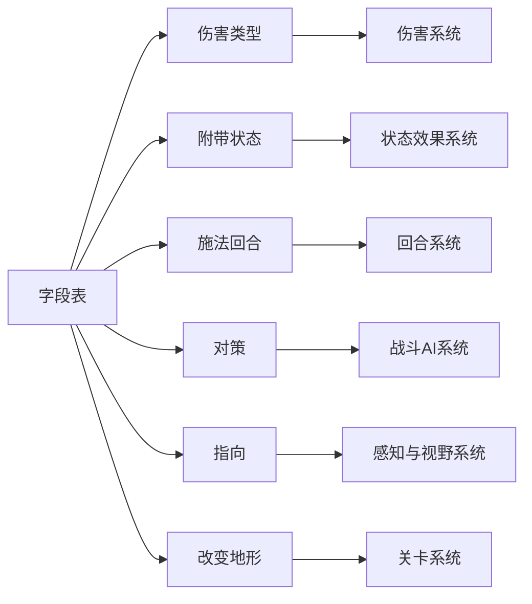

# 加一个战斗技能是填一张字段表，不是写一段代码

> **正典层级**：第 5 级（系统细化）。与[玩法正典](../canon/gameplay/玩法定位.md)冲突时以正典为准；**全部倍率、消耗量、冷却值、施放距离与概率归[数值模型](./数值模型.md)，本页一个都不定。**
>
> 返回 [总索引](../README.md)｜[系统文档与提案索引](./README.md)｜相关：[战斗与关卡](../canon/gameplay/战斗与关卡.md) · [角色与成长](../canon/gameplay/角色与成长.md) · [回合系统](./回合系统.md) · [伤害系统](./伤害系统.md) · [状态效果系统](./状态效果系统.md)｜台账：[`GP-31`](../spec/issues/README.md)

## 摘要

**这一页回答一个问题：加一个战斗技能要填哪些格子。** 读完你能判断一个新技能的字段够不够齐（填不出来的那一格通常说明它不是技能），也知道某个字段的效果该去哪一页查。

**技能不实现任何效果，它只是一张表。** 命中与伤害交给[伤害系统](./伤害系统.md)算，状态交给[状态效果系统](./状态效果系统.md)挂，轮到谁、施法回合怎么数交给[回合系统](./回合系统.md)。

**一张表装下所有人的招。** 普通攻击与防御也是这张表里的招，冷却都是 1；敌人的招也在这张表里（[战斗与关卡 · 敌人也是角色](../canon/gameplay/战斗与关卡.md)）。所以伤害那几格、对策与「放不出技能」这类状态，对敌我是同一句话。

**技能不属于任何人。** 主动技谁的属性够谁就能学，被动技谁都能读、还能由主角教会；一个角色会哪几招只记在他自己身上。

**主动技与被动技都不设数量上限。** 主动技进技能栏，技能栏不限格、不绑按键；被动技不进栏，学会的全部生效。被动技只许指一条「什么时候发生什么」或「一直给周围几格的人挂着」的状态，同一种落在同一个人身上只算最强的那一份 —— 防堆叠靠这一条，不靠数量上限。

**宝石改的是机制，不只是数字。** 判据写成可检验的形式：它换掉了这个技能的某个字段或某条行为，而不是只在某个字段上乘一个系数。

**本页不持有**：生活技能（同名不同物，见边界那一节）、技能怎么学会与练熟（[成长系统](./成长系统.md)）、回合怎么轮（[回合系统](./回合系统.md)）、伤害怎么算（[伤害系统](./伤害系统.md)）、状态的时长与叠层（[状态效果系统](./状态效果系统.md)）、谁看得见谁（[感知与视野系统](./感知与视野系统.md)）、技能栏与技能面板怎么摆（[界面系统](./界面系统.md)）。

## 术语

**无 —— 本页没有只有自己在用的词。** 字段名用的是正典[战斗与关卡 · 技能与操作：普通攻击与防御都是技能，技能栏不绑按键](../canon/gameplay/战斗与关卡.md)与[战斗与关卡 · 预警与打断](../canon/gameplay/战斗与关卡.md)里的叫法（施法回合、施放距离、范围形状、对策、类型标签这些），或者是白话；技能孔、实战值、载入校验这些在[术语表](../reference/术语表.md)里，本页不另起名词。

## 上游约束

只链接约束本页的正典与已接受的 ADR，并说明各约束本页的哪一部分。

- [战斗与关卡 · 技能与操作：普通攻击与防御都是技能，技能栏不绑按键](../canon/gameplay/战斗与关卡.md)：普通攻击与防御都是冷却 1 的技能。每一招写清占不占回合、施放距离、范围形状、施法回合、施法时能不能走、可不可以被打断、击退几格、改不改地形、用哪种兵器、带哪几个类型标签、消耗什么；范围形状归代码，兵器种类与类型标签归内容。指向一个人的招要出手的人自己看得见、在施放距离以内，范围招的落点也要看得见，队友的视野借不来。技能面板照这几格显示，描述由格子拼出来。消耗是一串，付不起的放不出来。主动技谁的属性够谁就能学；技能栏不限格、不绑按键；被动技能与天赋不占栏、不设上限。**这是本页字段表的来源，也约束选目标、消耗与技能栏那几节。**
- [战斗与关卡 · 预警与打断](../canon/gameplay/战斗与关卡.md)：每一招写一个施法回合，0 是当场生效；不为 0 的先把要打的格子标出来，格子钉在地上，以自己为中心的与写了跟着目标走的除外。写了施法时能走的，等的那几回合只能用行动力走。消耗在出手那一刻付、被打断不退，冷却从落下那一刻算。每一招声明可不可打断与对策，缺声明报错；跟着目标走的那一类对策里没有走开。**约束施法回合、施法时能不能走、跟着目标走与对策这几格。**
- [战斗与关卡 · 战斗区域的空间模型：一格一个基础单位的俯视棋盘](../canon/gameplay/战斗与关卡.md)：施放距离、范围招与「周围几格」横、竖、斜各算一格，不管中间隔着墙还是人，大个子从离得最近的那一格数。技能留在地上的效果叠一层、地面本身不动，那一层第一版不做。**约束数格子那一节，也约束改变地形那一格。**
- [战斗与关卡 · 回合：我方阶段主角先动、其余按敏捷，然后是敌方阶段](../canon/gameplay/战斗与关卡.md)：不占回合的招要在那一件之前放；冷却按自己的回合数算；写了「不引发借机攻击」的招（后撤、瞬移这类）不算走开，被击退、被推走也不算。**约束「占不占回合」与「引不引发借机攻击」**，怎么结算在[回合系统](./回合系统.md)。
- [战斗与关卡 · 误伤：范围招打到自己人减半](../canon/gameplay/战斗与关卡.md)：伤害招不能直接对自己人放；有益的范围招只作用于自己人；击退把人撞到自己人身上，那一下也算误伤。**约束作用目标那一格的取值。**
- [战斗与关卡 · 防御与失衡](../canon/gameplay/战斗与关卡.md)：防御用了身上挂「格挡」；技能都能暴击，治疗与屏障也算；反击是一条状态，谁的招都能给自己挂上它。**约束防御那一招与效果量那一格，也是招能给自己挂反击架势的来源。**
- [战斗与关卡 · 异常状态](../canon/gameplay/战斗与关卡.md)：技能声明一个施加概率，目标按那条状态的抗性减掉一部分；元素只决定这一击尝试施加哪种状态，有哪几个元素是内容；中毒、流血这类由招自己挂。**约束类型标签与「附带状态与施加概率」。**
- [战斗与关卡 · 主角的招式构成](../canon/gameplay/战斗与关卡.md)：给学生加增益的是被动技能，一直给周围几格内的队友挂着，同一种增益落在同一个人身上只算最强的那一份；真实形态整套顶替平时那一套，技能栏里换成这一套的招。**约束被动技那一节与真实形态那一节。**
- [战斗与关卡 · 敌人也是角色](../canon/gameplay/战斗与关卡.md)：敌人的定义与主角、学生同一张表，它的招就在技能那张表里；敌我之间的差别是各自声明的格。**约束本页只有一张技能表。**
- [角色与成长 · 书 → 学会 → 练熟](../canon/gameplay/角色与成长.md)：主动技能书不绑角色，前置属性够的都能读；被动技能书谁都可以；学会时实战值为 0，实战值只在命中时积累，到档位解锁技能孔与额外效果。**约束技能上不记谁能学，也约束技能孔的解锁条件。**
- [角色与成长 · 技能分两类：放出来的动作，与做事的熟练度](../canon/gameplay/角色与成长.md)：只有主动技进技能栏，被动不占、不设上限；每个技能各有自己的冷却，按自己的回合数算；生活技能不进技能栏、没有冷却与消耗。**这是「本页只装战斗技能」的依据。**
- [角色与成长 · 效果从哪来：状态是效果本身，天赋是来路之一](../canon/gameplay/角色与成长.md)：状态是效果本身，被动技能是给人挂上状态的来路之一；招能给人挂状态，格挡、反击架势就是。一直给别人挂着的增益管到周围几格由每一条自己写，同一种落在同一个人身上只算最强的那一份。**约束被动技只指一条状态、效果不在技能上另写一份。**
- [角色与成长 · 天赋与被动技能的分工](../canon/gameplay/角色与成长.md)：被动技能只能指「什么时候发生什么」或「一直给周围几格的人挂着」的状态；前一种的触发要是一件不一定发生的事，效果只管一小段。**约束被动技那几条载入校验。**
- [角色与成长 · 装备：宝物与宝石](../canon/gameplay/角色与成长.md)：技能孔在主动技能上，孔数是接口常量、按实战值档位解锁、技能孔之间不分类型；宝石只在宝石操作装置上换；宝石同时带正面与负面影响。**约束宝石那一节。**
- [ADR-0035](../decisions/ADR-0035-战斗改成俯视的格子回合制.md)：战斗是俯视的格子回合制；普通攻击与防御都是技能；主动技谁的属性够谁就能学。**约束技能上不记谁能学，也约束普通攻击与防御进这张表。**
- [ADR-0023](../decisions/ADR-0023-帧动画决定手感上限与技能归属.md)：被动技不绑角色，靠主角的教学传播。**约束被动技能书谁都能读、被动技不设数量上限。**
- [ADR-0025](../decisions/ADR-0025-取值集的家由加一个的代价决定.md)：一格能填哪些值，看加一个要不要写新代码。**约束哪几格归代码、哪几格归内容。**
- [ADR-0012](../decisions/ADR-0012-宝石的两个镶嵌目标.md)：宝石镶进宝物孔给属性、镶进技能孔改机制。**约束宝石那一节只装技能孔这一侧。**
- [ADR-0009](../decisions/ADR-0009-编辑器主导的开发模式.md)：参数唯一来源是场景与资源，代码不留能用的默认值。**约束本页的每个字段将来落成外置数据，缺字段当场报错。**

## 结构

### 一个战斗技能要声明的字段

**主动技按下面几张表填全；被动技只填「认出它的那几格」里的几格**，哪几格见「有的格按条件才填」那一节。

**认出它的那几格**

| 字段 | 填什么 | 谁读它 |
| --- | --- | --- |
| 标识 | 稳定字符串，跨存档与 mod 唯一 | 全体；存档只存标识 |
| 名称 | 文本键，真文本外置（`ENG-5`）。**没有描述那一格**：面板上的描述由下面这些格拼出来 | 技能面板 |
| 图标 | 一张图，每一招一张（仅主动技有）；图是作者画的 | 技能面板、技能栏 |
| 形态 | 主动技 / 被动技。**这一格归代码** | 本页的形态规则 |
| 指的那一条状态 | 一条状态标识（**仅被动技有**）。效果写在那条状态上，不在技能上另写一份 | 本页的被动技校验；[状态效果系统](./状态效果系统.md) |
| 普通攻击或防御 | 普通攻击 / 防御 / 都不是（仅主动技有）。**这一格归代码** | 角色定义上「学生开局会普通攻击与防御」那条校验（[成长系统](./成长系统.md)）；借机攻击与反击用的「他的普通攻击」（[回合系统](./回合系统.md)、[状态效果系统](./状态效果系统.md)）；队友 AI 挑防御的时机（[战斗AI系统](./战斗AI系统.md)） |

**往哪放、打到谁**（仅主动技有；怎么数格子见「数格子」那一节）

| 字段 | 填什么 | 谁读它 |
| --- | --- | --- |
| 指向 | 自己 / 一个人 / 一格。「自己」就是以自己为中心，范围跟着施法者走；「一个人」是指向一个人的招；「一格」是范围招的落点。**这一格归代码** | 选目标那一步；[感知与视野系统](./感知与视野系统.md)（看不看得见） |
| 作用目标 | 敌方 / 自己人，**按施放者那一侧算** —— 敌人的治疗填「自己人」。打敌方的不能直接对自己人放，范围里打到自己人按误伤算；给自己人的只作用于自己人。**这一格归代码** | 选目标那一步；[伤害系统](./伤害系统.md)（误伤） |
| 施放距离 | 几格，从施法者数到目标或落点 | 选目标那一步 |
| 范围形状 | 起步是单格、一条直线、十字、以一格为中心的一圈，外加它的大小（几格）。**这一格归代码**，加一种要写一段新的选格逻辑 | 选格；瞄准时把会被打到的人描一圈边（[界面系统](./界面系统.md)） |

**怎么出手**（仅主动技有）

| 字段 | 填什么 | 谁读它 |
| --- | --- | --- |
| 占不占回合 | 占 / 不占 | [回合系统](./回合系统.md) |
| 施法回合 | 0 是当场生效；不为 0 的出手那一回合只把要打的格子标出来。普通攻击一般写 0 | 回合系统；队友 AI 挑防御的时机 |
| 施法时能不能走 | 能 / 不能 | 回合系统 |
| 跟着目标走 | 跟 / 不跟：标出来的格子跟不跟着那个人走 | 回合系统 |
| 对策 | 一组应对办法，取值集与含义在[战斗AI系统](./战斗AI系统.md)；**含「打断」就是可以被打断**。「全部敌人合起来要覆盖到每一种对策」那条载入校验也在那一份 | 战斗AI系统；技能面板（能不能被打断） |
| 挪不挪自己 | 不挪，或者一种挪法（瞬移、冲锋、后撤这类）。**这一格归代码**，起步有哪几种挪法待定 | 回合系统 |
| 引不引发借机攻击 | 引发 / 不引发，后撤、瞬移这类写不引发 | 回合系统，借机攻击怎么结算在那一份 |

**打出去是什么**（仅主动技有）

| 字段 | 填什么 | 谁读它 |
| --- | --- | --- |
| 伤害类型 | 物理 / 魔法 / 无（不打伤害的招）。取值是正典定死的两条伤害线加「无」 | [伤害系统](./伤害系统.md) |
| 招式倍率 | 乘在攻方对应那份攻击上的系数 | 伤害系统 |
| 物理穿透、法术穿透 | **待定**：无视一部分防御现在由穿刺这个性质类标签给（正典），这两格留不留跟伤害系统一起定 | 伤害系统 |
| 类型标签 | 一组标签标识，**空是显式的空**。元素类标签决定这一下尝试挂哪种状态，性质类标签各带一条效果（穿刺、钝击、斩击这类），都由标签自己声明；在册的由外置数据给出 | 伤害系统；状态效果系统（被带某个标签的招打中时做什么）；技能面板（类型） |
| 附带状态与施加概率 | 一组状态标识（**空是显式的空**），挂在这一招作用到的人身上；外加一个施加概率，**不设上限**（可以超过 100），类型标签带来的与这里列的都按它试。格挡、反击架势这类就从这一格来 —— 指向自己的招把它们挂在自己身上 | 伤害系统的状态线（减掉抗性之后才钳）；[状态效果系统](./状态效果系统.md) |
| 效果量 | 治疗量、屏障量这类不是伤害的产出的系数，没有就显式写「无」；**也能暴击** | 伤害系统 |
| 击退几格 | 把人往外推几格，0 就是不推 | 伤害系统（撞击）；回合系统（被推走不算走开） |
| 改变地形 | 不改 / 留下一种地上效果 / 造墙 / 打碎挡路的东西。**这一格归代码**，留下哪一种地上效果是内容 | [关卡系统](./关卡系统.md) |
| 兵器 | 一个兵器种类，或显式的「无」。它只决定放哪段特效、配什么声音（正典） | 放特效、配声音的表现那一侧 |

**代价与成长**

| 字段 | 填什么 | 谁读它 |
| --- | --- | --- |
| 消耗 | 一串「什么 ＋ 多少」：HP、MP、背包里的某样东西，几样一起也行；**空是显式的空** | 本页的消耗规则；[背包系统](./背包系统.md)（扣背包里那一样） |
| 冷却 | 几个自己的回合，**并各自带一个不为零的下限** | 本页的冷却规则；回合系统 |
| 技能孔数 | 接口常量，家在正典（仅主动技有） | 本页的宝石规则。**宝物那一侧另有宝物孔**，见[装备系统](./装备系统.md) |

下面这张图回答一个问题：**填进这几张表的字段最后被谁读走。** 「技能不实现任何效果」这句话的分量全在图的右半边 —— 箭头只往外走，没有一条回到本页。

**重画条件**：字段表多一类字段、某类字段改由别的系统读，或者本页开始自己算某个字段时重画。

**这张图不新增任何事实，权威是上面那几张表。** 每个字段填什么、必填与否、以及「谁读它」那一栏的完整答案都在表里。

**字段表就是加技能的清单。** 填不出「伤害类型」说明它不打伤害（填「无」），类型标签与附带状态是空的说明它不挂状态 —— 都合法，但**必须显式填**，不许缺字段靠默认值兜底（`ADR-0009`）。

**形态、普通攻击或防御、指向、作用目标、范围形状、挪不挪自己与改变地形这几格，还有消耗能花哪几种东西，按 [ADR-0025](../decisions/ADR-0025-取值集的家由加一个的代价决定.md) 归代码。** 加一个取值算一次改设计、要先立项。判据套上去的结果很直接：加一种范围形状要一段新的选格逻辑（谁在线上、边界怎么算、打到第几个停），加一种形态要一整套新的规则（进不进技能栏、有没有数量上限、能不能镶宝石），加一种挪法要一段新的走位判定，消耗多一种东西要写它怎么扣、怎么判付不付得起。都是新逻辑，不是多一条数据。

- **这几格都是对[玩法定位 · mod 的扩展边界](../canon/gameplay/玩法定位.md)那条承诺的实质收窄，所以要写在这里。** 不写的后果很具体：照那条承诺往外置数据里填一种新的范围形状的人会发现它不工作，**而报不报错取决于实现怎么写**。所以另配一条载入校验 —— **填一个不在册的取值时被拒**，并说清它不在册。
- **形态刻意不拆成几项能力声明。** 按 [ADR-0018](../decisions/ADR-0018-内容定义按声明扩展.md) 的思路，「进不进技能栏／能不能镶宝石」本可以各成一项声明，加一种形态就只是换一组取值。**否决理由是拆开之后「哪几种组合是合法的」从此没有家** —— 例如「进技能栏但不能镶宝石」算不算一种合法形态，下面形态那一节的表答得出来，拆了就答不出来，而一个非法组合只表现为行为古怪、**不报错**。
- **它与类型标签那一格的分别正好说明这条判据不是一刀切**：一个标签只指一条效果，形态指的是一整套规则。

**类型标签与兵器种类能填哪些值，按 [ADR-0025](../decisions/ADR-0025-取值集的家由加一个的代价决定.md) 归内容。** 一个元素类标签只声明它施加哪一条状态，一个性质类标签只声明它那一条效果，一种兵器只声明放哪段特效、配什么声音；加一个都不需要新逻辑，所以本页不列名字。**填了一个不在册的标签或兵器种类时载入被拒**，并说清它不在册。起步量见[玩法定位 · 内容规模基准](../canon/gameplay/玩法定位.md)。

**本页不定义这些字段怎么被算。** 倍率怎么进结算、概率的上下限卡在哪、误伤怎么减半，全在[伤害系统](./伤害系统.md)；施法回合怎么数在[回合系统](./回合系统.md)。本页只保证技能把它们说清楚了。

### 有的格按条件才填，填错在载入时就被拒

**一格只在它有意义的时候填。** 没意义的格填了，读的人会以为它起作用；有意义的格缺了，就会落到一个谁都没定过的默认值上（[ADR-0009](../decisions/ADR-0009-编辑器主导的开发模式.md)）。所以下面每一条都是载入校验，填错一律被拒，并说清是哪个技能、哪一格。

- **被动技**只填标识、名称、形态与「指的那一条状态」，别的格填了被拒；主动技反过来不许填「指的那一条状态」。
- **施法时能不能走**：施法回合为 0 的不许填，不为 0 的必填。
- **跟着目标走**：只有指向「一个人」、施法回合不为 0 的才填，而且必填；别的不许填。写了跟着目标走的，**对策里不许有走开** —— 正典写明这一类刻意走不开，只能防御或打断。
- **施放距离**：指向「自己」的不许填，别的必填。
- **范围形状的大小**：单格不许填，别的必填。
- **引不引发借机攻击**：挪自己的招必填，不挪的不许填。
- **招式倍率**：伤害类型填「无」的不许填，别的必填。
- **普通攻击与防御**：标成普通攻击或防御的，冷却与下限都必须是 1（正典：它们是冷却 1 的技能）；标成防御的，指向必须是「自己」、附带状态里必须有格挡（正典：用了身上挂格挡）。

**施法回合为 0 的招，对策该填什么待定**：没有标出来的那几回合，走开与打断都来不及。

### 主动技进技能栏，被动技不进，都不设数量上限

| 形态 | 进技能栏吗 | 有数量上限吗 | 能镶宝石吗 |
| --- | --- | --- | --- |
| 主动技 | **进**，技能栏不限格，学会的都放得上 | 无 | 能，技能孔按档位开 |
| 被动技 | 不进 | 无，学会的全部生效 | 不能 |

- **主动技要放出来，所以进技能栏**；被动技一直生效、没有「放」这个动作，所以不进栏。宝石只镶主动技也是同一个理由：宝石改的是「这一招放出来是什么样」。
- **技能栏不限格、不绑按键**（[战斗与关卡 · 技能与操作：普通攻击与防御都是技能，技能栏不绑按键](../canon/gameplay/战斗与关卡.md)）。所以「出征前挑哪几招带进去」这个取舍不存在，构筑的分量落在读哪本书、学哪一招上 —— 这是正典写明的代价。
- **技能栏显示的是当前操作的那个人会的主动技**：接管学生时换成他的招，真实形态时换成那一套（正典）。栏怎么排、怎么翻页在[界面系统](./界面系统.md)。
- **不设数量上限不等于随便叠**：被动技靠「同一种落在同一个人身上只算最强的那一份」，见下面被动技那一节。
- **这与天赋点总量上限不冲突**：那条管「你能点几个节点」，本条管「学会的要不要挑着装」。

### 技能不属于任何人：谁会哪一招只记在角色身上

**技能上不记「谁能学」。** 主动技能书写着前置属性，谁的属性够谁就能学；被动技能书谁都能读（[角色与成长 · 书 → 学会 → 练熟](../canon/gameplay/角色与成长.md)、[ADR-0035](../decisions/ADR-0035-战斗改成俯视的格子回合制.md)）。理由在正典：施法时小人只朝目标冲一下，出了什么招由头顶上方那段大家共用的特效说，没有哪一招只对某一个人的身体成立。

- **「会」只记在角色身上。** 名册上的角色开局会的写在角色定义的「初始技能」那一格，此后靠书学会；被动技还能由主角授课教会（产出接在[教育系统](./教育系统.md)，本页不实现）。敌人不读书、不跨关存在，**它会哪几招就是那一格里的那些**（[成长系统](./成长系统.md)）。
- **只有敌人会用的招，就是没有哪本书教它**，例如复活尸体（[战斗与关卡 · 尸体与资源点：都有血条，打碎它的人拿东西](../canon/gameplay/战斗与关卡.md)）。不为它另加一格「敌人专用」：有没有书教它已经说清了，再加一格就是同一件事的第二个家。
- **普通攻击与防御也是这张表里的招。** 学生开局就会普通攻击与防御，主角另带他的基础技能（[玩法定位 · 开局](../canon/gameplay/玩法定位.md)）。学生的角色定义上缺其中一招时载入报错，那条校验在[成长系统](./成长系统.md)，它读的是「普通攻击或防御」那一格。
- **一个角色会几招普通攻击、借机攻击与反击用的是哪一招，待定。**
- **本页不给被动技加数量上限。** 被动技传开之后人人挂满这件事，压住它的是教学一天一次那个时间成本与被动技的总条数，代价与风险写在 [ADR-0023](../decisions/ADR-0023-帧动画决定手感上限与技能归属.md)；同一种叠在一个人身上，则由「只算最强的那一份」挡住。

### 数格子：横、竖、斜各算一格，选人还要自己看得见

- **施放距离与范围都按格数算**：横、竖、斜各算一格，所以「周围几格内」是一块方形；数的时候不管中间隔着墙还是人；占几格的大个子，从它离得最近的那一格数（[战斗与关卡 · 战斗区域的空间模型：一格一个基础单位的俯视棋盘](../canon/gameplay/战斗与关卡.md)）。
- **指向「一个人」的招**：目标要在出手的人自己看得见的地方、也在施放距离以内才选得上。**指向「一格」的范围招**：落点也一样要看得见、在施放距离以内（[战斗与关卡 · 技能与操作：普通攻击与防御都是技能，技能栏不绑按键](../canon/gameplay/战斗与关卡.md)）。正典只要求落点看得见，所以范围铺到看不见的格子里照样打得到。
- **「自己看得见」读的是出手那个人自己的视野，不是阵营的并集。** 队友看见的敌人会显示出来，但借不来打（正典），理由是躲在墙后的敌人得走过去才打得到，站位才有意义。视野怎么算在[感知与视野系统](./感知与视野系统.md)，那一份要给得出「这个人自己看不看得见那一格」。
- **范围里打到谁由作用目标那一格定**：打敌方的不能直接对自己人放，范围里打到自己人按误伤算；给自己人的只作用于自己人，不会加到敌人身上（[战斗与关卡 · 误伤：范围招打到自己人减半](../canon/gameplay/战斗与关卡.md)）。减半怎么算在[伤害系统](./伤害系统.md)。
- **起步那几种范围形状各自怎么铺格子，待定**：一条直线从哪一格起、朝哪个方向铺，以一格为中心的一圈包不包中间那一格，跟第一份写战斗代码的需求一起定。

### 击退推的是站位，改变地形改的是地上那一层

- **击退几格**：写了击退的招把人往外推那么多格；撞上墙、物件或别人时，撞的与被撞的都扣血；推进岩浆、毒池就吃那一格地形的效果；撞到自己人那一下按误伤算（[战斗与关卡 · 技能与操作：普通攻击与防御都是技能，技能栏不绑按键](../canon/gameplay/战斗与关卡.md)）。理由在正典：击退推的是站位，所以它是一种打法，不只是一个数。
- **击退只声明推几格，后果各有各的家。** 撞击扣多少血、记下是谁推的在[伤害系统](./伤害系统.md)（推进岩浆、被撞死的，掉落算推他的人的）；被推走不算走开、不引发借机攻击，在[回合系统](./回合系统.md)；那一格地形有什么效果写在地形上（[关卡系统](./关卡系统.md)）。
- **往哪个方向推，待定。**
- **改变地形**：不改，或者在打到的格子上留下一种地上效果、造墙、打碎挡路的东西（正典）。留下的效果落在叠在地形上面的那一层，地面本身不动；那一层第一版不做（[战斗与关卡 · 战斗区域的空间模型：一格一个基础单位的俯视棋盘](../canon/gameplay/战斗与关卡.md)）。
- **墙与碎掉的东西落在地形与物件上**，那一侧在[关卡系统](./关卡系统.md)；墙留多久、打碎挡路的东西按什么算，待定。

### 消耗是一串，付不起就放不出来

- **一招的消耗是一串「什么 ＋ 多少」**：HP、MP、背包里的某样东西，几样一起也行，也可以是显式的空（[战斗与关卡 · 技能与操作：普通攻击与防御都是技能，技能栏不绑按键](../canon/gameplay/战斗与关卡.md)）。
- **付不起其中任何一样，整招放不出来，一样都不扣。** 花 HP 的，付完会倒下的也放不出来，所以不会把自己耗死（正典）。
- **消耗在出手那一刻就付**，被打断不退（[战斗与关卡 · 预警与打断](../canon/gameplay/战斗与关卡.md)）。
- **背包里的那一样从施法者自己的背包里扣**，扣法在[背包系统](./背包系统.md)。
- **能花哪几种东西归代码**（[ADR-0025](../decisions/ADR-0025-取值集的家由加一个的代价决定.md)）：加一种要写它怎么扣、怎么判付不付得起。正典写明以后还能加别的，所以这张取值表会长，而**长出来的每一格都通向代码**；外置数据里填一种不在册的东西**载入被拒**。花多少是内容。

### 冷却：每个技能各有下限

- **冷却是技能自己的字段，按自己的回合数算**：冷却 N 就是用过之后，过 N 个自己的回合才能再用；施法回合不为 0 的，冷却从落下那一刻开始算（[战斗与关卡 · 预警与打断](../canon/gameplay/战斗与关卡.md)）。回合怎么数在[回合系统](./回合系统.md)。
- **每个技能各带一个不为零的冷却下限。** 减冷却的来源（天赋、宝石、状态）叠起来只能压到这个下限，压不到零 —— 正典给天赋写的就是「冷却少一回合，冷却的下限照旧」。没有下限的话，减冷却堆满就等于这一招想放就放：不占回合的能在那一件之前一直放，占回合的成了每回合都放的默认动作。
- **下限按技能各给一个，不是一个统一值。** 一个短促的标记与一个大范围控场招，「最快多久能再放一次」本来就不该一样。
- **普通攻击与防御的冷却是 1**（正典），下限也只能是 1。
- **被打断的那一招，冷却从哪一刻算，待定**：正典只写了落下的那一种。
- 冷却值与各自的下限归[数值模型](./数值模型.md)。

### 被动技只指一条状态，同一种落在一个人身上只算最强的那一份

**被动技自己不带效果，它是给人挂上一条状态的路**（[角色与成长 · 效果从哪来：状态是效果本身，天赋是来路之一](../canon/gameplay/角色与成长.md)）。一个被动技只填它指的那一条状态，效果写在那条状态上，敌人、学生、宝物与招用的是同一条定义。

- **那条状态只许是「什么时候发生什么」或「一直给周围几格的人挂着」**；指「一直给自己加的」那一种时载入被拒，那一种归天赋树上的节点（[角色与成长 · 天赋与被动技能的分工](../canon/gameplay/角色与成长.md)）。每条状态是哪一种由它自己写明，结构在[状态效果系统](./状态效果系统.md)。
- **「什么时候发生什么」那一种另有载入校验**（正典）：
  - **触发要是一件不一定发生的事**：光秃秃的「回合开头」被拒，带条件的（回合开头、身边一圈没有敌人）可以。哪几种触发条件算必然发生，跟触发条件那张取值表一起定，那张表在[状态效果系统](./状态效果系统.md)。
  - **效果只管一小段**：这一下、到下一回合，或者一层用完就没的屏障；一挂就是一整场的被拒。
  - 理由在正典：只查「同一条状态别两边都给」，挡不住名字不同、结果却一样的状态，例如天赋「每回合自然回的 HP 多一点」与被动「回合开头回一点 HP」。
- **「一直给周围几格的人挂着」那一种**：管几格由那条状态自己写，数法与施放距离一样、不看视线；走进那几格就挂上，走出去就掉；**同一种落在同一个人身上只算最强的那一份，不同种的照常一起生效**（正典）。进出与取最强那一份怎么算，在[状态效果系统](./状态效果系统.md)。
  - 主角给学生加的增益就是这一种（[战斗与关卡 · 主角的招式构成](../canon/gameplay/战斗与关卡.md)）：学生得靠近他才吃得到，所以他站在哪儿有分量。
- **防堆叠靠的就是「只算最强的那一份」，不靠数量上限。** 几个人带着同一种，落在一个学生身上也只算一份；不同种的叠起来，换来它们的是不同的书与不同的课。

### 宝石：改机制，不只是改数字

**本节只装技能这一侧。** 宝石镶在哪里决定它做什么（[ADR-0012](../decisions/ADR-0012-宝石的两个镶嵌目标.md)）：镶进**宝物孔**提高属性，镶进**技能孔**改变技能机制。宝石自己是什么、宝物孔怎么开，都在[装备系统](./装备系统.md)；本页持有的是技能孔。

- **技能孔在主动技能上**，每个技能几个孔是接口常量（家在[角色与成长 · 装备：宝物与宝石](../canon/gameplay/角色与成长.md)，本页不复述那个数），**技能孔之间不分类型** —— 任何声明了机制侧的宝石能进任何技能孔。分类型是在已有的正负面词条之上再加一层约束，收益不抵复杂度。
- **技能孔按实战值档位解锁。** 实战值只在命中时积累（[角色与成长 · 书 → 学会 → 练熟](../canon/gameplay/角色与成长.md)），所以「把一个技能练精」的回报不只是数字变大，还是构筑空间变大。档位阈值归[数值模型](./数值模型.md)。
- **哪一档开第几个孔：一档一个，按顺序。** 第一档开第一个孔，此后每升一档再开一个。**孔数与档数各是一个接口常量、各有各的家** —— 孔数在[角色与成长 · 装备：宝物与宝石](../canon/gameplay/角色与成长.md)，档数就是参数表里那串阈值的长度（`growth.skill_use_value_tiers`）；**本页只定它们之间的对应，一个数都不复述。** 按档位一档一个是唯一不用另存一张对应表的做法 —— 写成表就要在加一档或改一次孔数时回来改它，而漏改不报错。
- **孔数取下界的技能，最后那一档给的是额外效果而不是孔。** 正典写的是「到达档位时解锁技能孔**与额外效果**」，所以那一档不是空的，它兑现的正是那半句。**额外效果由技能自己声明**，用字段表里已有的那几格（附带状态与施加概率、效果量）就写得出来，**不为它加新字段**；具体给什么是内容。
- **一条载入校验**：技能声明的孔数**大于**档数时被拒，并说清是哪个技能。那样最上面那几个孔永远开不了，**而它不报错**。
- **宝石只在宝石操作装置上换**：镶进去、替换、取下来都在它上面做，所以出征在外换不了（[角色与成长 · 装备：宝物与宝石](../canon/gameplay/角色与成长.md)）。
- **宝石同时带正面与负面影响**，它声明的每一侧都要各自带负面，理由在[装备系统](./装备系统.md)。
- **只有声明了机制侧的宝石进得了技能孔**，缺那一侧的被拒。这不是一条分类规则，而是声明推出来的（[ADR-0012](../decisions/ADR-0012-宝石的两个镶嵌目标.md)）。
- **「改机制」的判据**：它**换掉了这个技能的某个字段，或加了一条这个技能本来没有的行为**。只在某个字段上乘一个系数的不算改机制。
  - 算改机制的例子：把伤害类型从物理换成魔法；给一个本来没有类型标签的招加上一个元素类标签；把范围形状从单格换成十字；给它加上击退；让一招挪自己的招不再引发借机攻击。
  - 不算的例子：只把倍率调高一点。
  - **这条判据可检验**，所以它能当成内容审查的入口：一颗宝石如果只动了一个系数，它该做成宝物的词条，而不是宝石。

### 真实形态是另一套面板，整套顶替

- **主角有平时与真实形态各一套招，一次只有一套在生效**（正典：真实形态是完全独立的属性与招式面板）。技能栏里换成这一套的招，玩家没得挑（[战斗与关卡 · 主角的招式构成](../canon/gameplay/战斗与关卡.md)）。
- **那一套不计实战值、不开技能孔。** 实战值只在命中时积累，而真实形态全作出现极少数次，练不起来；宝石是构筑的结果，而这一套不是构筑。
- **两套的冷却各记各的，切换不清零、不共享。** 清零等于送一次免费重置；共享要回答「两套招怎么一一对应」，而它们根本不对应。
- **它怎么被开启不在本页**：第一周目由剧情触发，第二周目靠星火积分解锁成一个可主动开启的技能（[多周目系统](./多周目系统.md)）。本页只持有「它是一套顶替上来的招」。

## 接口

| 挂载点 | 位置 |
| --- | --- |
| 命中、伤害、暴击、误伤减半、撞击扣血、记下是谁推的 | [伤害系统](./伤害系统.md)，本页只声明字段 |
| 状态挂上去之后：时长、叠层、每条状态是哪一种、一直给周围几格的进出与只算最强的那一份 | [状态效果系统](./状态效果系统.md)，本页不实现效果 |
| 占回合与那一件、施法回合怎么数、等的那几回合只能用行动力走、借机攻击怎么结算、冷却怎么过 | [回合系统](./回合系统.md)，本页只给它字段 |
| 选目标时，这个人自己看不看得见那一格 | [感知与视野系统](./感知与视野系统.md) |
| 敌人什么时候放哪一招；对策那一格的含义、取值集与覆盖校验 | [战斗AI系统](./战斗AI系统.md)；**对策填在本页字段表上**，判法在那一份 |
| 撞上什么、推进去吃什么效果、墙与挡路的东西 | [关卡系统](./关卡系统.md)；地上效果那一层的规则在[战斗与关卡 · 战斗区域的空间模型：一格一个基础单位的俯视棋盘](../canon/gameplay/战斗与关卡.md)，第一版不做 |
| 技能栏、技能面板、瞄准时把会被打到的人描一圈边、描述怎么拼成句子 | [界面系统](./界面系统.md)；面板每一项读哪一格见下面那张表 |
| 出手那一下小人怎么动 | [角色动作状态系统](./角色动作状态系统.md)，本页不碰 |
| 被动技怎么被教出去 | [教育系统](./教育系统.md)的授课产出，本页只声明技能上不记谁能学 |
| 技能书：前置属性、读完消耗 | [教育系统](./教育系统.md)与[成长系统](./成长系统.md) |
| 攻击力、效果量的来源 | 属性派生，[成长系统](./成长系统.md)（`GP-30`） |
| 实战值与档位 | 同上；本页只读「解锁到第几档」 |
| 一个角色会哪几招；学生缺普通攻击或防御时报错 | [成长系统](./成长系统.md)的角色定义，读本页「普通攻击或防御」那一格 |
| 宝石自己是什么、宝物孔 | [装备系统](./装备系统.md) |
| 消耗里背包那一样怎么扣 | [背包系统](./背包系统.md) |
| 「这个技能见过没有」 | [图鉴系统](./图鉴系统.md)，按定义收录、学会那一刻置位；**本页不加字段** |
| 技能、类型标签、兵器种类与宝石的内容 | 内容外置（`ENG-5`），起步清单在 `GP-89` |
| 全部数值 | [数值模型](./数值模型.md) |
| **作者画的** | 每一招的图标、每种兵器的那段特效（画法在[像素绘制原则](../production/像素绘制原则.md)）。技能本身是一张外置数据表，不是场景或资源上的导出属性（[ADR-0009](../decisions/ADR-0009-编辑器主导的开发模式.md)） |

**挂载点到此为止。** 下次加一样与「技能能做什么」有关的东西时，先问「它是一个新字段，还是上面某个挂载点那边的事」。

### 技能面板上的每一项读哪一格

正典定了技能面板照哪几项显示，描述由格子拼出来、不另写一份（[战斗与关卡 · 技能与操作：普通攻击与防御都是技能，技能栏不绑按键](../canon/gameplay/战斗与关卡.md)）。下面这张表是每一项读的格。

| 面板上 | 读哪一格 |
| --- | --- |
| 名称、图标 | 名称、图标 |
| 类型 | 伤害类型加类型标签，拼成「魔法·火焰」这样 |
| 描述 | 由格子拼出来。正典点名的是击退几格、对策里有没有打断、施法时能不能走、改变地形；占不占回合、跟着目标走、引不引发借机攻击与附带状态拼不拼进去，由[界面系统](./界面系统.md)定 |
| 范围 | 施放距离与范围形状 |
| 冷却回合 | 冷却 |
| 施法回合 | 施法回合 |
| 消耗 | 消耗那一串 |

**描述不另写一份**，理由在正典：另写一份迟早跟格子对不上。所以字段表里没有描述那一格，而一个新技能说不清自己做什么的时候，缺的是一格，不是一段文字。

### 它不碰的那几条接缝

- **不碰效果本身。** 伤害交给[伤害系统](./伤害系统.md)算、状态交给[状态效果系统](./状态效果系统.md)挂、小人出手那一下怎么动交给[角色动作状态系统](./角色动作状态系统.md)。
- **不碰回合。** 占回合与那一件、施法回合怎么数、借机攻击怎么结算都在[回合系统](./回合系统.md)，本页只给它字段。
- **不碰敌人怎么挑招。** 敌人的招就在本页这张表里，但它什么时候放哪一招是[战斗AI系统](./战斗AI系统.md)的事；对策那一格怎么判也在那一份。
- **不碰视野。** 选目标要的「这个人看不看得见那一格」由[感知与视野系统](./感知与视野系统.md)给，本页不算。
- **不碰生活技能。** 同名不同物，见边界那一节。
- **不碰「怎么学会」与实战值怎么涨。** 那些在[成长系统](./成长系统.md)，本页只读「解锁到第几档」。
- **不碰操作。** 键鼠与手柄怎么点技能栏、翻页、右键看说明归[界面系统](./界面系统.md)，正典只定操作结构。

## 边界与非目标

- **不定任何数值**：倍率、消耗量、冷却与各自的下限、施放距离、范围的大小、击退几格、施法回合、施加概率、效果量、宝石档位阈值全归[数值模型](./数值模型.md)；每一招各填多少跟着技能内容走。
- **不定内容**：有哪些技能、类型标签、兵器种类与宝石属内容，走内容外置（`ENG-5`），起步清单在 `GP-89`。量级基准见[玩法定位 · 内容规模基准](../canon/gameplay/玩法定位.md)。
- **同名不同物，本页只装一半**：「技能」在正典里同时指**战斗技能**与**生活技能**。生活技能是一个熟练度等级，不进技能栏、没有冷却与消耗，它的曲线与等级效果归[成长系统](./成长系统.md)（`GP-30`）。两者同时出现时写全名。
- **「形态」也是同名不同物**：本页的形态是主动技与被动技那一格，与主角的真实形态不是一回事；说到后者一律写全「真实形态」。
- **「效果」在本页有好几处**：效果量是治疗、屏障的系数，改变地形留下的是地上效果，练到最后一档给的是额外效果，性质类标签各带的也叫效果；出现时各写全名。
- **不做技能等级。** 技能不另设一条等级线，强度只靠实战值档位与宝石。再加一条等级就有两个「这招多强」的来源，而其中一个查不到出处。
- **不做技能树。** 构筑分支由天赋承载（[角色与成长 · 特质与天赋](../canon/gameplay/角色与成长.md)），技能靠书获得。两套分支会互相稀释。
- **不做宝石合成与洗练**：宝石的获取走掉落与购买，不做「三颗合一颗」。

## 理由与取舍

- **没选给被动技设数量上限。** 那是一道玩家看不出原因的墙：他只会发现「再学一个就没生效」。防堆叠交给「同一种落在同一个人身上只算最强的那一份」：叠不起来的是同一种，叠得起来的不同种，各要一本书或一堂课去换。
- **没选让被动技必带负面。** 宝物与宝石要带负面，是因为它们换起来不花代价，不带负面就只剩堆数值这一个答案；被动技学会了就一直在，代价付在拿到它的路上 —— 书全作只出一本，教给学生要占一次授课。
- **没选让被动技自己带效果。** 正典的做法是状态是效果本身：吸血只定义一次，被动技、宝物、特质与精英用的是同一条；被动技再写一份，迟早有一份跟别的对不上。
- **没选让被动技也进技能栏。** 被动技没有「放」这个动作，进了栏只是占一格看的东西；技能栏又不限格，也就没有「挑哪几个装上」可以换。
- **没选在技能上记「谁能学」。** 施法时小人只冲一下、特效大家共用，一招不再只对某一个人的身体成立；记了就有两个家（书上的前置属性与技能上的名单），而两处对不上时不报错。代价写在正典：一本主动技能书不再「天生就是某个学生的」，要靠前置属性分出谁更适合。
- **没选让普通攻击与防御另成一套。** 写成技能之后，伤害那几格、施法回合、对策与面板都只有一个家；另成一套就要把这些格再抄一遍，借机攻击与反击读的「他的普通攻击」也就有了两种来路。
- **没选给技能写一段描述文本。** 描述由格子拼出来；另写一份迟早跟格子对不上，而那不报错（正典）。
- **没选一个全局冷却下限。** 一个标记和一个控场大招的最短间隔本来就不该一样；全局下限要么把短招卡死，要么对大招形同不存在。
- **没选让技能孔里的宝石只改数字。** 那样它与宝物词条就是同一种东西的两个入口，玩家分不清该去哪找加成。**分工按孔的种类划**：宝物孔回答「强多少」，技能孔回答「变成什么样」（[ADR-0012](../decisions/ADR-0012-宝石的两个镶嵌目标.md)）。
- **没选给技能加等级线。** 实战值已经是那条线（命中才涨，堵掉刷子路线）。再加一条等级就有两个来源，而升级那条会把「你真的用过」这个意思冲掉。
- **没选给敌人的招另开一张表。** 敌人也是角色（[战斗与关卡 · 敌人也是角色](../canon/gameplay/战斗与关卡.md)），并进同一张表之后，伤害那几格、施法回合与对策对敌我是同一组格，「放不出技能」这类状态也不用对它另说一遍；敌我差别只是各自填的值。
- **没选让技能自己实现效果。** 每个技能自带一段逻辑短期最快，但那样结算顺序会有一百个版本，「为什么这招无视防御」就没人答得上来。字段表加固定的结算，是同一个防重构判据的另一次应用。

## 验收

**可自动验证项**（纯规则层，与引擎无关）：

- 字段完整性：缺任一必填字段的技能定义**载入时被拒**，报错说清缺哪个 —— 不许用默认值兜底。
- **按条件才填的格**（上面那一节，每条一条用例）：该填却缺、不该填却填了，各**被拒**；按条件填对的**载入通过**（反向反证）。
- **在册**：形态、普通攻击或防御、指向、作用目标、范围形状、挪不挪自己、改变地形与消耗能花的东西，各填一个没有实现的取值时**载入被拒**并说清它不在册；类型标签与兵器种类填一个不在册的也**被拒**；在册的、显式的空与「无」**载入通过**（反向反证）。**归代码的与归内容的读的不是同一份**：前者查代码里实现了哪几个，后者查外置数据那份册。
- **一张表装下所有人的招**（一条结构约束）：找不到专给敌人的招式类型，也找不到记在技能上的「谁能学」名单 —— 角色定义上只有「会」。
- 普通攻击与防御：冷却或下限不是 1 时**被拒**；标成防御的，指向不是自己、或附带状态里没有格挡时**被拒**。
- 选目标：指向一个人的招，目标在施放距离内而出手的人自己看不见时**选不上**，看得见而在距离外时也**选不上**；**队友看得见、自己看不见时选不上**（反证：视野借不来）。范围招落点看不见时**选不上**；落点看得见而范围铺进看不见的格子时，那几格里的人**照样打到**。
- 数格子：斜着一格与横着一格算的距离一样；隔着墙的目标照数距离，只是还要看得见；大个子从离得最近的那一格数。
- 作用目标：打敌方的招指向一个人时，自己人**选不上**；给自己人的范围招，范围里的敌人**不受影响**。
- 消耗：HP、MP、背包里的东西各一条「付不起就放不出来」；几样一起时缺一样整招放不出来、**一样都不扣**；花 HP 的，剩下的 HP 正好等于消耗时**放不出来**；被打断之后消耗不退。
- 冷却：每个技能的下限必须存在且不为零，缺失或为零的定义**载入时被拒**；把减冷却的来源叠到极端，实际冷却也不会低于这个技能自己的下限。冷却 1 的每个自己的回合都用得了，冷却 2 的用过之后要隔一回合（回合怎么数的用例在[回合系统](./回合系统.md)）。
- 被动技：指「一直给自己加的」状态时**被拒**；指的「什么时候发生什么」触发是光秃秃的回合开头时**被拒**，带条件的回合开头**通过**（反证）；效果挂一整场的**被拒**。「同一种只算最强的那一份」的用例在[状态效果系统](./状态效果系统.md)，被动技只是它的来路之一。
- 形态：学会再多的主动技都放得上技能栏，学会再多的被动技都全部生效，都**不被拒**；被动技不进技能栏。
- 形态没有被拆开：代码里**读不到「进不进技能栏」这类可以独立设置的位**（一条结构约束 —— 它钉住那几样仍然由形态一并决定，见上面那条否决理由）。
- 真实形态那一套：生效时**整套顶替**技能栏里的招；给它的招镶宝石**被拒**；关卡里命中**不让它涨实战值**；在两套之间切一次，平时那套的冷却**一格没变**。
- 施加概率不设上限：声明概率 ≥100 的技能定义**载入通过** —— 这条反证钉的是「钳制只发生在减掉抗性之后」（[伤害系统](./伤害系统.md)）。
- 技能孔解锁：实战值未到档位时镶嵌**被拒**；到档位后孔位数按档位增加，**一档一个、按顺序**。
- 孔数取下界的技能：走完全部档位之后它**仍然少一个孔**，而最后那一档给出的是它声明的额外效果。
- 孔数不得多于档数：声明的孔数大于档数的技能定义**载入被拒**，并说清是哪个技能。
- 只有声明了机制侧的宝石进得了技能孔：只声明属性侧的宝石镶进技能孔**被拒**（另一侧那条反证在[装备系统](./装备系统.md)）。
- 宝石只进主动技：往被动技上镶宝石**被拒**。
- 交出去而不是自己实现：技能施放时调的是[伤害系统](./伤害系统.md)的结算入口与[状态效果系统](./状态效果系统.md)的施加入口（可用替身验证被调用），本页不自己改 HP、不自己改地形。

**必须实机确认项**：面板上由格子拼出来的描述，玩家读完说不说得出这一招做什么；宝石换掉一个字段之后「这招变了」看不看得出来；起步那几种范围形状够不够用。按 [ADR-0009](../decisions/ADR-0009-编辑器主导的开发模式.md) 的分工由作者实机看。

**完成边界**：字段表落成外置数据的结构，按条件才填的格、在册与被动技那几条载入校验各有测试，冷却下限与技能孔按档位解锁各有测试。做到这些，后面加技能就只是填表。

## 下游同步

- **代码**：字段表落成技能定义的外置数据（`ENG-5` 那条既有路径）；载入校验、冷却与消耗规则落规则层；施放接[回合系统](./回合系统.md)与[伤害系统](./伤害系统.md)。
- **数值**：每一招各填的数（倍率、消耗量、冷却与下限、施放距离、范围的大小、击退几格、施法回合、施加概率、效果量）跟着技能内容走，校准归[数值模型](./数值模型.md)（`GP-7`）；实战值的档位阈值在参数表 `growth.skill_use_value_tiers`。
- **台账**：立项在 [`GP-31`](../spec/issues/README.md)；伤害结算在 `GP-32`，属性派生与实战值在 `GP-30`，状态载体在 `GP-18`，敌人怎么挑招在 `GP-36`，起步技能与宝石清单在 `GP-89`。
- **该上升进正典的**：只有一条 —— **「宝石改机制」的那条判据**（换掉一个字段或加一条行为，不是乘一个系数）。等真有几颗宝石、证明这条分得清之后，上升进[角色与成长 · 装备：宝物与宝石](../canon/gameplay/角色与成长.md)。字段表与那几条载入校验按定义不进正典。
