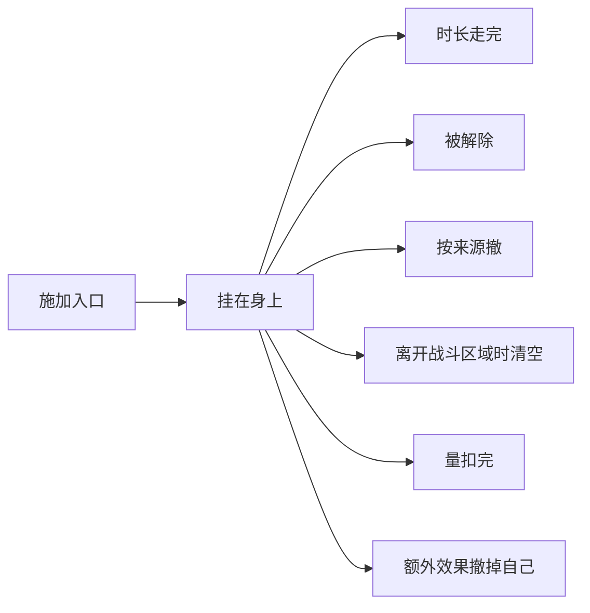
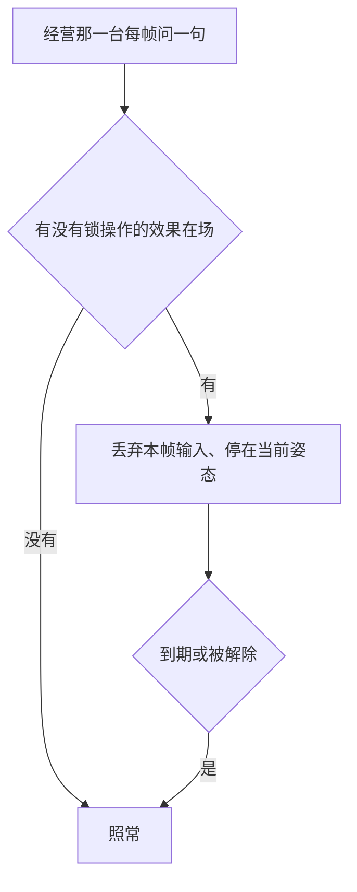

# 一份载体装下全部修饰：能并存的归这里，一次只能一个的归动作机

> **正典层级**：第 5 级（系统细化）。与[玩法正典](../canon/gameplay/玩法定位.md)冲突时以正典为准；**每条状态最多几层、最多持续多久见 [desc/状态.md](../../desc/状态.md)，desc 没给的时长、层数、量级与阈值归[数值模型](./数值模型.md)，本页一个都不定。**
>
> 返回 [总索引](../README.md)｜[系统文档与提案索引](./README.md)｜相关：[角色动作状态系统](./角色动作状态系统.md) · [回合系统](./回合系统.md) · [伤害系统](./伤害系统.md) · [技能系统](./技能系统.md) · [玩法定位](../canon/gameplay/玩法定位.md) · [战斗与关卡](../canon/gameplay/战斗与关卡.md)｜台账：[`GP-18`](../spec/issues/README.md)，写着待定的那几处归 [`DOC-160`](../spec/issues/README.md)

## 摘要

**这一页回答一个问题：一个角色身上现在挂着什么。** 读完你能判断：一样新的效果该不该挂在这份载体上（判据只有一句：能同时好几个的挂这里），以及一条「这个状态什么时候消失」的疑问该去查哪一格。

**一个效果只定义一次，就是一条状态。** 吸血、反击、加速、力量高一点这些，敌人、学生、宝物与招用的是同一条；天赋、特质、宝物、被动技能只是给人挂上它的路（[角色与成长 · 效果从哪来：状态是效果本身，天赋是来路之一](../canon/gameplay/角色与成长.md)）。所以角色身上能同时挂着的东西全部走**同一份载体**：格挡、破绽、冻结、灼烧这类按回合的，受伤、旧伤未愈与营养不良这类按天的，活跃失衡长出的增益、特质、天赋、宝物词条与薪火相传这类永久的，精英身上随机带的那几条，以及**什么都不改、只显示一行字的纯描述状态**。

**「他这几天过得怎么样」也由这份载体答。** 心情不单独成一个量，让人过得好或差的事各自挂一条状态（[角色与成长 · 心情](../canon/gameplay/角色与成长.md)）。

**一条状态要说清它在哪儿生效，是正面、负面还是特殊，做法是什么，怎么生效。** 先按在哪儿生效分经营里的与战斗里的两边，营养不良、旧伤未愈这类两边都管的，在两边各写它改的量；每一边再分正面、负面与特殊，写在每条状态自己的声明里，状态图标的底色跟着分三批颜色。只为某一个天赋做的那几条照效果填正面或负面，特殊天赋的填特殊，声明里写明属于哪个天赋，图标与底色用那个天赋的，挂在谁身上都一样。做法是另一回事，判据是「它管不管他这一回合能不能自己动、改不改数值」：控制状态拦下这一回合，是战斗那一边负面状态的一种做法；参数类改数值或判定，纯描述类什么都不改。它怎么生效分三种：**一直给自己加的、什么时候发生什么的、一直给周围几格的人挂着的**，每条写明是哪一种，载入时查。

**时长只在本页计。** 战斗里按回合（数持有者自己的回合，在他那一回合结束时扣），经营里按天，另有永久。[回合系统](./回合系统.md)在固定的时点问本页，[动作机](./角色动作状态系统.md)只问「有没有控制状态在场」。

还有一条不太常见但本作必须有的能力：**载体要能表达「显示成这样，实际是另一回事」**。主角的状态栏是伪造的，而那不是给他开的特例，是载体本来就该有两个字段。

**它定**一条状态要声明哪几格、载入时怎么查：声明写改什么、最多叠几层、最多持续多久，改多少、挂几层、持续多久由挂上它的那一方带来。**它持有**每个人身上挂着的每一项 —— 量级、层数与每一层的来源、剩余时长、显示字段 —— 以及破绽值，和「每回合一次」「一场一次」的那几条触发过没有。

**它不持有**这些，各有自己的家：

- 挂到别人身上的状态挂不挂得上、抗性怎么减（每一种各一份抗性）：[伤害系统](./伤害系统.md)那条状态线。
- 回合怎么往下走、哪一刻叫谁：[回合系统](./回合系统.md)。
- 姿态与它们怎么流转：[角色动作状态系统](./角色动作状态系统.md)。
- 改的量怎么汇总成下游读得到的数：[成长系统](./成长系统.md)那张派生表。
- 面板上每一项的上限（含 HP、MP 那个接口常量）：[desc/角色面板.md](../../desc/角色面板.md)；真实几率怎么钳在 0 到 100：[伤害系统](./伤害系统.md)。本页记的量级不钳。
- 状态挂在身上是什么样子：[战斗与关卡 · 状态在身上的样子：按种类画一次，所有人共用](../canon/gameplay/战斗与关卡.md)，画法在[像素绘制原则](../production/像素绘制原则.md)。
- 状态的图标：作者在 Godot 里给每条不属于天赋的状态配一份，底色用哪几种颜色、没画时怎么占位照[界面绘制约定](../production/界面绘制约定.md)；本页只给每一条算正面、负面还是特殊、属于哪个天赋。
- 背包被占了多少、落在哪一档：[背包系统](./背包系统.md)；怎么分档见 [desc/各类公式计算.md](../../desc/各类公式计算.md)，各扣几点见 [desc/状态.md](../../desc/状态.md)。
- 有哪几条状态：内容，走内容外置（`ENG-5`）。
- desc 没给的数值：[数值模型](./数值模型.md)。

最要紧的那条承诺：**不新建第二份修饰表，也不在回合、天、永久之外新造时长单位。** 「本场战斗」是按回合那一档里不往下扣的那一种（出征增益、精英身上随机带的那几条）；「在场期间」「这一趟出征」是永久项加按来源撤（天气、薪火相传这类）；都不是新的单位。

## 术语

只列**只有本页在用**的词。跨页共用的在[术语表](../reference/术语表.md)，本节不重复。

| 词 | 它在本页指什么 |
| --- | --- |
| **做法** | 一条状态对挂着它的人做什么：拦下这一回合的是控制状态，改数值或判定的是参数类，什么都不改的是纯描述类。它与正面、负面还是特殊是两回事，[desc/状态.md](../../desc/状态.md) 只写明控制状态归负面、什么都不改的归特殊 |

本页是全库那批修饰词汇的定义处：`控制状态`、`参数类`、`纯描述类`、`时长单位`、`永久项`、`叠加`、`显示字段`、`实际字段`、`薪火相传` 都被好几份文档引用，所以它们连同一句白话都在[术语表](../reference/术语表.md)里，各带一条指回本页的链接。

**「一直给自己加的」「什么时候发生什么的」「一直给周围几格的人挂着的」是白话，不另起名字**：后两种的说法照正典里被动技能给的那两样本事（[角色与成长 · 天赋与被动技能的分工](../canon/gameplay/角色与成长.md)）。

## 上游约束

- [玩法定位 · 跨系统约定](../canon/gameplay/玩法定位.md)：全部临时与持续效果走同一套状态系统；分战斗与经营两边、每边再分正面、负面与特殊，理由是玩家扫一眼状态栏就要知道它在这儿管不管用、是好是坏、是不是特殊来路给的。怎么分类、图标与底色怎么定、数由谁给、怎么叠层与解除，以及有哪几条，见 [desc/状态.md](../../desc/状态.md)「规则」：每条写能不能解除；控制状态归负面；真实形态、特殊天赋、特殊事件、天气与白天黑夜给的，以及只写描述、什么都不改的，归特殊，用特殊那一批的底色（[界面绘制约定](../production/界面绘制约定.md)）。第一组有自己的图标，只为某一个天赋做的第二组照效果算正面或负面，图标与底色用那个天赋的，挂在谁身上都一样；营养不良、旧伤未愈这类两边都管的是一条状态，两边的表里各写一行。**这是本页存在的理由，也是「载体只能有一份」的来源；也约束声明里「在哪儿生效」「正面、负面还是特殊」与「属于哪个天赋」的取值、两边各写一份的改什么，控制状态只在战斗那一边、只会是负面，纯描述类只会是特殊，属于特殊天赋的是特殊，属于别的天赋的只会是正面或负面。**
- [角色与成长 · 效果从哪来：状态是效果本身，天赋是来路之一](../canon/gameplay/角色与成长.md)：每个效果只定义一次、谁身上都能挂，来路上只写指向哪一条；一直给别人挂着的增益管几格每一条自己写，走进就有、走出就掉；同一种落在同一个人身上一起算，叠得越多每多一份加得越少，不同种的各算各的，递减的式子在 [desc/各类公式计算.md](../../desc/各类公式计算.md)。**约束本页只有一份状态声明，也是「谁在等这份载体」那张表的来路全集。**
- [角色与成长 · 天赋与被动技能的分工](../canon/gameplay/角色与成长.md)：天赋与被动技能按怎么得到分，理由是两样都以改做法为主，真正不同的是来路与能不能传给别人；被动技能给的是「什么时候发生什么」，或者一直给队友挂着一条增益。天赋给的技能与天赋专属的状态用天赋自己的图标，理由是同一样东西只画一张图，玩家一眼认得出是哪个天赋给的；哪几条是天赋专属的见 [desc/状态.md](../../desc/状态.md) 第二组。天赋专属的状态只由那个天赋给，载入时查得出来；通用状态谁都能给，天赋、被动技能、宝物、特质、精英随机带的都可以是吸血。**约束「哪一种」不限制来路、来路上只查天赋专属的那几条，也约束触发条件那张表接得住正典列的那几种触发，以及「属于哪个天赋」那一格管的是图标与底色。**
- [角色与成长 · 特质与天赋](../canon/gameplay/角色与成长.md)：天赋的规则与全部天赋见 [desc/天赋.md](../../desc/天赋.md)：特殊天赋开局就写在角色定义上，不花点，洗不掉，主角的薪火相传是其中一个，出征时给他自己和每个在队学生挂上同名的状态；写着「永久提升」的攒下来一直留着，最多到面板上限，理由是给爱刷的玩家留出空间。**约束薪火相传那一条由特殊天赋挂上、不随洗天赋撤，也约束天赋攒下的永久成长不落在本页。**
- [角色与成长 · 角色面板](../canon/gameplay/角色与成长.md)：面板上每一项的上限（含 HP、MP 那个接口常量）在 [desc/角色面板.md](../../desc/角色面板.md)；百分比的面板值可以超过 100%，理由是真实几率在两边面板值相减之后才钳在 0 到 100，多出来的那一截照样抵得住对面。**约束本页记的量级不钳，上限与钳都不在载体这一侧。**
- [战斗与关卡 · 战斗状态：挂上、叠层与解除](../canon/gameplay/战斗与关卡.md)：格挡、破绽、失控、宝物的词条与特殊效果、精英身上随机带的那几条同属战斗那一边的一套；怎么挂上、叠层、解除，每一条做什么，见 [desc/状态.md](../../desc/状态.md)「规则」。正典给的理由：解除用道具还是用技能各有代价，两样都照自己写的占不占回合；按类解碰不到特殊状态，因为一招洗掉特殊来路给的就没了分量，也只解按回合算的，因为按天算的要回基地那一侧处置。叠满、被某类招打中时做什么写在那条状态自己身上，加一种花样只是多写一条状态；控制状态挂上就不能自己动，也不会借机攻击、反击与协作攻击，因为动不了的人回合外也不该多打一下。**约束叠加、额外效果、可否解除与每回合那一下落在什么时候都是每条自己的一格，改多少、挂几层、几回合由挂上它的那一方带来（[desc/状态.md](../../desc/状态.md)）；也约束「这一回合动不了」那条判定还管回合外多打的那一下，以及解除分点名一条与按类解。**
- [战斗与关卡 · 防御与破绽](../canon/gameplay/战斗与关卡.md)：防御给自己挂格挡，到自己下一回合为止；破绽值攒满就露出破绽，下一回合动不了、这期间挨打更疼；反击是一条状态，挂着控制状态、露出破绽、倒下、失控或正在准备的人不还手；失控是单独一条负面状态，失控的人也不借机攻击、不反击、不协作攻击。**约束这几样各是载体上的一条，也约束破绽值攒满就露出破绽落在本页这一侧，以及失控那一条判定也管回合外多打的那一下。**
- [战斗与关卡 · 资源：HP 与 MP](../canon/gameplay/战斗与关卡.md)：吸血、吸蓝都是状态，不是人人都有的规则，从特质、天赋、被动技能、宝物或招里来；一下打中几个人时，两样都按每个人各算一份，每一份乘一个随打中人数变小的系数，打中一个人时是 1（[各类公式计算](../../desc/各类公式计算.md)）。**约束这两条是「什么时候发生什么」的那一种，也约束它们回的量乘那个系数。**
- [战斗与关卡 · 回合：我方阶段主角先动、其余按敏捷，然后是敌方阶段](../canon/gameplay/战斗与关卡.md)：冷却与状态的时长都按自己的回合数算；状态在挂着它的人自己那一回合结束时扣一回合，挂上的那一回合也算一回合，写着「到自己下一回合为止」的轮到他时就掉。额外再得的那一回合是他完整的一回合，冷却与状态照常数它；加速、移动降低、定身能改行动力。背包越满，每回合回满的行动力越少：按背包被占的格子占全部格子的比例分档，每一档是挂在状态栏上的一条负面状态，解不掉，背包一变就跟着换，扣的点数从他下一回合回满时算；只管战斗区域，敌人没有背包。**约束按回合那一档数的是谁的回合、在哪一刻扣，额外那一回合也照常扣，也约束这几条改的是什么，以及背包那几档是本页的项。**
- [战斗与关卡 · 战斗区域的空间模型：一格一个基础单位的俯视棋盘](../canon/gameplay/战斗与关卡.md)：「周围几格」横、竖、斜各算一格，不管中间隔着什么，一直挂着的增益不看视线；地形写清站上去或走进去挂什么状态；天气给区域里所有人挂一条，进来挂上、出去撤掉，子场景不吃。委托分白天与黑夜，也照天气那样给区域里所有人挂一条；有的状态只在黑夜出现，写在那一条上。**约束一直给周围几格的人挂着的那一种怎么数，也约束地形、天气与白天黑夜挂的都是本页的项，以及「只在黑夜出现」是状态声明上的一格。**
- [战斗与关卡 · 主角的招式构成](../canon/gameplay/战斗与关卡.md)：给学生加增益的是被动技能，一直给周围几格内的队友挂着，管几格每一条自己写；同一种增益落在同一个人身上按递减一起算。**同上。**
- [战斗与关卡 · 敌人也是角色](../canon/gameplay/战斗与关卡.md)：敌人身上的状态走同一份载体；精英身上随机带一两条状态，不另起名字，默认不能被解除、个别可以。**约束精英带的就是普通的状态，不另开一种东西。**
- [战斗与关卡 · 失败判定](../canon/gameplay/战斗与关卡.md)：倒下的学生身上亮出「神秘庇佑」，选不中、也不受伤，范围招也打不到他。**约束它是本页的一条，倒下时挂上。**
- [战斗与关卡 · 状态在身上的样子：按种类画一次，所有人共用](../canon/gameplay/战斗与关卡.md)：头顶的图标告诉你几层、还剩几回合；层数越多冒得越密；同时挂几种时轮流冒，新挂上的插进来冒一轮。**约束本页交给表现的那几样：哪几种、几层、还剩几回合、哪一条刚挂上。**
- [战斗与关卡 · 说明右键才看，画面上只留图形](../canon/gameplay/战斗与关卡.md)：画面上一直显示的只留图形，状态小图标是其中一样，说明右键才看，理由是说明都挂在画面上的话一屏就全是字；状态小图标的底色分三批颜色，正面、负面、特殊各一批，理由是一眼看得出是哪一类。哪一条算哪一类、哪几条用天赋的图标与底色，见 [desc/状态.md](../../desc/状态.md)「图标」；只写描述、什么都不改的用特殊那一批的底色（[界面绘制约定](../production/界面绘制约定.md)）。**约束「正面、负面还是特殊」那一格管着图标的底色，「属于哪个天赋」填了的读那个天赋的图标与底色，也约束叠几层、还剩多久、能不能解除都从声明与身上那一项里读得到。**
- [世界观 · 活跃失衡的规模](../canon/world/世界观.md)：活跃失衡以永久增益的形式改造一个生命，长成什么样由掌握程度与失衡高低共同决定。**约束载体必须支持无时长的永久项，且量级可正可负。**
- [人物 · 面具、右臂与伪装](../canon/characters/人物.md)：主角的手环读数是他伪造的，真实增益只在展示全力时显出来。**约束载体分「显示什么」与「实际是什么」两个字段。**
- [人物 · 教学：他与这个世界的主要接口](../canon/characters/人物.md)：考差的学生只得到一条什么都不影响的描述文本，它存在的理由只是让这个学生此刻是活的；授课给学生少量经验与增益。**约束纯描述类必须是一等成员。**
- [角色与成长 · 心情](../canon/gameplay/角色与成长.md)：心情不单独成量，「他这几天过得怎么样」由他身上挂着的状态回答：食物、授课、考试与节日给的增益，营养不良、受伤与旧伤未愈这几条按天的状态，都在载体上、到期自己掉；气泡与小事件读的是显示那一份。**约束本页不为心情另开字段、时长单位或第二份载体** —— 「高兴」「难过」一类就是载体上的项；也约束「按天」这个时长单位，以及气泡与事件前置条件读的是显示字段。
- [人物 · 战斗中的位置：教练，而非输出核心](../canon/characters/人物.md)：「薪火相传」是主角开局就有的特殊天赋，出征时给他自己和全体在队学生挂上同名的状态，**同时降低他自己、提高学生**，两侧各改什么在 [desc/天赋.md](../../desc/天赋.md)。玩家不能关，唯一解除的时刻是真实形态、结束后恢复；它**不占每日教学额度、不改任何角色的活跃失衡**。**约束本页只定那条状态用载体的哪几格，两侧各改什么不在本页。**
- [玩法定位 · 弹界面接管输入就暂停世界，世界里的动作不暂停](../canon/gameplay/玩法定位.md)：状态的时长按回合或游戏时间算，界面接管输入时两样都不走。**约束本页不为暂停加任何东西。**
- [ADR-0035](../decisions/ADR-0035-战斗改成俯视的格子回合制.md)：战斗是俯视的格子回合制；`rules/Combat/` 下只有状态载体照旧扩容。**约束战斗里的时长单位是回合。**
- [ADR-0025](../decisions/ADR-0025-取值集的家由加一个的代价决定.md)：一格能填哪些值，看加一个要不要写新代码。**约束本页每个取值集都写明归代码还是归内容。**
- [ADR-0009](../decisions/ADR-0009-编辑器主导的开发模式.md)：参数唯一来源是场景与资源，代码不留能用的默认值。**约束本页定出的每个量纲将来落成外置数据，缺声明当场报错。**

## 结构

载体在代码里是 `rules/Combat/StatusEffects.cs`，本页定的是它该有的字段与规则。按 [ADR-0035](../decisions/ADR-0035-战斗改成俯视的格子回合制.md)，`rules/Combat/` 下只有它照旧扩容。

### 效果本身就是状态，来路上只写指向哪一条

- **一个效果只定义一次。** 吸血、反击、加速这些，每一条只有一份声明，谁身上都能挂，敌人与角色共用。天赋、特质、被动技能、宝物、招、物品、角色定义的初始状态、地形、天气、白天黑夜与事件，都只是给人挂上某一条的路：它们身上写的是「指向哪一条」，效果不在它们身上另写一份。
- **所以设计一个新效果，先把它写成一条状态，再定它从哪条路发给谁**（[角色与成长 · 效果从哪来：状态是效果本身，天赋是来路之一](../canon/gameplay/角色与成长.md)）。那些路各是谁、各要哪一档，是下面「谁在等这份载体，各要哪一档」那张表。
- **精英身上随机带的就是状态，不另起名字**；「词条」只用在宝物上（[战斗与关卡 · 敌人也是角色](../canon/gameplay/战斗与关卡.md)）。同一种精英每次遇到都不太一样，靠的是拼地图时掷哪几条，不加新机制。
- **吸血、吸蓝与反击也是状态，不是人人都有的规则**：谁身上挂着谁才有。
- **只为某一个天赋做的状态，声明里写属于哪个天赋**：一个天赋给自己挂的增益、给目标挂的减益这类天赋专属的状态，图标与底色用那个天赋的，挂在谁身上都一样，玩家一眼认得出是哪个天赋给的；算正面还是负面看它的效果。天赋给的通用状态（吸血、流血这类）不写这一格，用自己的图标、算自己声明的那一类，由天赋挂上与由宝物挂上没有分别（[玩法定位 · 跨系统约定](../canon/gameplay/玩法定位.md)、[角色与成长 · 天赋与被动技能的分工](../canon/gameplay/角色与成长.md)）。所以一条状态算哪一类、显示哪张图只读它的声明，不读这一项是谁挂上的，见下面「每一边再分正面、负面与特殊，状态图标的底色跟着分三批」与「载体的字段」。

### 先按在哪儿生效分两边，两边都管的在两边各写它改的量

状态先按在哪儿生效分成经营里的与战斗里的两边，每一边再分正面、负面与特殊（[玩法定位 · 跨系统约定](../canon/gameplay/玩法定位.md)）。载体照旧只有一份，两边是每条状态声明里「在哪儿生效」那一格，正面、负面还是特殊是另一格（下面那一节）。

| 在哪儿生效 | 用得上哪几种做法 | 例 |
| --- | --- | --- |
| 战斗里的 | 控制状态、参数类、纯描述类 | 格挡、破绽、冻结、石化、灼烧、加速、屏障、反击、神秘庇佑、战斗天赋指的那一条、薪火相传、出征增益、天气与白天黑夜挂的那一条、精英身上随机带的那几条、背包占用的那几档 |
| 经营里的 | 参数类、纯描述类 | 受伤、经营天赋指的那一条、考核一般 |
| 两边都管的 | 两边各按那一边 | 营养不良、旧伤未愈（幸运是两边同名的两条，见 [desc/状态.md](../../desc/状态.md)「分类」） |

- **做法是另一回事。** 控制状态只在战斗里那一边：经营里没有回合，也就没有「这一回合动不了」。
- **两边都管的，改什么那一格两边各填一份。** 营养不良、旧伤未愈在关卡里与经营里各改什么，见 [desc/状态.md](../../desc/状态.md)，那里两边的表里各写一行。
- **在哪一边与时长单位各是各的一格**：战斗天赋指的那一条只在战斗里，却是永久；两边都管的也只能有一种单位，见下面「时长有三种单位，各有各的推进点」。
- **「哪一种」答的是另一个问题：它怎么生效。** 一条状态可以带几样效果，每一样各是其中一种（下面「每条状态写明自己是哪一种」）；两边都管的，两边各写的只有改什么那一格。
- **载入时查**：「在哪儿生效」填了；一直给自己加的那一种里，两边都管的两边的改什么都填了，只管一边的另一边那一份一格没填；控制状态的判定（这一回合动不了、由 AI 替他随机行动）只许写在战斗里那一份。缺一样就报错，说清是哪一条、哪一格。
- **「在哪儿生效」归代码**（[ADR-0025](../decisions/ADR-0025-取值集的家由加一个的代价决定.md)）：取值是正典定的，加一边要一套新的生效规则。
- 改力量、体质、智力这类两边都读的属性的状态（宝物词条、特质这类）算哪一边、改什么写一份还是两份，**待定（见台账 [`DOC-160`](../spec/issues/README.md)）**。

### 每一边再分正面、负面与特殊，状态图标的底色跟着分三批

每条状态在它生效的那一边里标正面、负面还是特殊（[玩法定位 · 跨系统约定](../canon/gameplay/玩法定位.md)）。这是声明里的一格（下面「载体的字段」），缺了载入报错，说清是哪一条。具体有哪几条状态、各填哪一样是内容。

- **取值是正典定的，只有正面、负面与特殊**，所以归代码（[ADR-0025](../decisions/ADR-0025-取值集的家由加一个的代价决定.md)），与「只在黑夜出现」那一格同一个理由。
- **哪一类写在每条状态自己的声明里**：真实形态、特殊天赋、特殊事件、天气与白天黑夜给的那几条填特殊，只写描述、什么都不改的也填特殊（下面「纯描述类只会是特殊」）；有哪几条见 [desc/状态.md](../../desc/状态.md) 两边的「特殊」表。
- **属于某个天赋的照效果填正面或负面，特殊天赋的填特殊**：声明里「属于哪个天赋」那一格填了的，是只为那个天赋做的状态，[desc/状态.md](../../desc/状态.md)「图标」写明它照效果算正面或负面，所以「正面、负面还是特殊」填特殊时载入被拒，与下面「控制状态只会是负面」同一种校验。特殊天赋的那几条是例外：desc/状态.md「分类」把特殊天赋给的归特殊，所以只许填特殊，填正面或负面时载入被拒；那个天赋算不算特殊天赋，读[成长系统](./成长系统.md)里它的定义。天赋给的通用状态不填那一格，算自己声明的那一类。
- **认正面、负面的几处读的都是声明里那一格**：按类解（下面「一条状态怎么没的：每条路各认一格」）、「被挂上负面状态时」那个触发、[战斗AI系统](./战斗AI系统.md)认身上有没有能解除的负面状态。一条状态算哪一类不看是谁挂上的、挂在谁身上：同一条吸血由宝物挂上与由天赋挂上算同一类，天赋专属的减益挂在目标身上照样算负面。
- **状态图标的底色跟着这一类分三批颜色**：正面、负面、特殊各一批（[战斗与关卡 · 说明右键才看，画面上只留图形](../canon/gameplay/战斗与关卡.md)）。属于某个天赋的那几条用那个天赋的图标与底色，纯描述类用特殊那一批的底色；用哪几种颜色归[界面绘制约定](../production/界面绘制约定.md)。
- **底色读显示那一份**：显示与实际分开的那几条（下面「显示与实际是两个字段」），显示那一份也带这一格。主角伪装上那条旧伤未愈实际什么都不改，显示成负面，跟学生身上真的那一条一样，底色就不会替主角露馅。按类解、「被挂上负面状态时」那个触发与战斗 AI 读的是实际那一份，跟结算一样。
- **控制状态只会是负面**：[desc/状态.md](../../desc/状态.md) 写明控制状态归负面，所以改什么那一格里填了控制状态判定的，「正面、负面还是特殊」只许填负面，填正面或特殊时载入被拒。
- **纯描述类只会是特殊**：[desc/状态.md](../../desc/状态.md) 写明只写描述、什么都不改的归特殊，所以改什么那一格写「无」的只许填特殊，填正面或负面时载入被拒，与「控制状态只会是负面」同一种校验。它查的是实际那一份，主角伪装上那条旧伤未愈的显示那一份照旧是负面。不属于天赋的参数类填哪一样都行，属于某个天赋的照上面「属于某个天赋的照效果填正面或负面，特殊天赋的填特殊」。
- **薪火相传两侧都填特殊**：它是主角的特殊天赋薪火相传给的（[desc/状态.md](../../desc/状态.md)「特殊」），主角那一项降、学生那几项升，填特殊就不用在一格里分好坏。「属于哪个天赋」填的就是那个特殊天赋，所以两侧的图标与底色都用那个天赋的（下面「薪火相传：一条状态，两侧各一项」）。
- **叠几层、持续多久、能不能解除写在每条状态自己身上**：就是声明里的叠加、时长与可否解除那几格，连同身上那一项此刻的层数与剩余时长（下面「载体的字段」），右键看的说明照着显示（[玩法定位 · 跨系统约定](../canon/gameplay/玩法定位.md)）。

### 做法分控制状态、参数类与纯描述类，判据是「它管不管他这一回合能不能自己动、改不改数值」

做法不另占一格，由改什么那一格里填了什么看出来：填了「这一回合动不了」或「由 AI 替他随机行动」的是控制状态，写「无」的是纯描述类，其余都是参数类。它跟正面、负面还是特殊是两回事，只有控制状态一定是负面、纯描述类一定是特殊，见上面那一节。

| 做法 | 他这一回合 | 数值与判定 | 例 |
| --- | --- | --- | --- |
| 控制状态 | **被拦下**：动不了，或者由 AI 替他随机行动；动作机来问时答「在场」 | 可以同时改 | 破绽、冻结、石化、眩晕、失控 |
| 参数类 | 照常 | **改**：改一个量、改一条判定，或者到点做一件事 | 格挡、屏障、加速、移动降低、定身、灼烧、中毒、流血、麻痹、反击、吸血、吸蓝、神秘庇佑、宝物词条与特殊效果、受伤、旧伤未愈、营养不良、活跃失衡长出的增益、薪火相传、精英身上随机带的那几条、背包占用的那几档 |
| 纯描述类 | 照常 | **不改** | 考核一般、主角伪装上的那条「旧伤未愈」 |

**控制状态只认「这一回合动不了」与「由 AI 替他随机行动」。** [回合系统](./回合系统.md)在轮到他时问的正是这些：动不了的跳过，失控的交给[战斗AI系统](./战斗AI系统.md)替他随机行动。它们可以同时改数值，破绽就还让他这期间挨打更疼。

**挂着控制状态的人，也不会借机攻击、反击与协作攻击。** 控制状态是眩晕、石化、冻结、露出破绽与失控（[desc/状态.md](../../desc/状态.md)「分类」）：前四条挂上就不能自己动；失控的人正在乱打，回合外再多打一下结果太难预料，所以也不打（[战斗与关卡 · 战斗状态：挂上、叠层与解除](../canon/gameplay/战斗与关卡.md)、[战斗与关卡 · 防御与破绽](../canon/gameplay/战斗与关卡.md)）。[回合系统](./回合系统.md)判谁打得出回合外多打的那一下时，读的就是这两条判定；倒下与还在准备不是本页的项，由那一侧自己认。

**「改不改数值」说的是它在结算里有没有任何作用**：改一个量、改一条判定、到点做一件事都算改。所以参数类装得下大部分状态，纯描述类只装什么都不做的那些。

**定身是参数类，不是控制状态。** 它只让他这一回合走不了，那一件照做。**神秘庇佑也是参数类**：它改的是选不选得中、受不受伤，而倒下的人本来就不动。

**背包占用的那几档也是参数类**：较重、超重、严重超重各是一条战斗那一边的负面状态，改的是每回合回满的行动力，不可解除（[战斗与关卡 · 回合：我方阶段主角先动、其余按敏捷，然后是敌方阶段](../canon/gameplay/战斗与关卡.md)）。挂哪一档由[背包系统](./背包系统.md)告诉本页：背包一变，那一侧就按来源撤掉旧的那一档、挂上新的；离开战斗区域时撤掉。它改的是回满的那个数，所以换了档，这一回合手里剩的行动力不动，扣的点数从他下一回合回满时算；最少扣到 0 的那道下限与别的钳一样不在本页。

**纯描述类必须是载体的一等成员**，不能让界面自己编字 —— 否则「状态栏里显示什么」会有两个来源，而其中一个查不到出处。它也是本作把角色写活的便宜手段：一条不影响任何数值的状态，成本接近零。

### 每条状态写明自己是哪一种：一直给自己加的、什么时候发生什么的、一直给周围几格的人挂着的

| 哪一种 | 怎么生效 | 要声明 | 例 |
| --- | --- | --- | --- |
| 一直给自己加的 | 挂着就生效 | 改哪几个量，或者改哪一条判定，两边都管的两边各写一份；改多少由挂上它的那一方给（下面「载体的字段」）；纯描述类在这一格显式写「无」 | 格挡、加速、移动降低、定身、灼烧、破绽、失控、旧伤未愈、宝物词条、考核一般 |
| 什么时候发生什么的 | 一件事发生时，做一件事 | 触发条件、做的事、多久能触发一次 | 吸血、吸蓝、反击、反伤、狂暴、分裂、召唤 |
| 一直给周围几格的人挂着的 | 戴着它的人周围那几格里的人，身上一直挂着另一条状态 | 几格、管谁、挂哪一条 | 主角给学生挂着的增益、宝物管到周围几格的特殊效果 |

- **一条状态可以带几样效果，每一样各写是哪一种**：灼烧在回合开始时掉血，同时一直压着灼烧抗性；薪火相传主角那一侧带的几样见 [desc/天赋.md](../../desc/天赋.md)。名字、图标、正面负面还是特殊、叠加、时长与可否解除是整条状态的，几样效果共用；层数照样乘在每一样上。具体每条带哪几样在[状态.md](../../desc/状态.md)。
- **载入时查**：每一样效果都写了是哪一种，「要声明」那一栏里它那一种的格都填了，别的种的格一格没填；一条状态至少带一样效果；缺一样就报错，说清是哪一条、哪一样、哪一格。
- **哪一种不限制哪条来路能指它**：天赋与被动技能按怎么得到分，天赋花点点亮、只在自己身上、教不了，被动技能读书学会、主角能教给学生（[角色与成长 · 天赋与被动技能的分工](../canon/gameplay/角色与成长.md)）。所以天赋与被动技能指哪一种都行，特质、宝物、招与精英带的也一样，它们都可以是吸血。
- **天赋专属的状态只由那个天赋给**：载入时查，那条校验在[技能系统](./技能系统.md)与[成长系统](./成长系统.md)；通用状态谁都能给，天赋与被动技能可以指同一条吸血。
- **纯描述类写「一直给自己加的」**：它不是触发出来的，也不管别人；改的那一格写「无」，所以它与漏填的分得开。
- **「哪一种」归代码**（[ADR-0025](../decisions/ADR-0025-取值集的家由加一个的代价决定.md)）：加一种要一套新的生效规则与校验。

#### 什么时候发生什么的：一个触发条件，加一件事

- **触发条件**从下面的触发条件表里挑一个，可以再加一层限定：只认近战、只认带某个类型标签的招、身边一圈没有敌人这类。这张表**归代码**：加一个触发条件，问本页的那一侧就要多一个时点。
- **做的事**从再下面的做的事表里挑，也**归代码**：加一种要写一段执行它的逻辑。
- **几率**：可以写一个触发几率，不写就是一定触发（物理攻击反弹、关键时机这类有几率才发生）。几率由挂上它的那一方给，与改多少同一个规矩；掷一次记一次，续玩点照常写。
- **多久能触发一次**：不限；每个自己的回合一次，轮到他时清零；一场一次，进入战斗状态那一刻清零。「一场」是[回合系统](./回合系统.md)的说法：正典的「一场仗一次」就是一场一次，「每回合第一次」就是每个自己的回合一次。这几样取值也归代码。

| 触发条件 | 谁在哪一刻问本页 | 正典里的例 |
| --- | --- | --- |
| 打中时 | [伤害系统](./伤害系统.md)的「打中之后」，看出手的人；范围招打中几个人就问几次 | 吸血、吸蓝、给目标挂一条状态 |
| 暴击时 | 同上 | 回一点 MP、下一招不耗 MP |
| 把敌人打出破绽时 | 同上 | 给身边的队友挂一层增益 |
| 击倒敌人时 | 同上 | 回一点 HP |
| 挨打时 | [伤害系统](./伤害系统.md)的「打中之后」，看挨打的人 | 反击（只认近战）、反伤、挨打之后防御高一点到自己下一回合为止 |
| 血少时 | 一笔扣血让他掉到那条线以下的那一刻，打中与每回合掉的血都算 | 自动挂一层屏障（一场一次）、狂暴 |
| 被挂上负面状态时 | 本页的施加入口；挂上的那一条声明里「正面、负面还是特殊」填负面时才问（上面「每一边再分正面、负面与特殊，状态图标的底色跟着分三批」） | 给挂它的那个人也挂上同一条（一场一次） |
| 叠满时 | 本页的施加入口 | 中毒叠满爆发一次；只用在额外效果那一格 |
| 被敌人先发现、进入战斗状态时 | [回合系统](./回合系统.md)的「进入战斗状态那一刻」 | 给自己挂一层加速，到自己的第一回合结束 |
| 回合开头 | [回合系统](./回合系统.md)的「轮到他时」：指挂着它的人自己那一回合开始，不是全场那一回合开头 | 身边一圈没有敌人时回一点 MP；召唤 |
| 走开时 | [回合系统](./回合系统.md)的「他每要走一格」 | 每回合第一次从敌人那一圈走开，不引发借机攻击 |
| 挨着的队友倒下时 | 有人倒下的那一刻 | 自己挂一层增益 |
| 扶起队友时 | [回合系统](./回合系统.md)的「他做那一件」 | 给他挂一层加速 |
| 死时 | 他死的那一刻 | 分裂 |
| 放技能时 | [技能系统](./技能系统.md)放出一招的那一刻，看放招的人 | 麻痹（放技能时可能受伤） |
| 受到致命伤害时 | [伤害系统](./伤害系统.md)算出这一下会让他倒下、还没扣的那一刻 | 神圣祝福（免疫这一下、减一层） |

| 做的事 | 交给谁做 | 正典里的例 |
| --- | --- | --- |
| 回一点 MP、回 HP | 落在他自己的 MP 与 HP 上；吸血按[伤害系统](./伤害系统.md)交出的打出去的伤害算；范围招里吸血与吸蓝每人一份，每份乘伤害系统交出的那个系数 | 吸血、吸蓝、暴击时回一点 MP、击倒敌人时回一点 HP |
| 给一个人挂一条状态 | 本页的施加入口；挂到别人身上的状态（含范围招波及的自己人与地形挂的）先走[伤害系统](./伤害系统.md)那条状态线 | 打中时给目标挂、把敌人打出破绽时给身边的队友挂、挨打之后给自己挂一层防御、血少时挂一层屏障、扶起队友时给他挂一层加速、狂暴 |
| 还手一下普通攻击 | [回合系统](./回合系统.md)排在那一下之后，[伤害系统](./伤害系统.md)照常算 | 反击 |
| 让打他的人也挨一份 | [伤害系统](./伤害系统.md) | 反伤 |
| 多打一份伤害 | [伤害系统](./伤害系统.md)；那一份多少写在这条状态上 | 冻结的人挨钝击碎冰、中毒叠满爆发一次 |
| 撤掉自己 | 本页 | 碎冰的同时解冻 |
| 自己减一层 | 本页 | 神圣祝福（免疫这一下、减一层） |
| 把经验分给队友 | 记经验的那一侧 | 倾囊相授（薪火相传在主角那一侧带的一样，见 [desc/天赋.md](../../desc/天赋.md)） |
| 解除别的状态 | 本页的解除入口，照点名一条或按类解的规矩（下面「一条状态怎么没的：每条路各认一格」） | 特制解药（回合开始时随机解掉两条负面状态） |
| 免疫这一下 | [伤害系统](./伤害系统.md)：这一下不扣血 | 神圣祝福 |
| 下一招不耗 MP | [技能系统](./技能系统.md)那一招的消耗 | 暴击时 |
| 这一次走开不引发借机攻击 | [回合系统](./回合系统.md) | 走开时 |
| 额外再得一个回合 | [回合系统](./回合系统.md)：排在这一轮最后，一个人一轮最多得一次也由那一侧管 | 关键时机 |
| 召出东西 | 待定（见台账 [`DOC-160`](../spec/issues/README.md)） | 召唤、分裂 |
| 在格子上留下一种地上效果 | 技能留在地上的效果那一层，第一版不做 | 灼烧叠满引燃旁边的格子 |

- **挂给谁**从触发那一下带出来的人里挑：自己、打中的那个、打他的那个、挂它的那个、身边的队友、扶起的那个。
- **一下打中几个人，吸血与吸蓝每人各算一份**，每一份乘一个随打中人数变小的系数，打中一个人时是 1（[战斗与关卡 · 资源：HP 与 MP](../canon/gameplay/战斗与关卡.md)）；系数由[伤害系统](./伤害系统.md)随那份结果交来，值见[各类公式计算](../../desc/各类公式计算.md)。暴击时、击倒敌人时回的那几条在范围招里乘不乘它，**待定（见台账 [`DOC-160`](../spec/issues/README.md)）**。
- **本页被问、被调、被读，从不主动去调别人。** 在一个时点上问本页的那一侧，拿回「哪几条触发了、各做什么、记在谁名下」，再交给上表里做那件事的系统；施加入口的调用方也一样，拿回这一下顺带触发的那几条。
- **反击、借机攻击与协作攻击互不引出**，规则的家在[回合系统](./回合系统.md)：反击那一下打中挂着反击的人，对面不再还手。

#### 一直给周围几格的人挂着的：走进就有，走出就掉，同一种按递减一起算

- **要声明**：几格，值归[数值模型](./数值模型.md)；管谁，友方或敌人，按戴着它的人那一侧算，归代码；挂哪一条，一条状态的标识。
- **几格照正典数**：横、竖、斜各算一格，所以是一块方形；不管中间隔着墙还是人，也不看视线；大个子从离得最近的那一格数（[战斗与关卡 · 战斗区域的空间模型：一格一个基础单位的俯视棋盘](../canon/gameplay/战斗与关卡.md)）。
- **按位置算**：一个人此刻在不在某个戴着它的人周围那几格里，决定他此刻身上有没有挂着的那一条。走进去就有，走出来就掉；怎么进出的（走一格、被击退或推走、瞬移、换层、刚召出来）不影响结果。派生表、界面与表现读到的都是按当前位置算出来的量。
- **挂在别人身上的那一项，来源记戴着它的那个人的那一条**，所以状态栏照样说得出来由；几个人的落在同一个人身上，几个来源都记着。
- **同一种落在同一个人身上按递减一起算**：几个人带着同一种、一个人戴两件同样的宝物，几份一起算，叠得越多每多一份加得越少（[角色与成长 · 效果从哪来：状态是效果本身，天赋是来路之一](../canon/gameplay/角色与成长.md)）。递减的式子与几份量级不一样时怎么排，见 [desc/各类公式计算.md](../../desc/各类公式计算.md)。带着它的人走远一个，就按剩下的几份重算；不同种的各算各的，互不打折。
- 管不管戴着它的人自己、戴着它的人倒下之后还管不管、挂上去的那一条能不能又是这一种、同一种还从别的来路挂着时与它怎么算，**待定（见台账 [`DOC-160`](../spec/issues/README.md)）**。

### 叠加、叠满与被某类标签打中：每条状态自己写

- **再挂一次怎么办，每条自己声明**：加一层，或者只刷新持续时间（[desc/状态.md](../../desc/状态.md)「叠加」）。**没有全局默认**，缺了载入报错；取值归代码。
- **加一层的**：每挂上一次往上加层、时长刷新，一次加几层由挂上它的那一方写（下面「载体的字段」）；每回合掉的血按层数乘，解除一次清掉全部层。灼烧、中毒、流血这类都是加一层，冻结这类控制状态只刷新时长（[desc/状态.md](../../desc/状态.md)「叠加」）。每条最多几层、最多持续多久见 [desc/状态.md](../../desc/状态.md)。
- **每一层各记各的来源**：几层可以是几个人挂的，每回合掉的血每一层记在挂上那一层的人名下（[伤害系统](./伤害系统.md)）。几层来自不同的人时弄死他的那一下算谁的，在那一份是待定。
- **额外效果**：一条状态还能写叠满时做什么、被带某个类型标签的招打中时做什么，**不写就没有**。触发条件与做的事都从上面的触发条件表与做的事表里取：叠满时，是这一下让层数到了上限；被带某个类型标签的招打中时，是挨打时加上「只认带这个标签的招」那一层限定。做的事可以挑几样，碎冰就是多打一份伤害、同时撤掉自己。
- 叠满之后再挂一次刷不刷新时长、叠满时那件事做完之后层数清不清，**待定（见台账 [`DOC-160`](../spec/issues/README.md)）**。
- **流血与灼烧、中毒同一套**：每回合掉血、加一层，由招自己或斩击这类性质类标签挂，各有各的抗性（[伤害系统](./伤害系统.md)）。
- **石化是控制状态**：与冻结、眩晕一样，挂上就不能自己动（[战斗与关卡 · 战斗状态：挂上、叠层与解除](../canon/gameplay/战斗与关卡.md)）。它与冻结一样盖住整个人、一直显示、不参加轮流冒（[战斗与关卡 · 状态在身上的样子：按种类画一次，所有人共用](../canon/gameplay/战斗与关卡.md)）；除此之外它还做什么是内容。

### 时长有三种单位，各有各的推进点

| 单位 | 谁推进 | 例 |
| --- | --- | --- |
| 回合 | [回合系统](./回合系统.md)给的时点，数**持有者自己的回合**：在他那一回合结束时扣，到自己下一回合为止的轮到他时掉；本场战斗的不扣，离开战斗区域时清空 | 格挡、破绽、冻结、石化、失控、灼烧、中毒、流血、加速、移动降低、定身、反击架势、出征增益、精英身上随机带的那几条 |
| 天 | 每日结算固定那一步 | 受伤、旧伤未愈、营养不良、考核一般、授课增益、食物增益 |
| 永久 | 不推进，只能被解除或按来源撤 | 活跃失衡长出的增益、薪火相传、特质、天赋、宝物词条与特殊效果、天气与白天黑夜挂的那一条、神秘庇佑、背包占用的那几档 |

**「本场战斗」是按回合那一档里不往下扣的那一种**：挂上时给的是本场战斗的，不按回合数扣，离开战斗区域时跟按回合的一起清空。它不是第四种单位：推进点与清空的时刻都跟按回合那一档一样，只是给的是「本场战斗」而不是回合数。[desc/状态.md](../../desc/状态.md) 表里的「最多持续」那一列是这条状态自己的上限，挂上时持续多久由给它的一方写，所以最多持续本场战斗的一条也可以只挂几回合。出征增益、精英身上随机带的那几条都是本场战斗的：离开战斗区域时清空，填了可以解除的按类解也解得掉。

**按回合的那一档**：

- **数的是持有者自己的回合**：被跳过的那一次也算一次；额外再得的那一回合也是他自己的一回合，照常扣一回合；探路时也一回合一回合走，照样扣；界面接管输入时不走（[回合系统](./回合系统.md)）。
- **在他自己那一回合结束时扣一回合，所以挂上的那一回合也算一回合**（[战斗与关卡 · 回合：我方阶段主角先动、其余按敏捷，然后是敌方阶段](../canon/gameplay/战斗与关卡.md)）。被动给的加速「到自己的第一回合结束」就是一条只有一回合的：进入战斗状态时挂上，他第一回合结束时扣完。
- **写着「到自己下一回合为止」的，轮到他时就掉**，格挡这类（正典同上）。它不按回合数扣，时长那一格写的就是这一句（下面「载体的字段」）。
- **每回合起作用的那一下落在什么时候，每条自己写**：挂着它的人自己那一回合开始时（流血、灼烧这类），在轮到他时起作用；或者结束时（中毒这类），在他这一回合结束时起作用（[desc/状态.md](../../desc/状态.md)「持续多久」）。落在结束时的那一下先起作用、再扣一回合，否则挂上时只有一回合、落在结束时的那几条一下都起不了作用。被跳过的那一次，这一下也照样起作用。
- **破绽照 [desc/状态.md](../../desc/状态.md) 写成「跳过一次为止」，不按回合数扣。** 在他自己那一回合里露出破绽时（被借机攻击或反击打出破绽），按回合数扣的话这一回合结束就扣完了，正典那句「下一回合动不了」就不成立；所以它的时长那一格写的是这一句，轮到他时跳过一次就掉。
- **只在战斗区域里有**：经营侧没有回合，所以离开战斗区域时清空（下面「跨场景与存档」）。

**一条硬约束：同一条效果只能有一种单位。** 想要「战斗里按回合、平时按天」的东西必须拆成两条，否则推进它就要看当前在哪个场景 —— 而那正是「两处各算一套」的开始。

**两边都管的不算拆成两条。** 营养不良与旧伤未愈在关卡里与经营里改的量不同（上面「先按在哪儿生效分两边，两边都管的在两边各写它改的量」），但都只按天推进，所以各是一条效果、一个标识、一张图标，两边的量写在同一条定义上。

**旧伤未愈在学生身上与在主角身上是两条效果。** 学生那条是参数类、按天，免费慢养留下、到期自己好。主角那条是纯描述类、永久，实际什么都不改，只把显示字段填成旧伤未愈：他对外是「因旧伤而战力再难精进」的老兵（[人物 · 面具、右臂与伪装](../canon/characters/人物.md)），所以他那条旧伤不会好。状态栏上两条是同一个名字、同一张图标，单位跟着实际那一条走，上面那条硬约束不破。

**「在场期间」与「这一趟出征」不是新的单位。** 天气与白天黑夜挂的那一条、薪火相传、能交互的物件给的那一条、神秘庇佑与背包占用的那几档都挂永久，到点由挂上它的那一侧按来源撤（下面「一条状态怎么没的：每条路各认一格」），与[`装备系统`](./装备系统.md)卸下一件宝物是同一条路径。

### 一条状态怎么没的：每条路各认一格

下面这张图回答一个问题：**一条挂在身上的状态有哪几条路会没掉。** 权威是紧跟它的那张表，图放不下每条路认哪一格、由谁发起。

**重画条件**：多出或少了一条撤掉的路，或者某条路改由别的系统发起时重画。

| 怎么没的 | 认哪一格 | 谁发起 |
| --- | --- | --- |
| 时长走完 | 时长单位是回合或天的 | 推进点到了 |
| 被解除 | 「可否解除」填了可以的；一次连同全部层一起撤。点名一条的只撤那一条；按类解的只认时长单位是回合的，照它选的那一类（正面、负面，或两类一起）全撤或随机撤几条，特殊的一条不碰；写明只解通用状态的，另外只认「属于哪个天赋」为空的 | 解除道具，或带解除效果的技能；两样都照自己写的占不占回合（[战斗与关卡 · 战斗状态：挂上、叠层与解除](../canon/gameplay/战斗与关卡.md)） |
| 按来源撤 | 全部；永久项除了被解除只走这一条 | 挂上它的那一侧：卸下宝物、洗天赋、离开关卡撤天气与白天黑夜那一条、出征结束撤薪火相传、真实形态撤薪火相传、被扶起时撤神秘庇佑、背包换档或离开战斗区域时撤背包占用的那一档 |
| 离开战斗区域时清空 | 时长单位是回合的 | 离开战斗区域那一刻 |
| 量扣完 | 屏障这类带量的 | [伤害系统](./伤害系统.md)交来要扣的量，扣到零就撤 |
| 额外效果撤掉自己 | 额外效果里写了「撤掉自己」的 | 碎冰这类 |

- **解除分点名一条与按类解**（[desc/状态.md](../../desc/状态.md)「挂上与解除」）：解毒的药点名中毒，只解中毒；解掉身上能解除的负面状态的药或招、驱散对方身上能解除的正面状态的招，是按类解。
- **按类解写明选哪一类、解几条**：可以只选正面或负面，也可以正面、负面一起选；可以把选中的那一类全解掉，也可以在那一类里随机解几条，一条连同它的全部层算一条。它读的是每条状态声明里那一类（上面「每一边再分正面、负面与特殊，状态图标的底色跟着分三批」），所以特殊状态一条都碰不到。
- **按类解也解得掉天赋专属的状态**：属于某个天赋、算正面或负面的那几条，只要可以解除、按回合算，就跟通用状态一样照它那一类解；属于特殊天赋的算特殊，照样碰不到。**一次按类解还可以写明只解通用状态**：只认「属于哪个天赋」为空的那几条，天赋专属的原样留着，[desc/天赋.md](../../desc/天赋.md)里诡异秘典随机解掉目标一条正面状态就是这样。
- **按类解只解按回合算的**：营养不良、旧伤未愈这类按天算的，与永久的，它都不碰 —— 按天的要回基地那一侧处置（[战斗与关卡 · 战斗状态：挂上、叠层与解除](../canon/gameplay/战斗与关卡.md)）。经营里没有回合，所以经营那一边的状态它一条都碰不到。
- **不管哪一种，都只解「可否解除」填了可以的**：按类解时不可以的原样留着，点名一条不可以解除的被拒。点名一条的不看算哪一类，可以解除的特殊状态也解得掉。
- 正面、负面一起选又随机解几条时，几条是两类合起来数还是每一类各数，**待定（见台账 [`DOC-160`](../spec/issues/README.md)）**。
- **零时长不是解除的通道**：施加一个为零的时长被拒，想撤掉一条只能走上表的路。
- **按来源撤可以整批，也可以只撤一条**：卸下一件宝物撤的是它那一批，被扶起时撤的是他身上那一条。按效果种类撤会撤错另一件的，而那种错不报错。

### 破绽值：载体上一个会回落的量，攒到韧性上限就露出破绽

- **它是一个量，不是一条状态**：没有叠加、解除与显示字段。每个人一份，只在战斗区域里有，离开时与按回合的那一档同一刻清空。
- **增量从[伤害系统](./伤害系统.md)来**：一下打中按攻方的力量与这一招带的标签算好交过来，本页只加上去。
- **随回合回落**：回落多少归[数值模型](./数值模型.md)；落在哪一刻待定，[回合系统](./回合系统.md)那一页已经列着。
- **攒到韧性上限就露出破绽**：韧性上限读[成长系统](./成长系统.md)派生表，基底由体质给。破绽是控制状态、按回合、不可解除：下一回合动不了，[回合系统](./回合系统.md)轮到他时跳过；这期间挨打更疼，[伤害系统](./伤害系统.md)在打折与加重那一步读它。
- 露出破绽之后破绽值清不清零、露出破绽期间挨打还攒不攒，**待定（见台账 [`DOC-160`](../spec/issues/README.md)）**。

### 载体的字段

一条状态声明一次的那几格，与它挂在某个人身上时记的那几格，分开写在下面。

**改多少、挂几层、几回合由挂上它的那一方给。** 状态声明里写它改什么、最多叠几层、最多持续多久；改多少、挂几层、持续多久由挂上它的那一方写 —— 那一招、那个天赋或那件事 —— 挂上时随施加入口带过来，记进身上那一项的量级、层数与剩余时长（[desc/状态.md](../../desc/状态.md)）。所以物理攻击升高只有一条，升多少看是谁挂的；身上那一项的层数与剩余时长都不超过声明里那两个上限。

#### 一条状态要声明这些

| 格 | 填什么 | 归哪类（[ADR-0025](../decisions/ADR-0025-取值集的家由加一个的代价决定.md)） | 缺了 |
| --- | --- | --- | --- |
| 标识 | 稳定字符串，跨存档与 mod 唯一。**种类可扩，不是定长枚举的固定索引** | 内容：加一种状态只是多一条数据，前提是它用到的触发条件、做的事与判定都已在册 | 载入报错 |
| 名称 | 文本键 | 内容 | 载入报错 |
| 属于哪个天赋 | 一个天赋的标识，或者显式的空。填了的是只为那个天赋做的状态：不另配图标，图标与底色用那个天赋的，挂在谁身上都一样（[角色与成长 · 天赋与被动技能的分工](../canon/gameplay/角色与成长.md)）；特殊天赋也一样，薪火相传就填那个特殊天赋。空的是通用状态，天赋给的吸血、流血这类也是，用它自己那一份图标、算它自己那一类 | 内容：有哪几个天赋是内容 | 载入报错；指向的天赋不在册被拒；填了特殊天赋以外的天赋、又在「正面、负面还是特殊」填特殊被拒；填了特殊天赋、又填正面或负面被拒 |
| 在哪儿生效 | 经营里／战斗里／两边都管 | 代码 | 载入报错 |
| 正面、负面还是特殊 | 正面／负面／特殊，每条状态自己写，挂在谁身上、由谁挂上都照这一格；真实形态、特殊天赋、特殊事件、天气与白天黑夜给的填特殊（[desc/状态.md](../../desc/状态.md) 两边的「特殊」表），属于别的天赋的照效果填正面或负面。状态图标的底色跟着它分三批颜色，属于某个天赋的用那个天赋的底色；用哪几种颜色归[界面绘制约定](../production/界面绘制约定.md)（上面「每一边再分正面、负面与特殊，状态图标的底色跟着分三批」） | 代码：取值是正典定的 | 载入报错；控制状态填了正面或特殊被拒；纯描述类填了正面或负面被拒；属于特殊天赋以外的天赋的填了特殊被拒，属于特殊天赋的填了正面或负面被拒 |
| 只在黑夜出现 | 战斗里那一边填：白天黑夜都有／只在黑夜（[战斗与关卡 · 战斗区域的空间模型：一格一个基础单位的俯视棋盘](../canon/gameplay/战斗与关卡.md)）；只在黑夜的那几条白天怎么不出现，待定（见台账 [`DOC-160`](../spec/issues/README.md)） | 代码：取值是正典定的 | 战斗里的缺了载入报错；只管经营里的填了被拒 |
| 哪一种 | 一直给自己加的／什么时候发生什么的／一直给周围几格的人挂着的 | 代码 | 载入报错 |
| 改什么 | 一直给自己加的那一种填：改哪几个量（只许是[成长系统](./成长系统.md)派生表里的量，加速、移动降低与背包占用的那几档改的行动力，白天黑夜改的视野格数、施放距离，也要在那张表里有一行），或改下面判定表里的哪一条；改多少不写在这里，由挂上它的那一方给（上面那一段）；纯描述类写「无」。两边都管的，经营里、战斗里各填一份；控制状态的判定只许在战斗里那一份 | 量的家在派生表；判定归代码 | 载入报错；两边都管的缺一份、只管一边的多填一份，都被拒 |
| 每回合那一下落在什么时候 | 改什么那一格里有每回合起作用的那一下（每回合掉的血这类）才填：持有人自己那一回合开始时，或者结束时（上面「时长有三种单位，各有各的推进点」） | 代码：取值是正典定的 | 该填的缺了载入报错；别的填了被拒 |
| 触发条件、做的事、多久能触发一次 | 什么时候发生什么的那一种填，取值见上面的触发条件表与做的事表 | 代码 | 载入报错 |
| 几格、管谁、挂哪一条 | 一直给周围几格的人挂着的那一种填 | 几格的值归[数值模型](./数值模型.md)；管谁归代码；挂哪一条是内容 | 载入报错 |
| 可否解除 | 可以／不可以。点名一条与按类解都只解填了可以的，按类解另外只解时长单位是回合的 | 代码 | 载入报错 |
| 叠加 | 加一层／只刷新持续时间；加一层的另填最多几层，一次挂几层由挂上它的那一方给 | 规则归代码；每条最多几层见 [desc/状态.md](../../desc/状态.md)，desc 没给的归[数值模型](./数值模型.md) | 载入报错 |
| 额外效果 | 叠满时、被带某个类型标签的招打中时各做什么；**空是显式的空** | 同触发条件与做的事 | 载入报错 |
| 时长单位与时长 | 回合／天／永久。回合的另填最多持续多久：几回合、「到自己下一回合为止」「本场战斗」或「跳过一次为止」；天的另填最多几天；永久不许填。最多持续多久是这条状态自己的上限，照 [desc/状态.md](../../desc/状态.md) 表里的「最多持续」；挂上时持续几回合、几天由给它的一方写，不超过那个上限 | 单位与「到自己下一回合为止」「本场战斗」「跳过一次为止」这几种写法归代码；最多持续多久见 desc/状态.md，desc 没给的归[数值模型](./数值模型.md) | 载入报错 |

**图标不在声明上。** 作者在 Godot 里给每条不属于天赋的状态建一份图标资源，图标资源名用 [desc/状态.md](../../desc/状态.md) 表里「标识」那一列，与[物品系统](./物品系统.md)的图标同一个做法；「属于哪个天赋」填了的不另配，界面显示那个天赋的图标（[ADR-0009](../decisions/ADR-0009-编辑器主导的开发模式.md)）。没画时怎么占位照[界面绘制约定](../production/界面绘制约定.md)。属于某个天赋的又另配了一份、两份图标资源写的是同一条，载入时报。

**改什么那一格能填的判定**，每一条都有一个读它的系统：

| 判定 | 谁读 | 例 |
| --- | --- | --- |
| 这一回合动不了 | [回合系统](./回合系统.md)：轮到他时跳过；借机攻击、反击与协作攻击也不让他打 | 破绽、冻结、石化、眩晕 |
| 由 AI 替他随机行动 | [回合系统](./回合系统.md)交给[战斗AI系统](./战斗AI系统.md)；借机攻击、反击与协作攻击也不让他打 | 失控 |
| 这一回合走不了 | [回合系统](./回合系统.md)：行动力为零，那一件照做 | 定身 |
| 挨打变轻或更疼 | [伤害系统](./伤害系统.md)打折与加重那一步 | 格挡、破绽 |
| 挨打先扣它，扣完才扣 HP | [伤害系统](./伤害系统.md) | 屏障 |
| 不吃自己人的误伤 | [伤害系统](./伤害系统.md) | 温馨难度给我方每个人挂的那一条 |
| 选不中，也不受伤 | [技能系统](./技能系统.md)选目标、[伤害系统](./伤害系统.md)、[战斗AI系统](./战斗AI系统.md) | 神秘庇佑 |
| 每回合掉的血 | [伤害系统](./伤害系统.md)，每一层记在挂上它的人名下 | 灼烧、中毒、流血 |

#### 挂在一个人身上的那一项记这些

| 格 | 记什么 |
| --- | --- |
| 哪一条 | 指向上面那份声明的标识 |
| 量级 | 可正可负，是挂上它的那一方带过来的那个数（上面「改多少、挂几层、几回合由挂上它的那一方给」）。没有量级的填空，但**格要在**，否则加第一个带量级的状态时要改结构。屏障这类挨打时被扣，扣到零就撤。**本页不钳**：百分比的面板值加起来可以超过 100%，真实几率在两边相减之后才钳在 0 到 100（[伤害系统](./伤害系统.md)）；面板上每一项的上限也不在本页（[角色与成长 · 角色面板](../canon/gameplay/角色与成长.md)） |
| 层数 | 加一层的那几条才有多层；一次挂几层由挂上它的那一方给，不超过声明里的最多几层 |
| 剩余时长 | 按回合或按天的那几条；永久的没有。按回合的从挂上它的那一方给的回合数数起，按天的从给的天数数起，都不超过声明里的最多持续多久；给的是「到自己下一回合为止」「本场战斗」或「跳过一次为止」的不数，记的是给了哪一种 |
| 来源 | 谁施加的（某次命中、某件宝物、某条特质、某个天赋、某个 mod 的内容）；加一层的那几条每一层各记一份。**这条是 `ENG-7` 的前提**：卸载 mod 后要能指出哪些状态因缺少来源而不可用 |
| 显示名与显示值 | 与实际值分开的两个字段，见下面「显示与实际是两个字段」 |
| 触发过没有 | 「每回合一次」「一场一次」的那几条，这一回合、这一场触发过没有 |

**一直给周围几格的人挂着的那几项不记在别人的这张表里**：它们按位置算，来源照记戴着它的那个人的那一条。

### 显示与实际是两个字段

状态栏显示的是**显示字段**，结算读的是**实际字段**。两者默认相同，只有被显式伪装时才不同。

**主角是唯一用到这条的角色，但它不是为他开的特例。** 手环本身就是一台会误报、可被欺骗的量产设备（[世界观 · 多功能手环与治理](../canon/world/世界观.md)），而他能骗过它的常规展示。所以：

- 玩家看到的是**真的界面、假的数据** —— UI 没有例外分支，它如实显示它拿到的显示字段。头顶那一排小图标、身上的样子与状态栏读的都是这一份。
- 展示真实力量时，伪装解除、显示字段换成实际字段；**结束后恢复伪装**。
- **这条能力对敌人同样可用**（将来若要做「看起来很弱的强敌」），所以它是载体的通用能力，不是主角的硬编码。

### 薪火相传：一条状态，两侧各一项

主角的特殊天赋「薪火相传」出征时给他自己和每个在队学生挂上的那条同名的永久状态（[人物 · 战斗中的位置：教练，而非输出核心](../canon/characters/人物.md)）落在本页，两侧各改什么在 [desc/天赋.md](../../desc/天赋.md)。**它同时改两侧**，所以单独写清它用的是已有的哪几格：

| 它要什么 | 用哪一格 | 新东西 |
| --- | --- | --- |
| 在哪儿生效 | **战斗里** —— 主角那一侧带的几样见 [desc/天赋.md](../../desc/天赋.md)，学生那几项改他们打死敌人得到的经验 | 无 |
| 做法 | **参数类** —— 不拦这一回合，两侧改的都在结算里起作用 | 无 |
| 正面、负面还是特殊 | **特殊** —— 特殊天赋给的（[玩法定位 · 跨系统约定](../canon/gameplay/玩法定位.md)）；主角那一项与学生那几项都是这一格，两侧一降一升也不用分开填 | 无 |
| 属于哪个天赋 | **薪火相传**那个特殊天赋 —— 不另配图标，两侧的图标与底色都用那个天赋的 | 无 |
| 哪一种 | 两侧各按它改的那几样填（[desc/天赋.md](../../desc/天赋.md)）：主角那一项带一直加着的一样、回合开始时做的两样、击杀敌人时做的一样，一条状态带几样效果、各写各的（上面「每条状态写明自己是哪一种」）。它管的是全体在队学生、不看几格，所以不是一直给周围几格的人挂着的那一种 | 无 |
| 时长 | **永久** —— 不推进，只能按来源撤；出征时挂上，出征结束时按来源整批撤 | 无 |
| 「同时改两侧」 | 在主角身上一项（他那一侧带的几样见 [desc/天赋.md](../../desc/天赋.md)），在**每个在队学生**身上各一项（打死敌人得到的经验提高） | 无 —— 载体本来就按角色各一份 |
| 两侧认得出是同一条 | **来源**字段填同一个来源，就是主角身上那个特殊天赋 | 无 |
| 解除与恢复 | 真实形态触发时**按来源整批撤**，结束后整批重加 | 无 —— 与[`装备系统`](./装备系统.md)卸下时那条路径相同 |
| 状态栏那一行 | **显示字段**（它是伪装的一部分） | 无 |

**所以本页不为它新建载体、不新建时长单位、不加字段**，哪一种那一格见上表。落地归 `GP-18`，与本页其余扩容同一批。

**玩家关不掉它，靠的不是「可否解除」那一格。** 那一格管的是「有没有道具或技能解得掉」；这条状态玩家手里根本没有点名它的入口，它又是特殊、又是永久的，按类解的道具与招也碰不到它。洗天赋也碰不到它：特殊天赋洗不掉，洗天赋时按来源撤的只有战斗天赋与经营天赋那几条（[角色与成长 · 特质与天赋](../canon/gameplay/角色与成长.md)）。真实形态那次解除由真实形态那一侧发起、走的是同一个按来源撤的动作，**不是第二条通路**。

**两侧的幅度不在本页**（[desc/天赋.md](../../desc/天赋.md)）；主角那一项怎么进到他的属性上也不在本页 —— 唯一出口是[`成长系统`](./成长系统.md)那张派生表；学生那几项提高的是击杀经验，记经验的那一侧读它。**它也不是教学的产出渠道**：不占每日那一次教学额度、不改任何角色的活跃失衡，理由在[`教育系统`](./教育系统.md)。

## 接口

### 与动作机的唯一接缝

> [动作机](./角色动作状态系统.md)经营那一台每帧问一句：**有没有锁操作的效果在场**。战斗那一台不问。

下面这张图回答一个问题：**这条接缝上发生什么，以及为什么一条效果没了之后他自己就能动了。** 方向只有一个（动作机问、本页答），所以图里的箭头也只有一个方向。

**重画条件**：接缝的方向变了、问的那句话变了，或者动作机开始自己记时长时重画。

**这张图不新增任何事实，权威是紧跟它的那几条。** 战斗那一台为什么不问，图放不下。

- **经营那一台每帧问一句**，本页答有没有：有就丢弃本帧输入、停在当前姿态，没有就照常。控制状态只在战斗那一边，所以要让经营里有锁操作的效果，得先改那条载入校验（[角色动作状态系统](./角色动作状态系统.md)）。
- **战斗那一台不问，也不声明被控姿态。** 「他这一回合能不能自己动」是[回合系统](./回合系统.md)轮到他时问的（下面「回合系统在哪几刻问本页」）；动不了的被跳过、停在站着，身上挂着什么由状态的样子说（[战斗与关卡 · 状态在身上的样子：按种类画一次，所有人共用](../canon/gameplay/战斗与关卡.md)）。
- **时长永远由本侧计。** 动作机不记时，所以一条效果到期或被解除，下一次问就答没有。
- 接缝只有这一条，方向只有一个（动作机问、本侧答）。**本侧永不主动调用动作机**，否则两边会互相触发。

### 回合系统在哪几刻问本页

时点的权威是[回合系统](./回合系统.md)那张时点表，本页只写在那几刻答什么。

| 时点 | 本页答什么 |
| --- | --- |
| 进入战斗状态那一刻 | 挂在「被敌人先发现、进入战斗状态时」上的那几条；「一场一次」的记账清零 |
| 轮到他时 | 写着「到自己下一回合为止」的那几条在这一刻掉；每回合那一下落在开始时的那几条起作用（流血、灼烧这类），挂在「回合开头」上的那几条也在这一刻问；他这一回合能不能自己动：动不了的跳过，失控的交给[战斗AI系统](./战斗AI系统.md)替他随机行动；走不走得了；「每回合一次」的记账清零 |
| 他每要走一格 | 这一次走开引不引发借机攻击：挂在「走开时」上的那几条；那一圈里挂着控制状态的人不借机攻击 |
| 他做那一件 | 挂在「扶起队友时」上的那几条；被扶起的那个人身上的神秘庇佑按来源撤 |
| 一下出手打中之后 | 挨打的人挂没挂反击，读的是[伤害系统](./伤害系统.md)交来的那份结果；他挂着控制状态时不还手，该补协作攻击的那个人也一样 |
| 他这一回合结束时 | 每回合那一下落在结束时的那几条先起作用（中毒这类）；然后按回合的那几条各扣一回合，扣到零的到期；这一回合里挂上的也扣 |
| 界面接管输入 | 不问；按回合与按天的都停着 |

- **行动力被改了多少**：改它的是本页的项（加速、移动降低这类状态，背包占用的那几档，天赋与宝物主词条、负面词条的永久项），汇总照旧走[成长系统](./成长系统.md)派生表，本页不另给一个总和。
- 破绽值回落落在哪一刻，**待定（见台账 [`DOC-160`](../spec/issues/README.md)）**；时点由[回合系统](./回合系统.md)给，本页跟着它。
- **离开战斗区域时清空**按回合的那一档与破绽值，背包占用的那一档也在这一刻按来源撤。撤离或失败让关卡结束的那一刻由谁告诉本页，**待定（见台账 [`DOC-160`](../spec/issues/README.md)）**。

### 谁在等这份载体，各要哪一档

**这张表是「谁调本页」的全集。** 每一行只写它要哪一档与撤法，**规则在那一行指的那份文档里，本页一个字不复述**。

| 谁 | 要哪一档 | 挂上去是什么，或读什么 | 怎么撤 |
| --- | --- | --- | --- |
| [`回合系统`](./回合系统.md) | 不挂项，它是**回合**那一档的推进点 | 在它那几个时点问本页，见上面「回合系统在哪几刻问本页」 | 不适用 |
| [`伤害系统`](./伤害系统.md) | **回合** | 一下打中挂上的状态（带来源）、屏障的量、破绽值增量；读格挡、破绽、失控、不吃误伤、神秘庇佑与屏障 | 按自己的时长走完；可解除的另有入口；屏障扣完就撤 |
| [`技能系统`](./技能系统.md) | 主动技附带的是**回合**；被动技指的那一条是**永久** | 主动技附带的状态，连同它给的改多少、几层、几回合，指向自己的招把格挡、反击架势挂在自己身上；被动技指的那一条；带解除效果的招点名解掉一条，或者按类解；选目标时读神秘庇佑 | 前者按时长走完；被动技学会了就一直在 |
| [`物品系统`](./物品系统.md) | **按那条状态自己声明的那一档** | 药水这类物品挂的增益；解除道具点名解掉一条，或者按类解，都只解可以解除的 | 按那一档的规则 |
| [`角色动作状态系统`](./角色动作状态系统.md) | 不挂任何项 | 它只问「有没有控制状态在场、是哪一条」 | 不适用 —— 见上面那条接缝 |
| [`战斗AI系统`](./战斗AI系统.md) | **只读** | 身上有没有能解除的负面状态，读的是声明里「正面、负面还是特殊」填负面、「可否解除」填了可以（[战斗与关卡 · 队友的道具与技能使用](../canon/gameplay/战斗与关卡.md)）；按类解解得掉哪几条也由本页答，只认按回合算的；对面挂没挂反击、谁挂着神秘庇佑、谁失控了 | 不适用 |
| [`教育系统`](./教育系统.md)：授课与考试 | **天** | 授课增益（参数类）与考核一般（**纯描述类**） | 到期自然消失 |
| [`生产系统`](./生产系统.md) | **天** | 食物增益（参数类） | 同上 |
| 受伤、营养不良与旧伤未愈（[时间与经营 · 精力](../canon/gameplay/时间与经营.md)、[时间与经营 · 治疗与照护](../canon/gameplay/时间与经营.md)） | **天** | 参数类，各改哪个量见 [desc/状态.md](../../desc/状态.md) | 同上 |
| [`装备系统`](./装备系统.md)：装上与卸下 | **永久** | 主词条、负面词条、随机词条与特殊效果，每颗宝石的属性侧（[角色与成长 · 装备：宝物与宝石](../canon/gameplay/角色与成长.md)） | **按来源整批撤** —— 按效果种类撤会撤错另一件的，而那种错不报错 |
| [`背包系统`](./背包系统.md) | **永久** | 背包占用的那一档：较重、超重、严重超重各是一条战斗那一边的负面状态，参数类，改每回合回满的行动力，不可解除；只挂在战斗区域里有背包的人身上，敌人没有背包（[战斗与关卡 · 回合：我方阶段主角先动、其余按敏捷，然后是敌方阶段](../canon/gameplay/战斗与关卡.md)） | 背包一变，那一侧按来源撤掉旧的那一档、挂上新的；离开战斗区域时按来源撤 |
| [`成长系统`](./成长系统.md)：特质与天赋 | **永久** | 特质、战斗天赋与经营天赋（敌人的写在角色定义上、不花点）各自指的那一条；天赋给的通用状态用它自己的图标与底色，天赋专属的那几条单列在下一行。特殊天赋给的薪火相传见下面「薪火相传」那一行 | 洗天赋时按来源撤战斗天赋与经营天赋那几条，与卸下一件宝物同一条路径；特殊天赋洗不掉，它给的不撤 |
| [`成长系统`](./成长系统.md)：天赋专属的状态（[desc/状态.md](../../desc/状态.md) 第二组） | **回合** | 只为某一个天赋做的那几条，由那个天赋挂在自己或目标身上，几回合、几层由天赋写；声明里写属于哪个天赋，图标与底色用那个天赋的，挂在谁身上都一样 | 按时长走完，离开战斗区域时清空；填了可以解除的，按类解也解得掉，写明只解通用状态的那一次碰不到 |
| [`成长系统`](./成长系统.md)：角色定义上的初始状态 | **按那条状态自己声明的那一档** | 「初始状态」那一格：名册上的角色开局挂上、作为敌人出场的出场时挂上；主角伪装上那条旧伤未愈从这里来 | 按那一档的规则，本页不为它开第二条路 |
| [`活跃失衡系统`](./活跃失衡系统.md) | **永久** | 活跃失衡长出的增益，量级可正可负 | 个体值跨档时由那一侧请求增删 |
| [`关卡系统`](./关卡系统.md)：地形、精英与能交互的物件 | 地形挂的与精英那几条是**回合**，物件那一条**永久** | 站上去或走进去挂的状态，挂不挂得上照[`伤害系统`](./伤害系统.md)的状态线；拼地图时掷给精英的一两条（[战斗与关卡 · 敌人也是角色](../canon/gameplay/战斗与关卡.md)）；能交互的物件给全队挂的、挂到这一趟出征结束的那一条（[战斗与关卡 · 关卡事件与附加目标](../canon/gameplay/战斗与关卡.md)） | 地形挂的按时长走完；精英那几条是本场战斗的，离开战斗区域时清空，默认解不掉、个别能解除；物件那一条出征结束时按来源整批撤 |
| [`关卡系统`](./关卡系统.md)：一关声明的额外增益 | **永久** | 这一关声明的那一组增益（为空是常态） | 进关卡整批加、离关卡**按来源整批撤** |
| [`天气系统`](./天气系统.md) | **永久** | 当天的天气给战斗区域里所有人挂的那一条，敌我都一样，算特殊（[desc/状态.md](../../desc/状态.md)「特殊」） | 进来整批加、离开**按来源整批撤**；子场景不吃，下去时撤、回来再挂 |
| 白天与黑夜（[战斗与关卡 · 战斗区域的空间模型：一格一个基础单位的俯视棋盘](../canon/gameplay/战斗与关卡.md)） | **永久** | 这一趟是白天还是黑夜，给战斗区域里所有人挂的那一条：白天所有人视野多几格、施放距离远一点，黑夜敌人视野多几格；出发那一刻定下，整趟不变；算特殊（[desc/状态.md](../../desc/状态.md)「特殊」） | 跟天气同一条路：进来整批加、离开**按来源整批撤**；子场景不吃，下去时撤、回来再挂 |
| 全局难度（[战斗与关卡 · 两层难度，职责不重叠](../canon/gameplay/战斗与关卡.md)） | **永久** | 温馨难度给我方每个人挂的「不吃误伤」；火种难度让精英多带的那一条走关卡系统那一行 | 开局锁定，不撤 |
| 出征增益（[战斗与关卡 · 关系在战斗里：协作攻击与出征增益](../canon/gameplay/战斗与关卡.md)） | **回合**（本场战斗） | 关系好的两个学生都在队里时，出发那一刻各挂一条；个别两人的专属那条顶替通用那条 | 离开战斗区域时清空；填了可以解除的，按类解也解得掉 |
| 薪火相传（见上面那一节） | **永久** | 主角的特殊天赋薪火相传出征时挂上：他自己身上一项、每个在队学生身上各一项，来源相同 | 出征结束时按来源整批撤；真实形态触发时按来源整批撤，结束后整批重加 |
| 神秘庇佑（[战斗与关卡 · 失败判定](../canon/gameplay/战斗与关卡.md)） | **永久** | 学生倒下的那一刻挂上：选不中、也不受伤，不可解除 | 被扶起或离开战斗区域时按来源撤 |
| 穹盾改造给全体居民的「希望之光」（[世界观 · 穹盾](../canon/world/世界观.md)） | **永久** | 全体居民身上各一项 | 一直在 |
| [`剧情演出系统`](./剧情演出系统.md)、[`事件系统`](./事件系统.md)与[`节日系统`](./节日系统.md) | **按它自己声明的那一档** | 脚本里的状态变更指令、事件后果表里「给增益」那一格；灵潮这类关卡事件与节日、比赛给的都走这一格 | 按那一档的规则；本页不为它们开第二条路 |
| [`界面系统`](./界面系统.md) | **只读** | 头顶那一排状态小图标、状态栏、角色面板的状态子页与右键看的说明，读**显示字段**，连同层数、还剩几回合或几天与底色跟着的那一类；右键看的说明另读能不能解除；图标读作者给这一条配的那一份，「属于哪个天赋」填了的读那个天赋的图标与底色 | 不适用 |
| 状态在身上的样子（[战斗与关卡 · 状态在身上的样子：按种类画一次，所有人共用](../canon/gameplay/战斗与关卡.md)） | **只读** | 每个人身上挂着哪几种、各几层、哪一条刚挂上，读**显示字段**；画法在[像素绘制原则](../production/像素绘制原则.md) | 不适用 |
| [`气泡对话系统`](./气泡对话系统.md) 与 [`事件系统`](./事件系统.md)的前置条件 | **只读** | 某个角色身上挂着哪几种状态，读**显示字段** —— 读实际那一份，主角的伪装会被一句闲话或一件小事说漏 | 不适用 |
| [`存档系统`](./存档系统.md) | **只读** | 按天与永久那两类加它们的来源进正式存档；按回合的那几项、破绽值与触发过没有进临时续玩点 | 见下面「跨场景与存档」 |
| **作者填** | —— | **无。** 一条状态的声明是外置数据（`ENG-5`），不是作者在编辑器里配的场景字段；图标（每条不属于天赋的状态在 Godot 里一份图标资源，资源名用 [desc/状态.md](../../desc/状态.md) 表里「标识」那一列）、头顶小图标的排版与身上的样子才归作者（[ADR-0009](../decisions/ADR-0009-编辑器主导的开发模式.md)） | 不适用 |

**挂载点到此为止。** 下次加一样与「角色身上现在有什么」有关的东西时，先问「它挂在上面哪一格」，而不是顺手插一个新钩子 —— 尤其**不许新建第二份修饰表**，[玩法定位 · 跨系统约定](../canon/gameplay/玩法定位.md)那条「全部修饰走同一套」正是要挡这个。

**表里没有「本页自己发起」这一格。** 本页被调用、被读，从不主动去调别人 —— 那与[`状态效果系统` · 与动作机的唯一接缝](./状态效果系统.md#与动作机的唯一接缝)那条「本侧永不主动调用动作机」是同一条纪律的推广。

### 跨场景与存档

- **载体一份，跨战斗区域与经营延续。** 受伤、词条、增益不因为进出战斗区域而重置。
- **按回合的在离开战斗区域时清空**，因为经营侧没有回合；破绽值同一刻清空；按天与永久的保留。换层不清，那时还在战斗区域里。
- **进正式存档的是按天与永久那两类**，外加它们的来源。按回合的、破绽值与「触发过没有」不进 —— 正式存档只在睡眠时写，那时不在战斗区域里（[`存档系统`](./存档系统.md)）。
- **它们进本页声明的那一份临时续玩点**：关卡里退出再回来要接着那一刻，身上的状态照旧（[玩法定位 · 存档](../canon/gameplay/玩法定位.md)）。所以续玩点里有按回合的那几项连同剩几回合、层数与每一层的来源，破绽值，以及「触发过没有」。
- **一直给周围几格的人挂着的那几项不存**：读回来按位置重算（[`存档系统`](./存档系统.md)）。

### 它不碰的那几条接缝

上面那几张表里没有的，都不是漏了。这几条是最容易被误接上的：

- **不碰姿态。** 姿态是[`角色动作状态系统`](./角色动作状态系统.md)的事，本页只答「有没有锁操作的效果在场」。
- **不碰回合的推进。** 本页不排顺序、不推进回合；按回合的那一档在[`回合系统`](./回合系统.md)给的时点上扣。
- **不碰挂不挂得上。** 挂到别人身上的状态（含范围招波及的自己人与地形挂的）先走[`伤害系统`](./伤害系统.md)那条状态线，本页只接挂上之后的那一项；元素与性质类标签挂哪一条也在那一份。
- **不碰派生表。** 参数类改的量最终怎么汇总成下游读得到的数字，出口只有[`成长系统`](./成长系统.md)那一张派生表；本页不自己算总和，也不给下游第二个读口，行动力也一样。面板上每一项的上限也不在本页：本页记的量级加起来超过上限、百分比超过 100%，都照原样记着。
- **不碰活跃失衡。** [`活跃失衡系统`](./活跃失衡系统.md)请求本页增删永久项，而本页**没有写活跃失衡的入口** —— 那是一条结构约束，验收里有反证。
- **不碰进度值。** 关系（[`人际系统`](./人际系统.md)）、书籍掌握度与知识吸收效率（[`教育系统`](./教育系统.md)）都不进本页：它们没有时长、不会过期、不参与叠加与解除。天赋攒下的永久加成（例如每挨一次暴击加一点 HP 上限）也一样，它是角色身上的量，跟着角色走、进存档，不是一条状态，不进本页（[角色与成长 · 特质与天赋](../canon/gameplay/角色与成长.md)）。判据是那一条 —— 塞进来就要造一个「永不过期且不可移除」的特例。
- **不碰位置。** 谁站在哪一格、格子怎么数不在本页：数法在正典，站位由持有它的那一侧给，本页只读。
- **不碰暂停。** 界面接管输入时回合与游戏时间都不走（[玩法定位 · 弹界面接管输入就暂停世界，世界里的动作不暂停](../canon/gameplay/玩法定位.md)），按回合与按天的都停着，**本页不为暂停加任何东西**。
- **不碰每日结算的步序。** 按天那一档的推进点就是那串里已有的一步（[`每日结算系统`](./每日结算系统.md)），本页不新开一步。

## 边界与非目标

- **不定任何数值**：每条最多几层、最多持续多久见 [desc/状态.md](../../desc/状态.md)；desc 没给的时长、层数、量级、几格、血少时那条线、破绽值回落多少，以及每一条做的事各做多少，归[数值模型](./数值模型.md)；等对应系统存在才定得出来的那些归 `GP-7`。
- **不定姿态与动画**：姿态与它们怎么流转全在[角色动作状态系统](./角色动作状态系统.md)。
- **不定样子**：状态挂在身上的样子按种类画一次、所有人共用，几种轮流冒，冻结与石化盖住整个人（[战斗与关卡 · 状态在身上的样子：按种类画一次，所有人共用](../canon/gameplay/战斗与关卡.md)），画法在[像素绘制原则](../production/像素绘制原则.md)；本页只给它读的那几样。
- **不定具体有哪几条**：有哪几种负面状态、精英身上掷哪几条、每件宝物带什么属内容，走[内容外置](../canon/gameplay/玩法定位.md)那条边界（`ENG-5`）；起步量见[玩法定位 · 内容规模基准](../canon/gameplay/玩法定位.md)。
- **不做地上那一层**：技能留在地上的效果叠在格子上、带剩几回合，它挂在格子上不挂在人身上，第一版也不做（[战斗与关卡 · 战斗区域的空间模型：一格一个基础单位的俯视棋盘](../canon/gameplay/战斗与关卡.md)）。灼烧叠满引燃旁边的格子要等它。
- **不设计存档格式**，只定「哪几样进哪一侧、要带来源」。格式与版本口径在 [ADR-0015](../decisions/ADR-0015-存档的版本与缺字段口径.md)，分片怎么声明在[`存档系统`](./存档系统.md)。**卸载 mod 后认不出来源的那一项走[`存档系统`](./存档系统.md)的不可用清单，隔离不删除**（`ENG-7`）：那一项原样留在存档里、只是不参与任何结算，装回 mod 就照旧生效。
- **不做两条状态之间按「同时在场」起的联动**（例如「中毒时受到的伤害额外提高」）。正典给的反应都写在那一条自己身上 —— 叠满时、被带某个类型标签的招打中时，以及「什么时候发生什么」那一种的触发条件。不是否决，是留到有真需求时再设计 —— 现在加它等于凭空造一层规则引擎。
- **同名不同物，写的时候带全名**：
  - **「同一种」**与**「哪一种」**：前者指同一个状态标识，同一种按递减一起算说的就是它；后者指一直给自己加的、什么时候发生什么的、一直给周围几格的人挂着的。
  - **叠加**与**按递减一起算**：前者管同一条再挂一次怎么办；后者管一直给周围几格的人挂着的同一种从几个人那里同时落下来时怎么合成一个量。
  - **「哪一种」**与**做法**、**正面、负面还是特殊**、**在哪一边**：哪一种管怎么生效；做法（控制状态、参数类、纯描述类）管拦不拦这一回合、改不改数值；正面、负面还是特殊是 [desc/状态.md](../../desc/状态.md) 在每一边里分的那一层，图标底色跟着它；在哪一边管它在经营里还是战斗里生效。
  - **参数类、纯描述类**名字里带「类」，却是做法；desc/状态.md 给状态分的类只有每一边里的正面、负面与特殊。
  - **特殊**与宝物的**特殊效果**：前者是 desc/状态.md 给状态分的那一类；后者是宝物上的一种属性，名字里的「特殊」与那一类无关。
  - **属于哪个天赋**与**来源**：前者是声明里的一格，只为某一个天赋做的那几条才填；后者记在身上那一项上，谁挂上的都记。天赋挂上的吸血，来源是那个天赋，属于哪个天赋却是空。
  - **做的事**与[回合系统](./回合系统.md)的**那一件**：前者是「什么时候发生什么」那一种触发之后做的事；后者是一回合里那一件占回合的事。
  - **词条**只用在宝物上；精英身上随机带的叫状态。

## 理由与取舍

- **没选把这一套和动作机写在同一份文档里。** 载体一份是正典要求，文档两份是因为读者不同 —— 改姿态与样子的人只看那边，加一个跨日状态的人只看这边。混着写的话，讲姿态流转的那一页里会出现「考差的学生身上那条什么都不影响的状态」，读起来像「挨打是个增益」。分开之后两边各答一个问题：那边答「这一刻他摆出什么样子」，本页答「这个角色身上现在有什么」。
- **没选按经营里与战斗里分成两份载体。** 两边是正典给每条状态的分法，落在声明里「在哪儿生效」那一格，不是两份载体。分成两份载体的话，营养不良、旧伤未愈这类两边都管的就得拆开 —— 它们在关卡里与经营里各改一个量，按天推进的却是同一条；宝物词条这类永久项也得在每次进出战斗区域时搬一次家。两份文档的界线按互斥性划，载体与动作机各管一样。
- **没选把控制状态整条留在动作机或回合系统里。** 那样它们要自己管时长、自己写叠加与解除、自己记谁挂的，等于在里面重造半个本页。
- **没选让纯描述状态只活在界面层。** 界面自己编字省事，代价是「状态栏显示什么」有两个来源，其中一个查不到出处、也进不了存档 —— 而它恰恰是玩家会截图问「这是什么」的那一个。
- **没选让纯描述类另成一种。** 它不是触发出来的，也不管别人，写成「一直给自己加的」、改的那一格写「无」就装得下，多一种只是多一套校验。
- **没选用一个全局叠加规则。** 中毒该叠层、冻结该只刷新时长，没有共同的正确答案；让每种效果自己声明，代价是数据多一个字段，收益是不会出现「为什么这个增益叠起来了」这类查不清的行为。
- **没选给「什么时候发生什么」那一种每条写一段代码。** 触发条件与做的事各是一张在册的表，加一条状态只是挑一个触发条件、一件事；只有加一个触发条件或一种做的事才写代码，而那要先立项（[ADR-0025](../decisions/ADR-0025-取值集的家由加一个的代价决定.md)）。每条各写一段的话，「吸血在哪一刻回血」会每条各有一个答案。
- **没选让一直给周围几格的人挂着的那几项挂上之后留在别人身上、走出时再撤。** 挪人的办法有好几种 —— 走一格、被击退或推走、瞬移、换层、刚召出来 —— 每一种都得记得通知一次，漏一种他就带着不该有的那一项走掉，而那不报错。按位置算只要知道谁站在哪。
- **没选把破绽值做成一条状态。** 它一下一下攒、随回合回落、攒满了还要挂另一条状态，这几样都不是叠加与时长那套规则说得清的；做成状态就得给它造一种新的叠加与一种新的时长单位，而它其实只是一个数。
- **没选按来源认哪一项是天赋给的。** 同一条吸血宝物也给、天赋也给，按来源认的话，同一条声明挂在两个人身上会算两类、显示两张图，按类解、「被挂上负面状态时」那个触发与战斗 AI 都得跟着读来源。只为某一个天赋做的那几条本来就只属于那个天赋，把它写在声明上，算哪一类、显示哪张图就只看声明，挂在谁身上都一样。
- **没选把改多少写进状态声明。** 写进去的话，物理攻击升高一点与升高很多就得是两条状态，天赋升一级也得换一条。改多少由挂上它的那一方写，一个效果就只定义一次。天赋每一级写它给什么，可以只改数，也可以换效果；天赋专属的状态随天赋等级变（[desc/天赋.md](../../desc/天赋.md)「规则」、[desc/状态.md](../../desc/状态.md)「图标」）。
- **没选让各个读它的系统各自认哪些算负面状态。** 「被挂上负面状态时」那个触发、[战斗AI系统](./战斗AI系统.md)找「身上有能解除的负面状态」与按类解读的是同一件事；各认各的，迟早一边算它、一边不算，所以它是声明里的一格，就是「正面、负面还是特殊」那一格。不另设一格「算不算负面状态」，是因为两格说的是同一件事，迟早对不上。
- **没选在回合之外给战斗再设一个更细的单位。** 回合制里冷却与状态都数自己的回合（[战斗与关卡 · 回合：我方阶段主角先动、其余按敏捷，然后是敌方阶段](../canon/gameplay/战斗与关卡.md)），更细的单位没有推进点。
- **没选给主角写一条伪装专用分支。** 把「显示与实际分离」做成载体的通用能力，成本几乎一样，但它同时给了将来「看起来很弱的强敌」这类设计一条现成的路；而专用分支会让 UI 里出现一个 `if 主角`。
- **没选用「授课」给那条状态命名。** 「授课」在正典里已经是那个一天一次额度的动作名（课堂授课、单独指导）；第三样也叫授课会让那条额度看起来被绕过 —— 名字本身就会制造「它是不是也算教了一次」这个问题。取「薪火相传」，是因为这个词自己说出了它的两半 —— 他是那根柴，火由他传到学生身上，正好对上它同时改两侧；它与代号「烬」、飞船「烬火号」同一个意象系，不是新造的比喻。
- **没选给它单开一条「队伍增益」通路。** 那样它就不是载体上的一项，而是第二套修饰机制，而[玩法定位 · 跨系统约定](../canon/gameplay/玩法定位.md)那条「全部修饰走同一套」正是要挡这个。代价是它在载体里表现为**两侧各一项**而不是一项，看着不如「一条管全队的增益」直观；换来的是解除、恢复、存档与「卸载 mod 后认不出来源」这几件事都不用为它写例外。
- **没选让永久项也参与叠加与过期。** 永久项（活跃失衡长出的增益、薪火相传、特质）只能被解除或按来源撤，不参与刷新与过期 —— 因为它们一旦进了同一套过期逻辑，就得为「永不过期」造一个特殊值，而特殊值是漏洞的常见入口。

## 验收

**可自动验证项**（纯规则层，与引擎无关）：

- 两边：缺「在哪儿生效」被拒；两边都管的少填一边的改什么被拒，只管一边的多填了另一边被拒；控制状态的判定写在经营里那一份被拒。营养不良两边各改各的量，仍是一个标识、一种时长单位。
- 正面、负面还是特殊：缺了载入被拒；控制状态填负面通过，填正面或特殊被拒；纯描述类填特殊通过，填正面或负面被拒；不属于天赋的参数类填正面、负面、特殊都通过（反证：只有控制状态与纯描述类被做法定死）。属于特殊天赋以外的天赋的填正面或负面通过、填特殊被拒，属于特殊天赋的填特殊通过、填正面或负面被拒（反证：薪火相传不被前一条拦下）。主角伪装上那条旧伤未愈实际那一份是纯描述类、填特殊，载入通过；显示那一份是负面，图标底色是负面那一批。
- 只在黑夜出现：战斗里的缺这一格载入被拒，只管经营里的填了被拒。
- 做法各自的行为：控制状态 → 回合系统问「能不能自己动」时答不能（动不了的被跳过，失控的交给 AI），动作机问时答在场；参数类 → 不拦这一回合、不切姿态，但量或判定变了；纯描述类 → 既不拦、也不切姿态、也不改任何量。
- 挂着控制状态就打不出回合外那一下：挂着冻结、石化、失控或露出破绽的人，旁边的人从他那一圈走开时他不借机攻击，挨近战打中时挂着反击也不还手，该他补协作攻击时也不补；同一个人换成挂着定身或麻痹，三样照常（反证：两样都是参数类）。
- **动作机与回合系统都不计时**：把一条控制状态解除，下一次问就答没有。
- 属于哪个天赋：填了的那一条，挂在持有人自己身上与挂在目标身上，都读出那个天赋的图标与底色、照声明里填的那一类（反证：挂在谁身上都一样）；指向不在册的天赋被拒。天赋给的通用状态（例如吸血）由天赋挂上与由宝物挂上，读出的都是它自己那一份图标与它声明的那一类（反证：来源不改它算哪一类）。属于某个天赋的又另配了图标、两份图标资源写的是同一条，载入时报。
- 数值由挂上它的那一方给：同一条状态由两个来路各带一份改多少与几回合挂到两个人身上，两人身上各记各的那一份（反证：声明里没有改多少，两份不一样也是同一条）；身上那一项的层数与剩余回合不超过声明里的上限。
- 量级不钳：几条改同一个百分比量的状态挂在一个人身上、加起来超过 100% 时，载体里每一项的量级原样不变。
- 哪一种：缺「哪一种」、或者填了另一种的格，载入被拒，每一种各一条；纯描述类改的那一格写「无」时通过、空着时被拒（反证：写无与漏填分得开）。
- 在册：触发条件、做的事、多久能触发一次、管谁、判定、叠加规则与时长单位，各填一个没实现的取值时载入被拒，说清它不在册；在册的通过（反向反证）。加一条只用在册取值的新状态，载入成功且代码零改动。
- 多久能触发一次：一场一次的那条，同一场里第二次不触发，下一场照常；每回合一次的那条，同一个自己的回合里第二次不触发。
- 一直给周围几格的人挂着的：走进那几格就有、走出就掉；斜着一格与横着一格同样算；隔着墙照样算（反证：不看视线）；被击退进去与走进去结果一样。
- **同一种按递减一起算**（照 [desc/各类公式计算.md](../../desc/各类公式计算.md) 那条式子）：两个人带着同一种、量级相同，落在一个人身上的量比一份多、比两份各算全额加起来少；量级不同时强的那份全算；再多一个人，多出来的那一份比第二份加得少。走远一个之后按剩下的重算，只剩一份时就是那一份的全额。不同种的两条各算各的、互不打折。只留最强一份的实现在第一条就不过，这是承重反证。
- 可解除类 `TryRemove` 成功，不可解除类拒绝；零时长不能当作解除通道；加一层的那条解除一次清掉全部层。
- 点名一条与按类解：点名一条的只撤那一条，可以解除的特殊状态也撤得掉。按类解负面、全解的，撤掉身上全部按回合算、可以解除的负面状态，特殊状态与不可解除的负面状态一条不少（反证）；解正面的同理，只认正面；两类一起选的两类都撤，特殊的照样不碰。
- 按类解碰不到按天算的与永久的：身上挂着可以解除的负面状态，按回合、按天、永久各一条，按类解负面之后只有按回合的那一条没了（反证）。
- 按类解与天赋专属：身上挂着一条属于某个天赋、可以解除、按回合算的负面状态，和一条同样的通用负面状态；按类解负面全解之后两条都没了，写明只解通用状态的那一次只撤通用的那一条，天赋专属的那一条还在（反证）。
- 按类解随机解几条：解掉的条数不超过它写的数，解掉的每一条都出自它选的那一类，另一类与特殊的一条不少（反证）；一条加了几层的也只算一条。
- 「被挂上负面状态时」：挂上一条声明里填负面的就触发，属于某个天赋的负面状态也触发；挂上正面的或特殊的都不触发（反证）。
- 「身上有没有能解除的负面状态」：挂着一条可以解除的负面状态时答有，属于某个天赋的也算；只挂着不可解除的负面状态或可以解除的特殊状态时答没有（反证）。
- 叠加按种类声明生效：加一层、只刷新持续时间各一条；层数不超过声明的上限；每一层各记各的来源。
- 额外效果：叠满时那件事在这一下让层数到上限时发生；被带某个类型标签的招打中时那件事，换一个不带那个标签的招打中时不发生（反证）；没写额外效果的状态，叠满与挨各种招都不发生任何事。
- 三种单位各自只被自己的推进点推进：推进回合不动按天项，跑一次每日结算不动按回合项；被跳过的那一次也扣；界面接管输入时都不走。
- 按回合的在持有者自己那一回合结束时扣：他自己那一回合里挂上、只有一回合的，这一回合结束时就没了；别人回合里挂上、只有一回合的，在他下一回合里还在，那一回合结束时没了。写着到自己下一回合为止的，轮到他时就不在了，撑不到他这一回合结束（反证）。这一轮额外再得了一个回合的，那一回合结束时照常再扣一回合（反证：只数阶段里那一回合的实现过不了这一条）。
- 最多持续与挂上时给的：最多持续本场战斗的一条，挂上时给本场战斗的，他每一回合结束时都不扣、离开战斗区域时清空；给几回合的，扣完那几回合就到期（反证：「最多持续」那一列是上限，不是每次挂上的时长）。露出破绽给的是跳过一次为止：在他自己那一回合里露出破绽的，撑到下一次轮到他、被跳过之后才掉（反证：按回合数扣的实现，这一回合结束就扣完了）。
- 每回合那一下：落在开始时的那一条在轮到他时起作用，落在结束时的那一条在他这一回合结束时起作用；只剩一回合、落在结束时的那一条，这一回合结束时先起作用再到期（反证：先扣一回合的实现过不了这一条）。有每回合那一下的缺这一格被拒，没有的填了被拒。
- 背包占用的那几档：背包一变就换档，状态栏上当场换成新的那一档，旧的那一档一条不剩；这一回合手里剩的行动力不动，扣的点数从他下一回合回满时算（反证：换档那一刻剩下的行动力不变）。点名一条与按类解都解不掉它；离开战斗区域时撤掉。
- 离开战斗区域：按回合的与破绽值清空，按天与永久的一条不少（反证）。
- 破绽值：增量攒到韧性上限就露出破绽，破绽是控制状态、不可解除；没攒满时不挂。
- 显示与实际分离：伪装状态下显示字段与实际字段不同，而**结算只读实际字段**。
- 神秘庇佑：学生倒下挂上，被扶起撤掉；解除被拒。
- 薪火相传那一条另有这些：
  - 出征时由那个特殊天赋挂上，在主角与每个在队学生身上各有一项，且**来源相同**；两侧读出的都是那个特殊天赋的图标与底色。
  - 按来源整批撤之后**两侧一条不剩**，重加之后**一条不少**（承重项的反证）。
  - 出征结束时两侧一项不剩；洗天赋之后两侧一项不少（反证：特殊天赋洗不掉）。
  - 它**没有给载体加字段、也没有加时长单位**（结构约束）。
  - **它不改任何角色的活跃失衡**（结构约束 —— 本页没有写活跃失衡的入口）。
  - 两侧各项都算特殊：按类解负面、正面或两类一起选之后，两侧一项不少。
- 续玩点：写完读回来，按回合的那几项剩几回合、层数与每一层的来源、破绽值、触发过没有都一样；一直给周围几格的人挂着的那几项按位置重算出同样的结果。
- 本页不主动调用：在一个时点上被问时只返回触发了的那几条，不自己改 HP、MP，不自己调动作机（可用替身验证）。

**必须实机确认项**：头顶那一排小图标与状态栏里同时挂着多条状态时读不读得清、几层与还剩几回合看不看得出来；一直给周围几格的人挂着的那几条，玩家看不看得出谁在范围里 —— 按 [ADR-0009](../decisions/ADR-0009-编辑器主导的开发模式.md) 的分工由作者实机看，本页不判。

**完成边界**：载体长出[`状态效果系统` · 载体的字段](./状态效果系统.md#载体的字段)那一节列的全部字段与三种单位，两边与「正面、负面还是特殊」（连同「属于哪个天赋」那一格）、点名一条与按类解的解除、每回合那一下落在什么时候、做法与哪一种的行为、同一种按递减一起算、叠加与额外效果各有测试，状态栏能显示显示字段。做到这些，后续每个玩法切片加状态就只是加数据。

## 下游同步

- **代码**：`rules/Combat/StatusEffects.cs` 长成本页定的字段与规则，种类由外置数据给、不留定长的固定索引，时长单位是回合、天与永久（[ADR-0035](../decisions/ADR-0035-战斗改成俯视的格子回合制.md)）；载入校验落规则层；状态栏读显示字段。
- **正典**：稳定后把参数类、纯描述类与「显示与实际分离」写进 [desc/状态.md](../../desc/状态.md)「规则」，与那里的两边、每一边里的正面、负面与特殊以及控制状态写在一处；本页留活跃部分。写着待定的那几处，凡是玩家看得出来的，定下来之后写进正典。只在黑夜出现的那几条白天怎么不出现，写进[战斗与关卡 · 战斗区域的空间模型：一格一个基础单位的俯视棋盘](../canon/gameplay/战斗与关卡.md)。
- **数值**：[desc/状态.md](../../desc/状态.md) 没给的时长、层数上限、量级、几格、血少时那条线、破绽值回落多少，进[数值模型](./数值模型.md)的参数表。
- **台账**：与[角色动作状态系统](./角色动作状态系统.md)共用 [`GP-18`](../spec/issues/README.md)；载体扩容是其中的第一批，且**不依赖任何玩法**，可以先做。写着待定的那几处归 [`DOC-160`](../spec/issues/README.md)。
