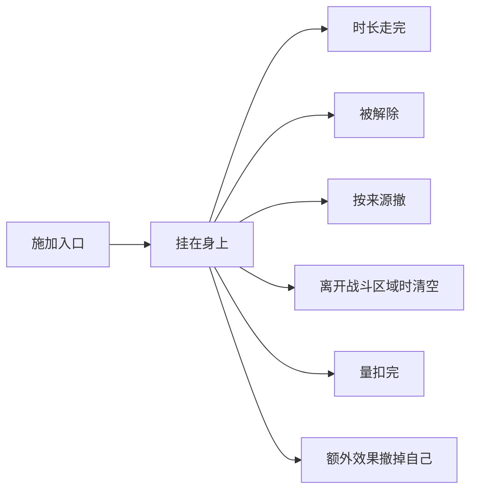
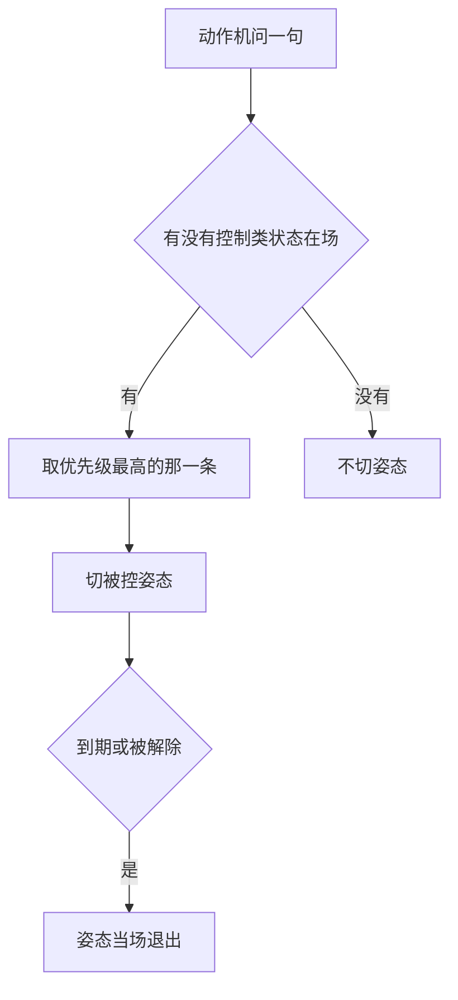

# 一份载体装下全部修饰：能并存的归这里，一次只能一个的归动作机

> **正典层级**：第 5 级（系统细化）。与[玩法正典](../canon/gameplay/玩法定位.md)冲突时以正典为准；**全部时长、层数、量级与阈值归[数值模型](./数值模型.md)，本页一个都不定。**
>
> 返回 [总索引](../README.md)｜[系统文档与提案索引](./README.md)｜相关：[角色动作状态系统](./角色动作状态系统.md) · [回合系统](./回合系统.md) · [伤害系统](./伤害系统.md) · [技能系统](./技能系统.md) · [玩法定位](../canon/gameplay/玩法定位.md) · [战斗与关卡](../canon/gameplay/战斗与关卡.md)｜台账：[`GP-18`](../spec/issues/README.md)，写着待定的那几处归 [`DOC-160`](../spec/issues/README.md)

## 摘要

**这一页回答一个问题：一个角色身上现在挂着什么。** 读完你能判断：一样新的效果该不该挂在这份载体上（判据只有一句：能同时好几个的挂这里），以及一条「这个状态什么时候消失」的疑问该去查哪一格。

**一个效果只定义一次，就是一条状态。** 吸血、反击、加速、力量高一点这些，敌人、学生、宝物与招用的是同一条；天赋节点、特质、宝物、被动技能只是给人挂上它的路（[角色与成长 · 效果从哪来：状态是效果本身，天赋是来路之一](../canon/gameplay/角色与成长.md)）。所以角色身上能同时挂着的东西全部走**同一份载体**：格挡、打崩、冰冻、灼烧这类按回合的，伤病、旧伤未愈与营养不良这类按天的，活跃失衡长出的增益、特质、天赋、专长、宝物词条与薪尽火传这类永久的，精英身上随机带的那几条，以及**什么都不改、只显示一行字的纯描述状态**。

**「他这几天过得怎么样」也由这份载体答。** 心情不单独成一个量，让人过得好或差的事各自挂一条状态（[角色与成长 · 心情](../canon/gameplay/角色与成长.md)）。

**一条状态要说清它改什么、怎么生效。** 它改什么分三类，判据是「它管不管他这一回合能不能自己动、改不改数值」：控制类拦下这一回合，参数类改数值或判定，纯描述类什么都不改。它怎么生效分三种：**一直给自己加的、什么时候发生什么的、一直给周围几格的人挂着的**，每条写明是哪一种，载入时查。

**时长只在本页计。** 战斗里按回合（数持有者自己的回合），经营里按天，另有永久。[回合系统](./回合系统.md)在固定的时点问本页，[动作机](./角色动作状态系统.md)只问「有没有控制类状态在场」。

还有一条不太常见但本作必须有的能力：**载体要能表达「显示成这样，实际是另一回事」**。主角的状态栏是伪造的，而那不是给他开的特例，是载体本来就该有两个字段。

**它定**一条状态要声明哪几格、载入时怎么查。**它持有**每个人身上挂着的每一项 —— 量级、层数与每一层的来源、剩余时长、显示字段 —— 以及战斗里的失衡值，和「每回合一次」「一场一次」的那几条触发过没有。

**它不持有**这些，各有自己的家：

- 挂到别人身上的状态挂不挂得上、抗性怎么减：[伤害系统](./伤害系统.md)那条状态线。
- 回合怎么往下走、哪一刻叫谁：[回合系统](./回合系统.md)。
- 姿态与它们怎么流转：[角色动作状态系统](./角色动作状态系统.md)。
- 改的量怎么汇总成下游读得到的数：[成长系统](./成长系统.md)那张派生表。
- 状态挂在身上是什么样子：[战斗与关卡 · 状态在身上的样子：按种类画一次，所有人共用](../canon/gameplay/战斗与关卡.md)，画法在[像素绘制原则](../production/像素绘制原则.md)。
- 有哪几条状态：内容，走内容外置（`ENG-5`）。
- 全部数值：[数值模型](./数值模型.md)。

最要紧的那条承诺：**不新建第二份修饰表，也不在回合、天、永久之外新造时长单位。** 「在场期间」「这一趟出征」都是永久项加按来源撤，不是新的单位。

## 术语

**无 —— 本页没有只有自己在用的词。** 它是全库那批修饰词汇的定义处：`控制类`、`参数类`、`纯描述类`、`时长单位`、`永久项`、`叠加`、`显示字段`、`实际字段`、`薪尽火传` 都被好几份文档引用，所以它们连同一句白话都在[术语表](../reference/术语表.md)里，各带一条指回本页的链接。

**「一直给自己加的」「什么时候发生什么的」「一直给周围几格的人挂着的」是正典的原话**（[角色与成长 · 天赋与被动技能的分工](../canon/gameplay/角色与成长.md)），本页照抄，不另起名字。

## 上游约束

- [玩法定位 · 跨系统约定](../canon/gameplay/玩法定位.md)：全部临时与持续效果走同一套状态系统，每条带「可否被解除」。**这是本页存在的理由，也是「载体只能有一份」的来源。**
- [角色与成长 · 效果从哪来：状态是效果本身，天赋是来路之一](../canon/gameplay/角色与成长.md)：每个效果只定义一次、谁身上都能挂，来路上只写指向哪一条；一直给别人挂着的增益管几格每一条自己写，走进就有、走出就掉，同一种落在同一个人身上只算最强的那一份。**约束本页只有一份状态声明，也是「谁在等这份载体」那张表的来路全集。**
- [角色与成长 · 天赋与被动技能的分工](../canon/gameplay/角色与成长.md)：每条状态写明自己是哪一种、载入时查；天赋树上的节点只能指一直给自己加的，被动技能只能指另外两种；「什么时候发生什么」那一种，触发要是一件不一定发生的事、效果只管一小段；专属天赋与特殊天赋哪一种都行。**约束「哪一种」那一格与触发条件那张表。**
- [战斗与关卡 · 异常状态](../canon/gameplay/战斗与关卡.md)：异常状态与格挡、失衡、失控、宝物的负面词条与特殊效果、精英身上随机带的那几条同属一套；分可解除与不可解除；叠层由每种状态自己写；叠满时、被带某个类型标签的招打中时做什么写在那一条自己身上；持续时间按回合算。**约束叠加、额外效果与可否解除都是每条自己的一格。**
- [战斗与关卡 · 防御与失衡](../canon/gameplay/战斗与关卡.md)：防御给自己挂格挡，到自己下一回合为止；失衡值攒满就被打崩，下一回合动不了、这期间挨打更疼；反击是一条状态；失控是单独一条异常状态。**约束这几样各是载体上的一条，也约束战斗里的失衡值攒满挂打崩落在本页这一侧。**
- [战斗与关卡 · 资源：HP 与 MP](../canon/gameplay/战斗与关卡.md)：打中回 MP、吸血都是状态，不是人人都有的规则，从特质、天赋、被动技能、宝物或招里来。**约束这两条是「什么时候发生什么」的那一种。**
- [战斗与关卡 · 回合：我方阶段主角先动、其余按敏捷，然后是敌方阶段](../canon/gameplay/战斗与关卡.md)：冷却与状态的时长都按自己的回合数算；加速、减速、定身能改行动力。**约束按回合那一档数的是谁的回合，也约束这几条改的是什么。**
- [战斗与关卡 · 战斗区域的空间模型：一格一个基础单位的俯视棋盘](../canon/gameplay/战斗与关卡.md)：「周围几格」横、竖、斜各算一格，不管中间隔着什么，一直挂着的增益不看视线；地形写清站上去或走进去挂什么状态；天气给区域里所有人挂一条，进来挂上、出去撤掉，子场景不吃。**约束一直给周围几格的人挂着的那一种怎么数，也约束地形与天气挂的都是本页的项。**
- [战斗与关卡 · 主角的招式构成](../canon/gameplay/战斗与关卡.md)：给学生加增益的是被动技能，一直给周围几格内的队友挂着，管几格每一条自己写。**同上。**
- [战斗与关卡 · 敌人也是角色](../canon/gameplay/战斗与关卡.md)：敌人身上的状态走同一份载体；精英身上随机带一两条状态，不另起名字，默认不能被解除、个别可以。**约束精英带的就是普通的状态，不另开一种东西。**
- [战斗与关卡 · 失败判定](../canon/gameplay/战斗与关卡.md)：倒下的学生身上亮出「神秘庇佑」，选不中、也不受伤，范围招也打不到他。**约束它是本页的一条，倒下时挂上。**
- [战斗与关卡 · 状态在身上的样子：按种类画一次，所有人共用](../canon/gameplay/战斗与关卡.md)：头顶的图标告诉你几层、还剩几回合；层数越多冒得越密；同时挂几种时轮流冒，新挂上的插进来冒一轮。**约束本页交给表现的那几样：哪几种、几层、还剩几回合、哪一条刚挂上。**
- [世界观 · 活跃失衡的规模](../canon/world/世界观.md)：活跃失衡以永久增益的形式改造一个生命，长成什么样由掌握程度与失衡高低共同决定。**约束载体必须支持无时长的永久项，且量级可正可负。**
- [人物 · 面具、右臂与伪装](../canon/characters/人物.md)：主角的手环读数是他伪造的，真实增益只在展示全力时显出来。**约束载体分「显示什么」与「实际是什么」两个字段。**
- [人物 · 教学：他与这个世界的主要接口](../canon/characters/人物.md)：考差的学生得到一条什么都不影响的描述文本，授课给学生的增益会过期。**约束纯描述类必须是一等成员，也约束「按天」这个时长单位。**
- [角色与成长 · 心情](../canon/gameplay/角色与成长.md)：心情不单独成量，「他这几天过得怎么样」由他身上挂着的状态回答；气泡与小事件读的是显示那一份。**约束本页不为心情另开字段、时长单位或第二份载体** —— 「高兴」「难过」一类就是载体上的项；也约束气泡与事件前置条件读的是显示字段。
- [人物 · 战斗中的位置：教练，而非输出核心](../canon/characters/人物.md)：主角出征时永久挂着「薪尽火传」，它**同时降低他自己、提高在队学生**，玩家不能关，唯一解除的时刻是真实形态、结束后恢复；它**不占每日教学额度、不改任何角色的活跃失衡**。**这是那一项的全部来源，本页只定它用载体的哪几格。**
- [玩法定位 · 弹界面接管输入就暂停世界，世界里的动作不暂停](../canon/gameplay/玩法定位.md)：状态的时长按回合或游戏时间算，界面接管输入时两样都不走。**约束本页不为暂停加任何东西。**
- [ADR-0035](../decisions/ADR-0035-战斗改成俯视的格子回合制.md)：战斗是俯视的格子回合制；`rules/Combat/` 下只有状态载体照旧扩容。**约束战斗里的时长单位是回合。**
- [ADR-0025](../decisions/ADR-0025-取值集的家由加一个的代价决定.md)：一格能填哪些值，看加一个要不要写新代码。**约束本页每个取值集都写明归代码还是归内容。**
- [ADR-0009](../decisions/ADR-0009-编辑器主导的开发模式.md)：参数唯一来源是场景与资源，代码不留能用的默认值。**约束本页定出的每个量纲将来落成外置数据，缺声明当场报错。**

## 结构

载体在代码里是 `rules/Combat/StatusEffects.cs`，本页定的是它该有的字段与规则。按 [ADR-0035](../decisions/ADR-0035-战斗改成俯视的格子回合制.md)，`rules/Combat/` 下只有它照旧扩容。

### 效果本身就是状态，来路上只写指向哪一条

- **一个效果只定义一次。** 吸血、反击、加速这些，每一条只有一份声明，谁身上都能挂，敌人与角色共用。天赋节点、特质、专长、被动技能、宝物、招、物品、角色定义的初始状态、地形、天气与事件，都只是给人挂上某一条的路：它们身上写的是「指向哪一条」，效果不在它们身上另写一份。
- **所以设计一个新效果，先把它写成一条状态，再定它从哪条路发给谁**（[角色与成长 · 效果从哪来：状态是效果本身，天赋是来路之一](../canon/gameplay/角色与成长.md)）。那些路各是谁、各要哪一档，是下面「谁在等这份载体，各要哪一档」那张表。
- **精英身上随机带的就是状态，不另起名字**；「词条」只用在宝物上（[战斗与关卡 · 敌人也是角色](../canon/gameplay/战斗与关卡.md)）。同一种精英每次遇到都不太一样，靠的是拼地图时掷哪几条，不加新机制。
- **打中回 MP、吸血与反击也是状态，不是人人都有的规则**：谁身上挂着谁才有。主角的专属天赋就是打中回 MP（[玩法定位 · 开局](../canon/gameplay/玩法定位.md)）。

### 三类，判据是「它管不管他这一回合能不能自己动、改不改数值」

| 类 | 他这一回合 | 数值与判定 | 例 |
| --- | --- | --- | --- |
| 控制类 | **被拦下**：动不了，或者由 AI 替他随机行动；动作机来问时答「在场」 | 可以同时改 | 打崩、冰冻、失控 |
| 参数类 | 照常 | **改**：改一个量、改一条判定，或者到点做一件事 | 格挡、屏障、加速、减速、定身、灼烧、中毒、流血、反击、吸血、打中回 MP、神秘庇佑、宝物词条与特殊效果、伤病、旧伤未愈、营养不良、活跃失衡长出的增益、薪尽火传、精英身上随机带的那几条 |
| 纯描述类 | 照常 | **不改** | 考差的评语、主角伪装上的那条「旧伤未愈」 |

**控制类只认「这一回合动不了」与「由 AI 替他随机行动」。** [回合系统](./回合系统.md)在轮到他时问的正是这些：动不了的跳过，失控的交给[战斗AI系统](./战斗AI系统.md)替他随机行动。它们可以同时改数值，打崩就还让他这期间挨打更疼。

**「改不改数值」说的是它在结算里有没有任何作用**：改一个量、改一条判定、到点做一件事都算改。所以参数类装得下大部分状态，纯描述类只装什么都不做的那些。

**定身是参数类，不是控制类。** 它只让他这一回合走不了，那一件照做。**神秘庇佑也是参数类**：它改的是选不选得中、受不受伤，而倒下的人本来就不动。

**纯描述类必须是载体的一等成员**，不能让界面自己编字 —— 否则「状态栏里显示什么」会有两个来源，而其中一个查不到出处。它也是本作把角色写活的便宜手段：一条不影响任何数值的状态，成本接近零。

### 每条状态写明自己是哪一种：一直给自己加的、什么时候发生什么的、一直给周围几格的人挂着的

| 哪一种 | 怎么生效 | 要声明 | 哪条来路能指它 | 例 |
| --- | --- | --- | --- | --- |
| 一直给自己加的 | 挂着就生效 | 改哪几个量、各改多少，或者改哪一条判定；纯描述类在这一格显式写「无」 | 天赋树上的节点只能指这一种 | 格挡、加速、减速、定身、灼烧、打崩、失控、旧伤未愈、宝物词条、薪尽火传、考差的评语 |
| 什么时候发生什么的 | 一件事发生时，做一件事 | 触发条件、做的事、多久能触发一次 | 被动技能能指 | 打中回 MP、吸血、反击、反伤、狂暴、分裂、召唤 |
| 一直给周围几格的人挂着的 | 戴着它的人周围那几格里的人，身上一直挂着另一条状态 | 几格、管谁、挂哪一条 | 被动技能能指 | 主角给学生挂着的增益、宝物管到周围几格的特殊效果 |

- **载入时查**：每条都写了是哪一种，「要声明」那一栏里它那一种的格都填了，别的种的格一格没填；缺一样就报错，说清是哪一条、哪一格。
- **「哪条来路能指它」那一栏不在本页查**：天赋节点指错了在[成长系统](./成长系统.md)被拒，被动技能指错了在[技能系统](./技能系统.md)被拒。专属天赋与特殊天赋哪一种都行；宝物、特质、招与精英带的也不受这一栏限，它们都可以是吸血。
- **纯描述类写「一直给自己加的」**：它不是触发出来的，也不管别人；改的那一格写「无」，所以它与漏填的分得开。
- **「哪一种」归代码**（[ADR-0025](../decisions/ADR-0025-取值集的家由加一个的代价决定.md)）：取值是正典定的，加一种要一套新的生效规则与校验。

#### 什么时候发生什么的：一个触发条件，加一件事

- **触发条件**从下面的触发条件表里挑一个，可以再加一层限定：只认近战、只认带某个类型标签的招、身边一圈没有敌人这类。这张表**归代码**：加一个触发条件，问本页的那一侧就要多一个时点。
- **做的事**从再下面的做的事表里挑，也**归代码**：加一种要写一段执行它的逻辑。
- **多久能触发一次**：不限；每个自己的回合一次，轮到他时清零；一场一次，进入战斗状态那一刻清零。「一场」是[回合系统](./回合系统.md)的说法：正典的「一场仗一次」就是一场一次，「每回合第一次」就是每个自己的回合一次。这几样取值也归代码。
- **「触发要不一定发生、效果只管一小段」那条校验在[技能系统](./技能系统.md)**，被动技能指它时查；本页给它「必然发生吗」那一栏。判据是正典那一句：这件事一回合里会不会必然发生。

| 触发条件 | 谁在哪一刻问本页 | 必然发生吗 | 正典里的例 |
| --- | --- | --- | --- |
| 打中时 | [伤害系统](./伤害系统.md)的「打中之后」，看出手的人 | 不 | 打中回 MP、吸血、给目标挂一条状态 |
| 暴击时 | 同上 | 不 | 回一点 MP、下一招不耗 MP |
| 打崩敌人时 | 同上 | 不 | 给身边的队友挂一层增益 |
| 击倒敌人时 | 同上 | 不 | 回一点 HP |
| 挨打时 | [伤害系统](./伤害系统.md)的「打中之后」，看挨打的人 | 不 | 反击（只认近战）、反伤、挨打之后防御高一点到自己下一回合为止 |
| 血少时 | 一笔扣血让他掉到那条线以下的那一刻，打中与每回合掉的血都算 | 不 | 自动挂一层屏障（一场一次）、狂暴 |
| 被挂上异常状态时 | 本页的施加入口 | 不 | 给挂它的那个人也挂上同一条（一场一次） |
| 叠满时 | 本页的施加入口 | 不 | 中毒叠满爆发一次；只用在额外效果那一格 |
| 被敌人先发现、进入战斗状态时 | [回合系统](./回合系统.md)的「进入战斗状态那一刻」 | 不 | 给自己挂一层加速，到自己的第一回合结束 |
| 回合开头 | [回合系统](./回合系统.md)；指这一回合开头还是轮到他时，待定（见台账 [`DOC-160`](../spec/issues/README.md)） | **不带限定的是**，带限定的不是 | 身边一圈没有敌人时回一点 MP；召唤 |
| 走开时 | [回合系统](./回合系统.md)的「他每要走一格」 | 不 | 每回合第一次从敌人那一圈走开，不引发借机攻击 |
| 挨着的队友倒下时 | 有人倒下的那一刻 | 不 | 自己挂一层增益 |
| 扶起队友时 | [回合系统](./回合系统.md)的「他做那一件」 | 不 | 给他挂一层加速 |
| 死时 | 他死的那一刻 | 不 | 分裂 |

| 做的事 | 交给谁做 | 正典里的例 |
| --- | --- | --- |
| 回一点 MP、回 HP | 落在他自己的 MP 与 HP 上；吸血按[伤害系统](./伤害系统.md)交出的打出去的伤害算 | 打中回 MP、暴击时回一点 MP、吸血、击倒敌人时回一点 HP |
| 给一个人挂一条状态 | 本页的施加入口；挂到别人身上的异常状态先走[伤害系统](./伤害系统.md)那条状态线 | 打中时给目标挂、打崩敌人时给身边的队友挂、挨打之后给自己挂一层防御、血少时挂一层屏障、扶起队友时给他挂一层加速、狂暴 |
| 还手一下普通攻击 | [回合系统](./回合系统.md)排在那一下之后，[伤害系统](./伤害系统.md)照常算 | 反击 |
| 让打他的人也挨一份 | [伤害系统](./伤害系统.md) | 反伤 |
| 多打一份伤害 | [伤害系统](./伤害系统.md)；那一份多少写在这条状态上 | 冰冻的人挨钝击碎冰、中毒叠满爆发一次 |
| 撤掉自己 | 本页 | 碎冰的同时解冻 |
| 下一招不耗 MP | [技能系统](./技能系统.md)那一招的消耗 | 暴击时 |
| 这一次走开不引发借机攻击 | [回合系统](./回合系统.md) | 走开时 |
| 召出东西 | 待定（见台账 [`DOC-160`](../spec/issues/README.md)） | 召唤、分裂 |
| 在格子上留下一种地上效果 | 技能留在地上的效果那一层，第一版不做 | 灼烧叠满引燃旁边的格子 |

- **挂给谁**从触发那一下带出来的人里挑：自己、打中的那个、打他的那个、挂它的那个、身边的队友、扶起的那个。
- **本页被问、被调、被读，从不主动去调别人。** 在一个时点上问本页的那一侧，拿回「哪几条触发了、各做什么、记在谁名下」，再交给上表里做那件事的系统；施加入口的调用方也一样，拿回这一下顺带触发的那几条。
- **反击、借机攻击与协作攻击互不引出**，规则的家在[回合系统](./回合系统.md)：反击那一下打中挂着反击的人，对面不再还手。

#### 一直给周围几格的人挂着的：走进就有，走出就掉，同一种只算最强的那一份

- **要声明**：几格，值归[数值模型](./数值模型.md)；管谁，友方或敌人，按戴着它的人那一侧算，归代码；挂哪一条，一条状态的标识。
- **几格照正典数**：横、竖、斜各算一格，所以是一块方形；不管中间隔着墙还是人，也不看视线；大个子从离得最近的那一格数（[战斗与关卡 · 战斗区域的空间模型：一格一个基础单位的俯视棋盘](../canon/gameplay/战斗与关卡.md)）。
- **按位置算**：一个人此刻在不在某个戴着它的人周围那几格里，决定他此刻身上有没有挂着的那一条。走进去就有，走出来就掉；怎么进出的（走一格、被击退或推走、瞬移、换层、刚召出来）不影响结果。派生表、界面与表现读到的都是按当前位置算的那一份。
- **挂在别人身上的那一项，来源记戴着它的那个人的那一条**，所以状态栏照样说得出来由。
- **同一种落在同一个人身上只算最强的那一份**：几个人带着同一种、一个人戴两件同样的宝物，都只算量级最大的那一份。最强那一份的主人走远了，剩下的里最强的接着算；不同种的照常一起生效。
- 管不管戴着它的人自己、戴着它的人倒下之后还管不管、挂上去的那一条能不能又是这一种、同一种还从别的来路挂着时与它怎么算，**待定（见台账 [`DOC-160`](../spec/issues/README.md)）**。

### 叠加、叠满与被某类标签打中：每条状态自己写

- **再挂一次怎么办，每条自己声明**：刷新时长、加一层，或者取更强的那个。**没有全局默认**，缺了载入报错；取值归代码。
- **加一层的**：每挂上一次加一层、时长刷新，每回合掉的血按层数乘，解除一次清掉全部层。灼烧、中毒、流血这类都是加一层，冰冻这类控制类只刷新时长（[战斗与关卡 · 异常状态](../canon/gameplay/战斗与关卡.md)）。最多几层每条自己声明，值归[数值模型](./数值模型.md)。
- **每一层各记各的来源**：几层可以是几个人挂的，每回合掉的血每一层记在挂上那一层的人名下（[伤害系统 · 每一笔扣血都记着算谁的](./伤害系统.md)）。几层来自不同的人时弄死他的那一下算谁的，在那一份是待定。
- **额外效果**：一条状态还能写叠满时做什么、被带某个类型标签的招打中时做什么，**不写就没有**。触发条件与做的事都从上面的触发条件表与做的事表里取：叠满时，是这一下让层数到了上限；被带某个类型标签的招打中时，是挨打时加上「只认带这个标签的招」那一层限定。做的事可以挑几样，碎冰就是多打一份伤害、同时撤掉自己。
- 叠满之后再挂一次刷不刷新时长、叠满时那件事做完之后层数清不清，**待定（见台账 [`DOC-160`](../spec/issues/README.md)）**。
- **流血与灼烧、中毒同一套**：每回合掉血、加一层，由招自己或斩击这类性质类标签挂（[伤害系统 · 性质类标签各写一条效果，挂在结算已有的几处上](./伤害系统.md)），各有各的抗性。**石化与冰冻一样盖住整个人**、一直显示、不参加轮流冒（[战斗与关卡 · 状态在身上的样子：按种类画一次，所有人共用](../canon/gameplay/战斗与关卡.md)）；它挂上之后做什么是内容。

### 时长有三种单位，各有各的推进点

| 单位 | 谁推进 | 例 |
| --- | --- | --- |
| 回合 | [回合系统](./回合系统.md)给的时点，数**持有者自己的回合** | 格挡、打崩、冰冻、失控、灼烧、中毒、流血、加速、减速、定身、反击架势 |
| 天 | 每日结算固定那一步 | 伤病、旧伤未愈、营养不良、考试评语、授课增益、食物增益 |
| 永久 | 不推进，只能被解除或按来源撤 | 活跃失衡长出的增益、薪尽火传、特质、天赋节点、专长、宝物词条与特殊效果、天气、出征增益、精英身上随机带的那几条、神秘庇佑 |

**按回合的那一档**：

- **数的是持有者自己的回合**：被跳过的那一次也算一次；探路时也一回合一回合走，照样扣；界面接管输入时不走（[回合系统 · 时长、冷却与每回合会变的量在哪一刻变](./回合系统.md)）。
- **扣在他自己那一回合的开头还是结尾，还是每条自己写落在哪一个，待定（见台账 [`DOC-160`](../spec/issues/README.md)）。** 正典里几种都有：格挡「到自己下一回合为止」，被动给的加速「到自己的第一回合结束」，打崩是「下一回合动不了」。[回合系统](./回合系统.md)在轮到他时与他这一回合结束时都给出时点。
- **只在战斗区域里有**：经营侧没有回合，所以离开战斗区域时清空（下面「跨场景与存档」）。

**一条硬约束：同一条效果只能有一种单位。** 想要「战斗里按回合、平时按天」的东西必须拆成两条，否则推进它就要看当前在哪个场景 —— 而那正是「两处各算一套」的开始。

**两个场合各改一个量不算拆成两条。** 营养不良与旧伤未愈在关卡里与经营里改的量不同（规则在[时间与经营 · 精力](../canon/gameplay/时间与经营.md)与[时间与经营 · 治疗与照护](../canon/gameplay/时间与经营.md)），但都只按天推进，所以各是一条效果、一个标识、一张图标，两边的量写在同一条定义上。

**旧伤未愈在学生身上与在主角身上是两条效果。** 学生那条是参数类、按天，免费慢养留下、到期自己好。主角那条是纯描述类、永久，实际什么都不改，只把显示字段填成旧伤未愈：他对外是「因旧伤而战力再难精进」的老兵（[人物 · 面具、右臂与伪装](../canon/characters/人物.md)），所以他那条旧伤不会好。状态栏上两条是同一个名字、同一张图标，单位跟着实际那一条走，上面那条硬约束不破。

**「在场期间」与「这一趟出征」不是新的单位。** 天气、出征增益、能交互的物件给的那一条、神秘庇佑都挂永久，到点由挂上它的那一侧按来源撤（下面「一条状态怎么没的：每条路各认一格」），与[`装备系统`](./装备系统.md)卸下一件宝物是同一条路径。

### 一条状态怎么没的：每条路各认一格

下面这张图回答一个问题：**一条挂在身上的状态有哪几条路会没掉。** 权威是紧跟它的那张表，图放不下每条路认哪一格、由谁发起。

**重画条件**：多出或少了一条撤掉的路，或者某条路改由别的系统发起时重画。

| 怎么没的 | 认哪一格 | 谁发起 |
| --- | --- | --- |
| 时长走完 | 时长单位是回合或天的 | 推进点到了 |
| 被解除 | 「可否解除」填了可以的；一次连同全部层一起撤 | 解除道具，或带解除效果的技能；两样都照自己写的占不占回合（[战斗与关卡 · 异常状态](../canon/gameplay/战斗与关卡.md)） |
| 按来源撤 | 全部；永久项除了被解除只走这一条 | 挂上它的那一侧：卸下宝物、洗天赋、离开关卡撤天气、出征结束撤出征增益、真实形态撤薪尽火传、被扶起时撤神秘庇佑 |
| 离开战斗区域时清空 | 时长单位是回合的 | 离开战斗区域那一刻 |
| 量扣完 | 屏障这类带量的 | [伤害系统](./伤害系统.md)交来要扣的量，扣到零就撤 |
| 额外效果撤掉自己 | 额外效果里写了「撤掉自己」的 | 碎冰这类 |

- **零时长不是解除的通道**：施加一个为零的时长被拒，想撤掉一条只能走上表的路。
- **按来源撤可以整批，也可以只撤一条**：卸下一件宝物撤的是它那一批，被扶起时撤的是他身上那一条。按效果种类撤会撤错另一件的，而那种错不报错。

### 战斗里的失衡值：载体上一个会回落的量，攒到韧性上限就挂打崩

- **它是一个量，不是一条状态**：没有叠加、解除与显示字段。每个人一份，只在战斗区域里有，离开时与按回合的那一档同一刻清空。
- **增量从[伤害系统](./伤害系统.md)来**：一下打中按攻方的力量与这一招带的标签算好交过来，本页只加上去（[伤害系统 · 失衡值：本页只产出增量，攒满之后打崩归载体那一侧](./伤害系统.md)）。
- **随回合回落**：回落多少归[数值模型](./数值模型.md)；落在哪一刻待定，[回合系统](./回合系统.md)那一页已经列着。
- **攒到韧性上限就挂打崩**：韧性上限读[成长系统](./成长系统.md)派生表，基底由体质给。打崩是控制类、按回合、不可解除：下一回合动不了，[回合系统](./回合系统.md)轮到他时跳过；这期间挨打更疼，[伤害系统](./伤害系统.md)在打折与加重那一步读它。
- 打崩挂上之后失衡值清不清零、打崩期间挨打还攒不攒，**待定（见台账 [`DOC-160`](../spec/issues/README.md)）**。

### 载体的字段

一条状态声明一次的那几格，与它挂在某个人身上时记的那几格，分开写在下面。

#### 一条状态要声明这些

| 格 | 填什么 | 归哪类（[ADR-0025](../decisions/ADR-0025-取值集的家由加一个的代价决定.md)） | 缺了 |
| --- | --- | --- | --- |
| 标识 | 稳定字符串，跨存档与 mod 唯一。**种类可扩，不是定长枚举的固定索引** | 内容：加一种状态只是多一条数据，前提是它用到的触发条件、做的事与判定都已在册 | 载入报错 |
| 名称、图标 | 文本键与一张图，图是作者画的 | 内容 | 载入报错；图还没画时显式写「暂无」（[界面绘制约定](../production/界面绘制约定.md)） |
| 哪一种 | 一直给自己加的／什么时候发生什么的／一直给周围几格的人挂着的 | 代码 | 载入报错 |
| 改什么 | 一直给自己加的那一种填：改哪几个量、各改多少（只许是[成长系统](./成长系统.md)派生表里的量，加速、减速改的行动力也要在那张表里有一行），或改下面判定表里的哪一条；纯描述类写「无」 | 量的家在派生表；判定归代码 | 载入报错 |
| 触发条件、做的事、多久能触发一次 | 什么时候发生什么的那一种填，取值见上面的触发条件表与做的事表 | 代码 | 载入报错 |
| 几格、管谁、挂哪一条 | 一直给周围几格的人挂着的那一种填 | 几格的值归[数值模型](./数值模型.md)；管谁归代码；挂哪一条是内容 | 载入报错 |
| 可否解除 | 可以／不可以 | 代码 | 载入报错 |
| 算不算异常状态 | 算／不算。「被挂上异常状态时」那个触发、[战斗AI系统](./战斗AI系统.md)认「身上有可解除的异常状态」都读它 | 代码 | 载入报错 |
| 叠加 | 刷新时长／加一层／取更强的那个；加一层的另填最多几层 | 规则归代码；层数的值归[数值模型](./数值模型.md) | 载入报错 |
| 额外效果 | 叠满时、被带某个类型标签的招打中时各做什么；**空是显式的空** | 同触发条件与做的事 | 载入报错 |
| 时长单位与时长 | 回合／天／永久；前两样另填多长，永久不许填 | 单位归代码；多长的值归[数值模型](./数值模型.md) | 载入报错 |
| 优先级 | 控制类填：几条同时在场时动作机认哪一条 | 值归[数值模型](./数值模型.md) | 控制类缺了载入报错；别的类填了被拒 |

**改什么那一格能填的判定**，每一条都有一个读它的系统：

| 判定 | 谁读 | 例 |
| --- | --- | --- |
| 这一回合动不了 | [回合系统](./回合系统.md)：轮到他时跳过 | 打崩、冰冻 |
| 由 AI 替他随机行动 | [回合系统](./回合系统.md)交给[战斗AI系统](./战斗AI系统.md) | 失控 |
| 这一回合走不了 | [回合系统](./回合系统.md)：行动力为零，那一件照做 | 定身 |
| 挨打变轻或更疼 | [伤害系统](./伤害系统.md)打折与加重那一步 | 格挡、打崩 |
| 挨打先扣它，扣完才扣 HP | [伤害系统](./伤害系统.md) | 屏障 |
| 不吃自己人的误伤 | [伤害系统](./伤害系统.md) | 温馨难度给我方每个人挂的那一条 |
| 选不中，也不受伤 | [技能系统](./技能系统.md)选目标、[伤害系统](./伤害系统.md)、[战斗AI系统](./战斗AI系统.md) | 神秘庇佑 |
| 每回合掉的血 | [伤害系统](./伤害系统.md)，每一层记在挂上它的人名下 | 灼烧、中毒、流血 |

#### 挂在一个人身上的那一项记这些

| 格 | 记什么 |
| --- | --- |
| 哪一条 | 指向上面那份声明的标识 |
| 量级 | 可正可负。没有量级的填空，但**格要在**，否则加第一个带量级的状态时要改结构。屏障这类挨打时被扣，扣到零就撤 |
| 层数 | 加一层的那几条才有多层 |
| 剩余时长 | 按回合或按天的那几条；永久的没有 |
| 来源 | 谁施加的（某次命中、某件宝物、某条特质、某个 mod 的内容）；加一层的那几条每一层各记一份。**这条是 `ENG-7` 的前提**：卸载 mod 后要能指出哪些状态因缺少来源而不可用 |
| 显示名与显示值 | 与实际值分开的两个字段，见下面「显示与实际是两个字段」 |
| 触发过没有 | 「每回合一次」「一场一次」的那几条，这一回合、这一场触发过没有 |

**一直给周围几格的人挂着的那几项不记在别人的这张表里**：它们按位置算，来源照记戴着它的那个人的那一条。

### 显示与实际是两个字段

状态栏显示的是**显示字段**，结算读的是**实际字段**。两者默认相同，只有被显式伪装时才不同。

**主角是唯一用到这条的角色，但它不是为他开的特例。** 手环本身就是一台会误报、可被欺骗的量产设备（[世界观 · 多功能手环与治理](../canon/world/世界观.md)），而他能骗过它的常规展示。所以：

- 玩家看到的是**真的界面、假的数据** —— UI 没有例外分支，它如实显示它拿到的显示字段。头顶那一排小图标、身上的样子与状态栏读的都是这一份。
- 展示真实力量时，伪装解除、显示字段换成实际字段；**结束后恢复伪装**。
- **这条能力对敌人同样可用**（将来若要做「看起来很弱的强敌」），所以它是载体的通用能力，不是主角的硬编码。

### 薪尽火传：一条状态，两侧各一项

主角出征时常驻的那条永久状态（[人物 · 战斗中的位置：教练，而非输出核心](../canon/characters/人物.md)）落在本页。**它同时改两侧**，所以单独写清它用的是已有的哪几格：

| 它要什么 | 用哪一格 | 新东西 |
| --- | --- | --- |
| 分类 | **参数类** —— 只改数值，不拦这一回合 | 无 |
| 哪一种 | 两侧各是**一直给自己加的**：主角那一项降他自己的量，学生那一项升学生自己的量。它管的是全体在队学生、不看几格，所以不是一直给周围几格的人挂着的那一种 | 无 |
| 时长 | **永久** —— 不推进，只能按来源撤 | 无 |
| 「同时改两侧」 | 在主角身上一项（他自己的量下降），在**每个在队学生**身上各一项（他们的量上升） | 无 —— 载体本来就按角色各一份 |
| 两侧认得出是同一条 | **来源**字段填同一个来源 | 无 |
| 解除与恢复 | 真实形态触发时**按来源整批撤**，结束后整批重加 | 无 —— 与[`装备系统`](./装备系统.md)卸下时那条路径相同 |
| 状态栏那一行 | **显示字段**（它是伪装的一部分） | 无 |

**所以本页不为它新建载体、不新建时长单位、不加字段。** 落地归 `GP-18`，与本页其余扩容同一批。

**玩家关不掉它，靠的不是「可否解除」那一格。** 那一格管的是「有没有道具或技能解得掉」；这条状态玩家手里根本没有那个入口，而真实形态那次解除由剧情侧发起、走的是同一个按来源撤的动作，**不是第二条通路**。

**两侧的幅度不在本页**（归 `GP-7`）；加成怎么进到学生的属性上也不在本页 —— 唯一出口是[`成长系统`](./成长系统.md)那张派生表。**它也不是教学的产出渠道**：不占每日那一次教学额度、不改任何角色的活跃失衡，理由在[`教育系统`](./教育系统.md)。

## 接口

### 与动作机的唯一接缝

> [动作机](./角色动作状态系统.md)要摆姿态时问一句：**有没有控制类状态在场、在场的是哪一条**。

下面这张图回答一个问题：**这条接缝上发生什么，以及为什么一条控制类状态没了之后姿态会自己退出。** 方向只有一个（动作机问、本页答），所以图里的箭头也只有一个方向。

**重画条件**：接缝的方向变了、问的那句话变了，或者动作机开始自己记时长时重画。

**这张图不新增任何事实，权威是紧跟它的那几条。** 哪一条控制类对应哪个姿态、参数类与纯描述类为什么一律不切，图都放不下。

- **动作机问一句**，本页答有没有、是哪一条：有就切被控姿态，没有就不切姿态。参数类与纯描述类一律不切。
- **几条控制类同时在场时，取优先级最高的那一条**，同级取更晚挂上的；优先级值归[数值模型](./数值模型.md)。哪一条对应哪个被控姿态、哪几条没有自己的姿态，在[角色动作状态系统](./角色动作状态系统.md)。
- **时长永远由本侧计。** 动作机不记时，所以一条控制类状态到期或被解除，下一次问就答没有，姿态当场退出。
- **这一回合能不能自己动不走这条接缝**：那是[回合系统](./回合系统.md)轮到他时问的（下面「回合系统在哪几刻问本页」），动作机只管摆出来的样子。
- 接缝只有这一条，方向只有一个（动作机问、本侧答）。**本侧永不主动调用动作机**，否则两边会互相触发。

### 回合系统在哪几刻问本页

时点的权威是[回合系统 · 时点：回合走到哪一刻，调谁](./回合系统.md)那张表，本页只写在那几刻答什么。

| 时点 | 本页答什么 |
| --- | --- |
| 进入战斗状态那一刻 | 挂在「被敌人先发现、进入战斗状态时」上的那几条；「一场一次」的记账清零 |
| 轮到他时 | 他这一回合能不能自己动：动不了的跳过，失控的交给[战斗AI系统](./战斗AI系统.md)替他随机行动；走不走得了；「每回合一次」的记账清零。按回合的那几条在不在这一刻扣，待定 |
| 他每要走一格 | 这一次走开引不引发借机攻击：挂在「走开时」上的那几条 |
| 他做那一件 | 挂在「扶起队友时」上的那几条；被扶起的那个人身上的神秘庇佑按来源撤 |
| 一下出手打中之后 | 挨打的人挂没挂反击，读的是[伤害系统](./伤害系统.md)交来的那份结果 |
| 他这一回合结束时 | 到这一回合结束为止的那几条到期。按回合的那几条在不在这一刻扣，待定 |
| 界面接管输入 | 不问；按回合与按天的都停着 |

- **行动力被改了多少**：改它的是本页的项（加速、减速这类状态，天赋与宝物主词条、负面词条的永久项），汇总照旧走[成长系统](./成长系统.md)派生表，本页不另给一个总和。
- 回合开头那一类触发指这一回合开头还是轮到他时、每回合掉的血与战斗里的失衡值回落落在哪一刻，[回合系统](./回合系统.md)那一页写的都是待定，本页跟着它。
- **离开战斗区域时清空**按回合的那一档与战斗里的失衡值。撤离或失败让关卡结束的那一刻由谁告诉本页，**待定（见台账 [`DOC-160`](../spec/issues/README.md)）**。

### 谁在等这份载体，各要哪一档

**这张表是「谁调本页」的全集。** 每一行只写它要哪一档与撤法，**规则在那一行指的那份文档里，本页一个字不复述**。

| 谁 | 要哪一档 | 挂上去是什么，或读什么 | 怎么撤 |
| --- | --- | --- | --- |
| [`回合系统`](./回合系统.md) | 不挂项，它是**回合**那一档的推进点 | 在它那几个时点问本页，见上面「回合系统在哪几刻问本页」 | 不适用 |
| [`伤害系统`](./伤害系统.md) | **回合** | 一下打中挂上的状态（带来源）、屏障的量、战斗里的失衡值增量；读格挡、打崩、失控、不吃误伤、神秘庇佑与屏障 | 按自己的时长走完；可解除的另有入口；屏障扣完就撤 |
| [`技能系统`](./技能系统.md) | 主动技附带的是**回合**；被动技指的那一条是**永久** | 主动技附带的状态，指向自己的招把格挡、反击架势挂在自己身上；被动技指的那一条；选目标时读神秘庇佑 | 前者按时长走完；被动技学会了就一直在 |
| [`物品系统`](./物品系统.md) | **按那条状态自己声明的那一档** | 药水这类物品挂的增益；解除道具解掉一条可解除的状态 | 按那一档的规则 |
| [`角色动作状态系统`](./角色动作状态系统.md) | 不挂任何项 | 它只问「有没有控制类状态在场、是哪一条」 | 不适用 —— 见上面那条接缝 |
| [`战斗AI系统`](./战斗AI系统.md) | **只读** | 身上有没有可解除的异常状态、对面挂没挂反击、谁挂着神秘庇佑、谁失控了 | 不适用 |
| [`教育系统` · 授课：每一项产出都接进别人的系统](./教育系统.md) | **天** | 授课增益（参数类）与考试评语（**纯描述类**） | 到期自然消失 |
| [`生产系统` · 六条渠道，差别只在那几格](./生产系统.md) | **天** | 食物增益（参数类） | 同上 |
| 伤病、营养不良与旧伤未愈（[时间与经营 · 精力](../canon/gameplay/时间与经营.md)、[时间与经营 · 治疗与照护](../canon/gameplay/时间与经营.md)） | **天** | 参数类，各改哪个量在那两节 | 同上 |
| [`装备系统` · 装上与卸下：同一份载体，按来源整批撤](./装备系统.md) | **永久** | 主词条、负面词条、随机词条与特殊效果，每颗宝石的属性侧（[角色与成长 · 装备：宝物与宝石](../canon/gameplay/角色与成长.md)） | **按来源整批撤** —— 按效果种类撤会撤错另一件的，而那种错不报错 |
| [`成长系统` · 特质：存在纯负面的，所以事件带风险](./成长系统.md) | **永久** | 特质、天赋节点、专长、专属天赋与特殊天赋各自指的那一条 | 洗天赋时按来源撤天赋节点那几条，与卸下一件宝物同一条路径；专属天赋与特殊天赋不退 |
| [`成长系统` · 角色定义上不会变的声明项](./成长系统.md) | **按那条状态自己声明的那一档** | 「初始状态」那一格：名册上的角色开局挂上、作为敌人出场的出场时挂上；薪尽火传与主角伪装上那条旧伤未愈从这里来 | 按那一档的规则，本页不为它开第二条路 |
| [`活跃失衡系统` · 个体失衡长出的永久增益是一张二维分档表](./活跃失衡系统.md) | **永久** | 活跃失衡长出的增益，量级可正可负 | 个体值跨档时由那一侧请求增删 |
| [`关卡系统`](./关卡系统.md)：地形、精英与能交互的物件 | 地形挂的是**回合**，其余**永久** | 站上去或走进去挂的状态，挂不挂得上照[`伤害系统`](./伤害系统.md)的状态线；拼地图时掷给精英的一两条（[战斗与关卡 · 敌人也是角色](../canon/gameplay/战斗与关卡.md)）；能交互的物件给全队挂的、挂到这一趟出征结束的那一条（[战斗与关卡 · 关卡事件与附加目标](../canon/gameplay/战斗与关卡.md)） | 地形挂的按时长走完；精英那几条跟着它，个别能解除；物件那一条出征结束时按来源整批撤 |
| [`关卡系统` · 一关的声明：来源、倒下处置、玩家操作谁、额外增益](./关卡系统.md) | **永久** | 这一关声明的那一组增益（为空是常态） | 进关卡整批加、离关卡**按来源整批撤** |
| [`天气系统` · 进关卡加，离关卡撤](./天气系统.md) | **永久** | 当天的天气给战斗区域里所有人挂的那一条，敌我都一样 | 进来整批加、离开**按来源整批撤**；子场景不吃，下去时撤、回来再挂 |
| 全局难度（[战斗与关卡 · 两层难度，职责不重叠](../canon/gameplay/战斗与关卡.md)） | **永久** | 温馨难度给我方每个人挂的「不吃误伤」；火种难度让精英多带的那一条走关卡系统那一行 | 开局锁定，不撤 |
| 出征增益（[战斗与关卡 · 关系在战斗里：协作攻击与出征增益](../canon/gameplay/战斗与关卡.md)） | **永久** | 关系好的两个学生都在队里时，出发那一刻各挂一条；个别两人的专属那条顶替通用那条 | 出征结束时按来源整批撤 |
| 薪尽火传（见上面那一节） | **永久** | 主角身上一项、每个在队学生身上各一项，来源相同 | 真实形态触发时按来源整批撤，结束后整批重加 |
| 神秘庇佑（[战斗与关卡 · 失败判定](../canon/gameplay/战斗与关卡.md)） | **永久** | 学生倒下的那一刻挂上：选不中、也不受伤，不可解除 | 被扶起或离开战斗区域时按来源撤 |
| 穹盾改造给全体居民的「希望之光」（[世界观 · 穹盾](../canon/world/世界观.md)） | **永久** | 全体居民身上各一项 | 一直在 |
| [`剧情演出系统`](./剧情演出系统.md)、[`事件系统`](./事件系统.md)与[`节日系统`](./节日系统.md) | **按它自己声明的那一档** | 脚本里的状态变更指令、事件后果表里「给增益」那一格；灵潮这类关卡事件与节日、比赛给的都走这一格 | 按那一档的规则；本页不为它们开第二条路 |
| [`界面系统`](./界面系统.md) | **只读** | 头顶那一排状态小图标、状态栏、角色面板的状态子页与右键看的说明，读**显示字段**，连同层数与还剩几回合或几天 | 不适用 |
| 状态在身上的样子（[战斗与关卡 · 状态在身上的样子：按种类画一次，所有人共用](../canon/gameplay/战斗与关卡.md)） | **只读** | 每个人身上挂着哪几种、各几层、哪一条刚挂上，读**显示字段**；画法在[像素绘制原则](../production/像素绘制原则.md) | 不适用 |
| [`气泡对话系统`](./气泡对话系统.md) 与 [`事件系统`](./事件系统.md)的前置条件 | **只读** | 某个角色身上挂着哪几种状态，读**显示字段** —— 读实际那一份，主角的伪装会被一句闲话或一件小事说漏 | 不适用 |
| [`存档系统`](./存档系统.md) | **只读** | 按天与永久那两类加它们的来源进正式存档；按回合的那几项、战斗里的失衡值与触发过没有进临时续玩点 | 见下面「跨场景与存档」 |
| **作者填** | —— | **无。** 一条状态的声明是外置数据（`ENG-5`），不是作者在编辑器里配的场景字段；图标、头顶小图标的排版与身上的样子才归作者（[ADR-0009](../decisions/ADR-0009-编辑器主导的开发模式.md)） | 不适用 |

**挂载点到此为止。** 下次加一样与「角色身上现在有什么」有关的东西时，先问「它挂在上面哪一格」，而不是顺手插一个新钩子 —— 尤其**不许新建第二份修饰表**，[玩法定位 · 跨系统约定](../canon/gameplay/玩法定位.md)那条「全部修饰走同一套」正是要挡这个。

**表里没有「本页自己发起」这一格。** 本页被调用、被读，从不主动去调别人 —— 那与[`状态效果系统` · 与动作机的唯一接缝](./状态效果系统.md#与动作机的唯一接缝)那条「本侧永不主动调用动作机」是同一条纪律的推广。

### 跨场景与存档

- **载体一份，跨战斗区域与经营延续。** 伤病、词条、增益不因为进出战斗区域而重置。
- **按回合的在离开战斗区域时清空**，因为经营侧没有回合；战斗里的失衡值同一刻清空；按天与永久的保留。换层不清，那时还在战斗区域里。
- **进正式存档的是按天与永久那两类**，外加它们的来源。按回合的、战斗里的失衡值与「触发过没有」不进 —— 正式存档只在睡眠时写，那时不在战斗区域里（[`存档系统` · 进哪一侧：判据一句话](./存档系统.md)）。
- **它们进本页声明的那一份临时续玩点**：关卡里退出再回来要接着那一刻，身上的状态照旧（[玩法定位 · 存档](../canon/gameplay/玩法定位.md)）。所以续玩点里有按回合的那几项连同剩几回合、层数与每一层的来源，战斗里的失衡值，以及「触发过没有」。
- **一直给周围几格的人挂着的那几项不存**：读回来按位置重算（[`存档系统` · 派生量不单独存](./存档系统.md)）。

### 它不碰的那几条接缝

上面那几张表里没有的，都不是漏了。这几条是最容易被误接上的：

- **不碰姿态。** 一条控制类状态在场时切哪个被控姿态是[`角色动作状态系统`](./角色动作状态系统.md)的事，本页只答「在不在场、是哪一条」。
- **不碰回合的推进。** 本页不排顺序、不推进回合；按回合的那一档在[`回合系统`](./回合系统.md)给的时点上扣。
- **不碰挂不挂得上。** 挂到别人身上的异常状态先走[`伤害系统` · 状态线：抗性减的是施加概率](./伤害系统.md)，本页只接挂上之后的那一项；元素与性质类标签挂哪一条也在那一份。
- **不碰派生表。** 参数类改的量最终怎么汇总成下游读得到的数字，出口只有[`成长系统` · 派生表：基底与来源分两栏](./成长系统.md)那一张表；本页不自己算总和，也不给下游第二个读口，行动力也一样。
- **不碰活跃失衡。** [`活跃失衡系统`](./活跃失衡系统.md)请求本页增删永久项，而本页**没有写活跃失衡的入口** —— 那是一条结构约束，验收里有反证。本页持有的是战斗里的失衡值，与它不是一回事。
- **不碰进度值。** 关系（[`人际系统`](./人际系统.md)）、书籍掌握度与知识吸收效率（[`教育系统`](./教育系统.md)）都不进本页：它们没有时长、不会过期、不参与叠加与解除。判据是那一条 —— 塞进来就要造一个「永不过期且不可移除」的特例。
- **不碰位置。** 谁站在哪一格、格子怎么数不在本页：数法在正典，站位由持有它的那一侧给，本页只读。
- **不碰暂停。** 界面接管输入时回合与游戏时间都不走（[玩法定位 · 弹界面接管输入就暂停世界，世界里的动作不暂停](../canon/gameplay/玩法定位.md)），按回合与按天的都停着，**本页不为暂停加任何东西**。
- **不碰每日结算的步序。** 按天那一档的推进点就是那串里已有的一步（[`每日结算系统`](./每日结算系统.md)），本页不新开一步。

## 边界与非目标

- **不定任何数值**：时长、层数上限、量级、几格、优先级值、血少时那条线、战斗里的失衡值回落多少，以及每一条做的事各做多少，全归[数值模型](./数值模型.md)；等对应系统存在才定得出来的那些归 `GP-7`。
- **不定姿态与动画**：被控姿态与它们怎么流转全在[角色动作状态系统](./角色动作状态系统.md)。
- **不定样子**：状态挂在身上的样子按种类画一次、所有人共用，几种轮流冒，冰冻与石化盖住整个人（[战斗与关卡 · 状态在身上的样子：按种类画一次，所有人共用](../canon/gameplay/战斗与关卡.md)），画法在[像素绘制原则](../production/像素绘制原则.md)；本页只给它读的那几样。
- **不定具体有哪几条**：有哪几种异常状态、精英身上掷哪几条、每件宝物带什么属内容，走[内容外置](../canon/gameplay/玩法定位.md)那条边界（`ENG-5`）；起步量见[玩法定位 · 内容规模基准](../canon/gameplay/玩法定位.md)。
- **不做地上那一层**：技能留在地上的效果叠在格子上、带剩几回合，它挂在格子上不挂在人身上，第一版也不做（[战斗与关卡 · 战斗区域的空间模型：一格一个基础单位的俯视棋盘](../canon/gameplay/战斗与关卡.md)）。灼烧叠满引燃旁边的格子要等它。
- **不设计存档格式**，只定「哪几样进哪一侧、要带来源」。格式与版本口径在 [ADR-0015](../decisions/ADR-0015-存档的版本与缺字段口径.md)，分片怎么声明在[`存档系统`](./存档系统.md)。**卸载 mod 后来源认不出来那一侧的口径也已经定了**（`ENG-7`）：走[`存档系统` · 缺 mod 的内容：隔离，不删除](./存档系统.md)那份不可用清单，而处置是**隔离而不是删除** —— 那一项原样留在存档里、只是不参与任何结算，装回 mod 就照旧生效。
- **不做两条状态之间按「同时在场」起的联动**（例如「中毒时受到的伤害额外提高」）。正典给的反应都写在那一条自己身上 —— 叠满时、被带某个类型标签的招打中时，以及「什么时候发生什么」那一种的触发条件。不是否决，是留到有真需求时再设计 —— 现在加它等于凭空造一层规则引擎。
- **同名不同物，写的时候带全名**：
  - **战斗里的失衡值**与**活跃失衡**：前者是本页那个攒满挂打崩、随回合回落的量；后者是跨日的世界量，它长出的增益是本页的永久项（[角色与成长 · 四项属性的作用方向](../canon/gameplay/角色与成长.md)）。
  - **「同一种」**与**「哪一种」**：前者指同一个状态标识，同一种只算最强的那一份说的就是它；后者指一直给自己加的、什么时候发生什么的、一直给周围几格的人挂着的。
  - **叠加**与**只算最强的那一份**：前者管同一条再挂一次怎么办；后者管一直给周围几格的人挂着的同一种从几个人那里同时落下来时算哪一份。
  - **做的事**与[回合系统](./回合系统.md)的**那一件**：前者是「什么时候发生什么」那一种触发之后做的事；后者是一回合里那一件占回合的事。
  - **词条**只用在宝物上；精英身上随机带的叫状态。

## 理由与取舍

- **没选把这一套和动作机写在同一份文档里。** 载体一份是正典要求，文档两份是因为读者不同 —— 改姿态与样子的人只看那边，加一个跨日状态的人只看这边。混着写的话，讲姿态流转的那一页里会出现「考差的学生身上那条什么都不影响的状态」，读起来像「挨打是个增益」。分开之后两边各答一个问题：那边答「这一刻他摆出什么样子」，本页答「这个角色身上现在有什么」。
- **没选按「战斗内／战斗外」分成两套载体。** 那条线看起来自然，却会把同一条营养不良、旧伤未愈拆到两边 —— 它们在关卡里与经营里各改一个量，按天推进的却是同一条；宝物词条这类永久项也得在每次进出战斗区域时搬一次家。按互斥性分才切得干净，按场景分是把「什么时候用」当成了「是什么」。
- **没选把控制类整条留在动作机或回合系统里。** 那样它们要自己管时长、自己写叠加与解除、自己记谁挂的，等于在里面重造半个本页。
- **没选让纯描述状态只活在界面层。** 界面自己编字省事，代价是「状态栏显示什么」有两个来源，其中一个查不到出处、也进不了存档 —— 而它恰恰是玩家会截图问「这是什么」的那一个。
- **没选让纯描述类另成一种。** 正典要每条都写明是哪一种；它不是触发出来的，也不管别人，写成「一直给自己加的」、改的那一格写「无」就装得下，多一种只是多一套校验。
- **没选用一个全局叠加规则。** 中毒该叠层、减速该取最强、冰冻该刷新时长，这几件事没有共同的正确答案；让每种效果自己声明，代价是数据多一个字段，收益是不会出现「为什么这个增益叠起来了」这类查不清的行为。
- **没选给「什么时候发生什么」那一种每条写一段代码。** 触发条件与做的事各是一张在册的表，加一条状态只是挑一个触发条件、一件事；只有加一个触发条件或一种做的事才写代码，而那要先立项（[ADR-0025](../decisions/ADR-0025-取值集的家由加一个的代价决定.md)）。每条各写一段的话，「吸血在哪一刻回血」会每条各有一个答案。
- **没选让一直给周围几格的人挂着的那几项挂上之后留在别人身上、走出时再撤。** 挪人的办法有好几种 —— 走一格、被击退或推走、瞬移、换层、刚召出来 —— 每一种都得记得通知一次，漏一种他就带着不该有的那一项走掉，而那不报错。按位置算只要知道谁站在哪。
- **没选把战斗里的失衡值做成一条状态。** 它一下一下攒、随回合回落、攒满了还要挂另一条状态，这几样都不是叠加与时长那套规则说得清的；做成状态就得给它造一种新的叠加与一种新的时长单位，而它其实只是一个数。
- **没选让各个读它的系统各自认「异常状态」。** 「被挂上异常状态时」那个触发与[战斗AI系统](./战斗AI系统.md)找「身上有可解除的异常状态」读的是同一件事；各认各的，迟早一边算它、一边不算，所以它是声明里的一格。
- **没选在回合之外给战斗再设一个更细的单位。** 回合制里冷却与状态都数自己的回合（[战斗与关卡 · 回合：我方阶段主角先动、其余按敏捷，然后是敌方阶段](../canon/gameplay/战斗与关卡.md)），更细的单位没有推进点。
- **没选给主角写一条伪装专用分支。** 把「显示与实际分离」做成载体的通用能力，成本几乎一样，但它同时给了将来「看起来很弱的强敌」这类设计一条现成的路；而专用分支会让 UI 里出现一个 `if 主角`。
- **没选用「授课」给那条状态命名。** 「授课」在正典里已经是那个一天一次额度的动作名（课堂授课、单独指导）；第三样也叫授课会让那条额度看起来被绕过 —— 名字本身就会制造「它是不是也算教了一次」这个问题。取「薪尽火传」，是因为这个词自己说出了它的两半 —— 柴烧尽、火传下去，正好对上它同时改两侧；它与主角真名、飞船名同一个意象系，不是新造的比喻。
- **没选给它单开一条「队伍增益」通路。** 那样它就不是载体上的一项，而是第二套修饰机制，而[玩法定位 · 跨系统约定](../canon/gameplay/玩法定位.md)那条「全部修饰走同一套」正是要挡这个。代价是它在载体里表现为**两侧各一项**而不是一项，看着不如「一条管全队的增益」直观；换来的是解除、恢复、存档与「卸载 mod 后认不出来源」这几件事都不用为它写例外。
- **没选让永久项也参与叠加与过期。** 永久项（活跃失衡长出的增益、薪尽火传、特质）只能被解除或按来源撤，不参与刷新与过期 —— 因为它们一旦进了同一套过期逻辑，就得为「永不过期」造一个特殊值，而特殊值是漏洞的常见入口。

## 验收

**可自动验证项**（纯规则层，与引擎无关）：

- 三类各自的行为：控制类 → 回合系统问「能不能自己动」时答不能（动不了的被跳过，失控的交给 AI），动作机问时答在场；参数类 → 不拦这一回合、不切姿态，但量或判定变了；纯描述类 → 既不拦、也不切姿态、也不改任何量。
- **动作机与回合系统都不计时**：把一条控制类状态解除，下一次问就答没有。
- 哪一种：缺「哪一种」、或者填了另一种的格，载入被拒，每一种各一条；纯描述类改的那一格写「无」时通过、空着时被拒（反证：写无与漏填分得开）。
- 在册：触发条件、做的事、多久能触发一次、管谁、判定、叠加规则与时长单位，各填一个没实现的取值时载入被拒，说清它不在册；在册的通过（反向反证）。加一条只用在册取值的新状态，载入成功且代码零改动。
- 多久能触发一次：一场一次的那条，同一场里第二次不触发，下一场照常；每回合一次的那条，同一个自己的回合里第二次不触发。
- 必然发生那一栏：不带限定的回合开头标成必然，带限定的不是；[技能系统](./技能系统.md)那条被动技校验读的就是它。
- 一直给周围几格的人挂着的：走进那几格就有、走出就掉；斜着一格与横着一格同样算；隔着墙照样算（反证：不看视线）；被击退进去与走进去结果一样。
- **只算最强的那一份**：两个人带着同一种，落在一个人身上只算量级大的那一份；量级大的那个走远之后，剩下那一份照样生效（承重反证 —— 只留一份的实现会在这里让他什么都没有）；不同种的两条一起生效。
- 可解除类 `TryRemove` 成功，不可解除类拒绝；零时长不能当作解除通道；加一层的那条解除一次清掉全部层。
- 叠加按种类声明生效：刷新、加一层、取更强各一条；层数不超过声明的上限；每一层各记各的来源。
- 额外效果：叠满时那件事在这一下让层数到上限时发生；被带某个类型标签的招打中时那件事，换一个不带那个标签的招打中时不发生（反证）；没写额外效果的状态，叠满与挨各种招都不发生任何事。
- 三种单位各自只被自己的推进点推进：推进回合不动按天项，跑一次每日结算不动按回合项；被跳过的那一次也扣；界面接管输入时都不走。
- 离开战斗区域：按回合的与战斗里的失衡值清空，按天与永久的一条不少（反证）。
- 战斗里的失衡值：增量攒到韧性上限挂上打崩，打崩是控制类、不可解除；没攒满时不挂。
- 显示与实际分离：伪装状态下显示字段与实际字段不同，而**结算只读实际字段**。
- 神秘庇佑：学生倒下挂上，被扶起撤掉；解除被拒。
- 薪尽火传那一条另有这些：
  - 它在主角与每个在队学生身上各有一项，且**来源相同**。
  - 按来源整批撤之后**两侧一条不剩**，重加之后**一条不少**（承重项的反证）。
  - 它**没有给载体加字段、也没有加时长单位**（结构约束）。
  - **它不改任何角色的活跃失衡**（结构约束 —— 本页没有写活跃失衡的入口）。
- 续玩点：写完读回来，按回合的那几项剩几回合、层数与每一层的来源、战斗里的失衡值、触发过没有都一样；一直给周围几格的人挂着的那几项按位置重算出同样的结果。
- 本页不主动调用：在一个时点上被问时只返回触发了的那几条，不自己改 HP、MP，不自己调动作机（可用替身验证）。

**必须实机确认项**：头顶那一排小图标与状态栏里同时挂着多条状态时读不读得清、几层与还剩几回合看不看得出来；一直给周围几格的人挂着的那几条，玩家看不看得出谁在范围里 —— 按 [ADR-0009](../decisions/ADR-0009-编辑器主导的开发模式.md) 的分工由作者实机看，本页不判。

**完成边界**：载体长出[`状态效果系统` · 载体的字段](./状态效果系统.md#载体的字段)那一节列的全部字段与三种单位，三类与三种的行为、只算最强的那一份、叠加与额外效果各有测试，状态栏能显示显示字段。做到这些，后续每个玩法切片加状态就只是加数据。

## 下游同步

- **代码**：`rules/Combat/StatusEffects.cs` 长成本页定的字段与规则，种类由外置数据给、不留定长的固定索引，时长单位是回合、天与永久（[ADR-0035](../decisions/ADR-0035-战斗改成俯视的格子回合制.md)）；载入校验落规则层；状态栏读显示字段。
- **正典**：稳定后把「三类 + 显示与实际分离」上升进[玩法定位 · 跨系统约定](../canon/gameplay/玩法定位.md)那一节，本页留活跃部分。按回合那一档扣在开头还是结尾，定下来之后跟[回合系统](./回合系统.md)那几个待定的时点一起写进[战斗与关卡 · 回合：我方阶段主角先动、其余按敏捷，然后是敌方阶段](../canon/gameplay/战斗与关卡.md)。
- **数值**：时长、层数上限、量级、几格、优先级、血少时那条线、战斗里的失衡值回落多少，进[数值模型](./数值模型.md)的参数表。
- **台账**：与[角色动作状态系统](./角色动作状态系统.md)共用 [`GP-18`](../spec/issues/README.md)；载体扩容是其中的第一批，且**不依赖任何玩法**，可以先做。写着待定的那几处归 [`DOC-160`](../spec/issues/README.md)。
