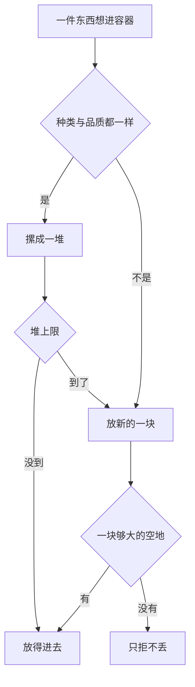

# 一堆占一块地，堆的标识是「种类 ＋ 品质」，所以容量压力由占地决定而不由种类数决定

> **正典层级**：第 5 级（系统细化）。与[玩法正典](../canon/gameplay/玩法定位.md)冲突时以正典为准；**全部格数、堆上限与扩容代价归[数值模型](./数值模型.md)，本页一个都不定。**
>
> 返回 [总索引](../README.md)｜[系统文档与提案索引](./README.md)｜相关：[时间与经营 · 背包与仓库](../canon/gameplay/时间与经营.md) · [物品系统](./物品系统.md) · [角色与成长 · 物品所属权](../canon/gameplay/角色与成长.md) · [数值模型 · 容量：一次取舍，不是频繁丢弃](./数值模型.md)｜台账：[`GP-23`](../spec/issues/README.md)

## 摘要

**这一页回答一个问题：东西放得进去吗，放不进去会怎样。** 读完你能判断两件事 —— 两样东西该不该摞成一堆（判据是种类与品质都一样），以及「满了之后那批东西去哪了」（答案永远是留在原处，不会消失）。

**任何入口都不自动丢弃。** 这是本页最硬的那条，每一条拒绝路径都只拒不丢。

下面这张图回答一个问题：**一件东西想进容器时，会走到哪几个结局。** 哪一条路都不通向「消失」。同标识堆装满了就放新的一块。

**重画条件**：多一条拒绝路径、堆的标识变了，或者出现任何自动丢弃时重画。

**这张图不新增任何事实，权威是下面「结构」那几节。** 每条拒绝路径各自的原因怎么报、关卡里哪些操作允许、一键整理怎么排，图都放不下。

本页持有两个容器：**背包**（按角色各一个、随身、靠等级增格）与**仓库**（基地一份、靠建造与升级扩容）。格子怎么占、满了走哪条路、关卡里哪些操作允许、容量判据按什么量，都在这里。

**两个容器都是网格**（[ADR-0034](../decisions/ADR-0034-背包与仓库改成网格.md)）：一格一个基础单位、格与格之间不留缝，一件东西按它的占地占一块长方形，一堆占一块，东西不能旋转。

**堆的标识从「种类」细化成「种类 ＋ 品质」**。品质是物品实例自带的属性（[物品系统](./物品系统.md)），而堆是容器的概念，所以这条落在本页，不落在物品那边。**声明「无品质」的那些物品（典籍、任务物品）标识里只有种类** —— 那不是例外，是同一条规则在少一维时的样子。由此来一条硬后果：**容量判据 C7 量的东西从种类数变成这些堆占的格数**，参数必须重算，判据形式不变。

**本页不持有**这些，各有自己的家：

- 物品自身的稀有度与品质两条轴、品质怎么进基础价（[物品系统](./物品系统.md)）。
- 归属、自动上交与索取（[角色与成长 · 物品所属权](../canon/gameplay/角色与成长.md)）。
- 各级格数、堆上限与预期出征堆数的值（[数值模型](./数值模型.md)）。
- 界面排版与控件（界面侧）。

最要紧的那条承诺：**不新建暂停机制、不新建第三个容器、任何入口都不自动丢弃。** 物品定义只多一格占地，那是「它是什么」的一部分（[物品系统](./物品系统.md)）。唯一的批量摆放动作是玩家点一次的一键整理，它不跨容器、不改数量。

## 术语

只列**只有本页在用**的词，本页只有一个。跨页共用的在[术语表](../reference/术语表.md)，本节不重复（`堆`、`堆上限`、`格位`、`满载`、`翻包`、`仓储级数`、`品质`、`稀有度`、`基础价` 都在那边）。

| 词 | 它在本页指什么 |
| --- | --- |
| **一键整理** | 玩家点一次、把一个容器里的堆重排一遍。**不跨容器、不改数量**，是本页唯一的批量摆放动作 |

## 上游约束

- [时间与经营 · 背包与仓库](../canon/gameplay/时间与经营.md)：背包与仓库都是网格、一件物品按占地占一块、同种堆到各自上限而一堆占一块、物品不能旋转、每个角色各有背包、背包靠升级增格而仓库靠建造与升级扩容、满时提示且不自动丢弃、队友背包满则停止自动采集、仓库满则无法入库、关卡内允许背包操作。**这是本页全部行为的来源，本页只细化结构与度量，不改任何一条。**
- [ADR-0034](../decisions/ADR-0034-背包与仓库改成网格.md)：网格、占地是长方形、不能旋转、放得下与满载的定义、随身栏是背包上单独一排只放占 1 格的东西、C7 的分子是占的格数。**约束下面「一堆占一块」与「随身栏」两节的结构，被放弃的几条与理由在那一份。**
- [时间与经营 · 翻包暂停，用道具不暂停](../canon/gameplay/时间与经营.md)：两半分属同一条判据的两边。**约束本页在关卡里那一节只能照这条分，不许合并。**
- [玩法定位 · 弹界面接管输入就暂停世界，世界里的动作不暂停](../canon/gameplay/玩法定位.md)：判据落在「界面接管输入」上；暂停复用顿帧那个「当帧不推进」的闸门。**约束翻包为什么停、用道具为什么不停，也约束本页不许自造暂停。**
- [玩法定位 · 手环的管理功能在关卡内不可用](../canon/gameplay/玩法定位.md)：背包是随身物，派工与订货才是管理功能。**约束本页在关卡里那一节只到背包，仓库不在场** —— 关卡里还能操作什么由正典那一句枚举，本页不复述。
- [时间与经营 · 结算顺序（固定，不得改动）](../canon/gameplay/时间与经营.md)：学生派工产出入库是跨日那一串里的一步。**它是仓库唯一的自动写入点，所以仓库满载的处理必须在那一步有明确去处。**
- [角色与成长 · 物品所属权](../canon/gameplay/角色与成长.md)与[角色与成长 · 战利品归属](../canon/gameplay/角色与成长.md)：所属权限制转移与处置、不限制使用与配装；掉落归击杀者、采集归采集者。**约束背包按角色分这件事不是界面便利，是所属权的载体；也约束本页不碰索取与自动上交。**
- [角色与成长 · 装备：宝物与宝石](../canon/gameplay/角色与成长.md)：宝物带固定主词条 ＋ 随机副词条。**约束宝物在容器里的占位 —— 随机词条让每个实例的标识互不相同。**
- [物品系统](./物品系统.md)：品质每个实例各带一个、取值是一张在册的声明表、不许合成、不做品质衰减。**它决定堆标识里「品质」这一维有多少个取值，也决定本页不必处理「放久了变差」。**
- [ADR-0009 · 分工边界](../decisions/ADR-0009-编辑器主导的开发模式.md)：参数唯一来源是场景与资源，代码不留能用的默认值。**约束本页定出的每个量纲将来落成外置数据，缺配置当场报错。**

## 结构

### 两个容器，分它们的判据是「跟着人走还是跟着建筑走」

| 容器 | 归谁 | 怎么变大 | 满了怎么办 | 关卡里 |
| --- | --- | --- | --- | --- |
| 背包 | 每个角色各一个，是[所属权](../canon/gameplay/角色与成长.md)的载体 | 背包等级（全队共用一个） | 拾取与自动采集被拒并提示 | 主角那个可查看、可用、可丢；队友的只读 |
| 仓库 | 基地一份，全队共用 | 建造仓储建筑并升级 | 入库被拒并提示 | 不在场 |

- **仓储建筑的室内只有一个交互点**，走到它那儿开仓库界面；室内摆的箱子是装饰，**不构成第二个容器**。做成一排真能用的箱子，玩家就能靠「再造一个箱子」绕开仓库满这件事，而那条压力正是建造系统的重要驱动力。

**新容器该不该建，判据就是这一句**：它跟着人走还是跟着建筑走。跟着人走的必须按角色各存一份，跟着建筑走的只有一份、由建造扩容。**没有第三种容器** —— 特别是没有「共享随身包」，那东西两边的规则都不满足，还会让所属权失去载体。

- **背包的内容按角色各存一份，格子数不按角色各存一份**：**背包等级全队共用一个**，升一级全员一起变大。格子数是装备能力而不是角色能力；按人各升要玩家给九个人各花一笔钱，而学生背包只在自动采集时起作用，没人会为它单独投资 —— 那笔钱会变成税，不是选择。
- **倒下不掉落任何东西。** 学生倒下不死亡、不做不可逆损伤（[时间与经营 · 治疗与照护](../canon/gameplay/时间与经营.md)），掉包会把一次失手变成一笔经济惩罚。

### 一堆占一块，堆的标识是「种类 ＋ 品质」

- **同标识的堆到各自上限，不同标识各占一块。** 8 个寻常木料与 3 个精良木料是两堆、两块。一块多大由那件物品的占地定（[物品系统](./物品系统.md)），一格大的东西一块就是一格。
- **无品质的物品按种类分堆**（[`物品系统` · 有些物品没有品质这条轴](./物品系统.md)）。**典籍另有一条**：它不可出售、不可丢弃（正典），所以满载那条路对它只剩「拒绝拿起」这一种 —— 不许自动丢弃，与下面那条「满了只拒不丢」同一句话。
- **两个容器共用这一条标识规则，仓库也按品质分堆。** 仓库的格数大一个量级、压力本来更小，但两处规则不一样的话，「从背包倒进仓库」就成了一次隐形的合并 —— 仓库那头得为一堆记一份品质分布，而玩家在背包里看到的是分开的堆。同一件东西在两个容器里占的格数必须能对上。
- **什么能进堆标识，判据两条同时成立**：它是物品实例自带、不随容器变的属性；并且玩家会分别处置带不同取值的两份东西。品质两条都成立 —— 它进基础价，也决定拿哪一份去加工。
- **所属权因此不进堆标识**：容器本身就是所属权的载体，同一个背包里的东西归同一个人。唯一已知会破掉这条的是偷来的物品（不转移所属权，见 `GP-3`）—— 那条真要做的时候按上面那个判据重判一次，现在不为它加一维。
- **实例唯一的东西永不合堆。** 带随机副词条的宝物每件的标识都不一样，所以它们一件一块。这不是例外，是同一条判据的结果；装备栏那一侧怎么存在[`装备系统`](./装备系统.md)，而**装在身上的宝物与镶进孔里的宝石都不占格** —— 装备栏不是第三种容器。
- **堆上限按种类给，各品质共用同一个，两个容器也用同一个。** 让上限按品质分档，玩家就得记住同一种东西的好几个上限；让仓库的上限更大，「倒过去占几格」又对不上了。
- **满载 = 既没有可合的同标识堆，也没有一块放得下它占地的空地。** 两个条件都要写：半满的同标识堆还能继续装，只判「有没有空地」会把它算成满。**空格的数目够、却凑不出一块够大的空地，也算放不下** —— 被拒时分两种说法：一格空的都没有是「满了」，有空格但凑不出是「放不下这么大的」，后者挪一挪就放得下，前者得先腾东西。

### 一堆放在哪：先合堆，再找第一块够大的空地，不能旋转

- **新的一块放在从上到下、从左到右第一个放得下它整块占地的位置。** 那一块里的每一格都必须空着、都在网格里面。
- **东西不能旋转。** 光从正上方照（[像素绘制原则 · 统一视角与光源](../production/像素绘制原则.md)），图转 90 度受光的顶面就跑到侧面，每件能转的都得另画一张；理由与被放弃的几条在 [ADR-0034](../decisions/ADR-0034-背包与仓库改成网格.md)。
- **玩家挪一堆：点它拿起，再点一个地方放下。** 放下时，拿起时点的那一格对准现在指的那一格。要放的那一块全空着（这一堆自己原来占的格算空）就挪过去；指到一堆同标识的东西上就合进去，到堆上限为止、剩下的留在原处；压到别的堆或者出了网格就放不下，什么都不变。**压到别的堆时不互换**：互换会让手上多出一件要另找地方的东西，而压到两堆以上时又换不了，规则要分三种情形。

### 随身栏是背包上单独一排，只放占 1 格的东西

- **随身栏那一排属于背包，不属于网格。** 格数与技能位同源（[`界面系统`](./界面系统.md)），网格里的位置不会挪进它，它也算进背包的容量。
- **只放得进占地 1×1 的东西。** 屏幕上的随身栏一格只装得下一个基础单位的图标，大东西要用得去背包页。
- **新进来的东西先合堆：先找随身栏，再找网格。** 还要放新的一块时，占 1 格的先找随身栏的空格、再找网格，大的直接找网格。这样手上空着的那几格最先被填，捡到的种子、吃的不用开背包就拿在手上。

### 分堆的代价由排序、筛选与一键整理来付

品质分堆的真代价不是格子变少，是**一屏里同名多行、找东西变慢**。所以排序、筛选与一键整理是分堆能落地的前提，不是可选的锦上添花。

| 手段 | 形状 |
| --- | --- |
| 排序 | 三个键：按品质（好的在前）、按类别、按最近获得（新的在前） |
| 筛选 | 按类别（连它下面的小类一起）与按品质；筛选态下仍可正常操作，不是只读预览 |
| 一键整理 | 把同标识的散堆并成一堆，再按当前排序键重排 |

- **整理有三条硬约束**：不丢弃任何东西、不跨容器、不改变任何数量。它只动「摆法」，动了别的就变成了自动丢弃的另一种写法。
- **排序与整理怎么摆**：按当前排序键排好先后，再一堆一堆找第一块够大的空地，从左上往右下摆。**照新的先后摆不下全部时，一格不动**，屏上说清是摆不下 —— 网格会有碎片，新摆法可能比玩家自己的更差；动了一半就停，等于替玩家把东西摆丢了一半。先放大的能摆得更紧，但会打乱排序的先后，不用。
- **整理是玩家点一次的动作，不在拾取时自动发生。** 拾取时自动重排会让每次捡东西都把整屏位置洗一遍，玩家刚记住的位置立刻失效。
- **排序与一键整理不碰随身栏那一排。** 屏幕上的随身栏画的就是那一排（[`界面系统` · 常驻那一层：战斗与经营的抬头显示](./界面系统.md)）。排一次就换掉玩家手上那一格，而他没按任何键。所以那一排只在玩家自己挪东西时才变。
- **被筛掉的那几堆不挪位。** 筛选态下排序与整理只在剩下的地方摆看得见的那几堆，被筛掉的照旧占着自己那一块；挪与丢弃也只对看得见的那几堆做。
- **不做撤销。** 按位置读背包的只有随身栏那一排，而排序与整理不碰它；网格里的位置不承载语义，重排不丢信息。**判据留在这里**：哪天又出现按位置读背包的东西，要么它也躲开排序与整理，要么撤销跟着补上。

### 满了怎么办：不自动丢弃，每个入口各有一条明确的拒绝路径

| 入口 | 谁触发 | 满载时的行为 |
| --- | --- | --- |
| 主角拾取 | 玩家 | 拾不起来并提示，**物品留在世界里**；玩家可手动丢弃腾位置后再拾 |
| 队友自动采集 | 队友 AI | 停止采集，不丢弃已有物品；腾出位置后自行恢复 |
| 玩家入库 | 玩家 | 无法入库并提示，须先卖出、加工或丢弃 |
| 学生派工产出入库 | 每日结算 | **产出留在工位上**，不入库也不消失；提示玩家，仓库腾出位置后由下一次结算入库 |
| 任务奖励 | 任务结算 | **不直接进背包**：东西一律当作货物送到家旁边的货物箱，也就是订货送达的那个送达点（[`经济系统`](./经济系统.md)）；玩家回基地自己取，取不进背包的一直留在箱里 |

- **拒绝不许吞掉世界状态。** 拾取失败时地上那份必须还在 —— 否则「背包满」就变成了一种看不见的丢弃，而正典禁的正是替玩家丢东西。
- **队友停采是停，不是错。** 它不该弹错误、不该打断队友的其它行为，恢复条件就是「有位置了」。
- **自动入库被拒时产出留在工位，和「拾取被拒时地上那份还在」是同一条规则**：东西留在原地，不丢也不搬家。跨日结算发生时玩家不在看，静默丢会变成查不出来的损失 —— 第二天只剩一句「我记得昨天该收 12 个」。**工位不是第三个容器**，留在原地与地上那份留在原地是一回事。
- **任务奖励的东西不直接进背包，委托、主线任务与个人请求都一样。** 委托在关卡结束那一刻结算，那时「世界里」已经不在了，拾取被拒时留在原地那条路走不通。只把放不下的那一份送走的话，同一份奖励会按那一刻背包满不满拆成两处，玩家每次都得两边找。所以一律送货物箱，玩家在基地挑着取；钱照旧直接进钱包。
- **货物箱只出不进，也不是第三个容器。** 它是东西落下来等人取的地方，与地上那份、工位上那份留在原地是一回事。能往里放的话，它就成了一个不占仓储级数、也装不满的仓库，而仓库扩容的唯一入口是仓储级数。
- **没有别的自动写入点。** 出征回来不自动把背包倒进仓库：入库是玩家的动作，正典也写着仓库满时「玩家须先卖出、加工或丢弃」。自动倒进去就得替玩家决定倒哪些、满了又丢哪些。**手环订货的货同样不自动进来** —— 它落在送达点等玩家取（[`经济系统`](./经济系统.md)），所以「满了怎么办」的答案与产出留在工位是同一个。任务奖励的东西也落在那里，见上面那张表。

### 关卡里：翻包暂停，用道具不暂停

| 操作 | 算什么 | 停不停 |
| --- | --- | --- |
| 打开背包、翻看、排序、筛选、整理、下指令 | 界面接管输入 | **暂停世界** |
| 丢弃 | 在界面里当场完成 | 界面开着，所以世界停着 |
| 用道具 | 世界里的动作 | **不暂停**，照走各自的读条与后摇，受击中断且不消耗 |
| 拾取 | 世界里的动作 | 不暂停 |

- **界面一关，那个动作才在世界里开始走。** 这是「暂停买不到一次免费的喝药」的实现形状：指令是在停着的时候下的，代价是在走着的时候付的。
- **关卡里打开时默认落在「用得上的那一页」，它按「使用效果引用非空」筛。** 战斗中要翻包，绝大多数情况是找一件要用的东西；默认落在别处等于每次都先筛一遍。
- **那一页读的是[物品系统](./物品系统.md)已有的那一格** —— 能不能直接用，看使用效果引用有没有值。所以**不给「消耗品」开一个类别值**：那一份刻意不把它当类别，理由在那边（写着消耗品却没有效果引用这种自相矛盾的定义查不出来）。**它也不是筛选控件的第三条轴** —— 控件仍然只有类别与品质两条（见上面「分堆的代价由排序、筛选与一键整理来付」那张表），这一页是关卡里那一套自己的默认落点，基地侧没有它。
- **点一个物品不立刻执行，在它右侧展开动作选择（使用／丢弃）。** 点一下就用等于替玩家猜他想用还是想丢，而本页**不做撤销** —— 猜错就是不可逆的。
- **丢弃必须在关卡里够得到。** 满时只拒不自动丢，所以腾位置是玩家在关卡里要做的事；动作选择里只有「使用」就把那条路堵死了。
- **这一侧有个已知代价，写下来免得以后当成缺陷**：战斗中用道具必须走背包，于是背包成了关卡里最高频的界面 —— 而正典允许它暂停的依据本是「偶尔翻一次」。实机仍嫌烦时的后手是给一件出征前指定的消耗品加一个快速使用键（手柄上 D-pad 第四向空着），那是加法，不推翻本页任何一条。
- **不自造暂停**，复用顿帧那个「当帧不推进」的闸门（[玩法定位](../canon/gameplay/玩法定位.md)），所以按帧计的状态在翻包期间自然不走，状态载体那一侧不需要为背包加任何东西。
- **仓库在关卡里不存在。** 不做远程存取：能在关卡里随时把东西塞进仓库，背包容量就不再是约束，而它是「带什么回去」这个选择的唯一载体。
- **关卡里只动主角自己的背包，队友背包只看不动。** 队友包里的东西归队友（[角色与成长 · 物品所属权](../canon/gameplay/角色与成长.md)），「调配消耗品」是基地侧的权限；关卡里连手环的管理功能都关着，玩家却能翻学生的包并不自洽。队友要不要用自己的道具归队友 AI，阈值那批值归 `GP-7`。

### 容量判据怎么量：分子是那些堆占的格数，不是种类数

- **占用 = 预期出征那些堆的占地之和 ÷ 初级背包格数**，背包格数算上随身栏那一排。判据 C7 的形式不变（占用落在 70%–100%），住在[数值模型](./数值模型.md)，由 `python tools/simulate_week.py` 判定。
- **堆数 ≥ 种类数**：一次出征带回来的同一种物品若有两个品质，它就占两块。所以品质落地之后同一次出征的占用只会变大，不会变小；大东西占地多，同样一堆占的格数也多。
- **量纲**：格是纯计数；堆上限是「件／堆」；占地是「格／堆」；预期出征产出从「种类／次」改成「堆／次」，乘上各堆的占地是「格／次」。
- **占用小于 100% 不保证摆得下**：网格有碎片，格数够也可能凑不出一块。C7 量的是格数，不量摆法，摆不摆得下由玩家挪出来。
- **校准办法是调格子数，不调预期堆数。** 预期堆数是从内容估出来的量（带回几种、每种跨几个品质），它不是可以为了让判据成立而回头改的旋钮；格子数才是。各级格数按同一比例一起放大，仓库同理 —— 它也按品质分堆。值归[数值模型](./数值模型.md)。
- **不重算 C7，它会在品质落地当天变成假的** —— 它那时量的还是种类数，而容器里一堆占一块。
- **容量只有格子这一条轴。** 重量与负重不做，正典已经把负重从力量的作用里去掉了（[角色与成长 · 四项属性的作用方向](../canon/gameplay/角色与成长.md)）。

## 接口

| 挂载点 | 位置 |
| --- | --- |
| 物品定义的字段（名称、描述、类别、图标、占地、稀有度、堆上限……） | [物品系统](./物品系统.md)。本页只读它们 —— 排序与筛选读的类别就是那张表里的字段，堆标识读的品质是实例级的那一项，一堆占多大一块读占地 |
| 各级格数、堆上限、预期出征堆数 | [数值模型 · 容量：一次取舍，不是频繁丢弃](./数值模型.md)，值在参数表 |
| 容量判据 C7 | [数值模型](./数值模型.md)；判定入口 `python tools/simulate_week.py` |
| 拾取与自动采集 | 关卡侧的世界动作；被拒时物品留在世界里 |
| 任务奖励 | [`任务系统`](./任务系统.md)的完成结算：东西送到货物箱（[`经济系统`](./经济系统.md)那个送达点），**不直接进背包**；从箱里取是玩家的动作 |
| 自动入库（**仓库唯一的自动写入点**） | [每日结算](../canon/gameplay/时间与经营.md)里学生派工产出入库那一步（**按步名引用，不按步号** —— 插一步会让步号静默指错）；满了则产出留在工位 |
| 背包等级 | 全队一个，值与扩容代价归[数值模型](./数值模型.md)；等级从哪来（买、造还是剧情给）是内容与经济侧的事，本页不定 |
| 仓库扩容 | [`建造系统` · 这两个挂点是别人在等的](./建造系统.md)：仓储建筑的级数 → 格数。**这是唯一的扩容入口** |
| 所属权、自动上交与索取 | [角色与成长 · 物品所属权](../canon/gameplay/角色与成长.md)，本页不碰 |
| 满载提示 | 即时反馈，**不进手环的事件流** |
| 存档 | 两个容器的内容跨日、非帧级，进正式存档；主角背包那一片的声明在下面「下游同步」那一节；缺少 mod 内容时的容错走 `ENG-7` |
| 排序、筛选与一键整理 | 形状与三条硬约束在本页；规则在代码仓 `rules/Economy/Bag.cs` 与 `rules/Economy/BagControls.cs`，控件在界面侧（`UI-13`） |
| 「这种物品见过没有」 | [`图鉴系统`](./图鉴系统.md)：一个实例进入玩家侧容器时报一次，**本页不加字段也不记它** |
| **作者填** | **无。** 两个容器是纯规则层的格位与满载判定；格数是数值、物品图标归[`物品系统`](./物品系统.md)那一侧的作者工作（[ADR-0009](../decisions/ADR-0009-编辑器主导的开发模式.md)）|

**挂载点到此为止。** 下次加一条与装东西有关的功能时，先问「它挂在上面哪一个」，而不是顺手插一个新钩子。

### 它不碰的那几条接缝

上面那张表里没有的，都不是漏了。这几条是最容易被误接上的：

- **不碰物品定义。** 名称、类别、堆上限那些字段在[`物品系统`](./物品系统.md)，本页只读它们。
- **不碰所属权。** 归属、自动上交与索取全在[角色与成长 · 物品所属权](../canon/gameplay/角色与成长.md)。
- **不碰扩容的来源。** 仓库格数的唯一入口是[`建造系统`](./建造系统.md)的仓储级数，本页不另开一条。
- **不碰暂停。** 关卡内翻包暂停靠的是顿帧那个既有闸门，**载体那一侧不需要为背包加任何东西**。
- **不碰界面实现。** 排序、筛选与一键整理的形状在本页，画出来归界面侧。

## 边界与非目标

- **不定任何数值**：各级背包与仓库格数、堆上限、预期出征堆数、扩容代价全归[数值模型](./数值模型.md)。本页只给量纲与「必须重算 C7」这条约束形式。
- **不定物品自身的两条轴**：它们在[物品系统](./物品系统.md)。耐久、修理与品质衰减那份已经明确不做，所以容器不必处理「放久了变差」。
- **不碰所属权**：归属判据、自动上交、索取全在[角色与成长 · 物品所属权](../canon/gameplay/角色与成长.md)。本页只保证「一个背包一个主人」这条结构成立。
- **不做自动丢弃**，任何入口都不做。一键整理是唯一的批量摆放动作，它受「分堆的代价由排序、筛选与一键整理来付」那一节的三条硬约束。
- **不做远程存取**：关卡里够不到仓库。
- **不做重量与负重**：容量只有格子这一条轴，理由见「容量判据怎么量」那一节。
- **不做界面排版**：一屏几列、角标画在哪、同名多行怎么排、排序与筛选的控件长什么样，归[`界面系统`](./界面系统.md)与作者实机定。本页只定要有哪几个排序键与哪几条约束。
- **同名不同物，三处容易混**：
  - **格数**（网格有多少格）与**堆上限**（一堆能装多少件）是两个量，C7 只用前者。
  - **背包**（容器）与**宝物栏**（装备位，见[角色与成长 · 装备：宝物与宝石](../canon/gameplay/角色与成长.md)）不是一回事：前者管存放，后者管生效。
  - **品质与宝物的随机副词条也是两件事**，一件宝物两样都有；本页只用到「品质是实例属性」这一半，那条分别的家在[角色与成长 · 装备：宝物与宝石](../canon/gameplay/角色与成长.md)，本页不复述。

## 理由与取舍

- **没选格子照旧一格一堆、能旋转或任意形状。** 一格一堆的话大东西只能挤成一个基础单位、丢掉细节；能旋转的话每件能转的都得另画一张；任意形状要每件声明一张形状图。理由全文在 [ADR-0034](../decisions/ADR-0034-背包与仓库改成网格.md)。
- **没选让一键整理摆不下时摆一半。** 摆一半就停，剩下那些没有地方去，等于替玩家丢；所以摆不下全部就不动，代价是那一下看着没反应，由一句提示补上。
- **没选让背包页滚动。** 这一页要答「还背得下吗」，整张网格一眼看得全才答得出；所以每一级背包以一页放得下为上限。仓库大一个量级，放不下一页时按整行竖着滚。
- **没选把不同品质塞进同一堆、堆内再记一个分布。** 看着省格子，实际把「带哪一堆回去」这个选择藏起来了，而且每次加工与出售都要多问一句「用哪些」。格子制的价值本来就是「看得见的取舍」，品质分堆让那个取舍变多，这正是收益而不是代价。
- **没选让堆标识带上所属权。** 容器已经是所属权的载体，加这一维只会让同一个背包里出现「同种同品质但分两堆」，而那两堆对玩家没有任何区别。
- **没选把满载定义成「有没有空格」。** 那会让半满的同标识堆收不进东西 —— 玩家看着那一堆只有 3 个却被告知装不下，是那种一看就像 bug 的行为。
- **没选让拾取失败吞掉地上的物品。** 省一次提示，代价是背包满时的丢弃变成隐形的，而「不自动丢弃」这条正典要防的就是这个。
- **没选把「背包满」做成手环通知。** 手环是事件通知渠道，而拾取失败是即时反馈：写进事件流会在一次出征里刷出一串同样的条目，把真正的事件（委托到期、收购队到达）挤下去。
- **没选让堆上限按品质分档。** 多一层要记的东西，不多一个决策。
- **没选在关卡里开仓库。** 背包容量是「带什么回去」唯一的载体，能随时入库就等于取消了它。
- **没选让 C7 继续量种类数。** 判据的形式是对的，量错的东西会让它在品质落地当天变成一句正确但无关的话 —— 那比判据不成立更难发现，因为脚本照样打绿。
- **没选给队友加「满了就自动丢最差的」。** 队友背包满停止采集看着浪费，但替玩家的学生决定丢什么，比替玩家自己决定更过分 —— 那份东西的所属权还不在玩家手上。
- **没选让仓库按种类合堆、只让背包分堆。** 仓库压力小，合堆看着更省地方，代价是它得为一堆记一份品质分布，而「倒进仓库」会变成一次隐形的换算 —— 同一批东西在两个容器里占的格数对不上，玩家没法预判自己倒不倒得进去。
- **没选给一键整理做撤销。** 撤销要存一份整理前的摆法，只救得了误点：整理照样每点一次就把手上那几格洗一遍。挡住这一条的是排序与整理不碰随身栏那一排，判据留在结构那一节。
- **没选让整理在拾取时自动跑。** 省玩家一次点击，代价是每捡一样东西整屏都可能重排，刚记住的位置立刻失效。
- **没选做重量制。** 两条容量轴要玩家同时盯两个上限，而格子制已经把取舍摆在明面上了；负重还会让「带什么回去」变成一道算术题而不是一次选择。
- **没选让背包等级按角色各记一份。** 更像「每个人自己的包」，代价是玩家要给九个人各花一笔钱，而学生背包只在自动采集时起作用 —— 那笔钱会变成税。共用一个等级，升级就是一次对全队都有意义的投资。
- **没选让派工产出在仓库满时自动卖掉。** 省掉一次玩家操作，代价是替他做了一笔经济决策，而定价有三层、行情会变 —— 他第二天才发现是在最差的行情下卖的。
- **没选让派工产出塞进学生自己的背包。** 学生背包会满，而且基地的种植物与制造物本来全归主角，塞进去等于顺手改了所属权。
- **没选让出征结算自动入库。** 省一次操作，代价是仓库满、背包也满时又得替玩家决定丢什么，而那正是整页都在拒绝的那件事。
- **没选只把背包放不下的那一份送货物箱。** 看着少走一趟，代价是同一份奖励按结算那一刻背包满不满拆成两处，玩家每次都得两边找；而出征回来时背包满着是常态。
- **没选让货物箱也能往里放。** 那样它就是一个不占仓储级数、也装不满的仓库，等于绕开了仓库扩容的唯一入口。
- **没选让玩家在关卡里翻队友的背包。** 递药看着贴心，但关卡里手环的管理功能全关着，唯独能动学生的私人物品说不通；「调配消耗品」留在基地侧。

## 验收

**可自动验证项**（纯规则层，与引擎无关）：

- 合堆与分堆：同种同品质合进一堆并堆到上限，同种不同品质各占一块；反过来构造一次「不同品质被合堆」的断言，必须失败。
- 两个容器同一条规则：堆上限相同，同一批东西在背包与仓库里占的格数相同，整批倒过去不多不少。
- 排序：三个键各排一次，结果稳定（同键两次排出同一个顺序）。
- 筛选：筛选态下的操作与未筛选时等效，且筛掉的东西没有被移动。
- 一键整理：同标识的散堆并成一堆、按当前排序键重排，**总数一件不变、不跨容器、一件都不丢**；容器里没有散堆时它是空操作。
- 随身栏那一排不动：排序与一键整理之后随身栏那一排一格不变；**反过来让整理把网格里占 1 格的东西也往随身栏里摆，那条用例必须失败** —— 一条反证，钉住前一条不是碰巧成立。
- 半满堆可续装：格子用尽但存在半满的同标识堆时，拾取仍然成功。
- 满载定义：只有「没有可合的同标识堆」与「没有一块放得下的空地」同时成立才算满；任一不成立就还装得下 —— 两个方向各一条。
- 碎片：空格的数目够、却凑不出一块够大的空地时被拒，原因是「放不下这么大的」；挪开挡着的一堆之后同一件放得进去。
- 不能旋转：没有任何旋转一堆的入口（一条结构约束）。
- 随身栏只放 1×1：大东西放进随身栏被拒，那一堆留在原处。
- 整理摆不下：照新的先后摆不下全部时一格不动；构造一种「原来的摆法放得下、新摆法放不下」的情形验它。
- 拾取被拒：不自动丢弃任何已有物品，且**地上那份仍在**。
- 队友停采：背包满后停止采集、已有物品一件不少；腾出位置后恢复。
- 玩家入库被拒：仓库满时入库失败并给出提示，一件都没进去。
- 派工产出入库被拒：产出留在工位、总数一件不差；腾出位置后下一次结算入进仓库。**构造一次「产出凭空少了」的断言，必须失败。**
- 出征结算不碰仓库：跑完一次归来结算，仓库内容一件不变（仓库只有派工产出那一个自动写入点）。
- 任务奖励不直接进背包：完成一条任务前后背包内容一件不变，奖励的东西在货物箱里（一条反证）；从箱里取不进背包时，那一样留在箱里、一件不少。
- 货物箱只出不进：往箱里放东西的入口不存在（一条结构约束）。
- 倒下不掉落：角色倒下前后背包内容完全一致。
- 背包等级：升一级之后全队每个背包的格数一起变大，不是只有主角。
- 关卡内范围：主角背包可操作，队友背包只读；两个方向各一条。
- 关卡里的默认页：它筛出来的正好是**使用效果引用非空**的那些 —— 给一件带引用的物品与一件不带的，前者在那一页里、后者不在；**筛选控件的轴仍然只有类别与品质**（一条结构约束 —— 它挡的是「顺手把这一页做成第三条筛选轴」那种实现）。
- 实例唯一：两件同名宝物因副词条不同而不合堆，各占一块。
- 扩容：背包升级与仓库扩建之后，原有堆与堆内数量一件不变。
- 暂停边界：翻包期间世界按帧不推进（复用顿帧那个闸门，可由一条测试钉住）；用道具的读条照走，且被击中时中断并**不消耗**那件道具。
- 关卡内可用集合：仓库入口在关卡里不可用；派工与订货同样不可用（那是[手环的管理功能](../canon/gameplay/玩法定位.md)）。
- 参数缺失当场报错：网格的行列与堆上限没有能用的默认值（[ADR-0009](../decisions/ADR-0009-编辑器主导的开发模式.md)）。
- **C7 重算之后仍成立**：由 `python tools/simulate_week.py` 判定，占用仍落在 70%–100%，且它量的是那些堆占的格数。

**必须实机确认项**：品质分堆之后一屏里同名多行读不读得下去、三个排序键够不够用、找东西要不要翻很久、满载提示看不看得见、翻包暂停的节奏顺不顺手、一格里的数量与品质角标在 16px 图标上分不分得清。按 [ADR-0009](../decisions/ADR-0009-编辑器主导的开发模式.md) 的分工由作者实机看，本页不判。

**完成边界**：两个容器各按自己的扩容途径存在、两处都按「种类 ＋ 品质」分堆、每个入口的拒绝路径都走得通且都不自动丢弃、排序筛选与一键整理可用、关卡内翻包与用道具各在判据的正确一侧、C7 按占的格数重算过并仍成立。做到这些，后面加物品就只是加数据。

## 下游同步

- **代码**：容器与堆叠是纯规则层的东西，落在经营侧；物品定义与品质取值走内容外置那条既有路径（`ENG-5`）。
- **存档**：**主角背包是一个分片，本页自己声明**（[`存档系统` · 一个分片要声明什么](./存档系统.md)那张表）—— 分片标识 `bag`；持有它的系统是本页；**进正式存档那一侧**（背包里的东西跨过一次睡眠还在）；缺字段时补**开新档时那个背包**：第一级那么大、一件都没有，与「这个分片从来没存过」时的初始值是同一处。每一堆存种类、品质、件数、「最近一次进东西的先后序号」（「按最近获得」排序读它）与它在网格里的位置（左上角那一格）；随身栏那一排另存一串。**「下一个序号从几起」不存**，取各堆里最大的那个（[`存档系统` · 派生量不单独存](./存档系统.md)）。存档里网格的行列比现在配置的大时载入被拒、说清两边各多大 —— 多出来的那一片没有地方放，而任何入口都不自动丢弃；小的照新的大小读，每一堆还在原来那一列那一行。随身栏比现在的格数多同样被拒，少的在后面补空格。两堆的位置压在一起、或有一堆出了网格，载入被拒。**改成网格之前那一版的存档能迁就迁**（[ADR-0017](../decisions/ADR-0017-版本更新对旧存档的两种后果.md)）：存档版本往上加一，旧档由本页这个分片声明的升级迁过来（[`存档系统` · 载入：先读分片，再统一解析标识](./存档系统.md)）—— 原来开头那几格进随身栏那一排，其余按原来的格号从左上往右下摆进网格；原来的格数比随身栏加网格还多时被拒，说清两边各几格。队友背包与仓库落地时照同一张表各自声明；缺 mod 内容时的容错走 `ENG-7`。
- **数值**：各级背包与仓库几行几列、堆上限、预期出征堆数与它们的占地、扩容代价进[数值模型](./数值模型.md)的参数表；**C7 的分子是那些堆占的格数，按调格子数的办法重新校准**，改完重跑 `python tools/simulate_week.py`。
- **界面**：排序、筛选与一键整理的控件与排版在[`界面系统` · 手环上：背包](./界面系统.md)，本页只定要有哪几个排序键与那三条硬约束。
- **台账**：立项在 [`GP-23`](../spec/issues/README.md)，未定项也记在那里；物品侧在 `GP-22`、装备侧在[`装备系统`](./装备系统.md)（`GP-24`）、偷来的物品在 `GP-3`、界面在 `UI-13`、货物箱在 `GP-164`。
- **该上升进正典的**：只有一条 —— **「堆的标识是种类 ＋ 品质」** 这个判据，等实现证明它在满编背包里仍然读得下去之后，上升进[时间与经营 · 背包与仓库](../canon/gameplay/时间与经营.md)。格数、堆上限与满载的定义按定义不进正典。
