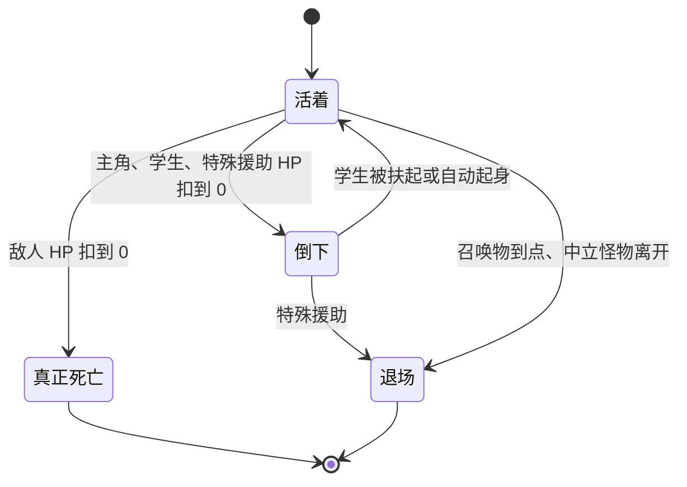

# 动作机持有互斥的姿态与流转：一次只能一个的归这里，能并存的归状态效果系统

> **正典层级**：第 5 级（系统细化）。与[玩法正典](../canon/gameplay/玩法定位.md)冲突时以正典为准；**代码动作的快慢归 `GP-6`，其余数值归[数值模型](./数值模型.md)，本页一个都不定。**
>
> 返回 [总索引](../README.md)｜[系统文档与提案索引](./README.md)｜相关：[状态效果系统](./状态效果系统.md) · [回合系统](./回合系统.md) · [战斗与关卡](../canon/gameplay/战斗与关卡.md) · [玩法定位](../canon/gameplay/玩法定位.md)｜台账：[`GP-18`](../spec/issues/README.md)

## 摘要

**这一页回答一个问题：一个角色此刻摆着什么样子，以及他在场上是活着、倒下、真正死亡还是已经退场。** 读完你能判断两件事 —— 一样新东西该加进这一页还是加进[状态效果系统](./状态效果系统.md)，以及一条「他为什么倒在那儿」「他为什么不见了」的疑问该去问谁。

**分界只有一句话：一次只能有一个的归这一页，能同时好几个的归那一页。** 站着和出手不能同时，所以它们在这里；中毒和格挡可以同时挂着，所以它们在那里。

**战斗那一台只剩一层姿态，加一个生命周期。** 小人用的是经营那套俯视四向图：走一格晃两下、出手朝目标冲一下、挨打闪白，都由代码做，不按招画动作帧；每个上战场的角色另画一套倒下的图（[战斗与关卡 · 敌人也是角色](../canon/gameplay/战斗与关卡.md)）。生命周期是活着、倒下、真正死亡与退场：倒下可救，死亡是终态。

**这一回合能不能动、做了什么，不在本页。** 那是[回合系统](./回合系统.md)的事：它结算完一件事，本页才把它摆出来。打崩、冰冻、石化、格挡这些能并存的东西归[状态效果系统](./状态效果系统.md)；它们挂在身上的样子按种类画一次、所有人共用，也不是姿态。

**它持有**：战斗那一台的姿态与流转，生命周期与每人每关那一次扶起，经营那一台的姿态与流转，以及动作集这一项声明。**它不持有**：任何效果与时长（[状态效果系统](./状态效果系统.md)），回合、那一件与施法到一半的招（[回合系统](./回合系统.md)），招的字段与那段特效挑哪一种（[技能系统](./技能系统.md)），一下打中多少（[伤害系统](./伤害系统.md)），以及全部数值。

最要紧的那条承诺：**战斗里本页不判任何一件事能不能做，也不数任何一个回合。** 能不能做在回合系统与技能系统，时长在载体；本页再判一遍、再数一遍，同一件事就有两个答案。

**经营那一台也在本页。** 它与战斗那一台是两台机器：一台按格子与回合走，一台照常走动、劳作按读条走。两台共用同一条判据、同一份状态载体与同一条接缝，所以它是本页的一节，不是另一篇。它自己的那张表见下面「经营场景：另一套动作机，共用同一份状态效果」。

## 术语

只列**只有本页在用**的词。跨页共用的在[术语表](../reference/术语表.md)，本节不重复（`动作机`、`姿态`、`动作集`、`连通性`、`全集`、`读条`、`失衡值` 都在那边）。

| 词 | 它在本页指什么 |
| --- | --- |
| **生命周期** | 一个角色在场上是活着、倒下、真正死亡还是退场。同一时刻只在其中一个，与姿态分开记 |
| **倒下那一套** | 每个上战场的角色另画的那一套倒下／死亡的图。主角与学生倒下、敌人死亡都放它 |
| **养伤** | 伤病期间不能派工。**它不是姿态**，是一条按天状态加一道派工闸门 |

## 上游约束

只链接约束本设计的正典与已定条目，不复制正文。

- [玩法定位 · 跨系统约定](../canon/gameplay/玩法定位.md)：全部临时与持续效果走同一套状态系统，每条带「可否被解除」。**这是那条判据的来源：能并存的一律归那一套，本页不另存任何效果。**
- [玩法定位 · 视角规则](../canon/gameplay/玩法定位.md)：基地、城区与战斗区域一律俯视、同一套小人；战斗区域里按格子与回合走，基地与城区里照常走动，基地里没有格子与回合。**约束「两台机器、一套小人、共用一份状态效果」。**
- [玩法定位 · 像素基准](../canon/gameplay/玩法定位.md)：一个角色只画一套俯视四向的小人，上战场的另加一套倒下／死亡的图；走路、劳作与倒下那几套按脚底锚点对齐到同一帧框；体型分小、中、大，读体型的地方不许假定只有这几档。**约束本页的姿态只落在这几套图上，也约束盖住整个人的那一套按体型取。**
- [战斗与关卡 · 敌人也是角色](../canon/gameplay/战斗与关卡.md)：走一格晃两下、出手朝目标冲一下、挨打闪白都由代码做，没有哪个角色另画战斗动作帧；另画的只有倒下；姿态怎么流转在本页；敌人声明自己是人形还是哪一类魔化载体，它只决定死亡终态留下什么。**这是战斗那一台全部姿态的来源，也约束真正死亡那一条。**
- [战斗与关卡 · 打击反馈](../canon/gameplay/战斗与关卡.md)与[战斗与关卡 · 状态在身上的样子：按种类画一次，所有人共用](../canon/gameplay/战斗与关卡.md)：出手冲一下、挨打闪白由代码做；特效画在小人头顶上方，射出去的从中心飞；状态的样子按种类画一次，冰冻与石化每个体型各一套、一直显示；闪白是着色器对整张图做的事。**约束出手那一下归本页而那段特效不归，也约束状态的样子不是姿态。**
- [战斗与关卡 · 战斗区域的空间模型：一格一个基础单位的俯视棋盘](../canon/gameplay/战斗与关卡.md)：小人只有四个朝向，斜着走、斜着打时朝左右那一侧；不做跳跃。**约束朝向那一条，也约束战斗那一台没有离地的姿态。**
- [战斗与关卡 · 回合：我方阶段主角先动、其余按敏捷，然后是敌方阶段](../canon/gameplay/战斗与关卡.md)：一回合只做一件占回合的事；战斗状态下走路花行动力；扶起倒下的人是那一件。**约束本页只摆结算好的事，不判能不能做。**
- [战斗与关卡 · 预警与打断](../canon/gameplay/战斗与关卡.md)与[战斗与关卡 · 防御与失衡](../canon/gameplay/战斗与关卡.md)：没有读条；施法回合里写了能走的只能走、没写的直接跳过；防御是一招技能，用了挂格挡；没有闪避键，也没有精准防御与精准闪避；失衡值攒满被打崩，下一回合动不了。**约束战斗那一台没有读条、防御、闪避与失衡的姿态，也约束施法到一半与打崩都不是姿态。**
- [战斗与关卡 · 失败判定](../canon/gameplay/战斗与关卡.md)：主角倒下即任务失败；学生倒下不会死亡，每人每关可被救起一次、以低血量复活；倒下的学生亮出神秘庇佑，选不中、也不受伤，扶他要走到旁边、用掉一回合。**约束生命周期里的倒下。**
- [战斗与关卡 · 队友与敌人](../canon/gameplay/战斗与关卡.md)与[战斗与关卡 · 关卡事件与附加目标](../canon/gameplay/战斗与关卡.md)：特殊援助倒下就退场；召唤物写清能存在几回合；中立怪物过几回合自己离开，没人打它时战斗状态结束它也跟着离开。**约束生命周期里的退场。**
- [战斗与关卡 · 尸体与资源点：都有血条，打碎它的人拿东西](../canon/gameplay/战斗与关卡.md)：尸体不挡路也不挡视线，残骸跟尸体同一套、只是不能被复活；复活尸体站起来那一下把那套倒下的图倒着播，复活出来的照原来的角色定义、再被打死不留尸体。**约束真正死亡留下的东西，与「死亡没有出口」。**
- [时间与经营 · 学生与派工](../canon/gameplay/时间与经营.md)、[时间与经营 · 生产](../canon/gameplay/时间与经营.md)与[时间与经营 · 治疗与照护](../canon/gameplay/时间与经营.md)：工位清单的唯一一处，劳作共用同一个「带读条、可打断」的动作，设备添料是一次交互；钓鱼是世界里的动作、不暂停世界，钓点只在基地；养伤期间不能派工。**约束经营那一台的读条动作、添料不占姿态与「养伤不是姿态」。**
- [玩法定位 · 弹界面接管输入就暂停世界，世界里的动作不暂停](../canon/gameplay/玩法定位.md)：界面接管输入才暂停，被打崩动不了不暂停。**约束本页不为暂停加任何姿态。**
- [玩法定位 · 剧情演出：一律引擎内，不做视频](../canon/gameplay/玩法定位.md)：演出摆布角色走动作机那条既有的路，与 AI 递进去的是同一种东西，只是来源不同。**约束演出那一行的入口。**
- [ADR-0035](../decisions/ADR-0035-战斗改成俯视的格子回合制.md)：角色不画战斗动作帧，动作交给代码；经营那一半的动作机一个字不改。**约束战斗那一台的范围，也约束经营那一台的结构不随战斗那一半变。**
- [ADR-0009](../decisions/ADR-0009-编辑器主导的开发模式.md)：参数唯一来源是场景与资源，缺配置当场报错。**约束动作集缺声明报错、不补默认全集，也约束帧由作者在 Godot 里做。**
- [ADR-0026](../decisions/ADR-0026-一道确认由误触与收益的落差决定.md)：一道确认由误触与收益的落差决定。**约束经营里用道具那道确认是界面的事、不是姿态。**

## 结构

### 战斗那一台：一层姿态，加一个生命周期

| 层 | 互斥性 | 管什么 |
| --- | --- | --- |
| 姿态 | 同一时刻恰好一个 | 小人此刻摆出的样子：站着、走一格、出手、挨打 |
| 生命周期 | 同一时刻恰好一个 | 他在不在场、还能不能回来：活着、倒下、真正死亡、退场 |

**姿态只在活着时有**：倒下与真正死亡放倒下那一套，退场就从场上拿掉。姿态在播的那一侧；生命周期记在规则层，回合、任务与 AI 都读它。

角色身上的东西按这条判据归位：

- 站着、走一格、出手、挨打 → 姿态，在本页。
- 倒下、真正死亡、退场 → 生命周期，在本页。
- 打崩、冰冻、石化、格挡、失控、神秘庇佑这类 → [状态效果系统](./状态效果系统.md)：它们能好几样一起挂。
- 这一回合能不能动、做没做那一件、施法到一半的招 → [回合系统](./回合系统.md)。

**本页摆的是结算好的事。** 一件事先由回合系统结算、写进续玩点，再交给表现去播（[回合系统 · 时点：回合走到哪一刻，调谁](./回合系统.md)）。看不见的敌人那一回合直接算完、不播，它的姿态也就不经过走一格与出手，直接落到结果上。

### 姿态：站着、走一格、出手、挨打，都由代码做

**小人用的是经营那套俯视四向图，战斗里不另画动作帧**（[ADR-0035](../decisions/ADR-0035-战斗改成俯视的格子回合制.md)）。站着之外那几下都是代码对整张图做的，快慢归 [`GP-6`](../spec/issues/README.md)。

- **站着**：没有别的事时就是它。被跳过的那一回合 —— 被打崩、被冻住，或者施法回合还没到点、那一招又没写施法时能走 —— 他停在站着，身上挂着什么由状态的样子说。
- **走一格**：代码让他晃两下、挪进下一格。探路时一格一回合，战斗状态下一格扣一点行动力（[回合系统 · 轮到一个人：先走，再做那一件](./回合系统.md)）；走几格就进几次。
- **出手**：代码让他朝目标冲一下再回来。每一招冲的都是这一下；出了什么招、用的什么兵器，由头顶上方那段特效说，射出去的从小人中心飞到目标那一格（[战斗与关卡 · 打击反馈](../canon/gameplay/战斗与关卡.md)）。回合外多打的那一下（借机攻击、反击、协作攻击）也是出手；采一下也是这一下，朝那个资源点冲（[战斗改成俯视战棋](./proposals/战斗改成俯视战棋.md)）。
- **挨打**：打中了就闪白。闪白是着色器对整张图做的一件事，不是画出来的帧（[战斗与关卡 · 状态在身上的样子：按种类画一次，所有人共用](../canon/gameplay/战斗与关卡.md)）。没打中不进挨打：没打中这一下对他什么都不产出（[伤害系统](./伤害系统.md)）。
- **朝向**：四个，斜着走、斜着打时朝左右那一侧（[战斗与关卡 · 战斗区域的空间模型：一格一个基础单位的俯视棋盘](../canon/gameplay/战斗与关卡.md)）。每个朝向各一套、代码不翻转（[ADR-0021](../decisions/ADR-0021-每个朝向各画一套不做水平翻转.md)）。

**施法到一半不是姿态。** 施法回合不为 0 的招放出去之后，还要占住他几次由[回合系统](./回合系统.md)记着；等的那几回合里，写了施法时能走的照常走一格，没写的被跳过、停在站着（[战斗与关卡 · 预警与打断](../canon/gameplay/战斗与关卡.md)）。它能与走一格同时成立，所以按那条判据不在本页。

**这几下还有没定的**，待定（见台账 [`DOC-160`](../spec/issues/README.md)）：

- 施法回合不为 0 的招，冲一下落在出手那一回合，还是落下那一刻。
- 指向自己的招没有可冲的方向，那一下小人怎么动。
- 挪自己的招（瞬移、冲锋、后撤）与被击退、被推走时，小人怎么从一格到另一格。
- 倒下那一套少于四个朝向时，缺的那几向取哪一向。

### 一个角色有哪些动作，是它自己声明的

**动作集是角色定义上的一个声明项**，那张表在[成长系统](./成长系统.md)。**缺声明时载入报错，不给默认全集**（[ADR-0009](../decisions/ADR-0009-编辑器主导的开发模式.md)：代码不留能用的默认值）。一个角色的实际动作机是它声明的那些动作在全集上导出的子图；缺一个动作只是那几条流转不存在，**不为缺席的动作在流转表上开例外**。

**战斗那一台的姿态人人一样，不进动作集。** 站着、走一格、出手、挨打都由代码做、不用画，上战场的人人都有。战斗里各人能做什么的差别落在他会哪几招（角色定义上的初始技能，[技能系统](./技能系统.md)）、行动力起步多少与他是不是人形上，这几样各有各的家，动作集不另抄一遍。所以战斗那一台只问动作集一件事：倒下那一套有没有。

**哪些必有，判据是「别人要不要读它」：**

| 动作 | 谁必有 | 为什么 |
| --- | --- | --- |
| 站着与走动 | 全体 | 经营那一台与演出都要他在世界里有个位置、走得过去 |
| 倒下 | 上战场的角色 | 正典写明每个上战场的角色另画一套；失败判定、扶人与真正死亡都要它有个样子 |
| 全集 | 被玩家操作的角色 | 玩家操作他，缺一个动作就是点了没反应 |

- **上战场的角色缺倒下时报错，并说清是谁。** 主角、学生与作为敌人出场的在载入时就判；特殊援助有哪些角色当得上还没有声明项，这一条随它一起定（待定，见台账 [`DOC-160`](../spec/issues/README.md)）。倒下那一套与走路、劳作那几套按脚底锚点对齐到同一帧框（[玩法定位 · 像素基准](../canon/gameplay/玩法定位.md)）。
- **被玩家操作的角色动作集必须是全集。** 经营里被操作的只有主角；战斗那一台人人一样，被接管的学生用的也是这一套。

**连通性的载入校验**，各报清是哪个动作：

- **进得去**：声明的每个动作都要有一条从站着可达的路。
- **出得来**：声明的每个动作都要有一条回站着的路。

它们管的是经营那一台：战斗那一台的姿态人人一样、流转写死，倒下属于生命周期，都不受连通性校验管。它们挡的是声明了却永远进不去、或者进去了回不来的动作，**而那不报错**。

**引用方那一侧还有一条同样的校验**：[剧情演出系统](./剧情演出系统.md)脚本里的一条角色动作指令引用了这个角色没声明的动作时载入报错，并说清是哪一条要哪个动作。**它与运行时只在声明的动作里挑是两回事**：那边是正常筛选、不报错，这边是内容配错了。混在一起会让配错静默变成「那个角色就是不做那个动作」。

### 生命周期：倒下可救、死亡是终态

下面这张图回答一个问题：**HP 扣到 0 之后，各种身份的人落到倒下、真正死亡还是退场，以及从哪里还能回到活着。** 主角、学生、特殊援助与敌人各走各的路，看图比读好几段话快。

**重画条件**：生命周期增删一种、某种身份 HP 扣到 0 之后落到哪里变了，或者回到活着的路多了、少了时重画。

**这张图不新增任何事实，权威是下面那张流转表** —— 每人每关只能被扶起一次、主角倒下即任务失败这类条件，图放不下。

- **倒下**：HP 扣到 0 就倒下，哪一下扣到 0 的都算 —— 一招打中、撞击，或每回合掉的血（[伤害系统 · 每一笔扣血都记着算谁的](./伤害系统.md)）。小人放倒下那一套。
  - **主角倒下即任务失败**，判定在[任务系统](./任务系统.md)（[战斗与关卡 · 失败判定](../canon/gameplay/战斗与关卡.md)）。
  - **学生倒下不会死亡**：每人每关可被扶起一次，以低血量回到活着；扶他的人要走到旁边、用掉那一件（[回合系统](./回合系统.md)）。那一次用过之后再倒下，就一直倒着，撤离时被带出去。低血量是多少归[数值模型](./数值模型.md)。
  - **倒下的学生身上亮出神秘庇佑**：选不中、也不受伤，范围招也打不到他，敌人不追着他打；他还占着那一格。那条状态在[状态效果系统](./状态效果系统.md)，本页只给出「他倒下了」；倒下那一刻由谁把它亮出来，待定（见台账 [`DOC-160`](../spec/issues/README.md)）。
  - **特殊援助倒下就退场**，不算进失败判定（[战斗与关卡 · 队友与敌人](../canon/gameplay/战斗与关卡.md)）。
  - **学生那一场的自动起身走的是同一条边**（倒下 → 活着），只换触发者与额度，那项声明在[关卡系统](./关卡系统.md)。
  - 被扶起那一下怎么播，待定（见台账 [`DOC-160`](../spec/issues/README.md)）。
- **真正死亡**：敌人的终态。留下什么由它角色定义上的声明决定：人形的不是魔化的，死了留尸体；其余的按魔化载体类别留尸体、残骸，或者什么都不留（[战斗与关卡 · 敌人也是角色](../canon/gameplay/战斗与关卡.md)，类别见[世界观 · 外魔与魔化](../canon/world/世界观.md)）。那项声明在战斗里只管这一件事，不改数值也不改行为。
  - 尸体与残骸留在原地躺着，有血条、不挡路也不挡视线，是资源点那一侧的东西（[关卡系统](./关卡系统.md)）。
  - **复活尸体不让死者回到活着。** 站起来那一下把它那套倒下的图倒着播，但出场的是按原来的角色定义新起的一个敌人：属性按施法者折算、战斗智慧固定是愚笨，再被打死不留尸体（[战斗与关卡 · 尸体与资源点：都有血条，打碎它的人拿东西](../canon/gameplay/战斗与关卡.md)）。所以真正死亡没有出口。
- **退场**：从场上拿掉，终态。特殊援助倒下、召唤物到了它写的回合数、中立怪物过几回合自己离开或战斗状态结束时跟着离开，都落到这里（[战斗与关卡 · 队友与敌人](../canon/gameplay/战斗与关卡.md)、[战斗与关卡 · 关卡事件与附加目标](../canon/gameplay/战斗与关卡.md)）。退场那一下怎么播，待定（见台账 [`DOC-160`](../spec/issues/README.md)）。
- **生命周期只在关卡里成立。** 关卡一结束它就清掉；倒下过的学生回去要养伤，那是一条按天状态（[时间与经营 · 治疗与照护](../canon/gameplay/时间与经营.md)）。

### 战斗动作层流转表

先立全局规则，避免每行重复：

- **结算在前，摆姿态在后。** 本页按[回合系统](./回合系统.md)结算出来的先后一件一件摆；同一个人同一时刻只摆一个姿态。
- **本页不拒绝任何一件。** 这一回合能不能走、能不能做那一件、一招放不放得出来，回合系统与[技能系统](./技能系统.md)已经判过；本页再判一遍，两边对不上时不报错。

| 状态 | 可流转到 | 明确不可 |
| --- | --- | --- |
| 站着 | 走一格、出手、挨打；HP 扣到 0 → 倒下或真正死亡 | 被跳过的那一回合摆别的姿态 |
| 走一格 | 挪进那一格 → 站着；接着走就再进一次 | 把被击退、被推走与挪自己的招算成走一格 |
| 出手 | 冲一下回来 → 站着；采一下与回合外多打的那一下也是这一下 | 按招各画一套动作帧 |
| 挨打 | 闪白完 → 站着；HP 扣到 0 → 倒下或真正死亡 | 没打中也进挨打 |
| 倒下（学生） | 被扶起或自动起身 → 活着，回到站着；被扶起每关一次 | 挨打、被选中、借机攻击；用过那一次之后再被扶起 |
| 倒下（主角） | 无出口：任务失败，关卡结束 | 被扶起 |
| 倒下（特殊援助） | → 退场 | 被扶起 |
| 真正死亡 | 终态；留下尸体、残骸，或者什么都不留 | 任何出口 —— 复活尸体出场的是新起的一个 |
| 退场 | 终态 | 任何出口 |

### 经营场景：另一套动作机，共用同一份状态效果

经营场景（基地、城区与室内）与战斗区域视角相同、小人也是同一套（[玩法定位 · 视角规则](../canon/gameplay/玩法定位.md)），**动作机分开，[状态效果](./状态效果系统.md)与角色数据共用**：

- **分开的理由**：走法根本不同 —— 战斗区域里按格子与回合走，一回合一件、结算在前播放在后；基地与城区里照常走动，没有格子与回合，劳作按读条的时长走、每帧收输入。可用动作也不同 —— 经营无战斗（正典不做基地防卫战），战斗区域里没有读条。硬塞一台机等于一台全是「if 在战斗区域」分支的机。
- **共用一份状态效果**：角色是同一个实体，伤病、负面词条、增益跨场景延续（正典「伤病」跨日累积）。载体必须只有一份，否则两处各算一套叠加。这也是「按互斥性分、不按场景分」那条判据的直接后果。
- **判据仍然只有那一条**：一次只能一个的归动作机、能并存的归[状态效果系统](./状态效果系统.md)。**经营侧不新立判据**，所以它分在本页而不是另起一篇。

**战斗那一台与经营那一台的分别：**

| | 战斗那一台 | 经营那一台 |
| --- | --- | --- |
| 怎么走 | 一格一格：探路时一格一回合，战斗状态下花行动力 | 照常走动，**没有格子与回合** |
| 主动做什么 | 出手与采一下，都是回合系统结算好的事 | **站着与走动之外一律是劳作读条**；**用道具是例外，它当帧生效、不占姿态**（见下）|
| 挨打 | 有，闪白 | **没有** —— 经营里不产生命中 |
| 生命周期 | 活着、倒下、真正死亡、退场 | **没有** —— 见下面「养伤不是姿态」 |
| 能不能自己动，谁去问载体 | 回合系统轮到他时问 | 本页每帧问；**不声明任何被控姿态**，见下 |
| 状态载体 | **同一份** | **同一份** |

**经营那一台的劳作一律是读条动作**：带读条、可打断、移动即取消。

- **具体有哪些劳作按工位清单走**，清单的家在[时间与经营 · 学生与派工](../canon/gameplay/时间与经营.md)，**本页不复述** —— 复述一遍，加工位时就要改两处。
- **授课也是一个劳作读条**（主角一天一次那个额度是闸门，不是姿态）。
- **钓鱼是经营那一台上的一个动作，不是一个界面**（[生产系统](./生产系统.md)）：它是读条动作的一个变体 —— 读条加一次时机判定，**不为它开一层新结构**。它不暂停世界；钓点只在基地，战斗区域里不钓鱼（[时间与经营 · 生产](../canon/gameplay/时间与经营.md)）。经营里没有命中，所以中断它的是移动与交互取消。
- **设备添料不占姿态**（[时间与经营 · 学生与派工](../canon/gameplay/时间与经营.md)：一次交互、不占时间与精力）—— 它是一次交互，不是一个带读条的持续动作。
- **用道具在经营里不读条，也不占姿态。** 它当帧生效，所以连着用得掉好几件。读条买的是打断，而经营里没有命中、没有打断源，读条在这里买不到任何东西，只剩纯等待还挡住批量。**标了「用掉前要一道确认」的那些先弹一次确认**（[ADR-0026](../decisions/ADR-0026-一道确认由误触与收益的落差决定.md)），而那道确认是界面层的事、**不是本页的一个姿态** —— 写明这一条，否则它会被实现成经营那一台的第二种读条。

**经营那一台不声明任何被控姿态，但那条接缝在。** 它每帧问一次「有没有锁操作的效果在场」（见下面「与状态效果系统的唯一接缝」），有就丢弃本帧输入并停在当前姿态。

- **理由是接缝只有一份。** 经营里现在没有会锁操作的效果，那是**内容上还没有**（伤病与营养不良都不锁操作），不是结构上不支持 —— 将来有一条事件给的控制状态跨到经营场景时，它不需要改任何接缝。
- **代价写明**：那种效果真出现时，经营那一台要声明一个被控姿态；现在不声明是因为**不给一个没有对象的姿态占位**。

**养伤不是姿态。** 它是一条按天状态（[状态效果系统](./状态效果系统.md)）加一道派工闸门（[时间与经营 · 治疗与照护](../canon/gameplay/时间与经营.md)：养伤期间不能派工）。写明这一条，否则「躺在治疗床上」会被做成一个生命周期终态 —— 而经营那一台没有生命周期，做出来之后「他什么时候起来」就有了两个答案（那条状态的剩余天数，与那个姿态自己的退出条件）。

**连通性载入校验照用，不新写**：声明的每个经营侧动作都要有一条从站着可达的路、一条回站着的路。

## 接口

### 与状态效果系统的唯一接缝

本页**不定义任何效果**，效果的分类、时长、可否解除、叠加、显示与挂在身上的样子全在[状态效果系统](./状态效果系统.md)。两者之间只有一条接缝：**问「这个人此刻能不能自己动」**。问的永远是动的这一边，载体只答。

> **经营那一台每帧问一次「有没有锁操作的效果在场」。** 有就丢弃本帧的主动输入、停在当前姿态；**它不拥有这段时长**，何时结束由那条效果的剩余时间决定。不锁操作的效果一律不改姿态。

- **战斗那一台不问，由回合系统在轮到他时问。** 「他这一回合能不能动」只在轮到他时才有意义，回合系统已经在那一刻问过（[回合系统 · 轮到一个人：先走，再做那一件](./回合系统.md)）；本页再问一遍，两边对不上时不报错。动不了的被跳过，本页让他停在站着。
- **本页不数回合。** 打崩的「下一回合动不了」、冰冻管几回合，数的是载体与回合系统；把那条效果清掉，下一次轮到他时他就能动，本页不用为此做任何事。
- **状态挂在身上的样子不是姿态。** 它按状态种类画一次、所有人共用，好几种可以一起挂、轮流冒（[战斗与关卡 · 状态在身上的样子：按种类画一次，所有人共用](../canon/gameplay/战斗与关卡.md)），按那条判据归那一页；本页的姿态在它底下照常。盖住整个人的冰冻与石化每个体型各一套，谁用哪一套看角色定义上的体型（[玩法定位 · 像素基准](../canon/gameplay/玩法定位.md)）。

### 谁把动作递进来，动作机答什么

**这张表是「谁调本页」的全集。** 每一行只写递什么与答什么，**规则在那一行指的那份文档里，本页一个字不复述**。

| 谁 | 递进来什么 | 动作机答什么 |
| --- | --- | --- |
| [回合系统](./回合系统.md) | 战斗区域里每一件结算好的事：走了一格、放了一招、打中了谁、采了一下、扶起了谁，以及这一件播不播。玩家与 AI 的「想做什么」都先到那里 | 照先后摆出姿态、切生命周期；**不判能不能做**，那在回合系统 |
| HP 扣到 0 | 哪一下扣到 0 的都算：一招打中、撞击，或每回合掉的血（[伤害系统](./伤害系统.md)） | 切生命周期：倒下或真正死亡 |
| [技能系统 · 一个战斗技能要声明的字段](./技能系统.md) | 那一招的指向 | 出手朝哪儿冲；那段特效挑哪一种不在本页 |
| 经营里的玩家输入 | 本帧的主动输入 | 经营那一台按它的流转判能不能进；**锁操作的效果在场时本帧输入被丢弃** |
| [剧情演出系统](./剧情演出系统.md) | 站位与角色动作 | 走的是本页那条既有的路，与 AI 递进来的是同一种东西，只是来源不同（[玩法定位 · 剧情演出：一律引擎内，不做视频](../canon/gameplay/玩法定位.md)）；被拒同样不绕过去 |
| [生产系统](./生产系统.md) | 一项劳作 | 经营那一台上的读条动作：带读条、可打断、移动即取消 |
| [成长系统](./成长系统.md) | **动作集声明**；人形还是哪一类魔化载体 | 按动作集导出这个角色的子图，**缺声明时载入报错，不补默认全集**；真正死亡留下什么读后一项 |
| **作者填** | 四向图、倒下那一套与劳作那几层的帧 | 不适用 —— 裁切、导入与摆位都在 Godot 里由作者做（[ADR-0009](../decisions/ADR-0009-编辑器主导的开发模式.md)），本页只定流转。**动作集本身不是作者填的**，它是角色定义上的外置数据 |

**挂载点到此为止。** 下次要让一个角色摆点什么时，先问「它挂在上面哪一个」，而不是顺手插一个新入口 —— **尤其不许在回合系统之外再判一次「这一回合能不能动」**，那会让同一件事有两个答案。

### 谁读本页

| 读者 | 读什么 |
| --- | --- |
| [回合系统](./回合系统.md) | 生命周期：倒下、真正死亡与退场的人怎么排进顺序在那一侧；扶起倒下的人那一件，读这个人倒下了没有、这一关被扶起过没有 |
| [任务系统](./任务系统.md) | 主角倒下、全体学生倒下：任务失败的判定在那一侧 |
| [战斗AI系统](./战斗AI系统.md) | 谁倒下了：去扶倒地的同伴是地板行为（[战斗与关卡 · 基础 AI 不分档，人人从第一天就有](../canon/gameplay/战斗与关卡.md)） |
| [关卡系统](./关卡系统.md) | 真正死亡留下什么；谁倒下过 |
| [气泡对话系统](./气泡对话系统.md) | 当前姿态的类别，**只读不写** |
| [存档系统](./存档系统.md) | 本页那一份续玩点分片，见下 |

### 进续玩点的那一份

**姿态不存**：它只是把结算好的事摆出来，读回来时活着的一律站着。**生命周期与扶起进临时续玩点，不进正式存档**：它们只在关卡里成立，跨不过一次睡眠（[存档系统](./存档系统.md)那条判据）。关卡里退出再回来，倒下的还倒着、被扶起过的仍然扶不起第二次（[战斗与关卡 · 失败判定](../canon/gameplay/战斗与关卡.md)）。

| 本页持有 | 说明 |
| --- | --- |
| 每个人的生命周期 | 活着、倒下、真正死亡或退场 |
| 每个学生这一关被扶起过没有 | 每人每关一次；学生那一场的自动起身不算 |

### 它不碰的那几条接缝

上面那几张表里没有的，都不是漏了。这几条是最容易被误接上的：

- **不碰时长。** 打崩、冰冻管几回合，伤病管几天，由[状态效果系统](./状态效果系统.md)计、回合系统与每日结算推进；本页只在被跳过时让他停在站着。
- **不碰能不能做。** 这一回合能不能走、能不能做那一件、一招放不放得出来，在[回合系统](./回合系统.md)与[技能系统](./技能系统.md)。
- **不碰特效。** 头顶上方那段与射出去的东西按那一招的兵器挑（[技能系统 · 一个战斗技能要声明的字段](./技能系统.md)），画法在[像素绘制原则](../production/像素绘制原则.md)；本页只管小人自己冲的那一下。
- **不碰状态的样子。** 粒子、几种轮流冒、盖住整个人的那一层，见上面那条接缝。
- **不碰可见性。** 「发现」不是一个姿态；看不见的敌人那一回合播不播，回合系统读[感知与视野系统](./感知与视野系统.md)那一份可见性数据定。
- **不碰目标选择。** 「打谁」在[战斗AI系统](./战斗AI系统.md)；警戒那台机器与本页正交，一个挨了打的敌人仍然处在追击状态。
- **不碰派工与工位。** 「今天谁在哪个工位」是[生产系统](./生产系统.md)持有的那张按天指派表，本页只定劳作动作；**「没被派工时去哪」也不在本页**，那条优先级在[时间与经营 · 训练与出征的分工](../canon/gameplay/时间与经营.md)，完整日程后置（进度见[待办台账](../spec/issues/README.md)）。
- **不碰暂停。** 界面接管输入时回合与经营里的时长都停着（[玩法定位 · 弹界面接管输入就暂停世界，世界里的动作不暂停](../canon/gameplay/玩法定位.md)），**本页不为暂停加任何姿态**；被打崩动不了、敌方阶段轮不到我方都不是暂停。

## 边界与非目标

- **不定任何数值**：代码那几下（晃两下、冲一下、闪白）多快与经营里走多快归 [`GP-6`](../spec/issues/README.md)；被扶起时的低血量与经营里读条的时长归[数值模型](./数值模型.md)。涉及这些的说法一律是结构而非数值。
- **不实现**：本页只定结构与流转，代码按切片走各自 issue（落地顺序记在 [`GP-18`](../spec/issues/README.md)）。
- **战斗那一台不按招画动作帧**：哪个角色都没有另画的战斗动作帧，另画的只有倒下那一套（[ADR-0035](../decisions/ADR-0035-战斗改成俯视的格子回合制.md)）。
- **战斗那一台没有读条、防御、闪避与离地的姿态**：战斗区域里没有读条；防御是一招技能、用了挂格挡；躲靠闪避率与走开；不做跳跃（[战斗与关卡 · 预警与打断](../canon/gameplay/战斗与关卡.md)、[战斗与关卡 · 防御与失衡](../canon/gameplay/战斗与关卡.md)、[战斗与关卡 · 战斗区域的空间模型：一格一个基础单位的俯视棋盘](../canon/gameplay/战斗与关卡.md)）。
- **打崩不是姿态**：失衡值攒满挂上的那条状态让他下一回合动不了（[伤害系统 · 失衡值：本页只产出增量，攒满之后打崩归载体那一侧](./伤害系统.md)），被跳过的那一回合他停在站着；它的样子按状态种类画一次。
- **不持有状态的样子与特效**：前者归[状态效果系统](./状态效果系统.md)、画法在[像素绘制原则](../production/像素绘制原则.md)，后者按那一招的兵器挑。
- **经营那一台不铺劳作清单**：有哪些工位在[时间与经营 · 学生与派工](../canon/gameplay/时间与经营.md)，本页只定它们共用的读条动作。**每一项劳作自己的产出与代价也不在本页**，那些在[生产系统](./生产系统.md)与[教育系统](./教育系统.md)。
- **经营那一台不声明被控姿态**：接缝在，但现在没有对象。**不给一个没有对象的姿态占位。**
- **养伤不是姿态**：它是一条按天状态加一道派工闸门。
- **不定义任何效果**：分类、时长、可否解除、叠加、显示全在[状态效果系统](./状态效果系统.md)。
- **角色特定的东西走同一框架**：各角色的专属招进技能（敌人也是角色），专属修饰进状态效果系统；本页只定通用姿态与流转，不为谁另开一个姿态。
- **同名或近名的几对，写的时候带全名**：
  - **倒下**与**真正死亡**用同一套图，却是生命周期里的两种：前者可扶起或退场，后者是敌人的终态。
  - **失衡**：战斗里的失衡值与打崩，与全作那个活跃失衡不是一回事（[伤害系统](./伤害系统.md)）。
  - **姿态**与**状态的样子**：前者一次一个、在本页，后者好几种一起挂、在状态效果系统。
  - **退场**、**撤离**与**撤退**：退场是一个人从场上被拿掉；撤离是主角带全队走出入口；撤退是给学生下的指令。

## 理由与取舍

- **没选「单台平铺状态机」。** 把能并存的（打崩、冰冻、格挡、中毒）与互斥的（站着、出手、倒下）混进一层会组合爆炸 —— 一个人可以同时「被冻住 ＋ 中毒 ＋ 挂着格挡」，而「正在出手」与「倒着」不能同时。正典也明确要求效果统一走一套。拆成两边之后，「一次一个」和「可以好几个」就被物理隔开。
- **没选给打崩、冰冻、石化各配一个姿态。** 正典写明状态的样子按种类画一次、所有人共用；做成姿态就是按角色各画一套，乘回 [ADR-0035](../decisions/ADR-0035-战斗改成俯视的格子回合制.md) 要去掉的那个乘法。它们又能好几样一起挂，按判据本来就不归本页。
- **没选让本页判这一回合能不能做。** 回合系统轮到一个人时已经问过载体、数过行动力与那一件；本页再判一遍，同一件事就有两个答案，而不一致时玩家看到的是「他明明被冻住了却出手了」。
- **没选让本页数回合。** 打崩的「下一回合动不了」是那条效果的时长，数它的是载体与回合系统；本页自己再数一份，清掉效果之后他就可能还被当成动不了。
- **没选让代码把站着的那张压灰当倒下。** 站着压灰读不出「倒了」（这是推断，没实机比过，见[战斗改成俯视战棋](./proposals/战斗改成俯视战棋.md)）。代价是每个上战场的角色多画一套，但它不随招式与动作的数目涨。
- **没选让复活尸体从真正死亡里走出来。** 正典写明复活出来的照原来的角色定义、属性按施法者折算、战斗智慧固定是愚笨、再被打死不留尸体 —— 这几条说的都是新起的一个。给真正死亡留一条出口，「死亡是终态」就有了例外，而读生命周期的回合系统、任务系统与关卡系统都得为它开一句。
- **没选让战斗与经营共用一台动作机。** 两边视角与小人相同，看着该合；但一边按格子与回合走、结算在前播放在后，一边照常走动、劳作按读条的时长走、每帧收输入，合成一台就是一台全是「if 在战斗区域」分支的机。共用的是判据、载体与那条接缝。
- **没选按「战斗内／战斗外」分文档**：那条线会把打崩与伤病分开，却把同一份载体也拆成两边。按互斥性分才切得干净。
- **没选把经营那一台单独成篇。** 它确实有自己的状态机，但它**有宿主页** —— 判据、接缝与连通性校验都在本页。分出去之后「一次只能一个的归动作机」会在两份文档里各写一遍，而两处迟早不一致；读者也没有分家：加一个劳作动作的人与加一个战斗姿态的人问的是同一个问题（它归哪一边）。**代价是本页变长**，而那比让一条判据有两个家便宜。
- **没选给经营那一台预先声明一个被控姿态。** 现在没有会锁操作的效果跨到经营场景，所以那个姿态没有对象；占位的代价是要立刻回答「它长什么样、什么时候退出」，而这些答案会被一个真实需求推翻。接缝留着、姿态不占位，将来加它是加法。
- **没选把养伤做成经营那一台的生命周期终态。** 它看起来像（人躺在床上、不能动），但那样「他什么时候起来」就有两个答案：那条按天状态的剩余天数，与那个终态自己的退出条件。留成「状态 ＋ 派工闸门」之后只有一个答案。

## 验收

- **可自动验证项**（规则层单测，不启引擎）：
  - **HP 扣到 0 落到哪里**：主角、学生与特殊援助倒下，敌人真正死亡；一招打中、撞击与每回合掉的血各一条，钉住「哪一下扣到 0 的都算」。
  - **主角倒下**：生命周期停在倒下，没有被扶起这一条路；任务失败的用例在[任务系统](./任务系统.md)。
  - **学生每关只被扶起一次**：第一次扶起回到活着，第二次被拒；学生那一场的自动起身不占这一次。
  - **退场**：特殊援助倒下就退场，召唤物到了它写的回合数退场，中立怪物离开时退场；退场之后没有出口。
  - **真正死亡没有出口**：复活尸体出场的是一个新的敌人，原来那个仍然是真正死亡；它再被打死不留尸体。
  - **死亡留下什么各一条**：人形留尸体，其余按载体类别留尸体、残骸或什么都不留，**纯灵之物死后没有可搜刮的对象**。
  - **动作集**：缺声明时载入被拒，且不补默认全集；主角、学生与作为敌人出场的动作集里没有倒下时载入被拒，并说清是谁；**主角的动作集不是全集时载入被拒。**
  - **引用方那一侧**：演出脚本引用这个角色没声明的动作时载入被拒，并说清是哪一条要哪个动作。
  - **本页不判能不能做**（一条结构约束）：找不到本页拒绝一件结算好的事的路径；被回合系统跳过的那一回合，姿态停在站着。
  - **本页不数回合**（一条结构约束）：本页没有任何按回合推进的计数；清掉打崩之后，下一次轮到他时就能动，本页不参与。
  - **续玩点**：写完读回来，倒下的还倒着，被扶起过的扶不起第二次。
- **经营那一台另有这些**：
  - **它没有格子与回合**（一条结构约束）。
  - **它没有挨打，也没有生命周期**（各一条结构约束）。
  - **它没声明任何被控姿态，但那条接缝仍然被问到**：造一条锁操作的效果放进经营场景，本帧输入要被丢弃。
  - 劳作读条**移动即取消**，且取消不消耗。
  - **养伤期间那个角色仍然处在正常姿态上。** 这是一条反证 —— 它挡的是「把养伤做成一个终态」那种实现。
  - 连通性载入校验：声明一个进不去或出不来的劳作时**载入被拒**，并说清是哪一个。
- **两台机器共用同一份载体**：同一个角色在两个场景里读到的按天与永久项完全一致（一条反证 —— 它挡的是「两处各算一套叠加」那种实现）。
- **必须实机确认项**：晃两下、冲一下、闪白的样子与快慢，倒下那一套读不读得出「倒了」，斜着走、斜着打时朝左右那一侧读不读得出往哪边打 —— 归 [`GP-6`](../spec/issues/README.md) 与作者实机看（[ADR-0009](../decisions/ADR-0009-编辑器主导的开发模式.md)），本页不判。**经营那一台另有**：俯视移动的手感（走多快归 `GP-6`）、劳作读条被取消那一下看不看得出来。
- **完成边界**：生命周期与扶起落进规则层并有上面那批单测，战斗那几下由表现那一侧按结算好的事播，经营那一台的用例全过。做到这些，「挨打 → 倒下 → 被扶起或撤离」这条链在规则层走得通，后续每个战斗切片知道新东西该加进哪一边。

## 下游同步

- **代码**：生命周期与扶起落**规则层**，它们只吃 HP 与角色定义上的声明，不需要引擎；姿态是表现那一侧按结算好的事播的那几下。代码仓 `rules/Combat/` 下侧视那批运动与连段（`rules/Combat/MotorState.cs`、`rules/Combat/ComboStateMachine.cs`、`rules/Combat/ActorCombatState.cs`）不在本页上接，按 [ADR-0035](../decisions/ADR-0035-战斗改成俯视的格子回合制.md) 删掉或重写。经营那一台的站着与走动在 `src/World/Farm/FarmWalker.cs`：四个朝向各一套，缺哪一个点名报错。体型那一格在 `rules/Foundation/Actors/BodyTier.cs`，那里还是侧视那套小、人、大的叫法，正典叫小、中、大；读它的地方不许假定只有这几档。
- **存档**：本页声明一个分片，进临时续玩点，内容是上面「进续玩点的那一份」那张表。缺字段时补一关刚加载完的那一份：人人活着，谁都没被扶起过。
- **数值**：被扶起时的低血量进[数值模型](./数值模型.md)的尚未给值表；代码那几下多快、经营里走多快归 [`GP-6`](../spec/issues/README.md)。本页不加别的量。
- **正典**：稳定后把「一次只能一个的归动作机、能并存的归效果」这条判据上升进[玩法定位 · 跨系统约定](../canon/gameplay/玩法定位.md)与[战斗与关卡](../canon/gameplay/战斗与关卡.md)。写着待定的那几样，凡是玩家看得出来的（施法回合不为 0 的招冲一下落在哪一刻、被扶起与退场那一下怎么播），定下来之后写进[战斗与关卡 · 敌人也是角色](../canon/gameplay/战斗与关卡.md)。字段与接口按定义不进正典。
- **台账**：立项在 [`GP-18`](../spec/issues/README.md)，以本页为依据；代码动作的快慢归 `GP-6`；全部数值归[数值模型](./数值模型.md)。**经营那一台并进同一个编号** —— 它与战斗那一台共用判据与接缝，分两个编号会让同一条判据有两处进度。
- **美术**：每个上战场的角色一套倒下的图，与走路、劳作那几套按脚底锚点对齐到同一帧框（[玩法定位 · 像素基准](../canon/gameplay/玩法定位.md)），画法与交付在[像素绘制原则](../production/像素绘制原则.md)。
